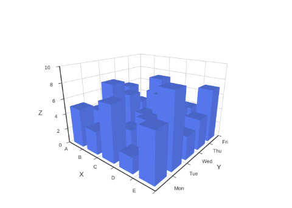

<!-- Generated by web/e2e/wiki.js - do not edit this page. Edit docs/wiki/examples/*.json, docs/wiki/notes/*.md or the generator, then run "npm run wiki" in web/. -->

3D bar charts on grid3D coordinates.

| | |
|---|---|
| Component id | `open.echarts.Bar3DChart` |
| Palette | **Open Components / ECharts 3D** → **Bar 3D Chart** |
| Default size | 700 × 500 |
| WebGL | Needs ECharts-GL, which the browser downloads from the gateway the first time a 3D / WebGL component is shown, and a browser with WebGL enabled. |



*Bar 3D Chart as dropped from the palette.* It takes any ECharts option in its `option` prop; the palette entry only decides which sample option a new component starts with.

<details>
<summary>Option of a freshly dropped component</summary>

```json
{
  "grid3D": { "boxWidth": 100, "boxDepth": 100, "boxHeight": 70, "viewControl": { "distance": 200 } },
  "xAxis3D": { "type": "category", "data": ["A", "B", "C", "D", "E"] },
  "yAxis3D": { "type": "category", "data": ["Mon", "Tue", "Wed", "Thu", "Fri"] },
  "zAxis3D": { "type": "value" },
  "series": [
    {
      "type": "bar3D",
      "shading": "lambert",
      "data": [
        [0, 0, 5],
        [1, 0, 3],
        [2, 0, 7],
        [3, 0, 2],
        [4, 0, 6],
        [0, 1, 4],
        [1, 1, 8],
        [2, 1, 3],
        [3, 1, 5],
        [4, 1, 9],
        [0, 2, 2],
        [1, 2, 6],
        [2, 2, 4],
        [3, 2, 7],
        [4, 2, 3],
        [0, 3, 6],
        [1, 3, 2],
        [2, 3, 8],
        [3, 3, 5],
        [4, 3, 4],
        [0, 4, 3],
        [1, 4, 5],
        [2, 4, 6],
        [3, 4, 4],
        [4, 4, 7]
      ]
    }
  ]
}
```

</details>

## Making your own

1. In the Designer, drag **Bar 3D Chart** from the **Open Components / ECharts 3D** group of the Perspective component palette onto a view.
2. Edit the `option` prop in the Property Editor, or paste a complete option over it (right-click `option`, **Paste**). Any option from the [ECharts documentation](https://echarts.apache.org/en/option.html) works as long as it is plain JSON (no JavaScript functions).
3. Bind the parts of the option that hold data; see [Binding Data](Binding-Data).
