<!-- Generated by web/e2e/wiki.js - do not edit this page. Edit docs/wiki/examples/*.json, docs/wiki/notes/*.md or the generator, then run "npm run wiki" in web/. -->

Bar, stacked, horizontal, polar, waterfall, and race charts.

| | |
|---|---|
| Component id | `open.echarts.BarChart` |
| Palette | **Open Components / ECharts** → **Bar Chart** |
| Default size | 600 × 350 |

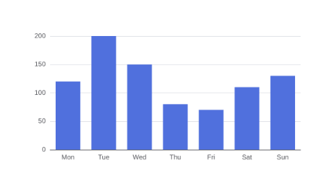

*Bar Chart as dropped from the palette.* It takes any ECharts option in its `option` prop; the palette entry only decides which sample option a new component starts with.

<details>
<summary>Option of a freshly dropped component</summary>

```json
{
  "xAxis": { "type": "category", "data": ["Mon", "Tue", "Wed", "Thu", "Fri", "Sat", "Sun"] },
  "yAxis": { "type": "value" },
  "tooltip": { "trigger": "axis" },
  "series": [{ "type": "bar", "data": [120, 200, 150, 80, 70, 110, 130] }]
}
```

</details>

## Examples

- [Bar Label Rotation](#bar-label-rotation): Grouped bars with the value and series name written vertically inside each bar.
- [Stacked Column](#stacked-column): Several stacks side by side: downtime minutes by cause, planned and unplanned, with a min-to-max line on the total.
- [Bar with Negative Values](#bar-with-negative-values): Horizontal bars around zero: energy generated, consumed and the net balance per day, with labels.
- [Bars with Min / Max / Average](#bars-with-min--max--average): Two bar series by month with max and min pins, an average line and a toolbox.
- [Mixed Line and Bar](#mixed-line-and-bar): Two bar series on the left axis and a line on a second axis on the right, with a shared crosshair.
- [Multiple Y Axes](#multiple-y-axes): Three value axes, each in the colour of its series: two bar series on the right-hand axes and a line on the left.
- [Horizontal Grouped Bars](#horizontal-grouped-bars): Horizontal bars comparing two periods per line, largest at the bottom.
- [Tangential Polar Bar](#tangential-polar-bar): Bars as arcs around a ring: one ring per machine, arc length is the value.
- [Radial Polar Bar](#radial-polar-bar): Bars as wedges growing from the centre: one wedge per machine, radius is the value.
- [Timeline: Bars and Pie by Year](#timeline-bars-and-pie-by-year): A timeline that plays through four years, switching the bars and a pie together. Uses baseOption plus one option per step.
- [Waterfall](#waterfall): Floating bars that step from a starting value to an end value. An invisible series underneath lifts each bar to where it starts.
- [Bars with Background Track](#bars-with-background-track): Horizontal rounded bars drawn over a pale full-length track, read as progress towards a maximum.

### Bar Label Rotation

Grouped bars with the value and series name written vertically inside each bar.

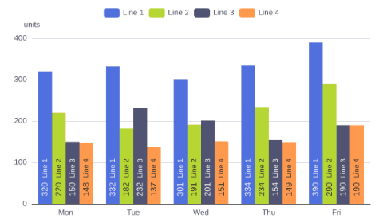

**How to make it in Ignition**

1. In the Designer, drag **Bar Chart** from the **Open Components / ECharts** group of the Perspective component palette onto a view.
2. Open **Option JSON** below and copy it. In the Property Editor, right-click the `option` property and choose **Paste**: the pasted JSON replaces the sample option. (See [Getting Started](Getting-Started) for other ways to enter an option.)
3. Replace the sample data with live data by binding these paths (expand `option` in the Property Editor down to the property, then use its binding icon). Everything else in the option stays as pasted.

   | Property | The binding must return |
   |---|---|
   | `props.option.xAxis.data` | a list of category labels: `["Mon", "Tue", "Wed"]` |
   | `props.option.series[0].data` | a list of numbers, one per category: `[820, 932, 901]` |
   | `props.option.series[1].data` | a list of numbers, one per category: `[820, 932, 901]` |
   | `props.option.series[2].data` | a list of numbers, one per category: `[820, 932, 901]` |
   | `props.option.series[3].data` | a list of numbers, one per category: `[820, 932, 901]` |

   Script transform for `props.option.xAxis.data` (the same query, its `label` column):

   ```python
   def transform(self, value, quality, timestamp):
       return [str(value.getValueAt(row, "label")) for row in range(value.getRowCount())]
   ```

   Script transform for `props.option.series[0].data`, on a binding that returns a dataset (for example a named query with a `value` column):

   ```python
   def transform(self, value, quality, timestamp):
       # value: dataset with a numeric column "value", one row per category
       return [value.getValueAt(row, "value") for row in range(value.getRowCount())]
   ```

4. Bind `xAxis.data` to the list of category names and each `series[n].data` to a list of numbers of the same length.
5. The label text comes from the template `{c}  {name|{a}}`: `{c}` is the value and `{a}` the series name, so renaming a series in `series[n].name` renames its labels.
6. All series share one label object in this example. In the Designer each `series[n].label` is its own copy: change `rotate`, `position` or `fontSize` on each series.

<details>
<summary>Option JSON</summary>

```json
{
  "tooltip": { "trigger": "axis", "axisPointer": { "type": "shadow" } },
  "legend": { "top": 8 },
  "grid": { "left": 50, "right": 20, "top": 60, "bottom": 30 },
  "xAxis": { "type": "category", "axisTick": { "show": false }, "data": ["Mon", "Tue", "Wed", "Thu", "Fri"] },
  "yAxis": { "type": "value", "name": "units" },
  "series": [
    {
      "name": "Line 1",
      "type": "bar",
      "barGap": 0,
      "label": {
        "show": true,
        "position": "insideBottom",
        "distance": 12,
        "align": "left",
        "verticalAlign": "middle",
        "rotate": 90,
        "formatter": "{c}  {name|{a}}",
        "fontSize": 13,
        "rich": { "name": { "fontSize": 11 } }
      },
      "emphasis": { "focus": "series" },
      "data": [320, 332, 301, 334, 390]
    },
    {
      "name": "Line 2",
      "type": "bar",
      "barGap": 0,
      "label": {
        "show": true,
        "position": "insideBottom",
        "distance": 12,
        "align": "left",
        "verticalAlign": "middle",
        "rotate": 90,
        "formatter": "{c}  {name|{a}}",
        "fontSize": 13,
        "rich": { "name": { "fontSize": 11 } }
      },
      "emphasis": { "focus": "series" },
      "data": [220, 182, 191, 234, 290]
    },
    {
      "name": "Line 3",
      "type": "bar",
      "barGap": 0,
      "label": {
        "show": true,
        "position": "insideBottom",
        "distance": 12,
        "align": "left",
        "verticalAlign": "middle",
        "rotate": 90,
        "formatter": "{c}  {name|{a}}",
        "fontSize": 13,
        "rich": { "name": { "fontSize": 11 } }
      },
      "emphasis": { "focus": "series" },
      "data": [150, 232, 201, 154, 190]
    },
    {
      "name": "Line 4",
      "type": "bar",
      "barGap": 0,
      "label": {
        "show": true,
        "position": "insideBottom",
        "distance": 12,
        "align": "left",
        "verticalAlign": "middle",
        "rotate": 90,
        "formatter": "{c}  {name|{a}}",
        "fontSize": 13,
        "rich": { "name": { "fontSize": 11 } }
      },
      "emphasis": { "focus": "series" },
      "data": [148, 137, 151, 149, 190]
    }
  ]
}
```

</details>

### Stacked Column

Several stacks side by side: downtime minutes by cause, planned and unplanned, with a min-to-max line on the total.

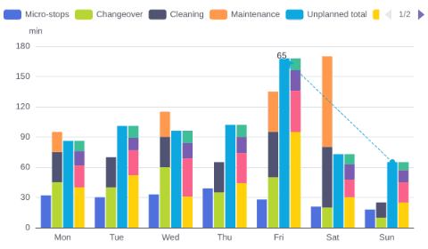

**How to make it in Ignition**

1. In the Designer, drag **Bar Chart** from the **Open Components / ECharts** group of the Perspective component palette onto a view.
2. Open **Option JSON** below and copy it. In the Property Editor, right-click the `option` property and choose **Paste**: the pasted JSON replaces the sample option. (See [Getting Started](Getting-Started) for other ways to enter an option.)
3. Replace the sample data with live data by binding these paths (expand `option` in the Property Editor down to the property, then use its binding icon). Everything else in the option stays as pasted.

   | Property | The binding must return |
   |---|---|
   | `props.option.xAxis.data` | a list of category labels: `["Mon", "Tue", "Wed"]` |
   | `props.option.series[0].data` | a list of numbers, one per category: `[820, 932, 901]` |
   | `props.option.series[1].data` | a list of numbers, one per category: `[820, 932, 901]` |
   | `props.option.series[2].data` | a list of numbers, one per category: `[820, 932, 901]` |
   | `props.option.series[3].data` | a list of numbers, one per category: `[820, 932, 901]` |
   | `props.option.series[4].data` | a list of numbers, one per category: `[820, 932, 901]` |
   | `props.option.series[5].data` | a list of numbers, one per category: `[820, 932, 901]` |
   | `props.option.series[6].data` | a list of numbers, one per category: `[820, 932, 901]` |

   The remaining 2 data properties of this example follow the same pattern.

   Script transform for `props.option.xAxis.data` (the same query, its `label` column):

   ```python
   def transform(self, value, quality, timestamp):
       return [str(value.getValueAt(row, "label")) for row in range(value.getRowCount())]
   ```

   Script transform for `props.option.series[0].data`, on a binding that returns a dataset (for example a named query with a `value` column):

   ```python
   def transform(self, value, quality, timestamp):
       # value: dataset with a numeric column "value", one row per category
       return [value.getValueAt(row, "value") for row in range(value.getRowCount())]
   ```

4. Series with the same `stack` name are stacked on one another; series without `stack` stand alone. Each `series[n].data` is a list of numbers, one per entry in `xAxis.data`.
5. To build the series from a query, return one row per series and use a script or expression transform to produce `{name, type: "bar", stack, data}` objects, then bind `series` as a whole.
6. The dashed line on `Unplanned total` is `markLine.data: [[{type: "min"}, {type: "max"}]]`: one line from the lowest to the highest bar of that series.

<details>
<summary>Option JSON</summary>

```json
{
  "tooltip": { "trigger": "axis", "axisPointer": { "type": "shadow" } },
  "legend": { "type": "scroll", "top": 8 },
  "grid": { "left": 50, "right": 20, "top": 65, "bottom": 30 },
  "xAxis": { "type": "category", "data": ["Mon", "Tue", "Wed", "Thu", "Fri", "Sat", "Sun"] },
  "yAxis": { "type": "value", "name": "min" },
  "series": [
    {
      "name": "Micro-stops",
      "type": "bar",
      "emphasis": { "focus": "series" },
      "data": [32, 30, 33, 39, 28, 21, 18]
    },
    {
      "name": "Changeover",
      "type": "bar",
      "stack": "Planned",
      "emphasis": { "focus": "series" },
      "data": [45, 40, 60, 35, 50, 20, 10]
    },
    {
      "name": "Cleaning",
      "type": "bar",
      "stack": "Planned",
      "emphasis": { "focus": "series" },
      "data": [30, 30, 30, 30, 45, 60, 15]
    },
    {
      "name": "Maintenance",
      "type": "bar",
      "stack": "Planned",
      "emphasis": { "focus": "series" },
      "data": [20, 0, 25, 0, 40, 90, 0]
    },
    {
      "name": "Unplanned total",
      "type": "bar",
      "emphasis": { "focus": "series" },
      "data": [86, 101, 96, 102, 168, 73, 65],
      "markLine": { "lineStyle": { "type": "dashed" }, "data": [[{ "type": "min" }, { "type": "max" }]] }
    },
    {
      "name": "Breakdown",
      "type": "bar",
      "stack": "Unplanned",
      "emphasis": { "focus": "series" },
      "data": [40, 52, 31, 44, 95, 30, 25]
    },
    {
      "name": "Material",
      "type": "bar",
      "stack": "Unplanned",
      "emphasis": { "focus": "series" },
      "data": [22, 25, 38, 30, 41, 18, 20]
    },
    {
      "name": "Operator",
      "type": "bar",
      "stack": "Unplanned",
      "emphasis": { "focus": "series" },
      "data": [14, 12, 15, 16, 20, 15, 12]
    },
    {
      "name": "Other",
      "type": "bar",
      "stack": "Unplanned",
      "emphasis": { "focus": "series" },
      "data": [10, 12, 12, 12, 12, 10, 8]
    }
  ]
}
```

</details>

### Bar with Negative Values

Horizontal bars around zero: energy generated, consumed and the net balance per day, with labels.

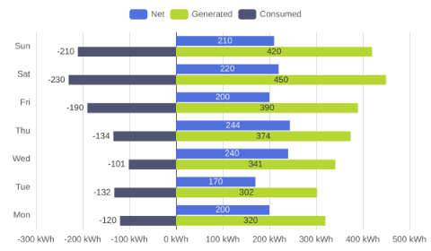

**How to make it in Ignition**

1. In the Designer, drag **Bar Chart** from the **Open Components / ECharts** group of the Perspective component palette onto a view.
2. Open **Option JSON** below and copy it. In the Property Editor, right-click the `option` property and choose **Paste**: the pasted JSON replaces the sample option. (See [Getting Started](Getting-Started) for other ways to enter an option.)
3. Replace the sample data with live data by binding these paths (expand `option` in the Property Editor down to the property, then use its binding icon). Everything else in the option stays as pasted.

   | Property | The binding must return |
   |---|---|
   | `props.option.yAxis.data` | a list of category labels: `["Mon", "Tue", "Wed"]` |
   | `props.option.series[0].data` | a list of numbers, one per category: `[820, 932, 901]` |
   | `props.option.series[1].data` | a list of numbers, one per category: `[820, 932, 901]` |
   | `props.option.series[2].data` | a list of numbers, one per category: `[820, 932, 901]` |

   Script transform for `props.option.yAxis.data` (the same query, its `label` column):

   ```python
   def transform(self, value, quality, timestamp):
       return [str(value.getValueAt(row, "label")) for row in range(value.getRowCount())]
   ```

   Script transform for `props.option.series[0].data`, on a binding that returns a dataset (for example a named query with a `value` column):

   ```python
   def transform(self, value, quality, timestamp):
       # value: dataset with a numeric column "value", one row per category
       return [value.getValueAt(row, "value") for row in range(value.getRowCount())]
   ```

4. Bind `yAxis.data` to the category list and each `series[n].data` to a list of numbers. Consumption is supplied as negative numbers; nothing else makes those bars point left.
5. `Generated` and `Consumed` share `stack: "Total"` so they sit on one row; `Net` is a separate bar.

<details>
<summary>Option JSON</summary>

```json
{
  "tooltip": { "trigger": "axis", "axisPointer": { "type": "shadow" } },
  "legend": { "top": 8 },
  "grid": { "left": 50, "right": 30, "top": 45, "bottom": 30 },
  "xAxis": { "type": "value", "axisLabel": { "formatter": "{value} kWh" } },
  "yAxis": {
    "type": "category",
    "axisTick": { "show": false },
    "data": ["Mon", "Tue", "Wed", "Thu", "Fri", "Sat", "Sun"]
  },
  "series": [
    {
      "name": "Net",
      "type": "bar",
      "label": { "show": true, "position": "inside" },
      "emphasis": { "focus": "series" },
      "data": [200, 170, 240, 244, 200, 220, 210]
    },
    {
      "name": "Generated",
      "type": "bar",
      "stack": "Total",
      "label": { "show": true },
      "emphasis": { "focus": "series" },
      "data": [320, 302, 341, 374, 390, 450, 420]
    },
    {
      "name": "Consumed",
      "type": "bar",
      "stack": "Total",
      "label": { "show": true, "position": "left" },
      "emphasis": { "focus": "series" },
      "data": [-120, -132, -101, -134, -190, -230, -210]
    }
  ]
}
```

</details>

### Bars with Min / Max / Average

Two bar series by month with max and min pins, an average line and a toolbox.

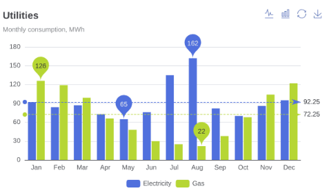

**How to make it in Ignition**

1. In the Designer, drag **Bar Chart** from the **Open Components / ECharts** group of the Perspective component palette onto a view.
2. Open **Option JSON** below and copy it. In the Property Editor, right-click the `option` property and choose **Paste**: the pasted JSON replaces the sample option. (See [Getting Started](Getting-Started) for other ways to enter an option.)
3. Replace the sample data with live data by binding these paths (expand `option` in the Property Editor down to the property, then use its binding icon). Everything else in the option stays as pasted.

   | Property | The binding must return |
   |---|---|
   | `props.option.xAxis.data` | a list of category labels: `["Mon", "Tue", "Wed"]` |
   | `props.option.series[0].data` | a list of numbers, one per category: `[820, 932, 901]` |
   | `props.option.series[1].data` | a list of numbers, one per category: `[820, 932, 901]` |

   Script transform for `props.option.xAxis.data` (the same query, its `label` column):

   ```python
   def transform(self, value, quality, timestamp):
       return [str(value.getValueAt(row, "label")) for row in range(value.getRowCount())]
   ```

   Script transform for `props.option.series[0].data`, on a binding that returns a dataset (for example a named query with a `value` column):

   ```python
   def transform(self, value, quality, timestamp):
       # value: dataset with a numeric column "value", one row per category
       return [value.getValueAt(row, "value") for row in range(value.getRowCount())]
   ```

4. Bind `xAxis.data` and each `series[n].data` (numbers). The pins and the average line are computed by the chart from the bound data: nothing to bind for them.
5. To mark a fixed target instead of the average, replace the `markLine.data` entry with `{yAxis: 100, name: "Target"}` and bind that `yAxis` value.
6. The toolbox buttons (switch to line or bar, restore, save as image) work in a running session; remove `toolbox` to hide them.

<details>
<summary>Option JSON</summary>

```json
{
  "title": { "text": "Utilities", "subtext": "Monthly consumption, MWh", "left": "left" },
  "tooltip": { "trigger": "axis" },
  "legend": { "bottom": 5, "data": ["Electricity", "Gas"] },
  "toolbox": {
    "show": true,
    "feature": { "magicType": { "type": ["line", "bar"] }, "restore": {}, "saveAsImage": {} }
  },
  "grid": { "left": 45, "right": 55, "top": 85, "bottom": 60 },
  "xAxis": {
    "type": "category",
    "data": ["Jan", "Feb", "Mar", "Apr", "May", "Jun", "Jul", "Aug", "Sep", "Oct", "Nov", "Dec"]
  },
  "yAxis": { "type": "value" },
  "series": [
    {
      "name": "Electricity",
      "type": "bar",
      "data": [92, 84, 87, 73, 65, 76, 135, 162, 82, 70, 86, 95],
      "markPoint": { "data": [{ "type": "max", "name": "Max" }, { "type": "min", "name": "Min" }] },
      "markLine": { "data": [{ "type": "average", "name": "Avg" }] }
    },
    {
      "name": "Gas",
      "type": "bar",
      "data": [126, 119, 99, 66, 48, 30, 25, 22, 38, 68, 104, 122],
      "markPoint": { "data": [{ "type": "max", "name": "Max" }, { "type": "min", "name": "Min" }] },
      "markLine": { "data": [{ "type": "average", "name": "Avg" }] }
    }
  ]
}
```

</details>

### Mixed Line and Bar

Two bar series on the left axis and a line on a second axis on the right, with a shared crosshair.

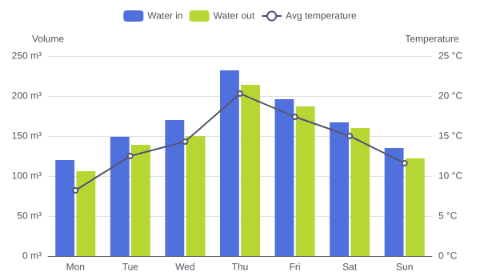

**How to make it in Ignition**

1. In the Designer, drag **Bar Chart** from the **Open Components / ECharts** group of the Perspective component palette onto a view.
2. Open **Option JSON** below and copy it. In the Property Editor, right-click the `option` property and choose **Paste**: the pasted JSON replaces the sample option. (See [Getting Started](Getting-Started) for other ways to enter an option.)
3. Replace the sample data with live data by binding these paths (expand `option` in the Property Editor down to the property, then use its binding icon). Everything else in the option stays as pasted.

   | Property | The binding must return |
   |---|---|
   | `props.option.xAxis.data` | a list of category labels: `["Mon", "Tue", "Wed"]` |
   | `props.option.series[0].data` | a list of numbers, one per category: `[820, 932, 901]` |
   | `props.option.series[1].data` | a list of numbers, one per category: `[820, 932, 901]` |
   | `props.option.series[2].data` | a list of numbers, one per category: `[820, 932, 901]` |

   Script transform for `props.option.xAxis.data` (the same query, its `label` column):

   ```python
   def transform(self, value, quality, timestamp):
       return [str(value.getValueAt(row, "label")) for row in range(value.getRowCount())]
   ```

   Script transform for `props.option.series[0].data`, on a binding that returns a dataset (for example a named query with a `value` column):

   ```python
   def transform(self, value, quality, timestamp):
       # value: dataset with a numeric column "value", one row per category
       return [value.getValueAt(row, "value") for row in range(value.getRowCount())]
   ```

4. Bind `xAxis.data` and each `series[n].data`. A series is drawn against the right-hand axis when it has `yAxisIndex: 1`.
5. The two axes have fixed `min`, `max` and `interval` so that their grid lines coincide. Bind those to your ranges, or remove them and add `alignTicks: true` to the second axis.

<details>
<summary>Option JSON</summary>

```json
{
  "tooltip": { "trigger": "axis", "axisPointer": { "type": "cross" } },
  "legend": { "top": 8 },
  "grid": { "left": 60, "right": 60, "top": 70, "bottom": 30 },
  "xAxis": {
    "type": "category",
    "axisPointer": { "type": "shadow" },
    "data": ["Mon", "Tue", "Wed", "Thu", "Fri", "Sat", "Sun"]
  },
  "yAxis": [
    {
      "type": "value",
      "name": "Volume",
      "min": 0,
      "max": 250,
      "interval": 50,
      "axisLabel": { "formatter": "{value} m³" }
    },
    {
      "type": "value",
      "name": "Temperature",
      "min": 0,
      "max": 25,
      "interval": 5,
      "axisLabel": { "formatter": "{value} °C" }
    }
  ],
  "series": [
    { "name": "Water in", "type": "bar", "data": [120, 149, 170, 232, 196, 167, 135] },
    { "name": "Water out", "type": "bar", "data": [106, 139, 150, 214, 187, 160, 122] },
    {
      "name": "Avg temperature",
      "type": "line",
      "yAxisIndex": 1,
      "data": [8.2, 12.5, 14.3, 20.3, 17.4, 15, 11.6]
    }
  ]
}
```

</details>

### Multiple Y Axes

Three value axes, each in the colour of its series: two bar series on the right-hand axes and a line on the left.

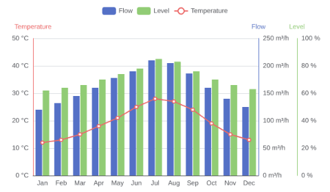

**How to make it in Ignition**

1. In the Designer, drag **Bar Chart** from the **Open Components / ECharts** group of the Perspective component palette onto a view.
2. Open **Option JSON** below and copy it. In the Property Editor, right-click the `option` property and choose **Paste**: the pasted JSON replaces the sample option. (See [Getting Started](Getting-Started) for other ways to enter an option.)
3. Replace the sample data with live data by binding these paths (expand `option` in the Property Editor down to the property, then use its binding icon). Everything else in the option stays as pasted.

   | Property | The binding must return |
   |---|---|
   | `props.option.xAxis.data` | a list of category labels: `["Mon", "Tue", "Wed"]` |
   | `props.option.series[0].data` | a list of numbers, one per category: `[820, 932, 901]` |
   | `props.option.series[1].data` | a list of numbers, one per category: `[820, 932, 901]` |
   | `props.option.series[2].data` | a list of numbers, one per category: `[820, 932, 901]` |

   Script transform for `props.option.xAxis.data` (the same query, its `label` column):

   ```python
   def transform(self, value, quality, timestamp):
       return [str(value.getValueAt(row, "label")) for row in range(value.getRowCount())]
   ```

   Script transform for `props.option.series[0].data`, on a binding that returns a dataset (for example a named query with a `value` column):

   ```python
   def transform(self, value, quality, timestamp):
       # value: dataset with a numeric column "value", one row per category
       return [value.getValueAt(row, "value") for row in range(value.getRowCount())]
   ```

4. Each series picks its axis with `yAxisIndex` (0 = Flow, 1 = Level, 2 = Temperature). Bind `series[n].data` to lists of numbers and `xAxis.data` to the categories.
5. The axis colours are set in `yAxis[n].axisLine.lineStyle.color` and match the `color` list at the top. Change both together.
6. The second right-hand axis is moved outwards with `offset: 70`; `grid.right` leaves room for both. Increase both if your axis labels are wider.

<details>
<summary>Option JSON</summary>

```json
{
  "color": ["#5470c6", "#91cc75", "#ee6666"],
  "tooltip": { "trigger": "axis", "axisPointer": { "type": "cross" } },
  "legend": { "top": 8 },
  "grid": { "left": 60, "right": 130, "top": 70, "bottom": 30 },
  "xAxis": {
    "type": "category",
    "axisTick": { "alignWithLabel": true },
    "data": ["Jan", "Feb", "Mar", "Apr", "May", "Jun", "Jul", "Aug", "Sep", "Oct", "Nov", "Dec"]
  },
  "yAxis": [
    {
      "type": "value",
      "name": "Flow",
      "position": "right",
      "alignTicks": true,
      "axisLine": { "show": true, "lineStyle": { "color": "#5470c6" } },
      "axisLabel": { "formatter": "{value} m³/h" }
    },
    {
      "type": "value",
      "name": "Level",
      "position": "right",
      "alignTicks": true,
      "offset": 70,
      "axisLine": { "show": true, "lineStyle": { "color": "#91cc75" } },
      "axisLabel": { "formatter": "{value} %" }
    },
    {
      "type": "value",
      "name": "Temperature",
      "position": "left",
      "alignTicks": true,
      "axisLine": { "show": true, "lineStyle": { "color": "#ee6666" } },
      "axisLabel": { "formatter": "{value} °C" }
    }
  ],
  "series": [
    {
      "name": "Flow",
      "type": "bar",
      "data": [120, 132, 145, 160, 178, 190, 210, 205, 186, 160, 140, 125]
    },
    {
      "name": "Level",
      "type": "bar",
      "yAxisIndex": 1,
      "data": [62, 64, 66, 70, 74, 78, 85, 83, 76, 70, 66, 63]
    },
    {
      "name": "Temperature",
      "type": "line",
      "yAxisIndex": 2,
      "data": [12, 13, 15, 18, 21, 25, 28, 27, 24, 19, 15, 13]
    }
  ]
}
```

</details>

### Horizontal Grouped Bars

Horizontal bars comparing two periods per line, largest at the bottom.

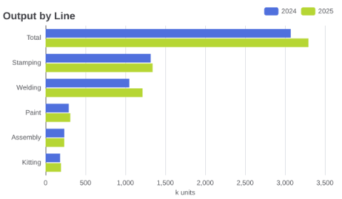

**How to make it in Ignition**

1. In the Designer, drag **Bar Chart** from the **Open Components / ECharts** group of the Perspective component palette onto a view.
2. Open **Option JSON** below and copy it. In the Property Editor, right-click the `option` property and choose **Paste**: the pasted JSON replaces the sample option. (See [Getting Started](Getting-Started) for other ways to enter an option.)
3. Replace the sample data with live data by binding these paths (expand `option` in the Property Editor down to the property, then use its binding icon). Everything else in the option stays as pasted.

   | Property | The binding must return |
   |---|---|
   | `props.option.yAxis.data` | a list of category labels: `["Mon", "Tue", "Wed"]` |
   | `props.option.series[0].data` | a list of numbers, one per category: `[820, 932, 901]` |
   | `props.option.series[1].data` | a list of numbers, one per category: `[820, 932, 901]` |

   Script transform for `props.option.yAxis.data` (the same query, its `label` column):

   ```python
   def transform(self, value, quality, timestamp):
       return [str(value.getValueAt(row, "label")) for row in range(value.getRowCount())]
   ```

   Script transform for `props.option.series[0].data`, on a binding that returns a dataset (for example a named query with a `value` column):

   ```python
   def transform(self, value, quality, timestamp):
       # value: dataset with a numeric column "value", one row per category
       return [value.getValueAt(row, "value") for row in range(value.getRowCount())]
   ```

4. Bind `yAxis.data` to the category names and each `series[n].data` to numbers. Categories are drawn bottom to top; add `inverse: true` to `yAxis` to list them top to bottom.

<details>
<summary>Option JSON</summary>

```json
{
  "title": { "text": "Output by Line", "left": "left" },
  "tooltip": { "trigger": "axis", "axisPointer": { "type": "shadow" } },
  "legend": { "top": 8, "right": 10 },
  "grid": { "left": 80, "right": 30, "top": 45, "bottom": 30 },
  "xAxis": {
    "type": "value",
    "boundaryGap": [0, 0.01],
    "name": "k units",
    "nameLocation": "middle",
    "nameGap": 22
  },
  "yAxis": { "type": "category", "data": ["Kitting", "Assembly", "Paint", "Welding", "Stamping", "Total"] },
  "series": [
    { "name": "2024", "type": "bar", "data": [182, 234, 290, 1049, 1317, 3072] },
    { "name": "2025", "type": "bar", "data": [193, 234, 310, 1215, 1341, 3293] }
  ]
}
```

</details>

### Tangential Polar Bar

Bars as arcs around a ring: one ring per machine, arc length is the value.

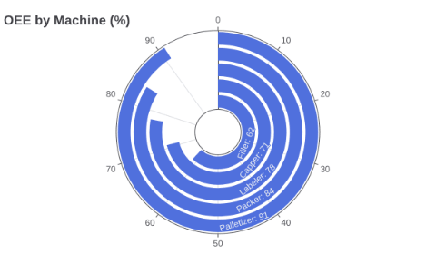

**How to make it in Ignition**

1. In the Designer, drag **Bar Chart** from the **Open Components / ECharts** group of the Perspective component palette onto a view.
2. Open **Option JSON** below and copy it. In the Property Editor, right-click the `option` property and choose **Paste**: the pasted JSON replaces the sample option. (See [Getting Started](Getting-Started) for other ways to enter an option.)
3. Replace the sample data with live data by binding these paths (expand `option` in the Property Editor down to the property, then use its binding icon). Everything else in the option stays as pasted.

   | Property | The binding must return |
   |---|---|
   | `props.option.radiusAxis.data` | a list of category labels: `["Mon", "Tue", "Wed"]` |
   | `props.option.series.data` | a list of numbers, one per category: `[820, 932, 901]` |

   Script transform for `props.option.radiusAxis.data` (the same query, its `label` column):

   ```python
   def transform(self, value, quality, timestamp):
       return [str(value.getValueAt(row, "label")) for row in range(value.getRowCount())]
   ```

   Script transform for `props.option.series.data`, on a binding that returns a dataset (for example a named query with a `value` column):

   ```python
   def transform(self, value, quality, timestamp):
       # value: dataset with a numeric column "value", one row per category
       return [value.getValueAt(row, "value") for row in range(value.getRowCount())]
   ```

4. Bind `radiusAxis.data` to the names (innermost ring first) and `series.data` to the values. `angleAxis.max` is the value of a full circle.
5. The label template `{b}: {c}` writes name and value on each arc, which is why the radius axis labels are hidden.

<details>
<summary>Option JSON</summary>

```json
{
  "title": { "text": "OEE by Machine (%)", "left": "left" },
  "tooltip": {},
  "polar": { "radius": ["18%", "80%"], "center": ["50%", "52%"] },
  "angleAxis": { "max": 100, "startAngle": 90 },
  "radiusAxis": {
    "type": "category",
    "axisLabel": { "show": false },
    "axisTick": { "show": false },
    "data": ["Filler", "Capper", "Labeler", "Packer", "Palletizer"]
  },
  "series": {
    "type": "bar",
    "coordinateSystem": "polar",
    "data": [62, 71, 78, 84, 91],
    "label": { "show": true, "position": "middle", "formatter": "{b}: {c}" }
  }
}
```

</details>

### Radial Polar Bar

Bars as wedges growing from the centre: one wedge per machine, radius is the value.

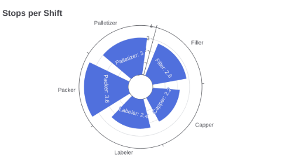

**How to make it in Ignition**

1. In the Designer, drag **Bar Chart** from the **Open Components / ECharts** group of the Perspective component palette onto a view.
2. Open **Option JSON** below and copy it. In the Property Editor, right-click the `option` property and choose **Paste**: the pasted JSON replaces the sample option. (See [Getting Started](Getting-Started) for other ways to enter an option.)
3. Replace the sample data with live data by binding these paths (expand `option` in the Property Editor down to the property, then use its binding icon). Everything else in the option stays as pasted.

   | Property | The binding must return |
   |---|---|
   | `props.option.angleAxis.data` | a list of category labels: `["Mon", "Tue", "Wed"]` |
   | `props.option.series.data` | a list of numbers, one per category: `[820, 932, 901]` |

   Script transform for `props.option.angleAxis.data` (the same query, its `label` column):

   ```python
   def transform(self, value, quality, timestamp):
       return [str(value.getValueAt(row, "label")) for row in range(value.getRowCount())]
   ```

   Script transform for `props.option.series.data`, on a binding that returns a dataset (for example a named query with a `value` column):

   ```python
   def transform(self, value, quality, timestamp):
       # value: dataset with a numeric column "value", one row per category
       return [value.getValueAt(row, "value") for row in range(value.getRowCount())]
   ```

4. Bind `angleAxis.data` to the names and `series.data` to the values. `radiusAxis.max` fixes the outer edge; remove it to scale to the data.

<details>
<summary>Option JSON</summary>

```json
{
  "title": { "text": "Stops per Shift", "left": "left" },
  "tooltip": {},
  "polar": { "radius": ["15%", "75%"], "center": ["50%", "53%"] },
  "radiusAxis": { "max": 4 },
  "angleAxis": {
    "type": "category",
    "startAngle": 75,
    "data": ["Filler", "Capper", "Labeler", "Packer", "Palletizer"]
  },
  "series": {
    "type": "bar",
    "coordinateSystem": "polar",
    "data": [2.8, 2.2, 2.4, 3.6, 3],
    "label": { "show": true, "position": "middle", "formatter": "{b}: {c}" }
  }
}
```

</details>

### Timeline: Bars and Pie by Year

A timeline that plays through four years, switching the bars and a pie together. Uses baseOption plus one option per step.

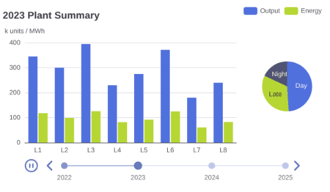

**How to make it in Ignition**

1. In the Designer, drag **Bar Chart** from the **Open Components / ECharts** group of the Perspective component palette onto a view.
2. Open **Option JSON** below and copy it. In the Property Editor, right-click the `option` property and choose **Paste**: the pasted JSON replaces the sample option. (See [Getting Started](Getting-Started) for other ways to enter an option.)
3. The sample data is part of the option. To show live data, bind the parts of `option` that hold it (expand `option` in the Property Editor to find them); see [Binding Data](Binding-Data).
4. The option has two parts: `baseOption` holds everything that stays the same, and `options` holds one entry per timeline step with only what changes (here the title and the series data).
5. Every series has an `id`, repeated in each step. Keep the ids: the component merges series by id, and without them the steps do not reach the series and the chart stays empty.
6. Bind `baseOption.timeline.data` to the step names and `options` to a list with one `{title, series}` object per step, in the same order.
7. Set `baseOption.timeline.autoPlay` to false to start paused; `playInterval` is the time per step in milliseconds.

<details>
<summary>Option JSON</summary>

```json
{
  "baseOption": {
    "timeline": {
      "axisType": "category",
      "autoPlay": true,
      "playInterval": 2500,
      "data": ["2022", "2023", "2024", "2025"],
      "left": 30,
      "right": 30,
      "bottom": 5
    },
    "title": { "left": "left" },
    "tooltip": {},
    "legend": { "top": 8, "right": 10, "data": ["Output", "Energy"] },
    "grid": { "left": 45, "right": 170, "top": 78, "bottom": 90 },
    "xAxis": {
      "type": "category",
      "axisLabel": { "interval": 0 },
      "data": ["L1", "L2", "L3", "L4", "L5", "L6", "L7", "L8"]
    },
    "yAxis": { "type": "value", "name": "k units / MWh" },
    "series": [
      { "id": "output", "name": "Output", "type": "bar" },
      { "id": "energy", "name": "Energy", "type": "bar" },
      {
        "id": "share",
        "name": "Shift share",
        "type": "pie",
        "center": ["87%", "45%"],
        "radius": "26%",
        "label": { "position": "inside", "formatter": "{b}" },
        "z": 100
      }
    ]
  },
  "options": [
    {
      "title": { "text": "2022 Plant Summary" },
      "series": [
        { "id": "output", "data": [320, 280, 410, 190, 260, 350, 150, 230] },
        { "id": "energy", "data": [110, 95, 130, 70, 88, 120, 52, 80] },
        {
          "id": "share",
          "data": [
            { "name": "Day", "value": 52 },
            { "name": "Late", "value": 31 },
            { "name": "Night", "value": 17 }
          ]
        }
      ]
    },
    {
      "title": { "text": "2023 Plant Summary" },
      "series": [
        { "id": "output", "data": [345, 300, 395, 230, 275, 372, 180, 240] },
        { "id": "energy", "data": [118, 99, 126, 82, 92, 125, 61, 83] },
        {
          "id": "share",
          "data": [
            { "name": "Day", "value": 49 },
            { "name": "Late", "value": 33 },
            { "name": "Night", "value": 18 }
          ]
        }
      ]
    },
    {
      "title": { "text": "2024 Plant Summary" },
      "series": [
        { "id": "output", "data": [372, 310, 430, 262, 268, 401, 214, 255] },
        { "id": "energy", "data": [121, 104, 139, 90, 89, 133, 72, 86] },
        {
          "id": "share",
          "data": [
            { "name": "Day", "value": 46 },
            { "name": "Late", "value": 35 },
            { "name": "Night", "value": 19 }
          ]
        }
      ]
    },
    {
      "title": { "text": "2025 Plant Summary" },
      "series": [
        { "id": "output", "data": [398, 342, 446, 301, 290, 425, 251, 262] },
        { "id": "energy", "data": [127, 110, 141, 101, 95, 138, 84, 88] },
        {
          "id": "share",
          "data": [
            { "name": "Day", "value": 43 },
            { "name": "Late", "value": 36 },
            { "name": "Night", "value": 21 }
          ]
        }
      ]
    }
  ]
}
```

</details>

### Waterfall

Floating bars that step from a starting value to an end value. An invisible series underneath lifts each bar to where it starts.

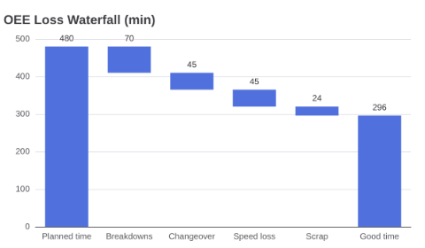

**How to make it in Ignition**

1. In the Designer, drag **Bar Chart** from the **Open Components / ECharts** group of the Perspective component palette onto a view.
2. Open **Option JSON** below and copy it. In the Property Editor, right-click the `option` property and choose **Paste**: the pasted JSON replaces the sample option. (See [Getting Started](Getting-Started) for other ways to enter an option.)
3. Replace the sample data with live data by binding these paths (expand `option` in the Property Editor down to the property, then use its binding icon). Everything else in the option stays as pasted.

   | Property | The binding must return |
   |---|---|
   | `props.option.xAxis.data` | a list of category labels: `["Mon", "Tue", "Wed"]` |
   | `props.option.series[0].data` | a list of numbers, one per category: `[820, 932, 901]` |
   | `props.option.series[1].data` | a list of numbers, one per category: `[820, 932, 901]` |

   Script transform for `props.option.xAxis.data` (the same query, its `label` column):

   ```python
   def transform(self, value, quality, timestamp):
       return [str(value.getValueAt(row, "label")) for row in range(value.getRowCount())]
   ```

   Script transform for `props.option.series[0].data`, on a binding that returns a dataset (for example a named query with a `value` column):

   ```python
   def transform(self, value, quality, timestamp):
       # value: dataset with a numeric column "value", one row per category
       return [value.getValueAt(row, "value") for row in range(value.getRowCount())]
   ```

4. Two stacked series: `Offset` is invisible and lifts each visible bar. Bind `series[1].data` to the bar heights and `series[0].data` to where each bar starts (0 for the first and last bar).
5. For a falling waterfall the offset of bar n is the first value minus all losses up to and including n. Compute both lists in one script transform so they stay in step.

<details>
<summary>Option JSON</summary>

```json
{
  "title": { "text": "OEE Loss Waterfall (min)", "left": "left" },
  "tooltip": { "trigger": "axis", "axisPointer": { "type": "shadow" } },
  "grid": { "left": 50, "right": 20, "top": 55, "bottom": 30 },
  "xAxis": {
    "type": "category",
    "axisLabel": { "interval": 0 },
    "data": ["Planned time", "Breakdowns", "Changeover", "Speed loss", "Scrap", "Good time"]
  },
  "yAxis": { "type": "value" },
  "series": [
    {
      "name": "Offset",
      "type": "bar",
      "stack": "Total",
      "silent": true,
      "itemStyle": { "color": "transparent" },
      "tooltip": { "show": false },
      "data": [0, 410, 365, 320, 296, 0]
    },
    {
      "name": "Minutes",
      "type": "bar",
      "stack": "Total",
      "label": { "show": true, "position": "top" },
      "data": [480, 70, 45, 45, 24, 296]
    }
  ]
}
```

</details>

### Bars with Background Track

Horizontal rounded bars drawn over a pale full-length track, read as progress towards a maximum.

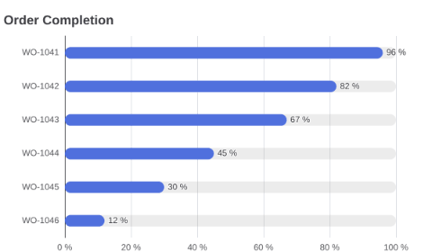

**How to make it in Ignition**

1. In the Designer, drag **Bar Chart** from the **Open Components / ECharts** group of the Perspective component palette onto a view.
2. Open **Option JSON** below and copy it. In the Property Editor, right-click the `option` property and choose **Paste**: the pasted JSON replaces the sample option. (See [Getting Started](Getting-Started) for other ways to enter an option.)
3. Replace the sample data with live data by binding these paths (expand `option` in the Property Editor down to the property, then use its binding icon). Everything else in the option stays as pasted.

   | Property | The binding must return |
   |---|---|
   | `props.option.yAxis.data` | a list of category labels: `["Mon", "Tue", "Wed"]` |
   | `props.option.series[0].data` | a list of numbers, one per category: `[820, 932, 901]` |

   Script transform for `props.option.yAxis.data` (the same query, its `label` column):

   ```python
   def transform(self, value, quality, timestamp):
       return [str(value.getValueAt(row, "label")) for row in range(value.getRowCount())]
   ```

   Script transform for `props.option.series[0].data`, on a binding that returns a dataset (for example a named query with a `value` column):

   ```python
   def transform(self, value, quality, timestamp):
       # value: dataset with a numeric column "value", one row per category
       return [value.getValueAt(row, "value") for row in range(value.getRowCount())]
   ```

4. Bind `yAxis.data` to the names and `series[0].data` to percentages. `xAxis.max` is the full length of the track.

<details>
<summary>Option JSON</summary>

```json
{
  "title": { "text": "Order Completion", "left": "left" },
  "tooltip": { "trigger": "axis", "axisPointer": { "type": "shadow" } },
  "grid": { "left": 90, "right": 50, "top": 50, "bottom": 20 },
  "xAxis": { "type": "value", "max": 100, "axisLabel": { "formatter": "{value} %" } },
  "yAxis": {
    "type": "category",
    "inverse": true,
    "axisTick": { "show": false },
    "data": ["WO-1041", "WO-1042", "WO-1043", "WO-1044", "WO-1045", "WO-1046"]
  },
  "series": [
    {
      "name": "Complete",
      "type": "bar",
      "barWidth": 16,
      "showBackground": true,
      "backgroundStyle": { "color": "rgba(128, 128, 128, 0.15)", "borderRadius": 8 },
      "itemStyle": { "borderRadius": 8 },
      "label": { "show": true, "position": "right", "formatter": "{c} %" },
      "data": [96, 82, 67, 45, 30, 12]
    }
  ]
}
```

</details>
