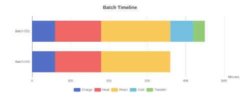

<!-- Generated by web/e2e/wiki.js - do not edit this page. Edit docs/wiki/examples/*.json, docs/wiki/notes/*.md or the generator, then run "npm run wiki" in web/. -->

Batch recipe phase durations (S88 model) on timeline lanes.

| | |
|---|---|
| Component id | `open.industrial.BatchTimeline` |
| Palette | **Open Components / Scheduling** → **Batch Timeline** |
| Default size | 900 × 350 |



*Batch Timeline as dropped from the palette, showing its built-in sample data.*

This component builds its chart from the domain props below, so there is no ECharts option to write: bind the props to your tags and queries. (A non-empty `option` is an advanced override that replaces the generated chart.)

## How to use it in Ignition

1. In the Designer, drag **Batch Timeline** from the **Open Components / Scheduling** group of the Perspective component palette onto a view. It shows sample data.
2. Select it and replace the sample data in the Property Editor: type values, paste JSON (right-click a property, **Paste**), or add a binding.
3. Bind the data props to tags, tag history or named queries. The props and the shape each one expects are listed under [Props](#props); [Binding examples](#binding-examples) has worked examples.

## Binding examples

`phases` is a list of `{ batch, phase, start, end }` objects with the times in epoch milliseconds. Each
`batch` becomes a row and each `phase` a colour.

**Batch records from a named query.**

```sql
SELECT batch_id, phase_name, phase_start, COALESCE(phase_end, CURRENT_TIMESTAMP) AS phase_end
FROM batch_phases
WHERE batch_id IN (SELECT TOP 5 batch_id FROM batches WHERE unit = :unit ORDER BY started_at DESC)
ORDER BY batch_id, phase_start
```

Bind it to `props.phases` (Return Format: dataset):

```python
def transform(self, value, quality, timestamp):
    return [
        {
            "batch": str(value.getValueAt(row, "batch_id")),
            "phase": str(value.getValueAt(row, "phase_name")),
            "start": value.getValueAt(row, "phase_start").getTime(),
            "end": value.getValueAt(row, "phase_end").getTime(),
        }
        for row in range(value.getRowCount())
    ]
```

**Colours per phase.** Type `phaseColors`, e.g.
`{ "Charge": "#5470c6", "Heat": "#e05252", "React": "#e6a23c", "Cool": "#73c0de", "Transfer": "#3ba272" }`.
Use the same names as the query returns; phases not listed keep the built-in colours.

## Props

| Property | Type | Default | Description |
|---|---|---|---|
| `phases` | array of object | sample data (8 items) | Batch phases (S88): { batch, phase, start (epoch ms), end (epoch ms), status? }. status is not charted. Bind to your batch records. |
| `phaseColors` | object | `{}` | Map of phase name to colour. Merged over the built-in defaults. |
| `title` | string | `""` | Chart title. Leave blank for the default title. |

The shared props (`theme`, `renderer`, `notMerge`, `lazyUpdate`, `sanitizeTooltip`, ...) and the seven events are the same as on every component: see [Binding Data](Binding-Data), [Themes](Themes) and [Events](Events).
