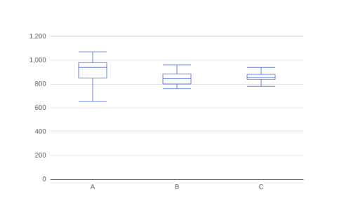
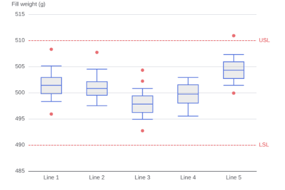
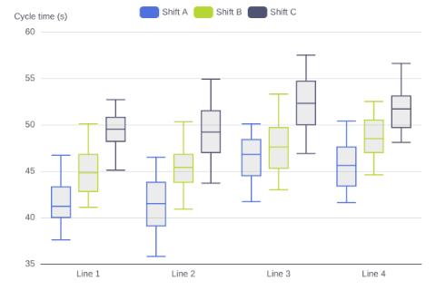

<!-- Generated by web/e2e/wiki.js - do not edit this page. Edit docs/wiki/examples/*.json, docs/wiki/notes/*.md or the generator, then run "npm run wiki" in web/. -->

Box-and-whisker statistical plots.

| | |
|---|---|
| Component id | `open.echarts.BoxplotChart` |
| Palette | **Open Components / ECharts** → **Boxplot Chart** |
| Default size | 600 × 400 |



*Boxplot Chart as dropped from the palette.* It takes any ECharts option in its `option` prop; the palette entry only decides which sample option a new component starts with.

<details>
<summary>Option of a freshly dropped component</summary>

```json
{
  "xAxis": { "type": "category", "data": ["A", "B", "C"] },
  "yAxis": { "type": "value" },
  "series": [
    {
      "type": "boxplot",
      "data": [[655, 850, 940, 980, 1070], [760, 800, 845, 885, 960], [780, 840, 855, 880, 940]]
    }
  ]
}
```

</details>

## Examples

- [Boxplot with Outliers](#boxplot-with-outliers): One box per category with the outliers drawn as separate points and the specification limits as dashed lines.
- [Grouped Boxplot](#grouped-boxplot): Three series side by side in every category, with a legend.

### Boxplot with Outliers

One box per category with the outliers drawn as separate points and the specification limits as dashed lines.



**How to make it in Ignition**

1. In the Designer, drag **Boxplot Chart** from the **Open Components / ECharts** group of the Perspective component palette onto a view.
2. Open **Option JSON** below and copy it. In the Property Editor, right-click the `option` property and choose **Paste**: the pasted JSON replaces the sample option. (See [Getting Started](Getting-Started) for other ways to enter an option.)
3. Replace the sample data with live data by binding these paths (expand `option` in the Property Editor down to the property, then use its binding icon). Everything else in the option stays as pasted.

   | Property | The binding must return |
   |---|---|
   | `props.option.xAxis.data` | a list of category labels: `["Mon", "Tue", "Wed"]` |
   | `props.option.series[0].data` | a list of rows with 5 values each, in the order of the example: `[[498.3, 499.8, 501.4, 502.9, 505.1], ...]` |
   | `props.option.series[1].data` | a list of rows with 2 values each, in the order of the example: `[[0, 508.3], ...]` |

   Script transform for `props.option.xAxis.data` (the same query, its `label` column):

   ```python
   def transform(self, value, quality, timestamp):
       return [str(value.getValueAt(row, "label")) for row in range(value.getRowCount())]
   ```

   Script transform for `props.option.series[0].data`, turning a dataset into rows. With a time axis the first value of a row is the time in epoch milliseconds:

   ```python
   def transform(self, value, quality, timestamp):
       # value: dataset, e.g. from a Tag History binding: t_stamp, then one column per tag
       rows = []
       for row in range(value.getRowCount()):
           t = value.getValueAt(row, 0)
           if hasattr(t, "getTime"):  # a date: ECharts wants epoch milliseconds
               t = t.getTime()
           rows.append([t] + [value.getValueAt(row, col) for col in range(1, 5)])
       return rows
   ```

4. Bind `series[0].data` to one row per category: `[min, Q1, median, Q3, max]` (already calculated, e.g. in SQL with percentile functions).
5. Bind `series[1].data` to the outliers as `[categoryIndex, value]` rows.
6. The limits are `series[0].markLine.data[n].yAxis`; bind them to the specification tags. `yAxis.min` / `max` are fixed so the limits stay visible.

<details>
<summary>Option JSON</summary>

```json
{
  "tooltip": { "trigger": "item" },
  "grid": { "left": 60, "right": 60, "top": 30, "bottom": 40 },
  "xAxis": {
    "type": "category",
    "data": ["Line 1", "Line 2", "Line 3", "Line 4", "Line 5"],
    "boundaryGap": true,
    "splitLine": { "show": false }
  },
  "yAxis": { "type": "value", "name": "Fill weight (g)", "min": 485, "max": 515 },
  "series": [
    {
      "name": "Fill weight",
      "type": "boxplot",
      "data": [
        [498.3, 499.8, 501.4, 502.9, 505.1],
        [497.5, 499.5, 500.8, 502.1, 504.5],
        [494.9, 496.2, 497.8, 499.4, 500.8],
        [495.5, 498, 499.7, 501.5, 502.9],
        [501.4, 502.7, 504.3, 505.9, 507.3]
      ],
      "boxWidth": ["20%", "45%"],
      "itemStyle": { "borderWidth": 1.5, "color": "rgba(128,128,128,0.15)" },
      "markLine": {
        "symbol": "none",
        "silent": true,
        "lineStyle": { "type": "dashed", "color": "#e5484d" },
        "label": { "formatter": "{b}", "color": "#e5484d" },
        "data": [{ "name": "USL", "yAxis": 510 }, { "name": "LSL", "yAxis": 490 }]
      }
    },
    {
      "name": "Outlier",
      "type": "scatter",
      "data": [
        [0, 508.3],
        [0, 495.9],
        [1, 507.7],
        [2, 502.2],
        [2, 492.7],
        [2, 504.3],
        [4, 510.9],
        [4, 499.9]
      ],
      "symbolSize": 7,
      "itemStyle": { "color": "#e5484d" }
    }
  ]
}
```

</details>

### Grouped Boxplot

Three series side by side in every category, with a legend.



**How to make it in Ignition**

1. In the Designer, drag **Boxplot Chart** from the **Open Components / ECharts** group of the Perspective component palette onto a view.
2. Open **Option JSON** below and copy it. In the Property Editor, right-click the `option` property and choose **Paste**: the pasted JSON replaces the sample option. (See [Getting Started](Getting-Started) for other ways to enter an option.)
3. Replace the sample data with live data by binding these paths (expand `option` in the Property Editor down to the property, then use its binding icon). Everything else in the option stays as pasted.

   | Property | The binding must return |
   |---|---|
   | `props.option.xAxis.data` | a list of category labels: `["Mon", "Tue", "Wed"]` |
   | `props.option.series[0].data` | a list of rows with 5 values each, in the order of the example: `[[37.6, 40, 41.2, 43.3, 46.7], ...]` |
   | `props.option.series[1].data` | a list of rows with 5 values each, in the order of the example: `[[41.1, 42.8, 44.8, 46.8, 50.1], ...]` |
   | `props.option.series[2].data` | a list of rows with 5 values each, in the order of the example: `[[45.1, 48.2, 49.5, 50.8, 52.7], ...]` |

   Script transform for `props.option.xAxis.data` (the same query, its `label` column):

   ```python
   def transform(self, value, quality, timestamp):
       return [str(value.getValueAt(row, "label")) for row in range(value.getRowCount())]
   ```

   Script transform for `props.option.series[0].data`, turning a dataset into rows. With a time axis the first value of a row is the time in epoch milliseconds:

   ```python
   def transform(self, value, quality, timestamp):
       # value: dataset, e.g. from a Tag History binding: t_stamp, then one column per tag
       rows = []
       for row in range(value.getRowCount()):
           t = value.getValueAt(row, 0)
           if hasattr(t, "getTime"):  # a date: ECharts wants epoch milliseconds
               t = t.getTime()
           rows.append([t] + [value.getValueAt(row, col) for col in range(1, 5)])
       return rows
   ```

4. Each series is one group: bind `series[n].data` to one row `[min, Q1, median, Q3, max]` per category of `xAxis.data`.
5. Boxes of different series are placed side by side automatically; `boxWidth` is `[min, max]` width per box.
6. Outlier points cannot be shifted to follow a group, so in a grouped boxplot either leave them out or draw them with the single-series example.

<details>
<summary>Option JSON</summary>

```json
{
  "legend": { "top": 4 },
  "tooltip": { "trigger": "item", "axisPointer": { "type": "shadow" } },
  "grid": { "left": 56, "right": 20, "top": 44, "bottom": 36 },
  "xAxis": {
    "type": "category",
    "data": ["Line 1", "Line 2", "Line 3", "Line 4"],
    "boundaryGap": true,
    "splitLine": { "show": false }
  },
  "yAxis": { "type": "value", "name": "Cycle time (s)", "scale": true },
  "series": [
    {
      "name": "Shift A",
      "type": "boxplot",
      "boxWidth": [8, 26],
      "itemStyle": { "borderWidth": 1.5, "color": "rgba(128,128,128,0.15)" },
      "data": [
        [37.6, 40, 41.2, 43.3, 46.7],
        [35.8, 39.1, 41.5, 43.8, 46.5],
        [41.7, 44.5, 46.8, 48.4, 50.1],
        [41.6, 43.4, 45.6, 47.6, 50.4]
      ]
    },
    {
      "name": "Shift B",
      "type": "boxplot",
      "boxWidth": [8, 26],
      "itemStyle": { "borderWidth": 1.5, "color": "rgba(128,128,128,0.15)" },
      "data": [
        [41.1, 42.8, 44.8, 46.8, 50.1],
        [40.9, 43.8, 45.4, 46.8, 50.3],
        [43, 45.3, 47.6, 49.7, 53.3],
        [44.6, 47, 48.5, 50.5, 52.5]
      ]
    },
    {
      "name": "Shift C",
      "type": "boxplot",
      "boxWidth": [8, 26],
      "itemStyle": { "borderWidth": 1.5, "color": "rgba(128,128,128,0.15)" },
      "data": [
        [45.1, 48.2, 49.5, 50.8, 52.7],
        [43.7, 47, 49.2, 51.5, 54.9],
        [46.9, 50, 52.3, 54.7, 57.5],
        [48.1, 49.7, 51.7, 53.1, 56.6]
      ]
    }
  ]
}
```

</details>
