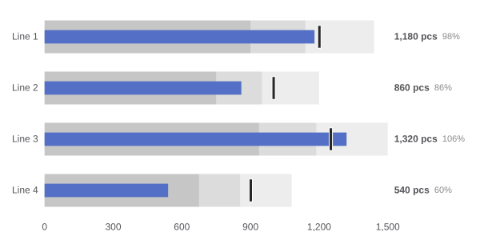

<!-- Generated by web/e2e/wiki.js - do not edit this page. Edit docs/wiki/examples/*.json, docs/wiki/notes/*.md or the generator, then run "npm run wiki" in web/. -->

Actual versus target per item on qualitative bands (Stephen Few bullet graphs).

| | |
|---|---|
| Component id | `open.industrial.BulletChart` |
| Palette | **Open Components / Industrial** → **Bullet Chart** |
| Default size | 600 × 300 |



*Bullet Chart as dropped from the palette, showing its built-in sample data.*

This component builds its chart from the domain props below, so there is no ECharts option to write: bind the props to your tags and queries. (A non-empty `option` is an advanced override that replaces the generated chart.)

## How to use it in Ignition

1. In the Designer, drag **Bullet Chart** from the **Open Components / Industrial** group of the Perspective component palette onto a view. It shows sample data.
2. Select it and replace the sample data in the Property Editor: type values, paste JSON (right-click a property, **Paste**), or add a binding.
3. Bind the data props to tags, tag history or named queries. The props and the shape each one expects are listed under [Props](#props); [Binding examples](#binding-examples) has worked examples.

## Binding examples

`items` is a list with one object per bullet: `name`, `value` and `target`; `max`, `ranges` and `color`
are optional.

**Production against plan from a named query.**

```sql
SELECT line AS name, SUM(good_count) AS value, MAX(planned_count) AS target
FROM shift_production
WHERE shift_id = :shift
GROUP BY line ORDER BY line
```

Bind it to `props.items` (Return Format: dataset) with this transform:

```python
def transform(self, value, quality, timestamp):
    return [
        {
            "name": str(value.getValueAt(row, "name")),
            "value": value.getValueAt(row, "value"),
            "target": value.getValueAt(row, "target"),
        }
        for row in range(value.getRowCount())
    ]
```

**A fixed set of lines from tags.** Type the items and their targets, then bind each
`props.items[n].value` to the line's counter tag, e.g. `[default]Line1/Production/GoodCount`.

**Items with different units.** Set `percentOfTarget` to `true`: every bar is drawn as a percentage of
its own target, so all targets line up, while the labels keep the real values.

**Status colours.** Set `statusColors` to `["#e05252", "#e6a23c", "#3ba272"]` to colour each bar by the
band its value falls in (the bands are set by `ranges`, in percent of the target).

## Props

| Property | Type | Default | Description |
|---|---|---|---|
| `items` | array | sample data (4 items) | One bullet per item: objects { name, value, target, max, ranges, color }. max is the end of the item's scale (default: 120 % of the target); ranges are its band boundaries in the units of the value, e.g. [600, 900]. |
| `title` | string | `""` | Chart title. Leave blank for none. |
| `orientation` | string | `"horizontal"` | Horizontal bars (one row per item) or vertical bars (one column per item). One of: `"horizontal"`, `"vertical"`. |
| `unit` | string | `"pcs"` | Unit written after the values. |
| `decimals` | integer | `0` | Decimal places of the values. |
| `percentOfTarget` | boolean | `false` | Draw every item as a percentage of its own target, so that all targets line up at 100 % and items with different targets or units can be compared. The labels keep the real values. |
| `ranges` | array | `[75,95]` | Boundaries between the qualitative bands in percent of the target, for items without their own ranges. [75, 95] gives poor below 75 %, acceptable up to 95 %, good above. |
| `bandColors` | array | sample data (3 items) | Colours of the bands from the lowest to the highest. |
| `color` | string | `"#5470c6"` | Colour of the bars, for items without their own color. |
| `statusColors` | array | `[]` | Optional. When set, a bar takes the colour of the band its value is in, lowest band first, e.g. ["#e05252", "#e6a23c", "#3ba272"]. |
| `targetColor` | string | `"#262626"` | Colour of the target markers. They carry a thin light outline so that they show on any background. |
| `showValues` | boolean | `true` | Write each value, and its percentage of the target, beside its bar. |

The shared props (`theme`, `renderer`, `notMerge`, `lazyUpdate`, `sanitizeTooltip`, ...) and the seven events are the same as on every component: see [Binding Data](Binding-Data), [Themes](Themes) and [Events](Events).
