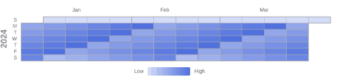
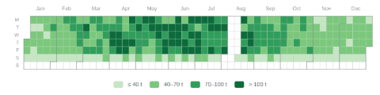
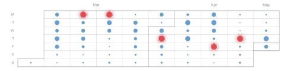

<!-- Generated by web/e2e/wiki.js - do not edit this page. Edit docs/wiki/examples/*.json, docs/wiki/notes/*.md or the generator, then run "npm run wiki" in web/. -->

Calendar heatmap/scatter overlays.

| | |
|---|---|
| Component id | `open.echarts.CalendarChart` |
| Palette | **Open Components / ECharts** → **Calendar Chart** |
| Default size | 800 × 200 |



*Calendar Chart as dropped from the palette.* It takes any ECharts option in its `option` prop; the palette entry only decides which sample option a new component starts with.

<details>
<summary>Option of a freshly dropped component</summary>

```json
{
  "tooltip": {},
  "calendar": {
    "range": ["2024-01-01", "2024-03-31"],
    "top": 40,
    "left": 50,
    "right": 20,
    "cellSize": ["auto", 15],
    "itemStyle": { "color": "transparent", "borderColor": "rgba(128,128,128,0.4)" },
    "splitLine": { "lineStyle": { "color": "#888" } }
  },
  "visualMap": {
    "min": 0,
    "max": 10,
    "orient": "horizontal",
    "left": "center",
    "bottom": 5,
    "itemHeight": 100,
    "text": ["High", "Low"]
  },
  "series": [
    {
      "type": "heatmap",
      "coordinateSystem": "calendar",
      "data": [
        ["2024-01-01", 5],
        ["2024-01-02", 6],
        ["2024-01-03", 7],
        ["2024-01-04", 8],
        ["2024-01-05", 9],
        ["2024-01-06", 8],
        ["2024-01-07", 0],
        ["2024-01-08", 6],
        ["2024-01-09", 7],
        ["2024-01-10", 8],
        ["2024-01-11", 9],
        ["2024-01-12", 10],
        ["2024-01-13", 3],
        ["2024-01-14", 0],
        ["2024-01-15", 7],
        ["2024-01-16", 8],
        ["2024-01-17", 9],
        ["2024-01-18", 10],
        ["2024-01-19", 5],
        ["2024-01-20", 4],
        ["2024-01-21", 0],
        ["2024-01-22", 8],
        ["2024-01-23", 9],
        ["2024-01-24", 10],
        ["2024-01-25", 5],
        ["2024-01-26", 6],
        ["2024-01-27", 5],
        ["2024-01-28", 0],
        ["2024-01-29", 9],
        ["2024-01-30", 10],
        ["2024-01-31", 5],
        ["2024-02-01", 6],
        ["2024-02-02", 7],
        ["2024-02-03", 6],
        ["2024-02-04", 0],
        ["2024-02-05", 10],
        ["2024-02-06", 5],
        ["2024-02-07", 6],
        ["2024-02-08", 7],
        ["2024-02-09", 8],
        ["2024-02-10", 7],
        ["2024-02-11", 0],
        ["2024-02-12", 5],
        ["2024-02-13", 6],
        ["2024-02-14", 7],
        ["2024-02-15", 8],
        ["2024-02-16", 9],
        ["2024-02-17", 8],
        ["2024-02-18", 0],
        ["2024-02-19", 6],
        ["2024-02-20", 7],
        ["2024-02-21", 8],
        ["2024-02-22", 9],
        ["2024-02-23", 10],
        ["2024-02-24", 3],
        ["2024-02-25", 0],
        ["2024-02-26", 7],
        ["2024-02-27", 8],
        ["2024-02-28", 9],
        ["2024-02-29", 10],
        ["2024-03-01", 5],
        ["2024-03-02", 4],
        ["2024-03-03", 0],
        ["2024-03-04", 8],
        ["2024-03-05", 9],
        ["2024-03-06", 10],
        ["2024-03-07", 5],
        ["2024-03-08", 6],
        ["2024-03-09", 5],
        ["2024-03-10", 0],
        ["2024-03-11", 9],
        ["2024-03-12", 10],
        ["2024-03-13", 5],
        ["2024-03-14", 6],
        ["2024-03-15", 7],
        ["2024-03-16", 6],
        ["2024-03-17", 0],
        ["2024-03-18", 10],
        ["2024-03-19", 5],
        ["2024-03-20", 6],
        ["2024-03-21", 7],
        ["2024-03-22", 8],
        ["2024-03-23", 7],
        ["2024-03-24", 0],
        ["2024-03-25", 5],
        ["2024-03-26", 6],
        ["2024-03-27", 7],
        ["2024-03-28", 8],
        ["2024-03-29", 9],
        ["2024-03-30", 8],
        ["2024-03-31", 0]
      ]
    }
  ]
}
```

</details>

## Examples

- [Full-year Calendar Heatmap](#full-year-calendar-heatmap): A whole year at a glance, one cell per day in four value classes; daily output in tonnes.
- [Calendar with Highlighted Days](#calendar-with-highlighted-days): Dots sized by value on a three-month calendar, with the worst days pulsing; stops per day.

### Full-year Calendar Heatmap

A whole year at a glance, one cell per day in four value classes; daily output in tonnes.



**How to make it in Ignition**

1. In the Designer, drag **Calendar Chart** from the **Open Components / ECharts** group of the Perspective component palette onto a view.
2. Open **Option JSON** below and copy it. In the Property Editor, right-click the `option` property and choose **Paste**: the pasted JSON replaces the sample option. (See [Getting Started](Getting-Started) for other ways to enter an option.)
3. Replace the sample data with live data by binding these paths (expand `option` in the Property Editor down to the property, then use its binding icon). Everything else in the option stays as pasted.

   | Property | The binding must return |
   |---|---|
   | `props.option.series[0].data` | a list of rows with 2 values each, in the order of the example: `[["2026-01-01", 44], ...]` |

   Script transform for `props.option.series[0].data`, turning a dataset into rows. With a time axis the first value of a row is the time in epoch milliseconds:

   ```python
   def transform(self, value, quality, timestamp):
       # value: dataset, e.g. from a Tag History binding: t_stamp, then one column per tag
       rows = []
       for row in range(value.getRowCount()):
           t = value.getValueAt(row, 0)
           if hasattr(t, "getTime"):  # a date: ECharts wants epoch milliseconds
               t = t.getTime()
           rows.append([t] + [value.getValueAt(row, col) for col in range(1, 2)])
       return rows
   ```

4. Bind `series[0].data` to rows `[date, value]` with the date as `yyyy-MM-dd` text. Days without a row stay empty.
5. Bind `calendar.range` to the year (`"2026"`), a month (`"2026-03"`) or a `[from, to]` pair of dates.
6. The classes are `visualMap.pieces` with `gt` / `lte` bounds (in our tests `min` / `max` left some boundary values uncoloured, so prefer these); a continuous scale works too (`"type": "continuous"` with `min` / `max`).
7. At small heights keep `calendar.cellSize` as `["auto", n]`: the width follows the component, the height is `n` pixels per day.

<details>
<summary>Option JSON</summary>

```json
{
  "tooltip": { "formatter": "{c}" },
  "visualMap": {
    "type": "piecewise",
    "orient": "horizontal",
    "left": "center",
    "bottom": 0,
    "itemGap": 16,
    "pieces": [
      { "gt": 0, "lte": 40, "label": "≤ 40 t" },
      { "gt": 40, "lte": 70, "label": "40–70 t" },
      { "gt": 70, "lte": 100, "label": "70–100 t" },
      { "gt": 100, "label": "> 100 t" }
    ],
    "inRange": { "color": ["#c6e6c3", "#7bc87c", "#2f9e5b", "#0b6b3a"] }
  },
  "calendar": {
    "range": "2026",
    "top": 34,
    "left": 50,
    "right": 16,
    "cellSize": ["auto", 16],
    "splitLine": { "lineStyle": { "width": 1, "color": "#8a8f98" } },
    "itemStyle": { "color": "transparent", "borderWidth": 0.5, "borderColor": "rgba(128,128,128,0.3)" },
    "yearLabel": { "show": false },
    "dayLabel": { "firstDay": 1, "fontSize": 10, "color": "#8a8f98" },
    "monthLabel": { "fontSize": 11, "color": "#8a8f98" }
  },
  "series": [
    {
      "type": "heatmap",
      "coordinateSystem": "calendar",
      "data": [
        ["2026-01-01", 44],
        ["2026-01-02", 61],
        ["2026-01-03", 29],
        ["2026-01-05", 54],
        ["2026-01-06", 34],
        ["2026-01-07", 64],
        ["2026-01-08", 48],
        ["2026-01-09", 39],
        ["2026-01-10", 17],
        ["2026-01-12", 49],
        ["2026-01-13", 35],
        ["2026-01-14", 44],
        ["2026-01-15", 60],
        ["2026-01-16", 41],
        ["2026-01-17", 16],
        ["2026-01-19", 61],
        ["2026-01-20", 63],
        ["2026-01-21", 37],
        ["2026-01-22", 67],
        ["2026-01-23", 55],
        ["2026-01-24", 23],
        ["2026-01-26", 63],
        ["2026-01-27", 72],
        ["2026-01-28", 45],
        ["2026-01-29", 62],
        ["2026-01-30", 45],
        ["2026-01-31", 24],
        ["2026-02-02", 70],
        ["2026-02-03", 50],
        ["2026-02-04", 58],
        ["2026-02-05", 67],
        ["2026-02-06", 67],
        ["2026-02-07", 23],
        ["2026-02-09", 71],
        ["2026-02-10", 56],
        ["2026-02-11", 62],
        ["2026-02-12", 63],
        ["2026-02-13", 55],
        ["2026-02-14", 32],
        ["2026-02-16", 75],
        ["2026-02-17", 80],
        ["2026-02-18", 60],
        ["2026-02-19", 60],
        ["2026-02-20", 54],
        ["2026-02-21", 20],
        ["2026-02-23", 60],
        ["2026-02-24", 74],
        ["2026-02-25", 84],
        ["2026-02-26", 78],
        ["2026-02-27", 69],
        ["2026-02-28", 28],
        ["2026-03-02", 48],
        ["2026-03-03", 101],
        ["2026-03-04", 79],
        ["2026-03-05", 59],
        ["2026-03-06", 90],
        ["2026-03-07", 30],
        ["2026-03-09", 73],
        ["2026-03-10", 56],
        ["2026-03-11", 56],
        ["2026-03-12", 66],
        ["2026-03-13", 100],
        ["2026-03-14", 39],
        ["2026-03-16", 87],
        ["2026-03-17", 89],
        ["2026-03-18", 67],
        ["2026-03-19", 74],
        ["2026-03-20", 80],
        ["2026-03-21", 37],
        ["2026-03-23", 60],
        ["2026-03-24", 89],
        ["2026-03-25", 85],
        ["2026-03-26", 59],
        ["2026-03-27", 58],
        ["2026-03-28", 41],
        ["2026-03-30", 68],
        ["2026-03-31", 96],
        ["2026-04-01", 118],
        ["2026-04-02", 115],
        ["2026-04-03", 80],
        ["2026-04-04", 34],
        ["2026-04-06", 74],
        ["2026-04-07", 93],
        ["2026-04-08", 107],
        ["2026-04-09", 110],
        ["2026-04-10", 112],
        ["2026-04-11", 35],
        ["2026-04-13", 61],
        ["2026-04-14", 70],
        ["2026-04-15", 78],
        ["2026-04-16", 101],
        ["2026-04-17", 108],
        ["2026-04-18", 43],
        ["2026-04-20", 107],
        ["2026-04-21", 74],
        ["2026-04-22", 97],
        ["2026-04-23", 110],
        ["2026-04-24", 58],
        ["2026-04-25", 36],
        ["2026-04-27", 80],
        ["2026-04-28", 114],
        ["2026-04-29", 95],
        ["2026-04-30", 74],
        ["2026-05-01", 86],
        ["2026-05-02", 58],
        ["2026-05-04", 116],
        ["2026-05-05", 92],
        ["2026-05-06", 97],
        ["2026-05-07", 72],
        ["2026-05-08", 67],
        ["2026-05-09", 34],
        ["2026-05-11", 124],
        ["2026-05-12", 117],
        ["2026-05-13", 85],
        ["2026-05-14", 63],
        ["2026-05-15", 64],
        ["2026-05-16", 34],
        ["2026-05-18", 82],
        ["2026-05-19", 107],
        ["2026-05-20", 129],
        ["2026-05-21", 93],
        ["2026-05-22", 95],
        ["2026-05-23", 52],
        ["2026-05-25", 68],
        ["2026-05-26", 133],
        ["2026-05-27", 80],
        ["2026-05-28", 125],
        ["2026-05-29", 104],
        ["2026-05-30", 34],
        ["2026-06-01", 68],
        ["2026-06-02", 105],
        ["2026-06-03", 104],
        ["2026-06-04", 102],
        ["2026-06-05", 76],
        ["2026-06-06", 57],
        ["2026-06-08", 133],
        ["2026-06-09", 122],
        ["2026-06-10", 125],
        ["2026-06-11", 104],
        ["2026-06-12", 87],
        ["2026-06-13", 36],
        ["2026-06-15", 70],
        ["2026-06-16", 140],
        ["2026-06-17", 80],
        ["2026-06-18", 134],
        ["2026-06-19", 131],
        ["2026-06-20", 47],
        ["2026-06-22", 127],
        ["2026-06-23", 76],
        ["2026-06-24", 119],
        ["2026-06-25", 85],
        ["2026-06-26", 136],
        ["2026-06-27", 34],
        ["2026-06-29", 139],
        ["2026-06-30", 70],
        ["2026-07-01", 132],
        ["2026-07-02", 128],
        ["2026-07-03", 121],
        ["2026-07-04", 52],
        ["2026-07-06", 134],
        ["2026-07-07", 81],
        ["2026-07-08", 91],
        ["2026-07-09", 75],
        ["2026-07-10", 73],
        ["2026-07-11", 42],
        ["2026-07-13", 126],
        ["2026-07-14", 118],
        ["2026-07-15", 71],
        ["2026-07-16", 77],
        ["2026-07-17", 127],
        ["2026-07-18", 35],
        ["2026-07-20", 90],
        ["2026-07-21", 118],
        ["2026-07-22", 86],
        ["2026-07-23", 79],
        ["2026-07-24", 100],
        ["2026-07-25", 31],
        ["2026-07-27", 85],
        ["2026-07-28", 135],
        ["2026-07-29", 97],
        ["2026-07-30", 79],
        ["2026-07-31", 109],
        ["2026-08-15", 32],
        ["2026-08-17", 103],
        ["2026-08-18", 56],
        ["2026-08-19", 109],
        ["2026-08-20", 73],
        ["2026-08-21", 113],
        ["2026-08-22", 34],
        ["2026-08-24", 62],
        ["2026-08-25", 82],
        ["2026-08-26", 106],
        ["2026-08-27", 118],
        ["2026-08-28", 77],
        ["2026-08-29", 49],
        ["2026-08-31", 73],
        ["2026-09-01", 79],
        ["2026-09-02", 93],
        ["2026-09-03", 72],
        ["2026-09-04", 90],
        ["2026-09-05", 36],
        ["2026-09-07", 50],
        ["2026-09-08", 84],
        ["2026-09-09", 94],
        ["2026-09-10", 89],
        ["2026-09-11", 60],
        ["2026-09-12", 36],
        ["2026-09-14", 59],
        ["2026-09-15", 84],
        ["2026-09-16", 74],
        ["2026-09-17", 77],
        ["2026-09-18", 88],
        ["2026-09-19", 44],
        ["2026-09-21", 59],
        ["2026-09-22", 54],
        ["2026-09-23", 89],
        ["2026-09-24", 90],
        ["2026-09-25", 71],
        ["2026-09-26", 29],
        ["2026-09-28", 75],
        ["2026-09-29", 93],
        ["2026-09-30", 90],
        ["2026-10-01", 84],
        ["2026-10-02", 50],
        ["2026-10-03", 30],
        ["2026-10-05", 79],
        ["2026-10-06", 46],
        ["2026-10-07", 58],
        ["2026-10-08", 55],
        ["2026-10-09", 53],
        ["2026-10-10", 26],
        ["2026-10-12", 49],
        ["2026-10-13", 70],
        ["2026-10-14", 45],
        ["2026-10-15", 80],
        ["2026-10-16", 44],
        ["2026-10-17", 27],
        ["2026-10-19", 72],
        ["2026-10-20", 78],
        ["2026-10-21", 47],
        ["2026-10-22", 58],
        ["2026-10-23", 44],
        ["2026-10-24", 31],
        ["2026-10-26", 47],
        ["2026-10-27", 44],
        ["2026-10-28", 52],
        ["2026-10-29", 51],
        ["2026-10-30", 81],
        ["2026-10-31", 19],
        ["2026-11-02", 37],
        ["2026-11-03", 49],
        ["2026-11-04", 46],
        ["2026-11-05", 64],
        ["2026-11-06", 49],
        ["2026-11-07", 26],
        ["2026-11-09", 39],
        ["2026-11-10", 40],
        ["2026-11-11", 69],
        ["2026-11-12", 67],
        ["2026-11-13", 66],
        ["2026-11-14", 23],
        ["2026-11-16", 58],
        ["2026-11-17", 50],
        ["2026-11-18", 62],
        ["2026-11-19", 41],
        ["2026-11-20", 51],
        ["2026-11-21", 26],
        ["2026-11-23", 57],
        ["2026-11-24", 45],
        ["2026-11-25", 49],
        ["2026-11-26", 60],
        ["2026-11-27", 35],
        ["2026-11-28", 23],
        ["2026-11-30", 66],
        ["2026-12-01", 56],
        ["2026-12-02", 51],
        ["2026-12-03", 64],
        ["2026-12-04", 58],
        ["2026-12-05", 21],
        ["2026-12-07", 39],
        ["2026-12-08", 53],
        ["2026-12-09", 61],
        ["2026-12-10", 32],
        ["2026-12-11", 41],
        ["2026-12-12", 23],
        ["2026-12-14", 58],
        ["2026-12-15", 45],
        ["2026-12-16", 56],
        ["2026-12-17", 59],
        ["2026-12-18", 67],
        ["2026-12-19", 28],
        ["2026-12-21", 64],
        ["2026-12-22", 47],
        ["2026-12-23", 59],
        ["2026-12-24", 43],
        ["2026-12-25", 57],
        ["2026-12-26", 16],
        ["2026-12-28", 33],
        ["2026-12-29", 56],
        ["2026-12-30", 47],
        ["2026-12-31", 68]
      ]
    }
  ]
}
```

</details>

### Calendar with Highlighted Days

Dots sized by value on a three-month calendar, with the worst days pulsing; stops per day.



**How to make it in Ignition**

1. In the Designer, drag **Calendar Chart** from the **Open Components / ECharts** group of the Perspective component palette onto a view.
2. Open **Option JSON** below and copy it. In the Property Editor, right-click the `option` property and choose **Paste**: the pasted JSON replaces the sample option. (See [Getting Started](Getting-Started) for other ways to enter an option.)
3. Replace the sample data with live data by binding these paths (expand `option` in the Property Editor down to the property, then use its binding icon). Everything else in the option stays as pasted.

   | Property | The binding must return |
   |---|---|
   | `props.option.series[0].data` | a list of rows with 2 values each, in the order of the example: `[["2026-03-01", 1], ...]` |
   | `props.option.series[1].data` | a list of rows with 2 values each, in the order of the example: `[["2026-04-17", 14], ...]` |

   Script transform for `props.option.series[0].data`, turning a dataset into rows. With a time axis the first value of a row is the time in epoch milliseconds:

   ```python
   def transform(self, value, quality, timestamp):
       # value: dataset, e.g. from a Tag History binding: t_stamp, then one column per tag
       rows = []
       for row in range(value.getRowCount()):
           t = value.getValueAt(row, 0)
           if hasattr(t, "getTime"):  # a date: ECharts wants epoch milliseconds
               t = t.getTime()
           rows.append([t] + [value.getValueAt(row, col) for col in range(1, 2)])
       return rows
   ```

4. Bind `series[0].data` to all days as `[date, value]` and `series[1].data` to only the days to highlight (for example the top six of a query).
5. Dot size comes from the hidden `visualMap` (`inRange.symbolSize` as `[smallest, largest]` in pixels between `min` and `max`); it applies to series 0 only (`seriesIndex`).
6. The pulsing dots have a fixed `symbolSize`. Bind `calendar.range` to `[first month, last month]`.

<details>
<summary>Option JSON</summary>

```json
{
  "tooltip": { "formatter": "{c}" },
  "visualMap": {
    "show": false,
    "min": 0,
    "max": 14,
    "dimension": 1,
    "seriesIndex": 0,
    "inRange": { "symbolSize": [3, 15] }
  },
  "calendar": {
    "range": ["2026-03", "2026-05"],
    "top": 30,
    "bottom": 12,
    "left": 50,
    "right": 16,
    "cellSize": ["auto", "auto"],
    "yearLabel": { "show": false },
    "splitLine": { "lineStyle": { "color": "#8a8f98" } },
    "dayLabel": { "firstDay": 1, "fontSize": 10, "color": "#8a8f98" },
    "monthLabel": { "fontSize": 11, "color": "#8a8f98" },
    "itemStyle": { "color": "transparent", "borderWidth": 0.5, "borderColor": "rgba(128,128,128,0.3)" }
  },
  "series": [
    {
      "name": "Stops",
      "type": "scatter",
      "coordinateSystem": "calendar",
      "data": [
        ["2026-03-01", 1],
        ["2026-03-02", 9],
        ["2026-03-03", 12],
        ["2026-03-04", 8],
        ["2026-03-05", 12],
        ["2026-03-06", 10],
        ["2026-03-07", 2],
        ["2026-03-08", 0],
        ["2026-03-09", 13],
        ["2026-03-10", 7],
        ["2026-03-11", 9],
        ["2026-03-12", 10],
        ["2026-03-13", 6],
        ["2026-03-14", 0],
        ["2026-03-15", 1],
        ["2026-03-16", 13],
        ["2026-03-17", 12],
        ["2026-03-18", 9],
        ["2026-03-19", 2],
        ["2026-03-20", 0],
        ["2026-03-21", 1],
        ["2026-03-22", 3],
        ["2026-03-23", 1],
        ["2026-03-24", 10],
        ["2026-03-25", 10],
        ["2026-03-26", 7],
        ["2026-03-27", 7],
        ["2026-03-28", 3],
        ["2026-03-29", 2],
        ["2026-03-30", 9],
        ["2026-03-31", 1],
        ["2026-04-01", 11],
        ["2026-04-02", 13],
        ["2026-04-03", 8],
        ["2026-04-04", 4],
        ["2026-04-05", 3],
        ["2026-04-06", 5],
        ["2026-04-07", 13],
        ["2026-04-08", 5],
        ["2026-04-09", 13],
        ["2026-04-10", 1],
        ["2026-04-11", 1],
        ["2026-04-12", 2],
        ["2026-04-13", 11],
        ["2026-04-14", 13],
        ["2026-04-15", 10],
        ["2026-04-16", 4],
        ["2026-04-17", 14],
        ["2026-04-18", 2],
        ["2026-04-19", 0],
        ["2026-04-20", 1],
        ["2026-04-21", 0],
        ["2026-04-22", 0],
        ["2026-04-23", 14],
        ["2026-04-24", 3],
        ["2026-04-25", 3],
        ["2026-04-26", 3],
        ["2026-04-27", 1],
        ["2026-04-28", 1],
        ["2026-04-29", 4],
        ["2026-04-30", 13],
        ["2026-05-01", 9],
        ["2026-05-02", 1],
        ["2026-05-03", 2],
        ["2026-05-04", 11],
        ["2026-05-05", 9],
        ["2026-05-06", 11],
        ["2026-05-07", 14],
        ["2026-05-08", 2],
        ["2026-05-09", 2],
        ["2026-05-10", 1],
        ["2026-05-11", 5],
        ["2026-05-12", 0],
        ["2026-05-13", 1],
        ["2026-05-14", 1],
        ["2026-05-15", 9],
        ["2026-05-16", 0],
        ["2026-05-17", 3],
        ["2026-05-18", 0],
        ["2026-05-19", 10],
        ["2026-05-20", 7],
        ["2026-05-21", 5],
        ["2026-05-22", 1],
        ["2026-05-23", 3],
        ["2026-05-24", 1],
        ["2026-05-25", 2],
        ["2026-05-26", 13],
        ["2026-05-27", 7],
        ["2026-05-28", 7],
        ["2026-05-29", 4],
        ["2026-05-30", 2],
        ["2026-05-31", 0]
      ],
      "itemStyle": { "color": "#3d85c6" }
    },
    {
      "name": "Worst days",
      "type": "effectScatter",
      "coordinateSystem": "calendar",
      "data": [
        ["2026-04-17", 14],
        ["2026-04-23", 14],
        ["2026-05-07", 14],
        ["2026-03-09", 13],
        ["2026-03-16", 13],
        ["2026-04-02", 13]
      ],
      "symbolSize": 16,
      "showEffectOn": "render",
      "rippleEffect": { "brushType": "stroke", "scale": 2.2 },
      "itemStyle": { "color": "#e5484d" },
      "zlevel": 1
    }
  ]
}
```

</details>
