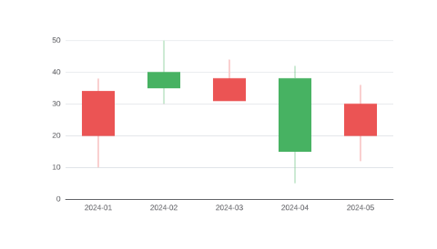
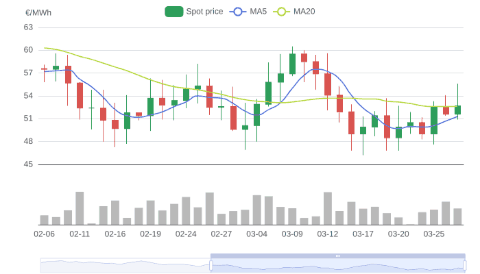

<!-- Generated by web/e2e/wiki.js - do not edit this page. Edit docs/wiki/examples/*.json, docs/wiki/notes/*.md or the generator, then run "npm run wiki" in web/. -->

K-line and OHLC financial charts.

| | |
|---|---|
| Component id | `open.echarts.CandlestickChart` |
| Palette | **Open Components / ECharts** → **Candlestick Chart** |
| Default size | 700 × 400 |



*Candlestick Chart as dropped from the palette.* It takes any ECharts option in its `option` prop; the palette entry only decides which sample option a new component starts with.

<details>
<summary>Option of a freshly dropped component</summary>

```json
{
  "xAxis": { "type": "category", "data": ["2024-01", "2024-02", "2024-03", "2024-04", "2024-05"] },
  "yAxis": { "type": "value" },
  "series": [
    {
      "type": "candlestick",
      "data": [[20, 34, 10, 38], [40, 35, 30, 50], [31, 38, 33, 44], [38, 15, 5, 42], [20, 30, 12, 36]]
    }
  ]
}
```

</details>

## Examples

### Candlestick with Volume

Price candles with moving averages above a volume bar chart, linked by a shared zoom slider and crosshair.



**How to make it in Ignition**

1. In the Designer, drag **Candlestick Chart** from the **Open Components / ECharts** group of the Perspective component palette onto a view.
2. Open **Option JSON** below and copy it. In the Property Editor, right-click the `option` property and choose **Paste**: the pasted JSON replaces the sample option. (See [Getting Started](Getting-Started) for other ways to enter an option.)
3. Replace the sample data with live data by binding these paths (expand `option` in the Property Editor down to the property, then use its binding icon). Everything else in the option stays as pasted.

   | Property | The binding must return |
   |---|---|
   | `props.option.xAxis[0].data` | a list of category labels: `["Mon", "Tue", "Wed"]` |
   | `props.option.xAxis[1].data` | a list of category labels: `["Mon", "Tue", "Wed"]` |
   | `props.option.series[0].data` | a list of rows with 4 values each, in the order of the example: `[[62, 64.3, 61.4, 64.9], ...]` |
   | `props.option.series[1].data` | a list in the shape of the example |
   | `props.option.series[2].data` | a list in the shape of the example |
   | `props.option.series[3].data` | a list of numbers, one per category: `[820, 932, 901]` |

   Script transform for `props.option.xAxis[0].data` (the same query, its `label` column):

   ```python
   def transform(self, value, quality, timestamp):
       return [str(value.getValueAt(row, "label")) for row in range(value.getRowCount())]
   ```

   Script transform for `props.option.series[0].data`, turning a dataset into rows. With a time axis the first value of a row is the time in epoch milliseconds:

   ```python
   def transform(self, value, quality, timestamp):
       # value: dataset, e.g. from a Tag History binding: t_stamp, then one column per tag
       rows = []
       for row in range(value.getRowCount()):
           t = value.getValueAt(row, 0)
           if hasattr(t, "getTime"):  # a date: ECharts wants epoch milliseconds
               t = t.getTime()
           rows.append([t] + [value.getValueAt(row, col) for col in range(1, 4)])
       return rows
   ```

   Script transform for `props.option.series[3].data`, on a binding that returns a dataset (for example a named query with a `value` column):

   ```python
   def transform(self, value, quality, timestamp):
       # value: dataset with a numeric column "value", one row per category
       return [value.getValueAt(row, "value") for row in range(value.getRowCount())]
   ```

   For `series[1].data`, `series[2].data` build the same structure as the example in a script transform or a project script; [Binding Data](Binding-Data) shows the pattern.

4. Bind `xAxis[0].data` and `xAxis[1].data` to the same list of period labels.
5. Bind `series[0].data` to rows `[open, close, lowest, highest]` (note the order) and `series[3].data` to one volume per period.
6. The moving averages (`series[1]`, `series[2]`) are plain line series: calculate them in the query or a script transform and use `"-"` where there is no value yet.
7. Both grids are zoomed together because every `dataZoom` lists `xAxisIndex: [0, 1]`; `axisPointer.link` ties the crosshair.
8. Rising and falling colours: `series[0].itemStyle.color` / `color0` (fill) and `borderColor` / `borderColor0`.

<details>
<summary>Option JSON</summary>

```json
{
  "legend": { "top": 4, "data": ["Spot price", "MA5", "MA20"] },
  "tooltip": { "trigger": "axis", "axisPointer": { "type": "cross" } },
  "axisPointer": { "link": [{ "xAxisIndex": "all" }] },
  "grid": [
    { "left": 56, "right": 24, "top": 40, "height": "50%" },
    { "left": 56, "right": 24, "top": "65%", "height": "17%" }
  ],
  "xAxis": [
    {
      "type": "category",
      "data": [
        "01-05",
        "01-06",
        "01-07",
        "01-08",
        "01-09",
        "01-12",
        "01-13",
        "01-14",
        "01-15",
        "01-16",
        "01-19",
        "01-20",
        "01-21",
        "01-22",
        "01-23",
        "01-26",
        "01-27",
        "01-28",
        "01-29",
        "01-30",
        "02-02",
        "02-03",
        "02-04",
        "02-05",
        "02-06",
        "02-09",
        "02-10",
        "02-11",
        "02-12",
        "02-13",
        "02-16",
        "02-17",
        "02-18",
        "02-19",
        "02-20",
        "02-23",
        "02-24",
        "02-25",
        "02-26",
        "02-27",
        "03-02",
        "03-03",
        "03-04",
        "03-05",
        "03-06",
        "03-09",
        "03-10",
        "03-11",
        "03-12",
        "03-13",
        "03-16",
        "03-17",
        "03-18",
        "03-19",
        "03-20",
        "03-23",
        "03-24",
        "03-25",
        "03-26",
        "03-27"
      ],
      "boundaryGap": true,
      "axisLine": { "onZero": false },
      "splitLine": { "show": false },
      "axisLabel": { "show": false },
      "axisTick": { "show": false }
    },
    {
      "type": "category",
      "gridIndex": 1,
      "data": [
        "01-05",
        "01-06",
        "01-07",
        "01-08",
        "01-09",
        "01-12",
        "01-13",
        "01-14",
        "01-15",
        "01-16",
        "01-19",
        "01-20",
        "01-21",
        "01-22",
        "01-23",
        "01-26",
        "01-27",
        "01-28",
        "01-29",
        "01-30",
        "02-02",
        "02-03",
        "02-04",
        "02-05",
        "02-06",
        "02-09",
        "02-10",
        "02-11",
        "02-12",
        "02-13",
        "02-16",
        "02-17",
        "02-18",
        "02-19",
        "02-20",
        "02-23",
        "02-24",
        "02-25",
        "02-26",
        "02-27",
        "03-02",
        "03-03",
        "03-04",
        "03-05",
        "03-06",
        "03-09",
        "03-10",
        "03-11",
        "03-12",
        "03-13",
        "03-16",
        "03-17",
        "03-18",
        "03-19",
        "03-20",
        "03-23",
        "03-24",
        "03-25",
        "03-26",
        "03-27"
      ],
      "boundaryGap": true,
      "axisTick": { "show": false }
    }
  ],
  "yAxis": [
    { "scale": true, "name": "€/MWh" },
    {
      "scale": true,
      "gridIndex": 1,
      "splitNumber": 2,
      "axisLabel": { "show": false },
      "axisLine": { "show": false },
      "axisTick": { "show": false },
      "splitLine": { "show": false }
    }
  ],
  "dataZoom": [
    { "type": "inside", "xAxisIndex": [0, 1], "start": 40, "end": 100 },
    { "type": "slider", "xAxisIndex": [0, 1], "bottom": 8, "height": 22, "start": 40, "end": 100 }
  ],
  "series": [
    {
      "name": "Spot price",
      "type": "candlestick",
      "data": [
        [62, 64.3, 61.4, 64.9],
        [64.3, 64.9, 64, 67.3],
        [64.9, 65.7, 64.3, 68.5],
        [65.7, 62.8, 62.5, 68.3],
        [62.8, 64.5, 61.2, 67.4],
        [64.5, 61.6, 59.2, 67.1],
        [61.6, 63.8, 60.9, 64.7],
        [63.8, 62, 60.3, 64.5],
        [62, 61.1, 58.8, 64.3],
        [61.1, 61.3, 58.6, 62.1],
        [61.3, 59, 57, 62.1],
        [59, 61.7, 57.1, 62],
        [61.7, 63.5, 59.4, 65.2],
        [63.5, 65.4, 60.7, 66.2],
        [65.4, 63.4, 62.5, 65.6],
        [63.4, 60.7, 59.1, 63.9],
        [60.7, 58.5, 57.5, 63.6],
        [58.5, 59.2, 58.5, 60.8],
        [59.2, 59.7, 57.2, 62.2],
        [59.7, 59, 56.6, 59.8],
        [59, 57.4, 56.3, 60.7],
        [57.4, 55.1, 53.9, 58.3],
        [55.1, 58.5, 53, 58.9],
        [58.5, 57.6, 55.2, 59.2],
        [57.6, 57.5, 55.8, 58.1],
        [57.5, 57.9, 55.9, 59.6],
        [57.9, 55.7, 52.7, 59.4],
        [55.7, 52.4, 50.9, 55.8],
        [52.4, 52.4, 49.6, 54.8],
        [52.4, 50.8, 48, 54.8],
        [50.8, 49.7, 47.3, 53.1],
        [49.7, 51.8, 47.7, 54.1],
        [51.8, 51.4, 50.8, 51.8],
        [51.4, 53.7, 49.4, 56.3],
        [53.7, 52.8, 50.9, 56.1],
        [52.8, 53.4, 50.8, 55.4],
        [53.4, 54.9, 52.4, 56.8],
        [54.9, 55.3, 53, 58.2],
        [55.3, 52.5, 51.5, 56.3],
        [52.5, 52.6, 50.8, 54.7],
        [52.6, 49.6, 49.4, 55.2],
        [49.6, 50.1, 46.9, 53.1],
        [50.1, 52.9, 48, 53.6],
        [52.9, 55.8, 52.6, 58.4],
        [55.8, 56.9, 53.2, 59.5],
        [56.9, 59.5, 56.6, 60.5],
        [59.5, 58.5, 55.8, 60],
        [58.5, 56.9, 54.8, 59.4],
        [56.9, 54.1, 52.1, 59.6],
        [54.1, 51.9, 50.5, 55.3],
        [51.9, 49, 46.8, 52.9],
        [49, 49.9, 46.2, 51.3],
        [49.9, 51.4, 48.7, 52],
        [51.4, 48.5, 46.8, 53.7],
        [48.5, 49.9, 46.8, 52.7],
        [49.9, 50.5, 49, 51.9],
        [50.5, 49, 48.3, 51.2],
        [49, 52.6, 47.6, 53.3],
        [52.6, 51.6, 51.4, 54.1],
        [51.6, 52.7, 50.9, 55.6]
      ],
      "itemStyle": {
        "color": "#2e9e5b",
        "color0": "#d9534f",
        "borderColor": "#2e9e5b",
        "borderColor0": "#d9534f"
      }
    },
    {
      "name": "MA5",
      "type": "line",
      "data": [
        "-",
        "-",
        "-",
        "-",
        64.4,
        63.9,
        63.7,
        62.9,
        62.6,
        62,
        61.4,
        61,
        61.3,
        62.2,
        62.6,
        62.9,
        62.3,
        61.4,
        60.3,
        59.4,
        58.8,
        58.1,
        57.9,
        57.5,
        57.2,
        57.3,
        57.4,
        56.2,
        55.2,
        53.8,
        52.2,
        51.4,
        51.2,
        51.5,
        51.9,
        52.6,
        53.2,
        54,
        53.8,
        53.7,
        53,
        52,
        51.5,
        52.2,
        53.1,
        55,
        56.7,
        57.5,
        57.2,
        56.2,
        54.1,
        52.4,
        51.3,
        50.1,
        49.7,
        50,
        49.9,
        50.1,
        50.7,
        51.3
      ],
      "smooth": true,
      "showSymbol": false,
      "lineStyle": { "width": 1.5 }
    },
    {
      "name": "MA20",
      "type": "line",
      "data": [
        "-",
        "-",
        "-",
        "-",
        "-",
        "-",
        "-",
        "-",
        "-",
        "-",
        "-",
        "-",
        "-",
        "-",
        "-",
        "-",
        "-",
        "-",
        "-",
        62.1,
        61.8,
        61.3,
        60.9,
        60.7,
        60.3,
        60.1,
        59.7,
        59.2,
        58.8,
        58.3,
        57.8,
        57.3,
        56.7,
        56.1,
        55.6,
        55.2,
        55,
        54.8,
        54.5,
        54.2,
        53.8,
        53.5,
        53.3,
        53.2,
        53.1,
        53.2,
        53.4,
        53.6,
        53.7,
        53.7,
        53.7,
        53.6,
        53.6,
        53.3,
        53.2,
        53,
        52.7,
        52.6,
        52.6,
        52.6
      ],
      "smooth": true,
      "showSymbol": false,
      "lineStyle": { "width": 1.5 }
    },
    {
      "name": "Volume",
      "type": "bar",
      "xAxisIndex": 1,
      "yAxisIndex": 1,
      "data": [
        593,
        320,
        369,
        451,
        531,
        501,
        413,
        371,
        270,
        517,
        317,
        592,
        390,
        500,
        520,
        338,
        348,
        333,
        283,
        468,
        308,
        612,
        471,
        410,
        321,
        298,
        385,
        623,
        216,
        438,
        511,
        288,
        417,
        512,
        383,
        468,
        556,
        424,
        615,
        340,
        375,
        392,
        580,
        566,
        428,
        412,
        287,
        308,
        619,
        376,
        494,
        406,
        431,
        349,
        294,
        205,
        361,
        394,
        497,
        409
      ],
      "itemStyle": { "color": "rgba(128,128,128,0.55)" }
    }
  ]
}
```

</details>
