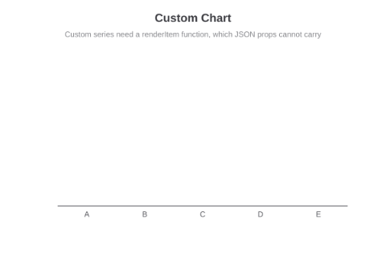

<!-- Generated by web/e2e/wiki.js - do not edit this page. Edit docs/wiki/examples/*.json, docs/wiki/notes/*.md or the generator, then run "npm run wiki" in web/. -->

Custom series (limited: renderItem functions cannot be supplied through props).

| | |
|---|---|
| Component id | `open.echarts.CustomChart` |
| Palette | **Open Components / ECharts** → **Custom Chart** |
| Default size | 600 × 400 |



*Custom Chart as dropped from the palette.* It takes any ECharts option in its `option` prop; the palette entry only decides which sample option a new component starts with.

<details>
<summary>Option of a freshly dropped component</summary>

```json
{
  "title": {
    "text": "Custom Chart",
    "subtext": "Custom series need a renderItem function, which JSON props cannot carry",
    "left": "center"
  },
  "tooltip": {},
  "xAxis": { "type": "category", "data": ["A", "B", "C", "D", "E"] },
  "yAxis": { "type": "value" },
  "series": []
}
```

</details>

## Making your own

1. In the Designer, drag **Custom Chart** from the **Open Components / ECharts** group of the Perspective component palette onto a view.
2. Edit the `option` prop in the Property Editor, or paste a complete option over it (right-click `option`, **Paste**). Any option from the [ECharts documentation](https://echarts.apache.org/en/option.html) works as long as it is plain JSON (no JavaScript functions).
3. Bind the parts of the option that hold data; see [Binding Data](Binding-Data).
