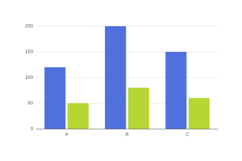
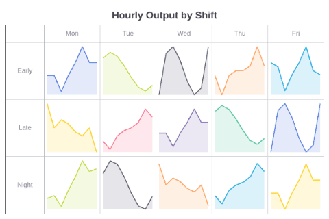

<!-- Generated by web/e2e/wiki.js - do not edit this page. Edit docs/wiki/examples/*.json, docs/wiki/notes/*.md or the generator, then run "npm run wiki" in web/. -->

Dataset-driven with encode/transform.

| | |
|---|---|
| Component id | `open.echarts.DatasetChart` |
| Palette | **Open Components / ECharts** → **Dataset Chart** |
| Default size | 600 × 400 |



*Dataset Chart as dropped from the palette.* It takes any ECharts option in its `option` prop; the palette entry only decides which sample option a new component starts with.

<details>
<summary>Option of a freshly dropped component</summary>

```json
{
  "dataset": { "source": [["Product", "Sales", "Profit"], ["A", 120, 50], ["B", 200, 80], ["C", 150, 60]] },
  "xAxis": { "type": "category" },
  "yAxis": {},
  "series": [{ "type": "bar" }, { "type": "bar" }]
}
```

</details>

## Examples

### Sparklines in a Matrix

A table of small line charts on the matrix coordinate system: one sparkline of hourly output per weekday and shift.



**How to make it in Ignition**

1. In the Designer, drag **Dataset Chart** from the **Open Components / ECharts** group of the Perspective component palette onto a view.
2. Open **Option JSON** below and copy it. In the Property Editor, right-click the `option` property and choose **Paste**: the pasted JSON replaces the sample option. (See [Getting Started](Getting-Started) for other ways to enter an option.)
3. Replace the sample data with live data by binding these paths (expand `option` in the Property Editor down to the property, then use its binding icon). Everything else in the option stays as pasted.

   | Property | The binding must return |
   |---|---|
   | `props.option.series[0].data` | a list of numbers, one per category: `[820, 932, 901]` |
   | `props.option.series[1].data` | a list of numbers, one per category: `[820, 932, 901]` |
   | `props.option.series[2].data` | a list of numbers, one per category: `[820, 932, 901]` |
   | `props.option.series[3].data` | a list of numbers, one per category: `[820, 932, 901]` |
   | `props.option.series[4].data` | a list of numbers, one per category: `[820, 932, 901]` |
   | `props.option.series[5].data` | a list of numbers, one per category: `[820, 932, 901]` |
   | `props.option.series[6].data` | a list of numbers, one per category: `[820, 932, 901]` |
   | `props.option.series[7].data` | a list of numbers, one per category: `[820, 932, 901]` |

   The remaining 7 data properties of this example follow the same pattern.

   Script transform for `props.option.series[0].data`, on a binding that returns a dataset (for example a named query with a `value` column):

   ```python
   def transform(self, value, quality, timestamp):
       # value: dataset with a numeric column "value", one row per category
       return [value.getValueAt(row, "value") for row in range(value.getRowCount())]
   ```

4. `matrix.x.data` and `matrix.y.data` name the columns and rows. Each cell holds a small `grid` placed with `coord: [column, row]`, with its own hidden x and y axis and one line series.
5. Bind `series[n].data` to a list of numbers. Series, axes and grids are in the same order: left to right, then top to bottom, so series 0 is Mon/Early and series 5 is Mon/Late.
6. To build it for other rows and columns, generate `grid`, `xAxis`, `yAxis` and `series` together in a script transform; entry n of each belongs to the same cell (`gridIndex`, `xAxisIndex`, `yAxisIndex` all equal n).
7. `yAxis[n].scale: true` scales every sparkline to its own range. Set the same `min` and `max` on every y axis to make the cells comparable.

<details>
<summary>Option JSON</summary>

```json
{
  "title": { "text": "Hourly Output by Shift" },
  "tooltip": { "trigger": "axis" },
  "matrix": {
    "x": { "levelSize": 32, "label": { "color": "#888" }, "data": ["Mon", "Tue", "Wed", "Thu", "Fri"] },
    "y": { "levelSize": 70, "label": { "color": "#888" }, "data": ["Early", "Late", "Night"] },
    "top": 45,
    "left": 10,
    "right": 10,
    "bottom": 10
  },
  "grid": [
    {
      "coordinateSystem": "matrix",
      "coord": ["Mon", "Early"],
      "top": 8,
      "bottom": 8,
      "left": 6,
      "right": 6
    },
    {
      "coordinateSystem": "matrix",
      "coord": ["Tue", "Early"],
      "top": 8,
      "bottom": 8,
      "left": 6,
      "right": 6
    },
    {
      "coordinateSystem": "matrix",
      "coord": ["Wed", "Early"],
      "top": 8,
      "bottom": 8,
      "left": 6,
      "right": 6
    },
    {
      "coordinateSystem": "matrix",
      "coord": ["Thu", "Early"],
      "top": 8,
      "bottom": 8,
      "left": 6,
      "right": 6
    },
    {
      "coordinateSystem": "matrix",
      "coord": ["Fri", "Early"],
      "top": 8,
      "bottom": 8,
      "left": 6,
      "right": 6
    },
    {
      "coordinateSystem": "matrix",
      "coord": ["Mon", "Late"],
      "top": 8,
      "bottom": 8,
      "left": 6,
      "right": 6
    },
    {
      "coordinateSystem": "matrix",
      "coord": ["Tue", "Late"],
      "top": 8,
      "bottom": 8,
      "left": 6,
      "right": 6
    },
    {
      "coordinateSystem": "matrix",
      "coord": ["Wed", "Late"],
      "top": 8,
      "bottom": 8,
      "left": 6,
      "right": 6
    },
    {
      "coordinateSystem": "matrix",
      "coord": ["Thu", "Late"],
      "top": 8,
      "bottom": 8,
      "left": 6,
      "right": 6
    },
    {
      "coordinateSystem": "matrix",
      "coord": ["Fri", "Late"],
      "top": 8,
      "bottom": 8,
      "left": 6,
      "right": 6
    },
    {
      "coordinateSystem": "matrix",
      "coord": ["Mon", "Night"],
      "top": 8,
      "bottom": 8,
      "left": 6,
      "right": 6
    },
    {
      "coordinateSystem": "matrix",
      "coord": ["Tue", "Night"],
      "top": 8,
      "bottom": 8,
      "left": 6,
      "right": 6
    },
    {
      "coordinateSystem": "matrix",
      "coord": ["Wed", "Night"],
      "top": 8,
      "bottom": 8,
      "left": 6,
      "right": 6
    },
    {
      "coordinateSystem": "matrix",
      "coord": ["Thu", "Night"],
      "top": 8,
      "bottom": 8,
      "left": 6,
      "right": 6
    },
    {
      "coordinateSystem": "matrix",
      "coord": ["Fri", "Night"],
      "top": 8,
      "bottom": 8,
      "left": 6,
      "right": 6
    }
  ],
  "xAxis": [
    { "type": "category", "gridIndex": 0, "show": false, "boundaryGap": false },
    { "type": "category", "gridIndex": 1, "show": false, "boundaryGap": false },
    { "type": "category", "gridIndex": 2, "show": false, "boundaryGap": false },
    { "type": "category", "gridIndex": 3, "show": false, "boundaryGap": false },
    { "type": "category", "gridIndex": 4, "show": false, "boundaryGap": false },
    { "type": "category", "gridIndex": 5, "show": false, "boundaryGap": false },
    { "type": "category", "gridIndex": 6, "show": false, "boundaryGap": false },
    { "type": "category", "gridIndex": 7, "show": false, "boundaryGap": false },
    { "type": "category", "gridIndex": 8, "show": false, "boundaryGap": false },
    { "type": "category", "gridIndex": 9, "show": false, "boundaryGap": false },
    { "type": "category", "gridIndex": 10, "show": false, "boundaryGap": false },
    { "type": "category", "gridIndex": 11, "show": false, "boundaryGap": false },
    { "type": "category", "gridIndex": 12, "show": false, "boundaryGap": false },
    { "type": "category", "gridIndex": 13, "show": false, "boundaryGap": false },
    { "type": "category", "gridIndex": 14, "show": false, "boundaryGap": false }
  ],
  "yAxis": [
    { "type": "value", "gridIndex": 0, "show": false, "scale": true },
    { "type": "value", "gridIndex": 1, "show": false, "scale": true },
    { "type": "value", "gridIndex": 2, "show": false, "scale": true },
    { "type": "value", "gridIndex": 3, "show": false, "scale": true },
    { "type": "value", "gridIndex": 4, "show": false, "scale": true },
    { "type": "value", "gridIndex": 5, "show": false, "scale": true },
    { "type": "value", "gridIndex": 6, "show": false, "scale": true },
    { "type": "value", "gridIndex": 7, "show": false, "scale": true },
    { "type": "value", "gridIndex": 8, "show": false, "scale": true },
    { "type": "value", "gridIndex": 9, "show": false, "scale": true },
    { "type": "value", "gridIndex": 10, "show": false, "scale": true },
    { "type": "value", "gridIndex": 11, "show": false, "scale": true },
    { "type": "value", "gridIndex": 12, "show": false, "scale": true },
    { "type": "value", "gridIndex": 13, "show": false, "scale": true },
    { "type": "value", "gridIndex": 14, "show": false, "scale": true }
  ],
  "series": [
    {
      "type": "line",
      "xAxisIndex": 0,
      "yAxisIndex": 0,
      "symbol": "none",
      "lineStyle": { "width": 1.5 },
      "areaStyle": { "opacity": 0.15 },
      "data": [54, 54, 49, 54, 58, 63, 58, 58]
    },
    {
      "type": "line",
      "xAxisIndex": 1,
      "yAxisIndex": 1,
      "symbol": "none",
      "lineStyle": { "width": 1.5 },
      "areaStyle": { "opacity": 0.15 },
      "data": [64, 67, 65, 60, 54, 49, 47, 50]
    },
    {
      "type": "line",
      "xAxisIndex": 2,
      "yAxisIndex": 2,
      "symbol": "none",
      "lineStyle": { "width": 1.5 },
      "areaStyle": { "opacity": 0.15 },
      "data": [74, 80, 81, 79, 76, 74, 75, 81]
    },
    {
      "type": "line",
      "xAxisIndex": 3,
      "yAxisIndex": 3,
      "symbol": "none",
      "lineStyle": { "width": 1.5 },
      "areaStyle": { "opacity": 0.15 },
      "data": [64, 60, 64, 65, 65, 66, 70, 66]
    },
    {
      "type": "line",
      "xAxisIndex": 4,
      "yAxisIndex": 4,
      "symbol": "none",
      "lineStyle": { "width": 1.5 },
      "areaStyle": { "opacity": 0.15 },
      "data": [74, 73, 67, 71, 74, 78, 72, 71]
    },
    {
      "type": "line",
      "xAxisIndex": 5,
      "yAxisIndex": 5,
      "symbol": "none",
      "lineStyle": { "width": 1.5 },
      "areaStyle": { "opacity": 0.15 },
      "data": [74, 68, 70, 69, 67, 66, 68, 62]
    },
    {
      "type": "line",
      "xAxisIndex": 6,
      "yAxisIndex": 6,
      "symbol": "none",
      "lineStyle": { "width": 1.5 },
      "areaStyle": { "opacity": 0.15 },
      "data": [64, 61, 66, 68, 69, 71, 76, 73]
    },
    {
      "type": "line",
      "xAxisIndex": 7,
      "yAxisIndex": 7,
      "symbol": "none",
      "lineStyle": { "width": 1.5 },
      "areaStyle": { "opacity": 0.15 },
      "data": [61, 61, 56, 61, 65, 70, 65, 65]
    },
    {
      "type": "line",
      "xAxisIndex": 8,
      "yAxisIndex": 8,
      "symbol": "none",
      "lineStyle": { "width": 1.5 },
      "areaStyle": { "opacity": 0.15 },
      "data": [71, 74, 72, 67, 61, 56, 54, 57]
    },
    {
      "type": "line",
      "xAxisIndex": 9,
      "yAxisIndex": 9,
      "symbol": "none",
      "lineStyle": { "width": 1.5 },
      "areaStyle": { "opacity": 0.15 },
      "data": [61, 67, 68, 66, 63, 61, 62, 68]
    },
    {
      "type": "line",
      "xAxisIndex": 10,
      "yAxisIndex": 10,
      "symbol": "none",
      "lineStyle": { "width": 1.5 },
      "areaStyle": { "opacity": 0.15 },
      "data": [61, 62, 58, 64, 69, 75, 71, 72]
    },
    {
      "type": "line",
      "xAxisIndex": 11,
      "yAxisIndex": 11,
      "symbol": "none",
      "lineStyle": { "width": 1.5 },
      "areaStyle": { "opacity": 0.15 },
      "data": [71, 75, 74, 70, 65, 61, 60, 64]
    },
    {
      "type": "line",
      "xAxisIndex": 12,
      "yAxisIndex": 12,
      "symbol": "none",
      "lineStyle": { "width": 1.5 },
      "areaStyle": { "opacity": 0.15 },
      "data": [61, 55, 57, 56, 54, 53, 55, 49]
    },
    {
      "type": "line",
      "xAxisIndex": 13,
      "yAxisIndex": 13,
      "symbol": "none",
      "lineStyle": { "width": 1.5 },
      "areaStyle": { "opacity": 0.15 },
      "data": [71, 68, 73, 75, 76, 78, 83, 80]
    },
    {
      "type": "line",
      "xAxisIndex": 14,
      "yAxisIndex": 14,
      "symbol": "none",
      "lineStyle": { "width": 1.5 },
      "areaStyle": { "opacity": 0.15 },
      "data": [68, 68, 63, 68, 72, 77, 72, 72]
    }
  ]
}
```

</details>
