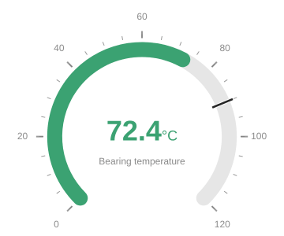

<!-- Generated by web/e2e/wiki.js - do not edit this page. Edit docs/wiki/examples/*.json, docs/wiki/notes/*.md or the generator, then run "npm run wiki" in web/. -->

A dial for one value: progress arc, stage band with needle, graded band with names, or a minimal arc.

| | |
|---|---|
| Component id | `open.industrial.DialGauge` |
| Palette | **Open Components / Industrial** → **Dial Gauge** |
| Default size | 360 × 300 |



*Dial Gauge as dropped from the palette, showing its built-in sample data.*

This component builds its chart from the domain props below, so there is no ECharts option to write: bind the props to your tags and queries. (A non-empty `option` is an advanced override that replaces the generated chart.)

## How to use it in Ignition

1. In the Designer, drag **Dial Gauge** from the **Open Components / Industrial** group of the Perspective component palette onto a view. It shows sample data.
2. Select it and replace the sample data in the Property Editor: type values, paste JSON (right-click a property, **Paste**), or add a binding.
3. Bind the data props to tags, tag history or named queries. The props and the shape each one expects are listed under [Props](#props); [Binding examples](#binding-examples) has worked examples.

## Binding examples

**One tag.** Bind `props.value` to the tag; nothing else needs a binding:

| Property | Binding (example) |
|---|---|
| `props.value` | Tag binding: `[default]Pump7/Bearing/Temperature` |
| `props.target` | Tag binding: `[default]Pump7/Bearing/TempHighSP` (or type a number, or `null` for no marker) |

A value that is not a number (a bad-quality tag that yields `null`) draws an empty dial with a dash.

**Scale from the tag's engineering range.** Bind `props.min` and `props.max` to the tag's `engLow` and
`engHigh` properties (`[default]Pump7/Bearing/Temperature.engLow`), and `props.unit` to
`[default]Pump7/Bearing/Temperature.engUnit`, so the dial follows the tag configuration.

**Stages.** `stages` colours the dial by value bands and is usually typed. Each stage ends at its
`upTo`; the last one, without `upTo`, takes everything above:

```json
[
  { "upTo": 80, "color": "#3ba272", "name": "Normal" },
  { "upTo": 100, "color": "#e6a23c", "name": "High" },
  { "color": "#e05252", "name": "Critical" }
]
```

To follow alarm setpoints, bind `props.stages[0].upTo` and `props.stages[1].upTo` to the setpoint tags.

**Looks.** `variant` chooses the dial: `progress` (a filled arc), `stages` (a coloured band with a
needle), `grade` (a thin band with the stage names) or `minimal` (arc and value only, for small tiles).

## Props

| Property | Type | Default | Description |
|---|---|---|---|
| `value` | number / string / null | `72.4` | The value shown. Bind it to a tag. Anything that is not a number draws an empty dial with a dash. |
| `min` | number | `0` | Start of the scale. |
| `max` | number | `120` | End of the scale. If it is not greater than min, the scale is 0 to 100. |
| `unit` | string | `"°C"` | Unit written after the value. |
| `decimals` | integer | `1` | Decimal places of the value. |
| `title` | string | `"Bearing temperature"` | Caption below the value. |
| `variant` | string | `"progress"` | The look of the dial. progress: a thick rounded arc filled up to the value, with the scale around it. stages: a wide band coloured by the stages, with a needle. grade: a thin band coloured by the stages with their names written along it, and a pointer. minimal: an arc and the value only, for small tiles. One of: `"progress"`, `"stages"`, `"grade"`, `"minimal"`. |
| `stages` | array | sample data (3 items) | Value bands as objects { upTo, color, name }. A value belongs to the first stage, in ascending order of upTo, whose upTo is greater than it; a stage without upTo takes everything above. The stages colour the band of the stages and grade variants, and the arc and value of the other two by the stage the value is in. The name is written along the band of the grade variant and shown in the tooltip. Empty for no stages. |
| `color` | string | `"#5470c6"` | Colour of the arc, the pointer and the value when there are no stages, or none takes the value. |
| `target` | number / null | `90` | A marker across the scale at this value, e.g. a setpoint or a limit. Null for none. |
| `showScale` | boolean | `true` | Draw the ticks and numbers of the scale. The minimal variant has none; the grade variant has ticks only. |
| `showValue` | boolean | `true` | Write the value in the dial. |
| `splitNumber` | integer | `0` | Number of labelled divisions of the scale. 0 chooses one that gives round steps. |
| `startAngle` | number / null | `null` | Angle in degrees where the scale starts: 90 is the top, 180 the left, 0 the right. The scale runs clockwise. Null centres the opening of the dial at the bottom. |
| `sweep` | number / null | `null` | Angle in degrees the scale covers (30-360). Null is 180 for the grade variant and 270 for the others. |

The shared props (`theme`, `renderer`, `notMerge`, `lazyUpdate`, `sanitizeTooltip`, ...) and the seven events are the same as on every component: see [Binding Data](Binding-Data), [Themes](Themes) and [Events](Events).
