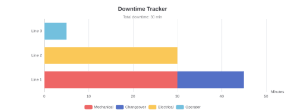

<!-- Generated by web/e2e/wiki.js - do not edit this page. Edit docs/wiki/examples/*.json, docs/wiki/notes/*.md or the generator, then run "npm run wiki" in web/. -->

Categorised downtime events on equipment timeline with reason codes.

| | |
|---|---|
| Component id | `open.industrial.DowntimeTracker` |
| Palette | **Open Components / Scheduling** → **Downtime Tracker** |
| Default size | 900 × 350 |



*Downtime Tracker as dropped from the palette, showing its built-in sample data.*

This component builds its chart from the domain props below, so there is no ECharts option to write: bind the props to your tags and queries. (A non-empty `option` is an advanced override that replaces the generated chart.)

## How to use it in Ignition

1. In the Designer, drag **Downtime Tracker** from the **Open Components / Scheduling** group of the Perspective component palette onto a view. It shows sample data.
2. Select it and replace the sample data in the Property Editor: type values, paste JSON (right-click a property, **Paste**), or add a binding.
3. Bind the data props to tags, tag history or named queries. The props and the shape each one expects are listed under [Props](#props); [Binding examples](#binding-examples) has worked examples.

## Binding examples

`events` is a list of `{ equipment, start, end, category }` objects with the times in epoch
milliseconds. Each `equipment` becomes a row and each `category` a colour.

**Downtime log from a named query.**

```sql
SELECT equipment, category, reason, start_time, COALESCE(end_time, CURRENT_TIMESTAMP) AS end_time
FROM downtime_events
WHERE start_time >= :from
ORDER BY equipment, start_time
```

Bind it to `props.events` (Return Format: dataset):

```python
def transform(self, value, quality, timestamp):
    return [
        {
            "equipment": str(value.getValueAt(row, "equipment")),
            "category": str(value.getValueAt(row, "category")),
            "reason": str(value.getValueAt(row, "reason")),
            "start": value.getValueAt(row, "start_time").getTime(),
            "end": value.getValueAt(row, "end_time").getTime(),
        }
        for row in range(value.getRowCount())
    ]
```

`reason` is carried along but not drawn. To react to a click on a bar, use the `onClick` event; [Events](Events)
lists what its payload contains.

**Colours per category.** Type `categoryColors`, e.g.
`{ "Mechanical": "#e05252", "Electrical": "#e6a23c", "Changeover": "#5470c6", "Material": "#73c0de" }`.
Categories not listed keep the built-in colours.

`showSummary` writes the total downtime under the title.

## Props

| Property | Type | Default | Description |
|---|---|---|---|
| `events` | array of object | sample data (4 items) | Downtime events: { equipment, start (epoch ms), end (epoch ms), category, reason? }. reason is not charted. Bind to your downtime log. |
| `categoryColors` | object | `{}` | Map of downtime category to colour. Merged over the built-in defaults. |
| `showSummary` | boolean | `true` | Show total downtime under the title. |
| `title` | string | `""` | Chart title. Leave blank for the default title. |

The shared props (`theme`, `renderer`, `notMerge`, `lazyUpdate`, `sanitizeTooltip`, ...) and the seven events are the same as on every component: see [Binding Data](Binding-Data), [Themes](Themes) and [Events](Events).
