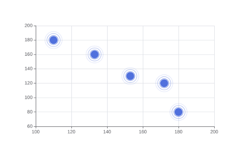

<!-- Generated by web/e2e/wiki.js - do not edit this page. Edit docs/wiki/examples/*.json, docs/wiki/notes/*.md or the generator, then run "npm run wiki" in web/. -->

Ripple-effect scatter with animated markers.

| | |
|---|---|
| Component id | `open.echarts.EffectScatterChart` |
| Palette | **Open Components / ECharts** → **Effect Scatter Chart** |
| Default size | 600 × 400 |



*Effect Scatter Chart as dropped from the palette.* It takes any ECharts option in its `option` prop; the palette entry only decides which sample option a new component starts with.

<details>
<summary>Option of a freshly dropped component</summary>

```json
{
  "xAxis": { "scale": true, "boundaryGap": ["10%", "10%"] },
  "yAxis": { "scale": true, "boundaryGap": ["10%", "10%"] },
  "series": [
    {
      "type": "effectScatter",
      "symbolSize": 20,
      "data": [[172, 120], [133, 160], [180, 80], [153, 130], [110, 180]],
      "rippleEffect": { "brushType": "stroke" }
    }
  ]
}
```

</details>

## Making your own

1. In the Designer, drag **Effect Scatter Chart** from the **Open Components / ECharts** group of the Perspective component palette onto a view.
2. Edit the `option` prop in the Property Editor, or paste a complete option over it (right-click `option`, **Paste**). Any option from the [ECharts documentation](https://echarts.apache.org/en/option.html) works as long as it is plain JSON (no JavaScript functions).
3. Bind the parts of the option that hold data; see [Binding Data](Binding-Data).
