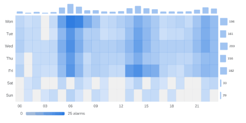

<!-- Generated by web/e2e/wiki.js - do not edit this page. Edit docs/wiki/examples/*.json, docs/wiki/notes/*.md or the generator, then run "npm run wiki" in web/. -->

When does it happen? Event counts by hour of day and day of week (alarms, downtime starts, rejects).

| | |
|---|---|
| Component id | `open.industrial.EventHeatmap` |
| Palette | **Open Components / Industrial** → **Event Heatmap** |
| Default size | 760 × 380 |



*Event Heatmap as dropped from the palette, showing its built-in sample data.*

This component builds its chart from the domain props below, so there is no ECharts option to write: bind the props to your tags and queries. (A non-empty `option` is an advanced override that replaces the generated chart.)

## How to use it in Ignition

1. In the Designer, drag **Event Heatmap** from the **Open Components / Industrial** group of the Perspective component palette onto a view. It shows sample data.
2. Select it and replace the sample data in the Property Editor: type values, paste JSON (right-click a property, **Paste**), or add a binding.
3. Bind the data props to tags, tag history or named queries. The props and the shape each one expects are listed under [Props](#props); [Binding examples](#binding-examples) has worked examples.

## Binding examples

There are two ways to feed the heatmap. Use `timestamps` when you have the raw events, `cells` when the
database does the counting. `cells` is ignored while `timestamps` has entries, so clear the one you do
not use (a freshly dropped component has sample `cells`).

**Raw alarm times from a named query.**

```sql
SELECT eventtime FROM alarm_events
WHERE eventtype = 0 AND eventtime >= :from
```

Bind it to `props.timestamps` (Return Format: dataset) and convert the dates to epoch milliseconds:

```python
def transform(self, value, quality, timestamp):
    return [value.getValueAt(row, 0).getTime() for row in range(value.getRowCount())]
```

Epoch values are instants, so set `utcOffsetMinutes` to the offset of the plant's clock (e.g. `60` for
UTC+1, `-300` for UTC-5); the browser's time zone is deliberately not used.

**Counted by the database.** Let the query group by weekday and hour and bind it to `props.cells`
(PostgreSQL syntax shown; its `DOW` is 0 for Sunday, which the component accepts):

```sql
SELECT EXTRACT(DOW FROM start_time) AS day, EXTRACT(HOUR FROM start_time) AS hour, COUNT(*) AS value
FROM downtime_events
WHERE start_time >= :from
GROUP BY 1, 2
```

```python
def transform(self, value, quality, timestamp):
    return [
        {
            "day": int(value.getValueAt(row, "day")),    # 0 or 7 = Sunday, 1 = Monday
            "hour": int(value.getValueAt(row, "hour")),  # 0..23
            "value": value.getValueAt(row, "value"),
        }
        for row in range(value.getRowCount())
    ]
```

The hours are then whatever the database's clock says, and `utcOffsetMinutes` is not applied.

**Weighted events.** To show lost minutes rather than the number of stops, fill `weights` with one number
per timestamp, in the same order, or use `SUM(minutes) AS value` in the grouped query. Set `valueLabel`
to what is counted (`stops`, `min`, `rejects`).

## Props

| Property | Type | Default | Description |
|---|---|---|---|
| `cells` | array | sample data (141 items) | Pre-aggregated counts, one row per cell: { day, hour, value }. day is 1 = Monday .. 7 = Sunday (0 is also Sunday, so JavaScript getDay() and PostgreSQL dow values work) or an English day name / one of dayLabels; hour is 0..23. Rows for the same cell are summed; invalid rows are skipped. Ignored while timestamps has entries. Clear this when you bind timestamps, otherwise the sample data shows whenever the binding returns no events. |
| `timestamps` | array | `[]` | Raw event times, bucketed by the component: epoch milliseconds, or ISO 8601 strings. Epoch values and strings with a zone (Z, +02:00) are instants and are shifted by utcOffsetMinutes; strings without a zone are taken as local wall-clock time exactly as written. Rows { timestamp \| t_stamp \| t, weight } are accepted too. When non-empty, replaces cells. |
| `weights` | array | `[]` | Optional weight of each timestamp, in the same order (e.g. downtime minutes, reject quantity). Leave empty to count every event as 1. When set, events without a valid non-negative weight are skipped. |
| `utcOffsetMinutes` | number | `0` | Offset from UTC, in minutes, of the clock the hours and weekdays are read on (e.g. 60 for UTC+1, -300 for UTC-5). Applied to epoch and zoned timestamps. The zone of the browser or gateway is deliberately not used, so every client shows the same chart. A fixed offset does not follow daylight saving time: for data spanning a DST change, aggregate in the database and bind cells. |
| `weekStart` | string | `"monday"` | First day of the week (top row). One of: `"monday"`, `"sunday"`. |
| `dayLabels` | array | sample data (7 items) | Seven day labels, always Monday first (weekStart only changes the row order). |
| `hourStep` | integer | `1` | Width of a column in hours: 1, 2, 3, 4 or 6. One of: `1`, `2`, `3`, `4`, `6`. |
| `colors` | array | sample data (4 items) | Colour ramp from low to high counts (two or more colours). The default is one hue with rising opacity, so it reads low-to-high on light and dark themes alike. Cells with no events are always drawn in neutral grey, outside this ramp. |
| `showValues` | boolean | `false` | Write the count in each cell. Best with larger components or a coarser hourStep. |
| `showTotals` | boolean | `true` | Show bars with the total per hour (above) and per day (right). |
| `showLegend` | boolean | `true` | Show the colour scale below the chart. |
| `max` | number | `0` | Count that gets the last colour of the ramp. 0 = automatic (the largest cell). Set a fixed value to keep colours comparable between periods. |
| `valueLabel` | string | `"alarms"` | What is being counted, written after values in tooltips and the legend (e.g. alarms, stops, rejects). |
| `title` | string | `""` | Chart title. Leave blank for no title. |

The shared props (`theme`, `renderer`, `notMerge`, `lazyUpdate`, `sanitizeTooltip`, ...) and the seven events are the same as on every component: see [Binding Data](Binding-Data), [Themes](Themes) and [Events](Events).
