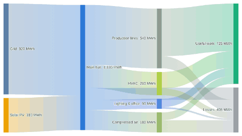

<!-- Generated by web/e2e/wiki.js - do not edit this page. Edit docs/wiki/examples/*.json, docs/wiki/notes/*.md or the generator, then run "npm run wiki" in web/. -->

Sankey diagram of energy, material or product flow, built from source / target / value rows.

| | |
|---|---|
| Component id | `open.industrial.FlowDiagram` |
| Palette | **Open Components / Industrial** → **Flow Diagram (Sankey)** |
| Default size | 800 × 450 |



*Flow Diagram (Sankey) as dropped from the palette, showing its built-in sample data.*

This component builds its chart from the domain props below, so there is no ECharts option to write: bind the props to your tags and queries. (A non-empty `option` is an advanced override that replaces the generated chart.)

## How to use it in Ignition

1. In the Designer, drag **Flow Diagram (Sankey)** from the **Open Components / Industrial** group of the Perspective component palette onto a view. It shows sample data.
2. Select it and replace the sample data in the Property Editor: type values, paste JSON (right-click a property, **Paste**), or add a binding.
3. Bind the data props to tags, tag history or named queries. The props and the shape each one expects are listed under [Props](#props); [Binding examples](#binding-examples) has worked examples.

## Binding examples

`flows` is a list of `{ source, target, value }` rows; the nodes are created from the names used in it.
A node that appears as a `target` in one row and as a `source` in another sits in the middle of the diagram.

**Energy balance from a named query.**

```sql
SELECT from_node, to_node, SUM(kwh) / 1000.0 AS mwh
FROM energy_flows
WHERE day = :day
GROUP BY from_node, to_node
```

Bind it to `props.flows` (Return Format: dataset):

```python
def transform(self, value, quality, timestamp):
    return [
        {
            "source": str(value.getValueAt(row, "from_node")),
            "target": str(value.getValueAt(row, "to_node")),
            "value": value.getValueAt(row, "mwh"),
        }
        for row in range(value.getRowCount())
    ]
```

Rows with the same source and target are added up, and rows whose value is not a positive number are
skipped, so the query needs no special cases for idle meters.

**A fixed diagram fed by meters.** Type the flows once and bind each `props.flows[n].value` to its
meter tag, e.g. `[default]Energy/Grid/ImportMWhToday`.

**Material yield.** The same shape shows where material goes: `Raw material -> Good product`,
`Raw material -> Scrap`, `Scrap -> Regrind`. Set `unit` to `t` or `pcs`.

Colours and display names of individual nodes are set in `nodes`
(`{ "name": "Losses", "color": "#9aa0a6" }`); they are usually typed, not bound.

## Props

| Property | Type | Default | Description |
|---|---|---|---|
| `flows` | array | sample data (15 items) | One row per flow: { source, target, value }. Nodes are created from the names used here. Rows with the same source and target are summed; rows whose value is not a positive number are skipped. A Sankey diagram cannot show loops: flows that close a loop (and flows from a node to itself) are left out and counted in a note under the title. |
| `nodes` | array | sample data (5 items) | Optional per-node overrides: { name, color, label }. name must match a name used in flows; color sets the node colour, label the text shown instead of the name. Nodes without an entry use the theme palette and their own name. |
| `title` | string | `""` | Chart title. Leave blank for no title. |
| `unit` | string | `"MWh"` | Unit written after every value, e.g. kWh, t, pcs. |
| `decimals` | integer | `0` | Decimal places of the values in labels and tooltips (0 to 6). |
| `orientation` | string | `"horizontal"` | Direction of flow: horizontal (left to right) or vertical (top to bottom). One of: `"horizontal"`, `"vertical"`. |
| `nodeAlign` | string | `"justify"` | Column placement of nodes: justify puts end nodes in the last column, left packs nodes towards the start, right towards the end. One of: `"justify"`, `"left"`, `"right"`. |
| `showValues` | boolean | `true` | Write each node's throughput next to its name. Turn off for small components. |
| `linkColor` | string | `"gradient"` | Colour of the links: that of the source node, of the target node, or a gradient from one to the other. One of: `"source"`, `"target"`, `"gradient"`. |
| `emphasis` | string | `"adjacency"` | What is highlighted on hover: adjacency (the node or link and its direct neighbours), trajectory (everything up- and downstream), or none. One of: `"adjacency"`, `"trajectory"`, `"none"`. |
| `nodeWidth` | number | `16` | Thickness of the node bars in pixels. |
| `nodeGap` | number | `12` | Gap between neighbouring nodes of a column in pixels. |
| `maxLabelLength` | integer | `28` | Node names longer than this many characters are shortened with an ellipsis in labels (tooltips show the full name). 0 = never shorten. |
| `colors` | array | `[]` | Node colour palette, used in order of first appearance. Leave empty to use the palette of the theme. Colours set in nodes take precedence. |

The shared props (`theme`, `renderer`, `notMerge`, `lazyUpdate`, `sanitizeTooltip`, ...) and the seven events are the same as on every component: see [Binding Data](Binding-Data), [Themes](Themes) and [Events](Events).
