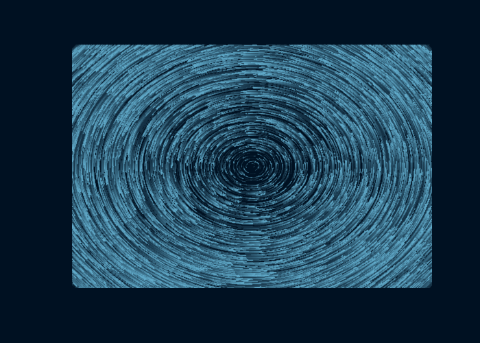

<!-- Generated by web/e2e/wiki.js - do not edit this page. Edit docs/wiki/examples/*.json, docs/wiki/notes/*.md or the generator, then run "npm run wiki" in web/. -->

WebGL vector field flow visualisation.

| | |
|---|---|
| Component id | `open.echarts.FlowGLChart` |
| Palette | **Open Components / ECharts 3D** → **Flow GL Chart** |
| Default size | 700 × 500 |
| WebGL | Needs ECharts-GL, which the browser downloads from the gateway the first time a 3D / WebGL component is shown, and a browser with WebGL enabled. |



*Flow GL Chart as dropped from the palette.* It takes any ECharts option in its `option` prop; the palette entry only decides which sample option a new component starts with.

<details>
<summary>Option of a freshly dropped component</summary>

```json
{
  "backgroundColor": "#001122",
  "xAxis": { "type": "value", "show": false, "min": -4, "max": 4 },
  "yAxis": { "type": "value", "show": false, "min": -3, "max": 3 },
  "series": [
    {
      "type": "flowGL",
      "data": [
        [-4, -3, 3, -4],
        [-3, -3, 3, -3],
        [-2, -3, 3, -2],
        [-1, -3, 3, -1],
        [0, -3, 3, 0],
        [1, -3, 3, 1],
        [2, -3, 3, 2],
        [3, -3, 3, 3],
        [4, -3, 3, 4],
        [-4, -2, 2, -4],
        [-3, -2, 2, -3],
        [-2, -2, 2, -2],
        [-1, -2, 2, -1],
        [0, -2, 2, 0],
        [1, -2, 2, 1],
        [2, -2, 2, 2],
        [3, -2, 2, 3],
        [4, -2, 2, 4],
        [-4, -1, 1, -4],
        [-3, -1, 1, -3],
        [-2, -1, 1, -2],
        [-1, -1, 1, -1],
        [0, -1, 1, 0],
        [1, -1, 1, 1],
        [2, -1, 1, 2],
        [3, -1, 1, 3],
        [4, -1, 1, 4],
        [-4, 0, 0, -4],
        [-3, 0, 0, -3],
        [-2, 0, 0, -2],
        [-1, 0, 0, -1],
        [0, 0, 0, 0],
        [1, 0, 0, 1],
        [2, 0, 0, 2],
        [3, 0, 0, 3],
        [4, 0, 0, 4],
        [-4, 1, -1, -4],
        [-3, 1, -1, -3],
        [-2, 1, -1, -2],
        [-1, 1, -1, -1],
        [0, 1, -1, 0],
        [1, 1, -1, 1],
        [2, 1, -1, 2],
        [3, 1, -1, 3],
        [4, 1, -1, 4],
        [-4, 2, -2, -4],
        [-3, 2, -2, -3],
        [-2, 2, -2, -2],
        [-1, 2, -2, -1],
        [0, 2, -2, 0],
        [1, 2, -2, 1],
        [2, 2, -2, 2],
        [3, 2, -2, 3],
        [4, 2, -2, 4],
        [-4, 3, -3, -4],
        [-3, 3, -3, -3],
        [-2, 3, -3, -2],
        [-1, 3, -3, -1],
        [0, 3, -3, 0],
        [1, 3, -3, 1],
        [2, 3, -3, 2],
        [3, 3, -3, 3],
        [4, 3, -3, 4]
      ],
      "particleDensity": 64,
      "particleSpeed": 1,
      "particleSize": 2,
      "itemStyle": { "color": "#7fdbff", "opacity": 0.8 }
    }
  ]
}
```

</details>

## Making your own

1. In the Designer, drag **Flow GL Chart** from the **Open Components / ECharts 3D** group of the Perspective component palette onto a view.
2. Edit the `option` prop in the Property Editor, or paste a complete option over it (right-click `option`, **Paste**). Any option from the [ECharts documentation](https://echarts.apache.org/en/option.html) works as long as it is plain JSON (no JavaScript functions).
3. Bind the parts of the option that hold data; see [Binding Data](Binding-Data).
