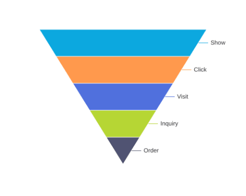
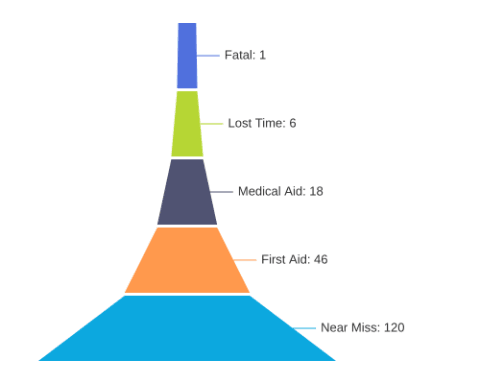
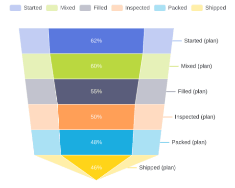

<!-- Generated by web/e2e/wiki.js - do not edit this page. Edit docs/wiki/examples/*.json, docs/wiki/notes/*.md or the generator, then run "npm run wiki" in web/. -->

Funnel and conversion pipeline charts.

| | |
|---|---|
| Component id | `open.echarts.FunnelChart` |
| Palette | **Open Components / ECharts** → **Funnel Chart** |
| Default size | 500 × 400 |



*Funnel Chart as dropped from the palette.* It takes any ECharts option in its `option` prop; the palette entry only decides which sample option a new component starts with.

<details>
<summary>Option of a freshly dropped component</summary>

```json
{
  "tooltip": { "trigger": "item" },
  "series": [
    {
      "type": "funnel",
      "data": [
        { "value": 60, "name": "Visit" },
        { "value": 40, "name": "Inquiry" },
        { "value": 20, "name": "Order" },
        { "value": 80, "name": "Click" },
        { "value": 100, "name": "Show" }
      ]
    }
  ]
}
```

</details>

## Examples

- [Pyramid](#pyramid): Funnel turned upside down (smallest on top) with gaps between the layers and labels beside them; a safety pyramid.
- [Funnel Compare](#funnel-compare): A translucent “expected” funnel behind a narrower “actual” one, with expected labels outside and actual values inside.

### Pyramid

Funnel turned upside down (smallest on top) with gaps between the layers and labels beside them; a safety pyramid.



**How to make it in Ignition**

1. In the Designer, drag **Funnel Chart** from the **Open Components / ECharts** group of the Perspective component palette onto a view.
2. Open **Option JSON** below and copy it. In the Property Editor, right-click the `option` property and choose **Paste**: the pasted JSON replaces the sample option. (See [Getting Started](Getting-Started) for other ways to enter an option.)
3. Replace the sample data with live data by binding these paths (expand `option` in the Property Editor down to the property, then use its binding icon). Everything else in the option stays as pasted.

   | Property | The binding must return |
   |---|---|
   | `props.option.series[0].data` | a list of objects: `[{ "name": "Good", "value": 90 }, ...]` (keep any other keys the example has, such as `itemStyle`) |

   Script transform for `props.option.series[0].data`, on a binding that returns a dataset with a `name` and a `value` column:

   ```python
   def transform(self, value, quality, timestamp):
       return [
           {"name": str(value.getValueAt(row, "name")), "value": value.getValueAt(row, "value")}
           for row in range(value.getRowCount())
       ]
   ```

4. Bind `series[0].data` to rows `{name, value}`; the chart orders them itself (`sort: "ascending"` puts the smallest on top).
5. Width is proportional to `value` between `min` and `max`; `minSize` / `maxSize` set the narrowest and widest layer.
6. Change the label text in `label.formatter` (`{b}` name, `{c}` value, `{d}` percent of the total).

<details>
<summary>Option JSON</summary>

```json
{
  "tooltip": { "trigger": "item", "formatter": "{b}: {c}" },
  "series": [
    {
      "type": "funnel",
      "sort": "ascending",
      "top": 24,
      "bottom": 24,
      "left": "8%",
      "width": "62%",
      "minSize": "6%",
      "gap": 3,
      "label": { "position": "right", "formatter": "{b}: {c}", "fontSize": 13 },
      "labelLine": { "length": 24 },
      "itemStyle": { "borderWidth": 0 },
      "data": [
        { "name": "Fatal", "value": 1 },
        { "name": "Lost Time", "value": 6 },
        { "name": "Medical Aid", "value": 18 },
        { "name": "First Aid", "value": 46 },
        { "name": "Near Miss", "value": 120 }
      ]
    }
  ]
}
```

</details>

### Funnel Compare

A translucent “expected” funnel behind a narrower “actual” one, with expected labels outside and actual values inside.



**How to make it in Ignition**

1. In the Designer, drag **Funnel Chart** from the **Open Components / ECharts** group of the Perspective component palette onto a view.
2. Open **Option JSON** below and copy it. In the Property Editor, right-click the `option` property and choose **Paste**: the pasted JSON replaces the sample option. (See [Getting Started](Getting-Started) for other ways to enter an option.)
3. Replace the sample data with live data by binding these paths (expand `option` in the Property Editor down to the property, then use its binding icon). Everything else in the option stays as pasted.

   | Property | The binding must return |
   |---|---|
   | `props.option.series[0].data` | a list of objects: `[{ "name": "Good", "value": 90 }, ...]` (keep any other keys the example has, such as `itemStyle`) |
   | `props.option.series[1].data` | a list of objects: `[{ "name": "Good", "value": 90 }, ...]` (keep any other keys the example has, such as `itemStyle`) |

   Script transform for `props.option.series[0].data`, on a binding that returns a dataset with a `name` and a `value` column:

   ```python
   def transform(self, value, quality, timestamp):
       return [
           {"name": str(value.getValueAt(row, "name")), "value": value.getValueAt(row, "value")}
           for row in range(value.getRowCount())
       ]
   ```

4. Two series share the same stage names: bind `series[0].data` to the expected values and `series[1].data` to the actual ones, both as `{name, value}` rows.
5. Both series must use the same `min` / `max` (here 0–100) so their widths are comparable; `sort: "none"` keeps the stage order of the data.
6. The legend shows the stages, not the two series; the tooltip shows the series name (`{a}`).

<details>
<summary>Option JSON</summary>

```json
{
  "tooltip": { "trigger": "item", "formatter": "{a}<br>{b}: {c}%" },
  "legend": { "top": 4, "data": ["Started", "Mixed", "Filled", "Inspected", "Packed", "Shipped"] },
  "series": [
    {
      "name": "Expected",
      "type": "funnel",
      "sort": "none",
      "top": 60,
      "bottom": 16,
      "left": "8%",
      "width": "66%",
      "min": 0,
      "max": 100,
      "label": { "formatter": "{b} (plan)", "opacity": 1 },
      "labelLine": { "show": true, "lineStyle": { "opacity": 1 } },
      "itemStyle": { "opacity": 0.35 },
      "emphasis": { "label": { "position": "inside", "formatter": "{b} plan: {c}%" } },
      "data": [
        { "name": "Started", "value": 100 },
        { "name": "Mixed", "value": 96 },
        { "name": "Filled", "value": 92 },
        { "name": "Inspected", "value": 88 },
        { "name": "Packed", "value": 84 },
        { "name": "Shipped", "value": 80 }
      ]
    },
    {
      "name": "Actual",
      "type": "funnel",
      "sort": "none",
      "top": 60,
      "bottom": 16,
      "left": "8%",
      "width": "66%",
      "min": 0,
      "max": 100,
      "maxSize": "100%",
      "label": { "position": "inside", "formatter": "{c}%", "color": "#fff" },
      "itemStyle": { "opacity": 0.9, "borderColor": "#fff", "borderWidth": 1 },
      "z": 100,
      "data": [
        { "name": "Started", "value": 62 },
        { "name": "Mixed", "value": 60 },
        { "name": "Filled", "value": 55 },
        { "name": "Inspected", "value": 50 },
        { "name": "Packed", "value": 48 },
        { "name": "Shipped", "value": 46 }
      ]
    }
  ]
}
```

</details>
