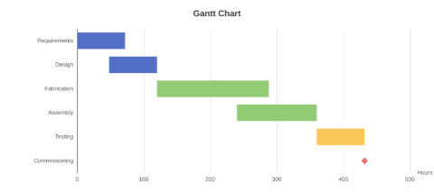

<!-- Generated by web/e2e/wiki.js - do not edit this page. Edit docs/wiki/examples/*.json, docs/wiki/notes/*.md or the generator, then run "npm run wiki" in web/. -->

Task scheduling with bars, milestones, and progress.

| | |
|---|---|
| Component id | `open.industrial.Gantt` |
| Palette | **Open Components / Scheduling** → **Gantt Chart** |
| Default size | 900 × 400 |



*Gantt Chart as dropped from the palette, showing its built-in sample data.*

This component builds its chart from the domain props below, so there is no ECharts option to write: bind the props to your tags and queries. (A non-empty `option` is an advanced override that replaces the generated chart.)

## How to use it in Ignition

1. In the Designer, drag **Gantt Chart** from the **Open Components / Scheduling** group of the Perspective component palette onto a view. It shows sample data.
2. Select it and replace the sample data in the Property Editor: type values, paste JSON (right-click a property, **Paste**), or add a binding.
3. Bind the data props to tags, tag history or named queries. The props and the shape each one expects are listed under [Props](#props); [Binding examples](#binding-examples) has worked examples.

## Binding examples

`tasks` is a list of `{ name, start, end }` objects with the times in epoch milliseconds; `progress`
(0-100), `category`, `color` and `milestone` are optional.

**Work orders from a named query.**

```sql
SELECT order_no, planned_start, planned_end, percent_complete, work_center
FROM work_orders
WHERE planned_end >= :from AND planned_start <= :to
ORDER BY planned_start
```

Bind it to `props.tasks` (Return Format: dataset):

```python
def transform(self, value, quality, timestamp):
    return [
        {
            "name": str(value.getValueAt(row, "order_no")),
            "start": value.getValueAt(row, "planned_start").getTime(),
            "end": value.getValueAt(row, "planned_end").getTime(),
            "progress": value.getValueAt(row, "percent_complete"),
            "category": str(value.getValueAt(row, "work_center")),
        }
        for row in range(value.getRowCount())
    ]
```

**Milestones.** A row with `"milestone": true` is drawn as a marker at its `start` (a delivery date, an
inspection); add such rows in the transform or with a `UNION` in the query.

Set `showProgress` to `false` when the schedule has no completion figures.

## Props

| Property | Type | Default | Description |
|---|---|---|---|
| `tasks` | array of object | sample data (6 items) | Gantt tasks: { name, start (epoch ms), end (epoch ms), progress?, category?, color?, milestone? }. Bind to your schedule data. |
| `showProgress` | boolean | `true` | Overlay each task's progress (percent, 0-100) on its bar. |
| `title` | string | `""` | Chart title. Leave blank for the default title. |

The shared props (`theme`, `renderer`, `notMerge`, `lazyUpdate`, `sanitizeTooltip`, ...) and the seven events are the same as on every component: see [Binding Data](Binding-Data), [Themes](Themes) and [Events](Events).
