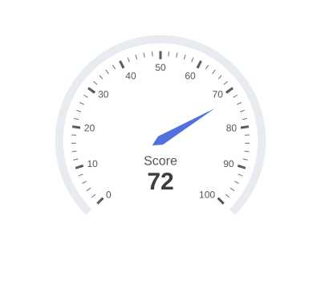
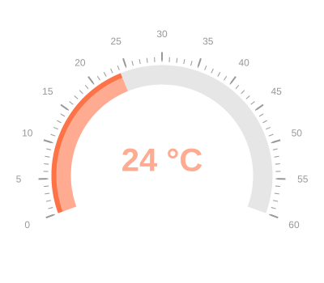
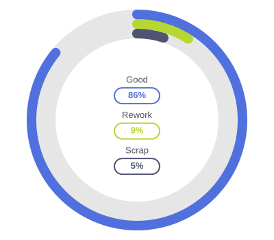
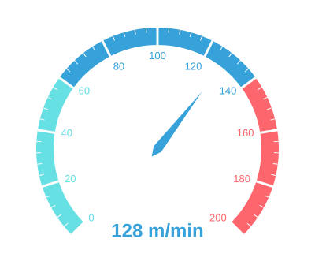
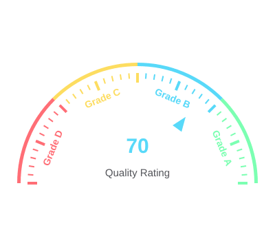
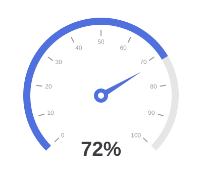
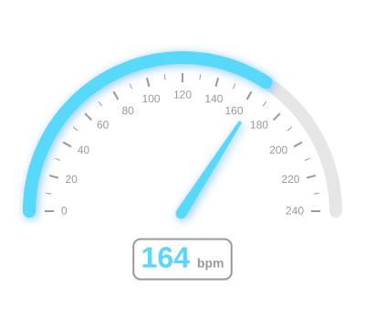
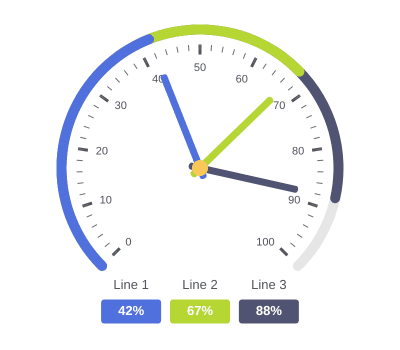
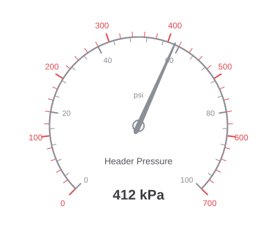

<!-- Generated by web/e2e/wiki.js - do not edit this page. Edit docs/wiki/examples/*.json, docs/wiki/notes/*.md or the generator, then run "npm run wiki" in web/. -->

Gauge, speed, progress, ring, temperature, and clock.

| | |
|---|---|
| Component id | `open.echarts.GaugeChart` |
| Palette | **Open Components / ECharts** → **Gauge Chart** |
| Default size | 400 × 350 |



*Gauge Chart as dropped from the palette.* It takes any ECharts option in its `option` prop; the palette entry only decides which sample option a new component starts with.

<details>
<summary>Option of a freshly dropped component</summary>

```json
{
  "series": [
    {
      "type": "gauge",
      "detail": { "valueAnimation": true },
      "data": [{ "value": 72, "name": "Score" }]
    }
  ]
}
```

</details>

## Examples

- [Temperature Gauge](#temperature-gauge): Thick progress arc with an outer tick scale and a large coloured value with unit.
- [Ring Gauge](#ring-gauge): Three concentric progress rings from one series with pill-shaped value labels in the centre.
- [Stage Speed Gauge](#stage-speed-gauge): Wide band in three coloured stages with ticks inside the band, a needle and a value with unit.
- [Grade Rating Gauge](#grade-rating-gauge): Semicircle with a thin four-colour arc, pointer triangle, score and caption; grade names come from a hidden pie series.
- [Progress Gauge](#progress-gauge): Classic dial whose band fills up to the value, with a ringed hub and a large value underneath.
- [Speed Gauge](#speed-gauge): Half dial with a rounded glowing progress arc, tapered needle and a boxed value with a small unit.
- [Multi Title Gauge](#multi-title-gauge): Three pointers on one dial, each with its own title and coloured value badge below.
- [Barometer Gauge](#barometer-gauge): Dual-scale dial: an outer scale in kPa and an inner scale in psi share one needle.

### Temperature Gauge

Thick progress arc with an outer tick scale and a large coloured value with unit.



**How to make it in Ignition**

1. In the Designer, drag **Gauge Chart** from the **Open Components / ECharts** group of the Perspective component palette onto a view.
2. Open **Option JSON** below and copy it. In the Property Editor, right-click the `option` property and choose **Paste**: the pasted JSON replaces the sample option. (See [Getting Started](Getting-Started) for other ways to enter an option.)
3. Replace the sample data with live data by binding these paths (expand `option` in the Property Editor down to the property, then use its binding icon). Everything else in the option stays as pasted.

   | Property | The binding must return |
   |---|---|
   | `props.option.series[0].data[0].value` | a number |
   | `props.option.series[1].data[0].value` | a number |

   A single number needs no script: put a **Tag** binding (or an expression binding) directly on the value.

4. Bind `series[0].data[0].value` and `series[1].data[0].value` to the same temperature tag (the second series is the thin darker rim).
5. Set `min` / `max` on both series to the engineering range; `splitNumber` controls how many numbered ticks appear.
6. Change the unit in `series[0].detail.formatter` (`{value} °C`). The two arc colours are `series[0].itemStyle.color` and `series[1].itemStyle.color`.
7. For a ready-made dial driven by simple props (value, min, max, unit), see the Dial Gauge component; use this option when you need full control.

<details>
<summary>Option JSON</summary>

```json
{
  "series": [
    {
      "type": "gauge",
      "center": ["50%", "62%"],
      "radius": "78%",
      "startAngle": 200,
      "endAngle": -20,
      "min": 0,
      "max": 60,
      "pointer": { "show": false },
      "splitNumber": 12,
      "itemStyle": { "color": "#FFAB91" },
      "progress": { "show": true, "width": 24 },
      "axisLine": { "lineStyle": { "width": 24, "color": [[1, "rgba(128,128,128,0.2)"]] } },
      "axisTick": { "distance": -34, "splitNumber": 5, "lineStyle": { "width": 1, "color": "#999" } },
      "splitLine": { "distance": -40, "length": 10, "lineStyle": { "width": 2, "color": "#999" } },
      "axisLabel": { "distance": -14, "color": "#999", "fontSize": 12 },
      "anchor": { "show": false },
      "title": { "show": false },
      "detail": {
        "valueAnimation": true,
        "offsetCenter": [0, "-12%"],
        "fontSize": 40,
        "fontWeight": "bolder",
        "formatter": "{value} °C",
        "color": "inherit"
      },
      "data": [{ "value": 24 }]
    },
    {
      "type": "gauge",
      "center": ["50%", "62%"],
      "radius": "78%",
      "startAngle": 200,
      "endAngle": -20,
      "min": 0,
      "max": 60,
      "pointer": { "show": false },
      "itemStyle": { "color": "#FD7347" },
      "progress": { "show": true, "width": 6 },
      "axisLine": { "show": false },
      "axisTick": { "show": false },
      "splitLine": { "show": false },
      "axisLabel": { "show": false },
      "detail": { "show": false },
      "data": [{ "value": 24 }]
    }
  ]
}
```

</details>

### Ring Gauge

Three concentric progress rings from one series with pill-shaped value labels in the centre.



**How to make it in Ignition**

1. In the Designer, drag **Gauge Chart** from the **Open Components / ECharts** group of the Perspective component palette onto a view.
2. Open **Option JSON** below and copy it. In the Property Editor, right-click the `option` property and choose **Paste**: the pasted JSON replaces the sample option. (See [Getting Started](Getting-Started) for other ways to enter an option.)
3. Replace the sample data with live data by binding these paths (expand `option` in the Property Editor down to the property, then use its binding icon). Everything else in the option stays as pasted.

   | Property | The binding must return |
   |---|---|
   | `props.option.series[0].data[0].value` | a number |
   | `props.option.series[0].data[1].value` | a number |
   | `props.option.series[0].data[2].value` | a number |

   A single number needs no script: put a **Tag** binding (or an expression binding) directly on the value.

4. Bind `series[0].data[0].value`, `data[1].value` and `data[2].value` to three percentages (0–100). Each data item draws one ring, from the outside in.
5. Rename the rings with `data[n].name`. Each item carries its own `title.offsetCenter` and `detail.offsetCenter`, which stack the captions in the centre: keep them when you bind, or bind only the `value` fields.
6. For a scale other than 0–100 set `series[0].min` / `max` and change `detail.formatter` (`{value}%`).
7. `axisLine.lineStyle.width` is the total band width shared by all rings; add a fourth data item and it is divided by four. `axisLine.lineStyle.color` is the neutral track behind the rings.

<details>
<summary>Option JSON</summary>

```json
{
  "series": [
    {
      "type": "gauge",
      "radius": "92%",
      "startAngle": 90,
      "endAngle": -270,
      "pointer": { "show": false },
      "progress": { "show": true, "overlap": false, "roundCap": true, "clip": false },
      "axisLine": { "lineStyle": { "width": 42, "color": [[1, "rgba(128,128,128,0.2)"]] } },
      "splitLine": { "show": false },
      "axisTick": { "show": false },
      "axisLabel": { "show": false },
      "title": { "fontSize": 13 },
      "detail": {
        "width": 46,
        "height": 13,
        "fontSize": 13,
        "color": "inherit",
        "borderColor": "inherit",
        "borderRadius": 20,
        "borderWidth": 1,
        "formatter": "{value}%"
      },
      "data": [
        {
          "value": 86,
          "name": "Good",
          "title": { "offsetCenter": ["0%", "-36%"] },
          "detail": { "valueAnimation": true, "offsetCenter": ["0%", "-22%"] }
        },
        {
          "value": 9,
          "name": "Rework",
          "title": { "offsetCenter": ["0%", "-4%"] },
          "detail": { "valueAnimation": true, "offsetCenter": ["0%", "10%"] }
        },
        {
          "value": 5,
          "name": "Scrap",
          "title": { "offsetCenter": ["0%", "28%"] },
          "detail": { "valueAnimation": true, "offsetCenter": ["0%", "42%"] }
        }
      ]
    }
  ]
}
```

</details>

### Stage Speed Gauge

Wide band in three coloured stages with ticks inside the band, a needle and a value with unit.



**How to make it in Ignition**

1. In the Designer, drag **Gauge Chart** from the **Open Components / ECharts** group of the Perspective component palette onto a view.
2. Open **Option JSON** below and copy it. In the Property Editor, right-click the `option` property and choose **Paste**: the pasted JSON replaces the sample option. (See [Getting Started](Getting-Started) for other ways to enter an option.)
3. Replace the sample data with live data by binding these paths (expand `option` in the Property Editor down to the property, then use its binding icon). Everything else in the option stays as pasted.

   | Property | The binding must return |
   |---|---|
   | `props.option.series[0].data[0].value` | a number |

   A single number needs no script: put a **Tag** binding (or an expression binding) directly on the value.

4. Bind `series[0].data[0].value` to the speed tag and `series[0].max` to the top of the range.
5. The stages are `series[0].axisLine.lineStyle.color`: a list of `[fraction, colour]` pairs where the fraction is the END of the stage as a share of the range (0.3 = 30 %). Bind it to move the limits at runtime.
6. The needle and the value take the colour of the stage they are in (`color: "auto"` / `"inherit"`). Change the unit in `detail.formatter`.

<details>
<summary>Option JSON</summary>

```json
{
  "series": [
    {
      "type": "gauge",
      "radius": "88%",
      "center": ["50%", "54%"],
      "min": 0,
      "max": 200,
      "axisLine": {
        "lineStyle": { "width": 22, "color": [[0.3, "#67e0e3"], [0.7, "#37a2da"], [1, "#fd666d"]] }
      },
      "pointer": { "itemStyle": { "color": "auto" } },
      "axisTick": { "distance": -22, "length": 6, "lineStyle": { "color": "#fff", "width": 1 } },
      "splitLine": { "distance": -22, "length": 22, "lineStyle": { "color": "#fff", "width": 3 } },
      "axisLabel": { "color": "inherit", "distance": 30, "fontSize": 13 },
      "detail": {
        "valueAnimation": true,
        "formatter": "{value} m/min",
        "color": "inherit",
        "fontSize": 24,
        "offsetCenter": [0, "68%"]
      },
      "data": [{ "value": 128 }]
    }
  ]
}
```

</details>

### Grade Rating Gauge

Semicircle with a thin four-colour arc, pointer triangle, score and caption; grade names come from a hidden pie series.



**How to make it in Ignition**

1. In the Designer, drag **Gauge Chart** from the **Open Components / ECharts** group of the Perspective component palette onto a view.
2. Open **Option JSON** below and copy it. In the Property Editor, right-click the `option` property and choose **Paste**: the pasted JSON replaces the sample option. (See [Getting Started](Getting-Started) for other ways to enter an option.)
3. Replace the sample data with live data by binding these paths (expand `option` in the Property Editor down to the property, then use its binding icon). Everything else in the option stays as pasted.

   | Property | The binding must return |
   |---|---|
   | `props.option.series[0].data[0].value` | a number |
   | `props.option.series[1].data` | a list of objects: `[{ "name": "Good", "value": 90 }, ...]` (keep any other keys the example has, such as `itemStyle`) |

   A single number needs no script: put a **Tag** binding (or an expression binding) directly on the value.

   Script transform for `props.option.series[1].data`, on a binding that returns a dataset with a `name` and a `value` column:

   ```python
   def transform(self, value, quality, timestamp):
       return [
           {"name": str(value.getValueAt(row, "name")), "value": value.getValueAt(row, "value")}
           for row in range(value.getRowCount())
       ]
   ```

4. Bind `series[0].data[0].value` to a score between `min` and `max` (0–100); `data[0].name` is the caption.
5. The band colours are `series[0].axisLine.lineStyle.color` as `[fraction, colour]` pairs.
6. The grade names are drawn by the second, invisible pie series (`series[1]`): one data item per band, left to right. Keep its `data` names, label colours and item count in sync with the bands; give an item a larger `value` if its band is wider.
7. ECharts can only label gauge ticks with a formatter function, which a JSON prop cannot hold; the hidden pie is the function-free way to get the same look.

<details>
<summary>Option JSON</summary>

```json
{
  "series": [
    {
      "type": "gauge",
      "startAngle": 180,
      "endAngle": 0,
      "center": ["50%", "76%"],
      "radius": "100%",
      "min": 0,
      "max": 100,
      "splitNumber": 8,
      "axisLine": {
        "lineStyle": {
          "width": 5,
          "color": [[0.25, "#FF6E76"], [0.5, "#FDDD60"], [0.75, "#58D9F9"], [1, "#7CFFB2"]]
        }
      },
      "pointer": {
        "icon": "path://M12.8,0.7l12,40.1H0.7L12.8,0.7z",
        "length": "12%",
        "width": 16,
        "offsetCenter": [0, "-56%"],
        "itemStyle": { "color": "auto" }
      },
      "axisTick": { "length": 8, "lineStyle": { "color": "auto", "width": 2 } },
      "splitLine": { "length": 14, "lineStyle": { "color": "auto", "width": 4 } },
      "axisLabel": { "show": false },
      "title": { "offsetCenter": [0, "-8%"], "fontSize": 15 },
      "detail": { "fontSize": 30, "offsetCenter": [0, "-30%"], "valueAnimation": true, "color": "inherit" },
      "data": [{ "value": 70, "name": "Quality Rating" }]
    },
    {
      "type": "pie",
      "silent": true,
      "startAngle": 180,
      "endAngle": 0,
      "center": ["50%", "76%"],
      "radius": ["64%", "84%"],
      "itemStyle": { "color": "transparent" },
      "label": {
        "position": "inside",
        "rotate": "tangential",
        "fontSize": 14,
        "fontWeight": "bold",
        "textBorderWidth": 0
      },
      "labelLine": { "show": false },
      "emphasis": { "disabled": true },
      "tooltip": { "show": false },
      "data": [
        { "name": "Grade D", "value": 1, "label": { "color": "#FF6E76" } },
        { "name": "Grade C", "value": 1, "label": { "color": "#FDDD60" } },
        { "name": "Grade B", "value": 1, "label": { "color": "#58D9F9" } },
        { "name": "Grade A", "value": 1, "label": { "color": "#7CFFB2" } }
      ]
    }
  ]
}
```

</details>

### Progress Gauge

Classic dial whose band fills up to the value, with a ringed hub and a large value underneath.



**How to make it in Ignition**

1. In the Designer, drag **Gauge Chart** from the **Open Components / ECharts** group of the Perspective component palette onto a view.
2. Open **Option JSON** below and copy it. In the Property Editor, right-click the `option` property and choose **Paste**: the pasted JSON replaces the sample option. (See [Getting Started](Getting-Started) for other ways to enter an option.)
3. Replace the sample data with live data by binding these paths (expand `option` in the Property Editor down to the property, then use its binding icon). Everything else in the option stays as pasted.

   | Property | The binding must return |
   |---|---|
   | `props.option.series[0].data[0].value` | a number |

   A single number needs no script: put a **Tag** binding (or an expression binding) directly on the value.

4. Bind `series[0].data[0].value` to the tag; set `min` / `max` for a range other than 0–100.
5. Change or remove the unit in `series[0].detail.formatter`.
6. The filled band and the needle use the first theme colour; set `series[0].itemStyle.color` to override it, or bind it for an alarm colour. The unfilled track is `axisLine.lineStyle.color`.

<details>
<summary>Option JSON</summary>

```json
{
  "series": [
    {
      "type": "gauge",
      "radius": "88%",
      "center": ["50%", "54%"],
      "progress": { "show": true, "width": 14 },
      "axisLine": { "lineStyle": { "width": 14, "color": [[1, "rgba(128,128,128,0.2)"]] } },
      "axisTick": { "show": false },
      "splitLine": { "length": 12, "lineStyle": { "width": 2, "color": "#999" } },
      "axisLabel": { "distance": 20, "color": "#999", "fontSize": 12 },
      "anchor": { "show": true, "showAbove": true, "size": 20, "itemStyle": { "borderWidth": 8 } },
      "title": { "show": false },
      "detail": {
        "valueAnimation": true,
        "fontSize": 40,
        "offsetCenter": [0, "70%"],
        "formatter": "{value}%"
      },
      "data": [{ "value": 72 }]
    }
  ]
}
```

</details>

### Speed Gauge

Half dial with a rounded glowing progress arc, tapered needle and a boxed value with a small unit.



**How to make it in Ignition**

1. In the Designer, drag **Gauge Chart** from the **Open Components / ECharts** group of the Perspective component palette onto a view.
2. Open **Option JSON** below and copy it. In the Property Editor, right-click the `option` property and choose **Paste**: the pasted JSON replaces the sample option. (See [Getting Started](Getting-Started) for other ways to enter an option.)
3. Replace the sample data with live data by binding these paths (expand `option` in the Property Editor down to the property, then use its binding icon). Everything else in the option stays as pasted.

   | Property | The binding must return |
   |---|---|
   | `props.option.series[0].data[0].value` | a number |

   A single number needs no script: put a **Tag** binding (or an expression binding) directly on the value.

4. Bind `series[0].data[0].value` to the speed tag and `series[0].max` to the top of the range (keep `splitNumber` a divisor of the range for round tick labels).
5. The value box uses rich text: `detail.formatter` is `{value|{value}}{unit|bpm}`; replace `bpm` with your unit and style the two parts under `detail.rich`.
6. Arc and needle colour: `series[0].itemStyle.color` (and `shadowColor` for the glow).

<details>
<summary>Option JSON</summary>

```json
{
  "series": [
    {
      "type": "gauge",
      "startAngle": 180,
      "endAngle": 0,
      "center": ["50%", "66%"],
      "radius": "100%",
      "min": 0,
      "max": 240,
      "splitNumber": 12,
      "itemStyle": {
        "color": "#58D9F9",
        "shadowColor": "rgba(0,138,255,0.45)",
        "shadowBlur": 10,
        "shadowOffsetX": 2,
        "shadowOffsetY": 2
      },
      "progress": { "show": true, "roundCap": true, "width": 14 },
      "pointer": {
        "icon": "path://M6.5,0 C7.6,0 8.5,0.9 8.6,2 L13,113.5 C13.2,117.1 10.3,120 6.5,120 C2.7,120 -0.2,117.1 0,113.5 L4.4,2 C4.5,0.9 5.4,0 6.5,0 Z",
        "length": "72%",
        "width": 12,
        "offsetCenter": [0, "5%"]
      },
      "axisLine": { "roundCap": true, "lineStyle": { "width": 14, "color": [[1, "rgba(128,128,128,0.2)"]] } },
      "axisTick": { "splitNumber": 2, "lineStyle": { "width": 1, "color": "#999" } },
      "splitLine": { "length": 10, "lineStyle": { "width": 2, "color": "#999" } },
      "axisLabel": { "distance": 22, "color": "#999", "fontSize": 12 },
      "title": { "show": false },
      "detail": {
        "borderColor": "#999",
        "borderWidth": 1,
        "width": "50%",
        "lineHeight": 34,
        "height": 34,
        "borderRadius": 8,
        "offsetCenter": [0, "30%"],
        "valueAnimation": true,
        "formatter": "{value|{value}}{unit|bpm}",
        "rich": {
          "value": { "fontSize": 32, "fontWeight": "bolder", "color": "inherit" },
          "unit": { "fontSize": 14, "color": "#999", "padding": [0, 0, -10, 8] }
        }
      },
      "data": [{ "value": 164 }]
    }
  ]
}
```

</details>

### Multi Title Gauge

Three pointers on one dial, each with its own title and coloured value badge below.



**How to make it in Ignition**

1. In the Designer, drag **Gauge Chart** from the **Open Components / ECharts** group of the Perspective component palette onto a view.
2. Open **Option JSON** below and copy it. In the Property Editor, right-click the `option` property and choose **Paste**: the pasted JSON replaces the sample option. (See [Getting Started](Getting-Started) for other ways to enter an option.)
3. Replace the sample data with live data by binding these paths (expand `option` in the Property Editor down to the property, then use its binding icon). Everything else in the option stays as pasted.

   | Property | The binding must return |
   |---|---|
   | `props.option.series[0].data[0].value` | a number |
   | `props.option.series[0].data[1].value` | a number |
   | `props.option.series[0].data[2].value` | a number |

   A single number needs no script: put a **Tag** binding (or an expression binding) directly on the value.

4. Bind `series[0].data[0].value`, `data[1].value`, `data[2].value` to three tags that share one scale; each item draws its own pointer and progress arc.
5. Each data item positions its caption and value badge with `title.offsetCenter` / `detail.offsetCenter` (percent of the radius from the centre). Add a fourth item by spacing the x offsets, e.g. -60 %, -20 %, 20 %, 60 %.
6. The pointers take the theme colours in order; set `data[n].itemStyle.color` to fix one.

<details>
<summary>Option JSON</summary>

```json
{
  "series": [
    {
      "type": "gauge",
      "radius": "82%",
      "center": ["50%", "48%"],
      "anchor": { "show": true, "showAbove": true, "size": 16, "itemStyle": { "color": "#FAC858" } },
      "pointer": {
        "icon": "path://M2.9,0.7L2.9,0.7c1.4,0,2.6,1.2,2.6,2.6v115c0,1.4-1.2,2.6-2.6,2.6l0,0c-1.4,0-2.6-1.2-2.6-2.6V3.3C0.3,1.9,1.4,0.7,2.9,0.7z",
        "width": 7,
        "length": "78%",
        "offsetCenter": [0, "8%"]
      },
      "progress": { "show": true, "overlap": true, "roundCap": true },
      "axisLine": { "roundCap": true, "lineStyle": { "color": [[1, "rgba(128,128,128,0.2)"]] } },
      "axisLabel": { "fontSize": 11, "distance": 18 },
      "title": { "fontSize": 13 },
      "detail": {
        "width": 40,
        "height": 14,
        "fontSize": 13,
        "color": "#fff",
        "backgroundColor": "inherit",
        "borderRadius": 3,
        "formatter": "{value}%"
      },
      "data": [
        {
          "value": 42,
          "name": "Line 1",
          "title": { "offsetCenter": ["-48%", "82%"] },
          "detail": { "offsetCenter": ["-48%", "100%"] }
        },
        {
          "value": 67,
          "name": "Line 2",
          "title": { "offsetCenter": ["0%", "82%"] },
          "detail": { "offsetCenter": ["0%", "100%"] }
        },
        {
          "value": 88,
          "name": "Line 3",
          "title": { "offsetCenter": ["48%", "82%"] },
          "detail": { "offsetCenter": ["48%", "100%"] }
        }
      ]
    }
  ]
}
```

</details>

### Barometer Gauge

Dual-scale dial: an outer scale in kPa and an inner scale in psi share one needle.



**How to make it in Ignition**

1. In the Designer, drag **Gauge Chart** from the **Open Components / ECharts** group of the Perspective component palette onto a view.
2. Open **Option JSON** below and copy it. In the Property Editor, right-click the `option` property and choose **Paste**: the pasted JSON replaces the sample option. (See [Getting Started](Getting-Started) for other ways to enter an option.)
3. Replace the sample data with live data by binding these paths (expand `option` in the Property Editor down to the property, then use its binding icon). Everything else in the option stays as pasted.

   | Property | The binding must return |
   |---|---|
   | `props.option.series[0].data[0].value` | a number |
   | `props.option.series[1].data` | a list of objects with the keys of the example (`name`) |

   A single number needs no script: put a **Tag** binding (or an expression binding) directly on the value.

   For `series[1].data` build the same structure as the example in a script transform or a project script; [Binding Data](Binding-Data) shows the pattern.

4. Bind `series[0].data[0].value` to the reading in the OUTER unit (kPa here). Only the first series has a needle.
5. The inner scale is a second gauge series with no pointer. It is not linked to the outer one: choose `series[1].max` so both scales describe the same range (700 kPa is about 100 psi).
6. Captions: `series[0].data[0].name` (measurement) and `series[1].data[0].name` (inner unit). The outer unit is in `series[0].detail.formatter`.

<details>
<summary>Option JSON</summary>

```json
{
  "series": [
    {
      "type": "gauge",
      "min": 0,
      "max": 700,
      "splitNumber": 7,
      "radius": "74%",
      "center": ["50%", "52%"],
      "axisLine": { "lineStyle": { "color": [[1, "#e5484d"]], "width": 2 } },
      "splitLine": { "distance": -14, "length": 14, "lineStyle": { "color": "#e5484d", "width": 2 } },
      "axisTick": { "distance": -9, "length": 7, "lineStyle": { "color": "#e5484d" } },
      "axisLabel": { "distance": -30, "color": "#e5484d", "fontSize": 12 },
      "anchor": { "show": true, "size": 16, "itemStyle": { "borderColor": "#8a8f98", "borderWidth": 2 } },
      "pointer": {
        "offsetCenter": [0, "10%"],
        "icon": "path://M6.5,0 C7.6,0 8.5,0.9 8.6,2 L13,113.5 C13.2,117.1 10.3,120 6.5,120 C2.7,120 -0.2,117.1 0,113.5 L4.4,2 C4.5,0.9 5.4,0 6.5,0 Z",
        "length": "112%",
        "width": 8,
        "itemStyle": { "color": "#8a8f98" }
      },
      "detail": {
        "valueAnimation": true,
        "fontSize": 20,
        "formatter": "{value} kPa",
        "offsetCenter": [0, "78%"]
      },
      "title": { "offsetCenter": [0, "40%"], "fontSize": 13 },
      "data": [{ "value": 412, "name": "Header Pressure" }]
    },
    {
      "type": "gauge",
      "min": 0,
      "max": 100,
      "splitNumber": 5,
      "radius": "74%",
      "center": ["50%", "52%"],
      "axisLine": { "lineStyle": { "color": [[1, "#8a8f98"]], "width": 2 } },
      "splitLine": { "distance": -2, "length": 12, "lineStyle": { "color": "#8a8f98", "width": 2 } },
      "axisTick": { "distance": 0, "length": 6, "lineStyle": { "color": "#8a8f98" } },
      "axisLabel": { "distance": 8, "fontSize": 11, "color": "#8a8f98" },
      "pointer": { "show": false },
      "title": { "offsetCenter": [0, "-34%"], "fontSize": 11, "color": "#8a8f98" },
      "detail": { "show": false },
      "data": [{ "name": "psi" }]
    }
  ]
}
```

</details>
