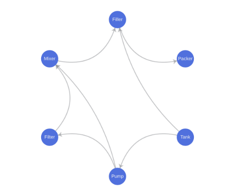
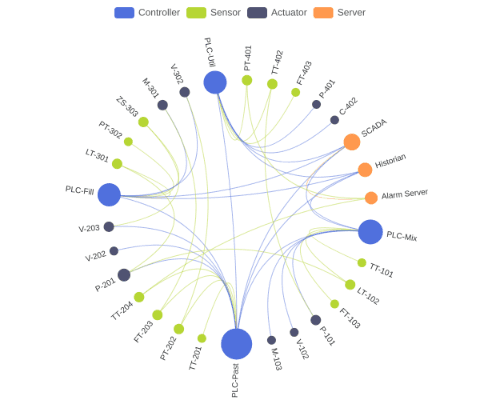
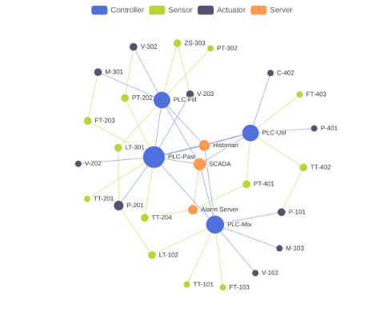
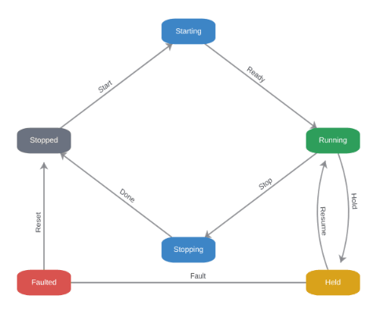
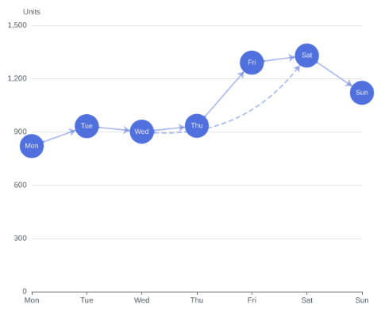

<!-- Generated by web/e2e/wiki.js - do not edit this page. Edit docs/wiki/examples/*.json, docs/wiki/notes/*.md or the generator, then run "npm run wiki" in web/. -->

Force, circular, and grid graph networks.

| | |
|---|---|
| Component id | `open.echarts.GraphChart` |
| Palette | **Open Components / ECharts** → **Graph Chart** |
| Default size | 600 × 500 |



*Graph Chart as dropped from the palette.* It takes any ECharts option in its `option` prop; the palette entry only decides which sample option a new component starts with.

<details>
<summary>Option of a freshly dropped component</summary>

```json
{
  "tooltip": {},
  "series": [
    {
      "type": "graph",
      "layout": "circular",
      "roam": true,
      "symbolSize": 44,
      "label": { "show": true },
      "lineStyle": { "width": 2, "curveness": 0.2 },
      "edgeSymbol": ["none", "arrow"],
      "data": [
        { "name": "Tank" },
        { "name": "Pump" },
        { "name": "Filter" },
        { "name": "Mixer" },
        { "name": "Filler" },
        { "name": "Packer" }
      ],
      "links": [
        { "source": "Tank", "target": "Pump" },
        { "source": "Pump", "target": "Filter" },
        { "source": "Filter", "target": "Mixer" },
        { "source": "Mixer", "target": "Filler" },
        { "source": "Filler", "target": "Packer" },
        { "source": "Pump", "target": "Mixer" },
        { "source": "Tank", "target": "Filler" }
      ]
    }
  ]
}
```

</details>

## Examples

- [Circular Network](#circular-network): Nodes on a circle grouped by category, sized by number of connections, with curved edges coloured by their source.
- [Force Layout Network](#force-layout-network): Self-arranging force-directed layout with categories, a legend and draggable nodes.
- [State Machine](#state-machine): Directed graph with fixed node positions, arrow heads and labelled transitions.
- [Graph on Cartesian](#graph-on-cartesian): Graph nodes placed on ordinary x/y axes and joined by arrows; values on a category axis.

### Circular Network

Nodes on a circle grouped by category, sized by number of connections, with curved edges coloured by their source.



**How to make it in Ignition**

1. In the Designer, drag **Graph Chart** from the **Open Components / ECharts** group of the Perspective component palette onto a view.
2. Open **Option JSON** below and copy it. In the Property Editor, right-click the `option` property and choose **Paste**: the pasted JSON replaces the sample option. (See [Getting Started](Getting-Started) for other ways to enter an option.)
3. Replace the sample data with live data by binding these paths (expand `option` in the Property Editor down to the property, then use its binding icon). Everything else in the option stays as pasted.

   | Property | The binding must return |
   |---|---|
   | `props.option.series[0].data` | a list of objects: `[{ "name": "Good", "value": 90 }, ...]` (keep any other keys the example has, such as `itemStyle`) |
   | `props.option.series[0].links` | a list of objects with the keys of the example (`source`, `target`) |

   Script transform for `props.option.series[0].data`, on a binding that returns a dataset with a `name` and a `value` column:

   ```python
   def transform(self, value, quality, timestamp):
       return [
           {"name": str(value.getValueAt(row, "name")), "value": value.getValueAt(row, "value")}
           for row in range(value.getRowCount())
       ]
   ```

   For `series[0].links` build the same structure as the example in a script transform or a project script; [Binding Data](Binding-Data) shows the pattern.

4. Bind `series[0].data` to nodes `{name, category, value, symbolSize}` and `series[0].links` to edges `{source, target}` (node names).
5. `category` is an index into `series[0].categories`; the legend lists the same names. Nodes are placed in data order, so sort them by category to keep the groups together.
6. Node size is not computed: write `symbolSize` per node (here 8 px plus 2.6 px per connection) in the query or a script transform.
7. The four margins leave room for the rotated labels; increase them for longer names.

<details>
<summary>Option JSON</summary>

```json
{
  "tooltip": {},
  "legend": [{ "data": ["Controller", "Sensor", "Actuator", "Server"], "top": 4 }],
  "animationDurationUpdate": 1500,
  "animationEasingUpdate": "quinticInOut",
  "series": [
    {
      "name": "Tag dependencies",
      "type": "graph",
      "layout": "circular",
      "circular": { "rotateLabel": true },
      "top": 100,
      "bottom": 70,
      "left": 120,
      "right": 120,
      "roam": true,
      "data": [
        { "name": "PLC-Mix", "category": 0, "value": 9, "symbolSize": 31 },
        { "name": "TT-101", "category": 1, "value": 1, "symbolSize": 11 },
        { "name": "LT-102", "category": 1, "value": 2, "symbolSize": 13 },
        { "name": "FT-103", "category": 1, "value": 1, "symbolSize": 11 },
        { "name": "P-101", "category": 2, "value": 2, "symbolSize": 13 },
        { "name": "V-102", "category": 2, "value": 1, "symbolSize": 11 },
        { "name": "M-103", "category": 2, "value": 1, "symbolSize": 11 },
        { "name": "PLC-Past", "category": 0, "value": 12, "symbolSize": 39 },
        { "name": "TT-201", "category": 1, "value": 1, "symbolSize": 11 },
        { "name": "PT-202", "category": 1, "value": 2, "symbolSize": 13 },
        { "name": "FT-203", "category": 1, "value": 2, "symbolSize": 13 },
        { "name": "TT-204", "category": 1, "value": 2, "symbolSize": 13 },
        { "name": "P-201", "category": 2, "value": 3, "symbolSize": 16 },
        { "name": "V-202", "category": 2, "value": 1, "symbolSize": 11 },
        { "name": "V-203", "category": 2, "value": 2, "symbolSize": 13 },
        { "name": "PLC-Fill", "category": 0, "value": 8, "symbolSize": 29 },
        { "name": "LT-301", "category": 1, "value": 2, "symbolSize": 13 },
        { "name": "PT-302", "category": 1, "value": 1, "symbolSize": 11 },
        { "name": "ZS-303", "category": 1, "value": 2, "symbolSize": 13 },
        { "name": "M-301", "category": 2, "value": 2, "symbolSize": 13 },
        { "name": "V-302", "category": 2, "value": 2, "symbolSize": 13 },
        { "name": "PLC-Util", "category": 0, "value": 8, "symbolSize": 29 },
        { "name": "PT-401", "category": 1, "value": 2, "symbolSize": 13 },
        { "name": "TT-402", "category": 1, "value": 2, "symbolSize": 13 },
        { "name": "FT-403", "category": 1, "value": 1, "symbolSize": 11 },
        { "name": "P-401", "category": 2, "value": 1, "symbolSize": 11 },
        { "name": "C-402", "category": 2, "value": 1, "symbolSize": 11 },
        { "name": "SCADA", "category": 3, "value": 5, "symbolSize": 21 },
        { "name": "Historian", "category": 3, "value": 4, "symbolSize": 18 },
        { "name": "Alarm Server", "category": 3, "value": 3, "symbolSize": 16 }
      ],
      "links": [
        { "source": "TT-101", "target": "PLC-Mix" },
        { "source": "LT-102", "target": "PLC-Mix" },
        { "source": "FT-103", "target": "PLC-Mix" },
        { "source": "PLC-Mix", "target": "P-101" },
        { "source": "PLC-Mix", "target": "V-102" },
        { "source": "PLC-Mix", "target": "M-103" },
        { "source": "TT-201", "target": "PLC-Past" },
        { "source": "PT-202", "target": "PLC-Past" },
        { "source": "FT-203", "target": "PLC-Past" },
        { "source": "TT-204", "target": "PLC-Past" },
        { "source": "PLC-Past", "target": "P-201" },
        { "source": "PLC-Past", "target": "V-202" },
        { "source": "PLC-Past", "target": "V-203" },
        { "source": "LT-301", "target": "PLC-Fill" },
        { "source": "PT-302", "target": "PLC-Fill" },
        { "source": "ZS-303", "target": "PLC-Fill" },
        { "source": "PLC-Fill", "target": "M-301" },
        { "source": "PLC-Fill", "target": "V-302" },
        { "source": "PT-401", "target": "PLC-Util" },
        { "source": "TT-402", "target": "PLC-Util" },
        { "source": "FT-403", "target": "PLC-Util" },
        { "source": "PLC-Util", "target": "P-401" },
        { "source": "PLC-Util", "target": "C-402" },
        { "source": "PLC-Mix", "target": "SCADA" },
        { "source": "PLC-Mix", "target": "Historian" },
        { "source": "PLC-Past", "target": "SCADA" },
        { "source": "PLC-Past", "target": "Historian" },
        { "source": "PLC-Fill", "target": "SCADA" },
        { "source": "PLC-Fill", "target": "Historian" },
        { "source": "PLC-Util", "target": "SCADA" },
        { "source": "PLC-Util", "target": "Historian" },
        { "source": "SCADA", "target": "Alarm Server" },
        { "source": "PLC-Mix", "target": "PLC-Past" },
        { "source": "PLC-Past", "target": "PLC-Fill" },
        { "source": "PLC-Util", "target": "PLC-Past" },
        { "source": "LT-102", "target": "P-201" },
        { "source": "PT-202", "target": "V-302" },
        { "source": "TT-204", "target": "Alarm Server" },
        { "source": "PT-401", "target": "Alarm Server" },
        { "source": "FT-203", "target": "M-301" },
        { "source": "TT-402", "target": "P-101" },
        { "source": "ZS-303", "target": "V-203" },
        { "source": "LT-301", "target": "P-201" }
      ],
      "categories": [{ "name": "Controller" }, { "name": "Sensor" }, { "name": "Actuator" }, { "name": "Server" }],
      "label": { "show": true, "position": "right", "formatter": "{b}", "fontSize": 10 },
      "lineStyle": { "color": "source", "curveness": 0.3 },
      "emphasis": { "focus": "adjacency", "lineStyle": { "width": 3 } }
    }
  ]
}
```

</details>

### Force Layout Network

Self-arranging force-directed layout with categories, a legend and draggable nodes.



**How to make it in Ignition**

1. In the Designer, drag **Graph Chart** from the **Open Components / ECharts** group of the Perspective component palette onto a view.
2. Open **Option JSON** below and copy it. In the Property Editor, right-click the `option` property and choose **Paste**: the pasted JSON replaces the sample option. (See [Getting Started](Getting-Started) for other ways to enter an option.)
3. Replace the sample data with live data by binding these paths (expand `option` in the Property Editor down to the property, then use its binding icon). Everything else in the option stays as pasted.

   | Property | The binding must return |
   |---|---|
   | `props.option.series[0].data` | a list of objects: `[{ "name": "Good", "value": 90 }, ...]` (keep any other keys the example has, such as `itemStyle`) |
   | `props.option.series[0].links` | a list of objects with the keys of the example (`source`, `target`) |

   Script transform for `props.option.series[0].data`, on a binding that returns a dataset with a `name` and a `value` column:

   ```python
   def transform(self, value, quality, timestamp):
       return [
           {"name": str(value.getValueAt(row, "name")), "value": value.getValueAt(row, "value")}
           for row in range(value.getRowCount())
       ]
   ```

   For `series[0].links` build the same structure as the example in a script transform or a project script; [Binding Data](Binding-Data) shows the pattern.

4. Bind `series[0].data` to nodes `{name, category, value, symbolSize}` and `series[0].links` to `{source, target}`.
5. Tune the layout under `series[0].force`: `repulsion` pushes nodes apart, `edgeLength` is the preferred link length (`[min, max]`), `gravity` pulls everything to the centre.
6. The layout is recalculated whenever the data binding delivers a new list, so nodes can move. For a stable picture bind rarely, or use the circular or fixed-position examples.
7. `labelLayout.hideOverlap` drops labels that would collide.

<details>
<summary>Option JSON</summary>

```json
{
  "tooltip": {},
  "legend": [{ "data": ["Controller", "Sensor", "Actuator", "Server"], "top": 4 }],
  "series": [
    {
      "name": "Tag dependencies",
      "type": "graph",
      "layout": "force",
      "top": 50,
      "roam": true,
      "draggable": true,
      "force": { "repulsion": 260, "edgeLength": [40, 90], "gravity": 0.2, "layoutAnimation": false },
      "data": [
        { "name": "PLC-Mix", "category": 0, "value": 9, "symbolSize": 28 },
        { "name": "TT-101", "category": 1, "value": 1, "symbolSize": 10 },
        { "name": "LT-102", "category": 1, "value": 2, "symbolSize": 12 },
        { "name": "FT-103", "category": 1, "value": 1, "symbolSize": 10 },
        { "name": "P-101", "category": 2, "value": 2, "symbolSize": 12 },
        { "name": "V-102", "category": 2, "value": 1, "symbolSize": 10 },
        { "name": "M-103", "category": 2, "value": 1, "symbolSize": 10 },
        { "name": "PLC-Past", "category": 0, "value": 12, "symbolSize": 34 },
        { "name": "TT-201", "category": 1, "value": 1, "symbolSize": 10 },
        { "name": "PT-202", "category": 1, "value": 2, "symbolSize": 12 },
        { "name": "FT-203", "category": 1, "value": 2, "symbolSize": 12 },
        { "name": "TT-204", "category": 1, "value": 2, "symbolSize": 12 },
        { "name": "P-201", "category": 2, "value": 3, "symbolSize": 15 },
        { "name": "V-202", "category": 2, "value": 1, "symbolSize": 10 },
        { "name": "V-203", "category": 2, "value": 2, "symbolSize": 12 },
        { "name": "PLC-Fill", "category": 0, "value": 8, "symbolSize": 26 },
        { "name": "LT-301", "category": 1, "value": 2, "symbolSize": 12 },
        { "name": "PT-302", "category": 1, "value": 1, "symbolSize": 10 },
        { "name": "ZS-303", "category": 1, "value": 2, "symbolSize": 12 },
        { "name": "M-301", "category": 2, "value": 2, "symbolSize": 12 },
        { "name": "V-302", "category": 2, "value": 2, "symbolSize": 12 },
        { "name": "PLC-Util", "category": 0, "value": 8, "symbolSize": 26 },
        { "name": "PT-401", "category": 1, "value": 2, "symbolSize": 12 },
        { "name": "TT-402", "category": 1, "value": 2, "symbolSize": 12 },
        { "name": "FT-403", "category": 1, "value": 1, "symbolSize": 10 },
        { "name": "P-401", "category": 2, "value": 1, "symbolSize": 10 },
        { "name": "C-402", "category": 2, "value": 1, "symbolSize": 10 },
        { "name": "SCADA", "category": 3, "value": 5, "symbolSize": 19 },
        { "name": "Historian", "category": 3, "value": 4, "symbolSize": 17 },
        { "name": "Alarm Server", "category": 3, "value": 3, "symbolSize": 15 }
      ],
      "links": [
        { "source": "TT-101", "target": "PLC-Mix" },
        { "source": "LT-102", "target": "PLC-Mix" },
        { "source": "FT-103", "target": "PLC-Mix" },
        { "source": "PLC-Mix", "target": "P-101" },
        { "source": "PLC-Mix", "target": "V-102" },
        { "source": "PLC-Mix", "target": "M-103" },
        { "source": "TT-201", "target": "PLC-Past" },
        { "source": "PT-202", "target": "PLC-Past" },
        { "source": "FT-203", "target": "PLC-Past" },
        { "source": "TT-204", "target": "PLC-Past" },
        { "source": "PLC-Past", "target": "P-201" },
        { "source": "PLC-Past", "target": "V-202" },
        { "source": "PLC-Past", "target": "V-203" },
        { "source": "LT-301", "target": "PLC-Fill" },
        { "source": "PT-302", "target": "PLC-Fill" },
        { "source": "ZS-303", "target": "PLC-Fill" },
        { "source": "PLC-Fill", "target": "M-301" },
        { "source": "PLC-Fill", "target": "V-302" },
        { "source": "PT-401", "target": "PLC-Util" },
        { "source": "TT-402", "target": "PLC-Util" },
        { "source": "FT-403", "target": "PLC-Util" },
        { "source": "PLC-Util", "target": "P-401" },
        { "source": "PLC-Util", "target": "C-402" },
        { "source": "PLC-Mix", "target": "SCADA" },
        { "source": "PLC-Mix", "target": "Historian" },
        { "source": "PLC-Past", "target": "SCADA" },
        { "source": "PLC-Past", "target": "Historian" },
        { "source": "PLC-Fill", "target": "SCADA" },
        { "source": "PLC-Fill", "target": "Historian" },
        { "source": "PLC-Util", "target": "SCADA" },
        { "source": "PLC-Util", "target": "Historian" },
        { "source": "SCADA", "target": "Alarm Server" },
        { "source": "PLC-Mix", "target": "PLC-Past" },
        { "source": "PLC-Past", "target": "PLC-Fill" },
        { "source": "PLC-Util", "target": "PLC-Past" },
        { "source": "LT-102", "target": "P-201" },
        { "source": "PT-202", "target": "V-302" },
        { "source": "TT-204", "target": "Alarm Server" },
        { "source": "PT-401", "target": "Alarm Server" },
        { "source": "FT-203", "target": "M-301" },
        { "source": "TT-402", "target": "P-101" },
        { "source": "ZS-303", "target": "V-203" },
        { "source": "LT-301", "target": "P-201" }
      ],
      "categories": [{ "name": "Controller" }, { "name": "Sensor" }, { "name": "Actuator" }, { "name": "Server" }],
      "label": { "show": true, "position": "right", "fontSize": 10 },
      "labelLayout": { "hideOverlap": true },
      "lineStyle": { "color": "source", "opacity": 0.6 },
      "emphasis": { "focus": "adjacency", "lineStyle": { "width": 3 } }
    }
  ]
}
```

</details>

### State Machine

Directed graph with fixed node positions, arrow heads and labelled transitions.



**How to make it in Ignition**

1. In the Designer, drag **Graph Chart** from the **Open Components / ECharts** group of the Perspective component palette onto a view.
2. Open **Option JSON** below and copy it. In the Property Editor, right-click the `option` property and choose **Paste**: the pasted JSON replaces the sample option. (See [Getting Started](Getting-Started) for other ways to enter an option.)
3. Replace the sample data with live data by binding these paths (expand `option` in the Property Editor down to the property, then use its binding icon). Everything else in the option stays as pasted.

   | Property | The binding must return |
   |---|---|
   | `props.option.series[0].data` | a list of objects with the keys of the example (`name`, `x`, `y`, `itemStyle`) |
   | `props.option.series[0].links` | a list of objects with the keys of the example (`source`, `target`, `label`) |

   For `series[0].data`, `series[0].links` build the same structure as the example in a script transform or a project script; [Binding Data](Binding-Data) shows the pattern.

4. Nodes have fixed positions: `series[0].data` is `{name, x, y, itemStyle: {color}}`. Only the relative positions matter; the chart scales them to fit.
5. Transitions are `series[0].links`: `{source, target, label: {formatter: "text"}}`. Give a pair of opposite transitions a `lineStyle.curveness` (0.25) so they do not overlap.
6. To show the active state, bind one node’s `itemStyle.color` (or `itemStyle.borderColor` / `borderWidth`) to the state tag, or bind the whole `data` list from a script transform.

<details>
<summary>Option JSON</summary>

```json
{
  "tooltip": { "show": false },
  "series": [
    {
      "type": "graph",
      "layout": "none",
      "top": 50,
      "bottom": 50,
      "left": 70,
      "right": 70,
      "symbol": "roundRect",
      "symbolSize": [86, 36],
      "roam": true,
      "label": { "show": true, "color": "#fff", "fontSize": 12 },
      "edgeSymbol": ["none", "arrow"],
      "edgeSymbolSize": [0, 10],
      "edgeLabel": { "show": true, "fontSize": 11 },
      "lineStyle": { "width": 2, "opacity": 0.9, "curveness": 0 },
      "data": [
        { "name": "Stopped", "x": 0, "y": 100, "itemStyle": { "color": "#6b7280" } },
        { "name": "Starting", "x": 150, "y": 0, "itemStyle": { "color": "#3d85c6" } },
        { "name": "Running", "x": 300, "y": 100, "itemStyle": { "color": "#2e9e5b" } },
        { "name": "Held", "x": 300, "y": 230, "itemStyle": { "color": "#d9a21b" } },
        { "name": "Stopping", "x": 150, "y": 200, "itemStyle": { "color": "#3d85c6" } },
        { "name": "Faulted", "x": 0, "y": 230, "itemStyle": { "color": "#d9534f" } }
      ],
      "links": [
        { "source": "Stopped", "target": "Starting", "label": { "formatter": "Start" } },
        { "source": "Starting", "target": "Running", "label": { "formatter": "Ready" } },
        {
          "source": "Running",
          "target": "Held",
          "label": { "formatter": "Hold" },
          "lineStyle": { "curveness": 0.25 }
        },
        {
          "source": "Held",
          "target": "Running",
          "label": { "formatter": "Resume" },
          "lineStyle": { "curveness": 0.25 }
        },
        { "source": "Running", "target": "Stopping", "label": { "formatter": "Stop" } },
        { "source": "Stopping", "target": "Stopped", "label": { "formatter": "Done" } },
        { "source": "Held", "target": "Faulted", "label": { "formatter": "Fault" } },
        { "source": "Faulted", "target": "Stopped", "label": { "formatter": "Reset" } }
      ]
    }
  ]
}
```

</details>

### Graph on Cartesian

Graph nodes placed on ordinary x/y axes and joined by arrows; values on a category axis.



**How to make it in Ignition**

1. In the Designer, drag **Graph Chart** from the **Open Components / ECharts** group of the Perspective component palette onto a view.
2. Open **Option JSON** below and copy it. In the Property Editor, right-click the `option` property and choose **Paste**: the pasted JSON replaces the sample option. (See [Getting Started](Getting-Started) for other ways to enter an option.)
3. Replace the sample data with live data by binding these paths (expand `option` in the Property Editor down to the property, then use its binding icon). Everything else in the option stays as pasted.

   | Property | The binding must return |
   |---|---|
   | `props.option.xAxis.data` | a list of category labels: `["Mon", "Tue", "Wed"]` |
   | `props.option.series[0].data` | a list of numbers, one per category: `[820, 932, 901]` |
   | `props.option.series[0].links` | a list of objects with the keys of the example (`source`, `target`) |

   Script transform for `props.option.xAxis.data` (the same query, its `label` column):

   ```python
   def transform(self, value, quality, timestamp):
       return [str(value.getValueAt(row, "label")) for row in range(value.getRowCount())]
   ```

   Script transform for `props.option.series[0].data`, on a binding that returns a dataset (for example a named query with a `value` column):

   ```python
   def transform(self, value, quality, timestamp):
       # value: dataset with a numeric column "value", one row per category
       return [value.getValueAt(row, "value") for row in range(value.getRowCount())]
   ```

   For `series[0].links` build the same structure as the example in a script transform or a project script; [Binding Data](Binding-Data) shows the pattern.

4. The series sits on normal axes (`coordinateSystem: "cartesian2d"`): bind `xAxis.data` to the categories and `series[0].data` to one value per category.
5. `series[0].links` join data indexes (`{source: 0, target: 1}`); they must be regenerated if the number of points changes.

<details>
<summary>Option JSON</summary>

```json
{
  "tooltip": {},
  "grid": { "left": 50, "right": 30, "top": 40, "bottom": 40 },
  "xAxis": {
    "type": "category",
    "boundaryGap": false,
    "data": ["Mon", "Tue", "Wed", "Thu", "Fri", "Sat", "Sun"]
  },
  "yAxis": { "type": "value", "name": "Units" },
  "series": [
    {
      "type": "graph",
      "layout": "none",
      "coordinateSystem": "cartesian2d",
      "symbolSize": 38,
      "label": { "show": true, "fontSize": 11 },
      "edgeSymbol": ["circle", "arrow"],
      "edgeSymbolSize": [4, 10],
      "lineStyle": { "width": 2, "color": "source" },
      "data": [820, 932, 901, 934, 1290, 1330, 1120],
      "links": [
        { "source": 0, "target": 1 },
        { "source": 1, "target": 2 },
        { "source": 2, "target": 3 },
        { "source": 3, "target": 4 },
        { "source": 4, "target": 5 },
        { "source": 5, "target": 6 },
        { "source": 2, "target": 5, "lineStyle": { "curveness": -0.3, "type": "dashed" } }
      ]
    }
  ]
}
```

</details>
