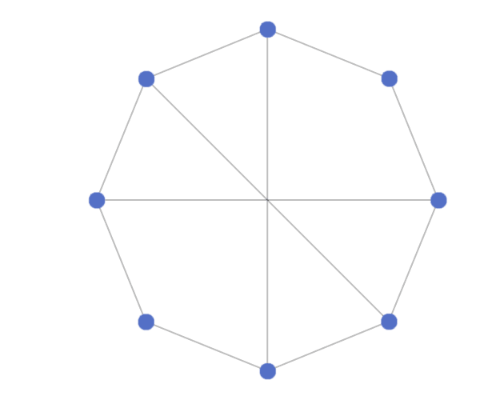

<!-- Generated by web/e2e/wiki.js - do not edit this page. Edit docs/wiki/examples/*.json, docs/wiki/notes/*.md or the generator, then run "npm run wiki" in web/. -->

WebGL-accelerated large-scale graph layout.

| | |
|---|---|
| Component id | `open.echarts.GraphGLChart` |
| Palette | **Open Components / ECharts 3D** → **Graph GL Chart** |
| Default size | 600 × 500 |
| WebGL | Needs ECharts-GL, which the browser downloads from the gateway the first time a 3D / WebGL component is shown, and a browser with WebGL enabled. |



*Graph GL Chart as dropped from the palette.* It takes any ECharts option in its `option` prop; the palette entry only decides which sample option a new component starts with.

<details>
<summary>Option of a freshly dropped component</summary>

```json
{
  "series": [
    {
      "type": "graphGL",
      "nodes": [
        { "name": "N0", "x": 100, "y": 0 },
        { "name": "N1", "x": 71, "y": 71 },
        { "name": "N2", "x": 0, "y": 100 },
        { "name": "N3", "x": -71, "y": 71 },
        { "name": "N4", "x": -100, "y": 0 },
        { "name": "N5", "x": -71, "y": -71 },
        { "name": "N6", "x": 0, "y": -100 },
        { "name": "N7", "x": 71, "y": -71 }
      ],
      "edges": [
        { "source": 0, "target": 1 },
        { "source": 1, "target": 2 },
        { "source": 2, "target": 3 },
        { "source": 3, "target": 4 },
        { "source": 4, "target": 5 },
        { "source": 5, "target": 6 },
        { "source": 6, "target": 7 },
        { "source": 7, "target": 0 },
        { "source": 0, "target": 4 },
        { "source": 2, "target": 6 },
        { "source": 1, "target": 5 }
      ],
      "symbolSize": 20,
      "itemStyle": { "color": "#5470c6", "opacity": 1 },
      "lineStyle": { "color": "rgba(0,0,0,0.5)", "width": 2 },
      "forceAtlas2": { "steps": 1, "maxSteps": 1, "GPU": false }
    }
  ]
}
```

</details>

## Making your own

1. In the Designer, drag **Graph GL Chart** from the **Open Components / ECharts 3D** group of the Perspective component palette onto a view.
2. Edit the `option` prop in the Property Editor, or paste a complete option over it (right-click `option`, **Paste**). Any option from the [ECharts documentation](https://echarts.apache.org/en/option.html) works as long as it is plain JSON (no JavaScript functions).
3. Bind the parts of the option that hold data; see [Binding Data](Binding-Data).
