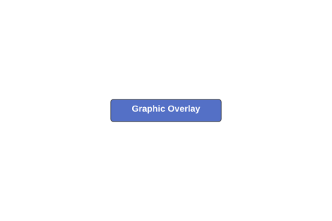

<!-- Generated by web/e2e/wiki.js - do not edit this page. Edit docs/wiki/examples/*.json, docs/wiki/notes/*.md or the generator, then run "npm run wiki" in web/. -->

Graphic shape/text/image overlays.

| | |
|---|---|
| Component id | `open.echarts.GraphicChart` |
| Palette | **Open Components / ECharts** → **Graphic Chart** |
| Default size | 600 × 400 |



*Graphic Chart as dropped from the palette.* It takes any ECharts option in its `option` prop; the palette entry only decides which sample option a new component starts with.

<details>
<summary>Option of a freshly dropped component</summary>

```json
{
  "graphic": [
    {
      "type": "group",
      "left": "center",
      "top": "center",
      "children": [
        {
          "type": "rect",
          "shape": { "width": 200, "height": 40, "r": 5 },
          "style": { "fill": "#5470c6", "stroke": "#333", "lineWidth": 1 },
          "left": "center",
          "top": 0
        },
        {
          "type": "text",
          "style": {
            "text": "Graphic Overlay",
            "fill": "#fff",
            "fontSize": 16,
            "fontWeight": "bold",
            "textAlign": "center"
          },
          "left": "center",
          "top": 10
        }
      ]
    }
  ]
}
```

</details>

## Making your own

1. In the Designer, drag **Graphic Chart** from the **Open Components / ECharts** group of the Perspective component palette onto a view.
2. Edit the `option` prop in the Property Editor, or paste a complete option over it (right-click `option`, **Paste**). Any option from the [ECharts documentation](https://echarts.apache.org/en/option.html) works as long as it is plain JSON (no JavaScript functions).
3. Bind the parts of the option that hold data; see [Binding Data](Binding-Data).
