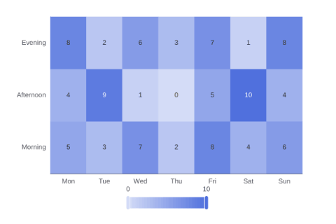
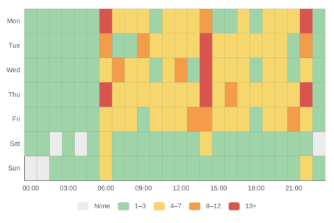
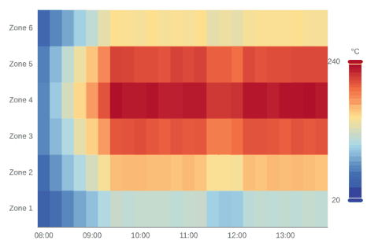

<!-- Generated by web/e2e/wiki.js - do not edit this page. Edit docs/wiki/examples/*.json, docs/wiki/notes/*.md or the generator, then run "npm run wiki" in web/. -->

Heatmaps on cartesian, calendar, or geo coordinates.

| | |
|---|---|
| Component id | `open.echarts.HeatmapChart` |
| Palette | **Open Components / ECharts** → **Heatmap Chart** |
| Default size | 600 × 400 |



*Heatmap Chart as dropped from the palette.* It takes any ECharts option in its `option` prop; the palette entry only decides which sample option a new component starts with.

<details>
<summary>Option of a freshly dropped component</summary>

```json
{
  "xAxis": { "type": "category", "data": ["Mon", "Tue", "Wed", "Thu", "Fri", "Sat", "Sun"] },
  "yAxis": { "type": "category", "data": ["Morning", "Afternoon", "Evening"] },
  "visualMap": {
    "min": 0,
    "max": 10,
    "calculable": true,
    "orient": "horizontal",
    "left": "center",
    "bottom": 10
  },
  "series": [
    {
      "type": "heatmap",
      "data": [
        [0, 0, 5],
        [1, 0, 3],
        [2, 0, 7],
        [3, 0, 2],
        [4, 0, 8],
        [5, 0, 4],
        [6, 0, 6],
        [0, 1, 4],
        [1, 1, 9],
        [2, 1, 1],
        [3, 1, 0],
        [4, 1, 5],
        [5, 1, 10],
        [6, 1, 4],
        [0, 2, 8],
        [1, 2, 2],
        [2, 2, 6],
        [3, 2, 3],
        [4, 2, 7],
        [5, 2, 1],
        [6, 2, 8]
      ],
      "label": { "show": true }
    }
  ],
  "grid": { "top": 30, "bottom": 90 }
}
```

</details>

## Examples

- [Heatmap with Value Classes](#heatmap-with-value-classes): Cells coloured by class (piecewise visualMap) instead of a continuous ramp; alarms per hour and weekday.
- [Thermal Profile Heatmap](#thermal-profile-heatmap): Dense, label-free heatmap with a continuous blue-to-red ramp and a draggable range bar; oven zone temperatures over time.

### Heatmap with Value Classes

Cells coloured by class (piecewise visualMap) instead of a continuous ramp; alarms per hour and weekday.



**How to make it in Ignition**

1. In the Designer, drag **Heatmap Chart** from the **Open Components / ECharts** group of the Perspective component palette onto a view.
2. Open **Option JSON** below and copy it. In the Property Editor, right-click the `option` property and choose **Paste**: the pasted JSON replaces the sample option. (See [Getting Started](Getting-Started) for other ways to enter an option.)
3. Replace the sample data with live data by binding these paths (expand `option` in the Property Editor down to the property, then use its binding icon). Everything else in the option stays as pasted.

   | Property | The binding must return |
   |---|---|
   | `props.option.xAxis.data` | a list of category labels: `["Mon", "Tue", "Wed"]` |
   | `props.option.yAxis.data` | a list of category labels: `["Mon", "Tue", "Wed"]` |
   | `props.option.series[0].data` | a list of rows with 3 values each, in the order of the example: `[[0, 0, 1], ...]` |

   Script transform for `props.option.xAxis.data` (the same query, its `label` column):

   ```python
   def transform(self, value, quality, timestamp):
       return [str(value.getValueAt(row, "label")) for row in range(value.getRowCount())]
   ```

   Script transform for `props.option.series[0].data`, turning a dataset into rows. With a time axis the first value of a row is the time in epoch milliseconds:

   ```python
   def transform(self, value, quality, timestamp):
       # value: dataset, e.g. from a Tag History binding: t_stamp, then one column per tag
       rows = []
       for row in range(value.getRowCount()):
           t = value.getValueAt(row, 0)
           if hasattr(t, "getTime"):  # a date: ECharts wants epoch milliseconds
               t = t.getTime()
           rows.append([t] + [value.getValueAt(row, col) for col in range(1, 3)])
       return rows
   ```

4. Bind `series[0].data` to rows `[xIndex, yIndex, value]` (or `[xLabel, yLabel, value]`): here hour, weekday, alarm count.
5. The classes are `visualMap.pieces`: each has `gte` / `lte` bounds (or one `value`), a `label` and a `color`. Clicking a class in the legend hides its cells.
6. `xAxis.data` and `yAxis.data` list the categories.

<details>
<summary>Option JSON</summary>

```json
{
  "tooltip": { "position": "top" },
  "grid": { "left": 44, "right": 16, "top": 16, "bottom": 76 },
  "xAxis": {
    "type": "category",
    "data": [
      "00:00",
      "01:00",
      "02:00",
      "03:00",
      "04:00",
      "05:00",
      "06:00",
      "07:00",
      "08:00",
      "09:00",
      "10:00",
      "11:00",
      "12:00",
      "13:00",
      "14:00",
      "15:00",
      "16:00",
      "17:00",
      "18:00",
      "19:00",
      "20:00",
      "21:00",
      "22:00",
      "23:00"
    ],
    "axisLabel": { "interval": 2 }
  },
  "yAxis": { "type": "category", "data": ["Mon", "Tue", "Wed", "Thu", "Fri", "Sat", "Sun"], "inverse": true },
  "visualMap": {
    "type": "piecewise",
    "orient": "horizontal",
    "left": "center",
    "bottom": 8,
    "itemGap": 14,
    "pieces": [
      { "value": 0, "label": "None", "color": "rgba(128,128,128,0.15)" },
      { "gte": 1, "lte": 3, "label": "1–3", "color": "#9fd3a8" },
      { "gte": 4, "lte": 7, "label": "4–7", "color": "#f5d76e" },
      { "gte": 8, "lte": 12, "label": "8–12", "color": "#f39c4a" },
      { "gte": 13, "label": "13+", "color": "#d9534f" }
    ]
  },
  "series": [
    {
      "name": "Alarms",
      "type": "heatmap",
      "data": [
        [0, 0, 1],
        [1, 0, 2],
        [2, 0, 2],
        [3, 0, 1],
        [4, 0, 1],
        [5, 0, 1],
        [6, 0, 22],
        [7, 0, 5],
        [8, 0, 5],
        [9, 0, 4],
        [10, 0, 3],
        [11, 0, 7],
        [12, 0, 7],
        [13, 0, 5],
        [14, 0, 10],
        [15, 0, 3],
        [16, 0, 3],
        [17, 0, 4],
        [18, 0, 3],
        [19, 0, 7],
        [20, 0, 5],
        [21, 0, 7],
        [22, 0, 13],
        [23, 0, 1],
        [0, 1, 2],
        [1, 1, 1],
        [2, 1, 2],
        [3, 1, 1],
        [4, 1, 1],
        [5, 1, 1],
        [6, 1, 10],
        [7, 1, 2],
        [8, 1, 2],
        [9, 1, 8],
        [10, 1, 7],
        [11, 1, 7],
        [12, 1, 5],
        [13, 1, 7],
        [14, 1, 16],
        [15, 1, 4],
        [16, 1, 4],
        [17, 1, 4],
        [18, 1, 4],
        [19, 1, 6],
        [20, 1, 4],
        [21, 1, 2],
        [22, 1, 11],
        [23, 1, 1],
        [0, 2, 1],
        [1, 2, 1],
        [2, 2, 1],
        [3, 2, 1],
        [4, 2, 2],
        [5, 2, 2],
        [6, 2, 7],
        [7, 2, 8],
        [8, 2, 5],
        [9, 2, 6],
        [10, 2, 3],
        [11, 2, 5],
        [12, 2, 8],
        [13, 2, 3],
        [14, 2, 17],
        [15, 2, 4],
        [16, 2, 5],
        [17, 2, 6],
        [18, 2, 3],
        [19, 2, 7],
        [20, 2, 7],
        [21, 2, 3],
        [22, 2, 5],
        [23, 2, 1],
        [0, 3, 2],
        [1, 3, 1],
        [2, 3, 1],
        [3, 3, 2],
        [4, 3, 2],
        [5, 3, 1],
        [6, 3, 22],
        [7, 3, 4],
        [8, 3, 7],
        [9, 3, 4],
        [10, 3, 6],
        [11, 3, 7],
        [12, 3, 5],
        [13, 3, 5],
        [14, 3, 21],
        [15, 3, 5],
        [16, 3, 8],
        [17, 3, 4],
        [18, 3, 7],
        [19, 3, 7],
        [20, 3, 6],
        [21, 3, 5],
        [22, 3, 15],
        [23, 3, 2],
        [0, 4, 1],
        [1, 4, 1],
        [2, 4, 1],
        [3, 4, 1],
        [4, 4, 2],
        [5, 4, 2],
        [6, 4, 7],
        [7, 4, 5],
        [8, 4, 5],
        [9, 4, 2],
        [10, 4, 6],
        [11, 4, 4],
        [12, 4, 5],
        [13, 4, 8],
        [14, 4, 8],
        [15, 4, 5],
        [16, 4, 4],
        [17, 4, 4],
        [18, 4, 3],
        [19, 4, 4],
        [20, 4, 6],
        [21, 4, 8],
        [22, 4, 4],
        [23, 4, 1],
        [0, 5, 1],
        [1, 5, 1],
        [2, 5, 0],
        [3, 5, 1],
        [4, 5, 0],
        [5, 5, 1],
        [6, 5, 5],
        [7, 5, 1],
        [8, 5, 2],
        [9, 5, 2],
        [10, 5, 1],
        [11, 5, 2],
        [12, 5, 2],
        [13, 5, 2],
        [14, 5, 4],
        [15, 5, 1],
        [16, 5, 3],
        [17, 5, 1],
        [18, 5, 2],
        [19, 5, 2],
        [20, 5, 3],
        [21, 5, 1],
        [22, 5, 3],
        [23, 5, 0],
        [0, 6, 0],
        [1, 6, 0],
        [2, 6, 1],
        [3, 6, 1],
        [4, 6, 1],
        [5, 6, 1],
        [6, 6, 6],
        [7, 6, 2],
        [8, 6, 2],
        [9, 6, 2],
        [10, 6, 2],
        [11, 6, 2],
        [12, 6, 2],
        [13, 6, 2],
        [14, 6, 3],
        [15, 6, 3],
        [16, 6, 2],
        [17, 6, 1],
        [18, 6, 2],
        [19, 6, 2],
        [20, 6, 1],
        [21, 6, 3],
        [22, 6, 6],
        [23, 6, 1]
      ],
      "itemStyle": { "borderWidth": 1, "borderColor": "rgba(128,128,128,0.2)" },
      "emphasis": { "itemStyle": { "shadowBlur": 8, "shadowColor": "rgba(0,0,0,0.4)" } }
    }
  ]
}
```

</details>

### Thermal Profile Heatmap

Dense, label-free heatmap with a continuous blue-to-red ramp and a draggable range bar; oven zone temperatures over time.



**How to make it in Ignition**

1. In the Designer, drag **Heatmap Chart** from the **Open Components / ECharts** group of the Perspective component palette onto a view.
2. Open **Option JSON** below and copy it. In the Property Editor, right-click the `option` property and choose **Paste**: the pasted JSON replaces the sample option. (See [Getting Started](Getting-Started) for other ways to enter an option.)
3. Replace the sample data with live data by binding these paths (expand `option` in the Property Editor down to the property, then use its binding icon). Everything else in the option stays as pasted.

   | Property | The binding must return |
   |---|---|
   | `props.option.xAxis.data` | a list of category labels: `["Mon", "Tue", "Wed"]` |
   | `props.option.yAxis.data` | a list of category labels: `["Mon", "Tue", "Wed"]` |
   | `props.option.series[0].data` | a list of rows with 3 values each, in the order of the example: `[[0, 0, 51], ...]` |

   Script transform for `props.option.xAxis.data` (the same query, its `label` column):

   ```python
   def transform(self, value, quality, timestamp):
       return [str(value.getValueAt(row, "label")) for row in range(value.getRowCount())]
   ```

   Script transform for `props.option.series[0].data`, turning a dataset into rows. With a time axis the first value of a row is the time in epoch milliseconds:

   ```python
   def transform(self, value, quality, timestamp):
       # value: dataset, e.g. from a Tag History binding: t_stamp, then one column per tag
       rows = []
       for row in range(value.getRowCount()):
           t = value.getValueAt(row, 0)
           if hasattr(t, "getTime"):  # a date: ECharts wants epoch milliseconds
               t = t.getTime()
           rows.append([t] + [value.getValueAt(row, col) for col in range(1, 3)])
       return rows
   ```

4. Bind `series[0].data` to rows `[xIndex, yIndex, value]`; bind `xAxis.data` to the time labels and `yAxis.data` to the zone names.
5. Set `visualMap.min` / `max` to the temperature range. Dragging the handles of the bar filters the cells (`calculable: true`).
6. For long time ranges add a `dataZoom` on the x axis rather than shrinking the cells.

<details>
<summary>Option JSON</summary>

```json
{
  "tooltip": { "position": "top" },
  "grid": { "left": 60, "right": 80, "top": 16, "bottom": 40 },
  "xAxis": {
    "type": "category",
    "data": [
      "08:00",
      "08:15",
      "08:30",
      "08:45",
      "09:00",
      "09:15",
      "09:30",
      "09:45",
      "10:00",
      "10:15",
      "10:30",
      "10:45",
      "11:00",
      "11:15",
      "11:30",
      "11:45",
      "12:00",
      "12:15",
      "12:30",
      "12:45",
      "13:00",
      "13:15",
      "13:30",
      "13:45"
    ],
    "axisLabel": { "interval": 3 }
  },
  "yAxis": { "type": "category", "data": ["Zone 1", "Zone 2", "Zone 3", "Zone 4", "Zone 5", "Zone 6"] },
  "visualMap": {
    "min": 20,
    "max": 240,
    "calculable": true,
    "orient": "vertical",
    "right": 8,
    "top": "center",
    "itemHeight": 220,
    "text": ["°C", ""],
    "inRange": { "color": ["#313695", "#4575b4", "#abd9e9", "#fee090", "#f46d43", "#a50026"] }
  },
  "series": [
    {
      "name": "Temperature",
      "type": "heatmap",
      "data": [
        [0, 0, 51],
        [1, 0, 59],
        [2, 0, 73],
        [3, 0, 83],
        [4, 0, 98],
        [5, 0, 110],
        [6, 0, 123],
        [7, 0, 119],
        [8, 0, 121],
        [9, 0, 121],
        [10, 0, 122],
        [11, 0, 118],
        [12, 0, 121],
        [13, 0, 123],
        [14, 0, 105],
        [15, 0, 100],
        [16, 0, 101],
        [17, 0, 117],
        [18, 0, 120],
        [19, 0, 118],
        [20, 0, 120],
        [21, 0, 118],
        [22, 0, 122],
        [23, 0, 119],
        [0, 1, 58],
        [1, 1, 77],
        [2, 1, 96],
        [3, 1, 112],
        [4, 1, 133],
        [5, 1, 148],
        [6, 1, 165],
        [7, 1, 166],
        [8, 1, 168],
        [9, 1, 165],
        [10, 1, 165],
        [11, 1, 163],
        [12, 1, 167],
        [13, 1, 163],
        [14, 1, 149],
        [15, 1, 150],
        [16, 1, 148],
        [17, 1, 164],
        [18, 1, 163],
        [19, 1, 167],
        [20, 1, 165],
        [21, 1, 166],
        [22, 1, 165],
        [23, 1, 162],
        [0, 2, 71],
        [1, 2, 94],
        [2, 2, 113],
        [3, 2, 139],
        [4, 2, 158],
        [5, 2, 180],
        [6, 2, 205],
        [7, 2, 206],
        [8, 2, 208],
        [9, 2, 205],
        [10, 2, 202],
        [11, 2, 206],
        [12, 2, 204],
        [13, 2, 205],
        [14, 2, 190],
        [15, 2, 190],
        [16, 2, 193],
        [17, 2, 207],
        [18, 2, 207],
        [19, 2, 205],
        [20, 2, 202],
        [21, 2, 206],
        [22, 2, 204],
        [23, 2, 206],
        [0, 3, 73],
        [1, 3, 102],
        [2, 3, 128],
        [3, 3, 155],
        [4, 3, 178],
        [5, 3, 207],
        [6, 3, 233],
        [7, 3, 230],
        [8, 3, 230],
        [9, 3, 232],
        [10, 3, 227],
        [11, 3, 227],
        [12, 3, 230],
        [13, 3, 230],
        [14, 3, 217],
        [15, 3, 218],
        [16, 3, 219],
        [17, 3, 231],
        [18, 3, 231],
        [19, 3, 228],
        [20, 3, 232],
        [21, 3, 232],
        [22, 3, 233],
        [23, 3, 230],
        [0, 4, 69],
        [1, 4, 94],
        [2, 4, 120],
        [3, 4, 143],
        [4, 4, 163],
        [5, 4, 186],
        [6, 4, 213],
        [7, 4, 212],
        [8, 4, 209],
        [9, 4, 209],
        [10, 4, 207],
        [11, 4, 213],
        [12, 4, 211],
        [13, 4, 213],
        [14, 4, 201],
        [15, 4, 202],
        [16, 4, 198],
        [17, 4, 210],
        [18, 4, 207],
        [19, 4, 209],
        [20, 4, 209],
        [21, 4, 210],
        [22, 4, 211],
        [23, 4, 211],
        [0, 5, 55],
        [1, 5, 71],
        [2, 5, 89],
        [3, 5, 104],
        [4, 5, 119],
        [5, 5, 136],
        [6, 5, 152],
        [7, 5, 149],
        [8, 5, 148],
        [9, 5, 151],
        [10, 5, 148],
        [11, 5, 149],
        [12, 5, 148],
        [13, 5, 151],
        [14, 5, 140],
        [15, 5, 143],
        [16, 5, 141],
        [17, 5, 148],
        [18, 5, 150],
        [19, 5, 149],
        [20, 5, 149],
        [21, 5, 153],
        [22, 5, 147],
        [23, 5, 148]
      ],
      "progressive": 0
    }
  ]
}
```

</details>
