<!-- Generated by web/e2e/wiki.js - do not edit this page. Edit docs/wiki/examples/*.json, docs/wiki/notes/*.md or the generator, then run "npm run wiki" in web/. -->

**Open ECharts** adds Apache ECharts charts to Ignition Perspective as ordinary components: drop one on a view, edit or bind its props, and it renders in the session.

This wiki shows what each of the 57 components looks like and how to build the examples in the Designer (76 worked examples so far).

## Guides

- [Getting Started](Getting-Started)
- [Binding Data](Binding-Data)
- [Events](Events)
- [Themes](Themes)
- [Security](Security)
- [Troubleshooting](Troubleshooting)

## Open Components / ECharts

| | | |
|:---:|:---:|:---:|
| [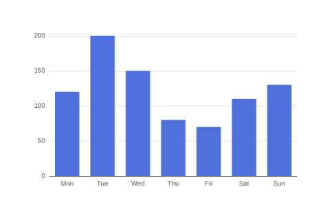](ECharts-Chart) [ECharts Chart](ECharts-Chart) | [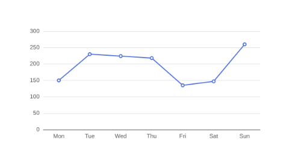](Line-Chart) [Line Chart](Line-Chart) 8 examples | [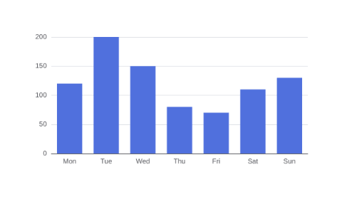](Bar-Chart) [Bar Chart](Bar-Chart) 12 examples |
| [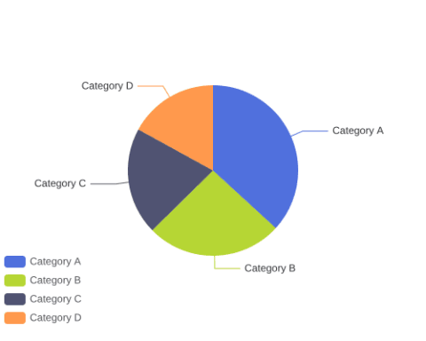](Pie-Chart) [Pie Chart](Pie-Chart) 6 examples | [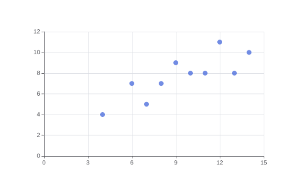](Scatter-Chart) [Scatter Chart](Scatter-Chart) 3 examples | [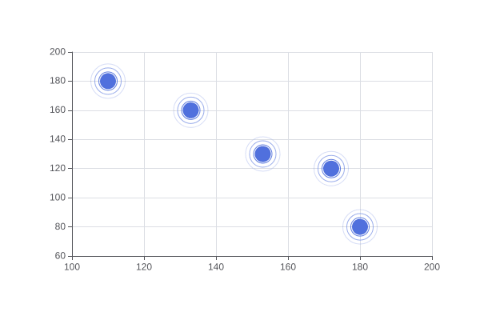](Effect-Scatter-Chart) [Effect Scatter Chart](Effect-Scatter-Chart) |
| [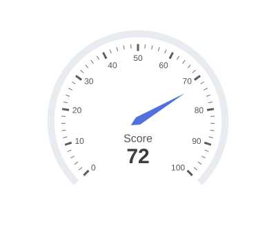](Gauge-Chart) [Gauge Chart](Gauge-Chart) 8 examples | [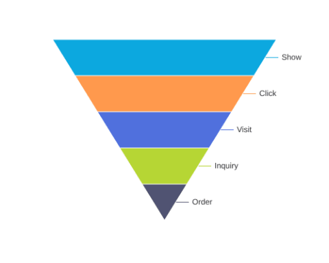](Funnel-Chart) [Funnel Chart](Funnel-Chart) 2 examples | [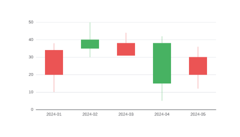](Candlestick-Chart) [Candlestick Chart](Candlestick-Chart) 1 example |
| [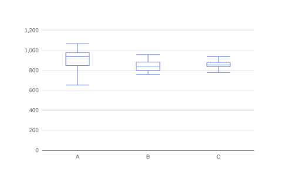](Boxplot-Chart) [Boxplot Chart](Boxplot-Chart) 2 examples | [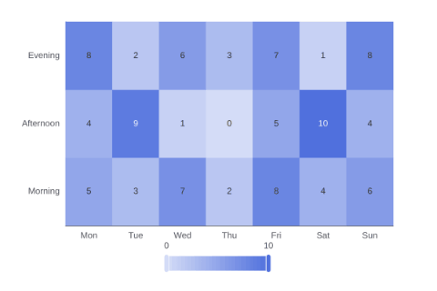](Heatmap-Chart) [Heatmap Chart](Heatmap-Chart) 2 examples | [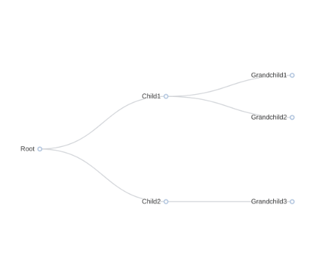](Tree-Chart) [Tree Chart](Tree-Chart) 6 examples |
| [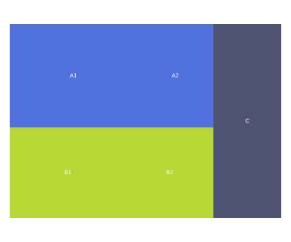](Treemap-Chart) [Treemap Chart](Treemap-Chart) 3 examples | [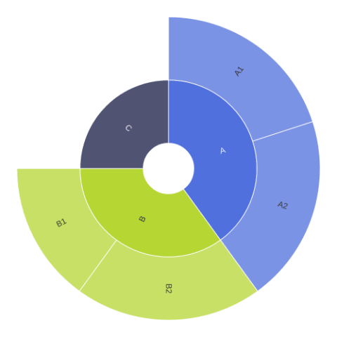](Sunburst-Chart) [Sunburst Chart](Sunburst-Chart) 5 examples | [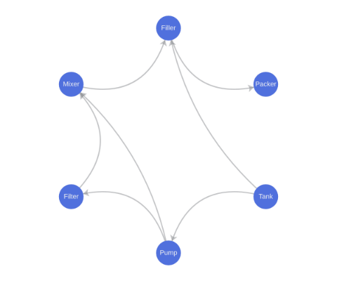](Graph-Chart) [Graph Chart](Graph-Chart) 4 examples |
| [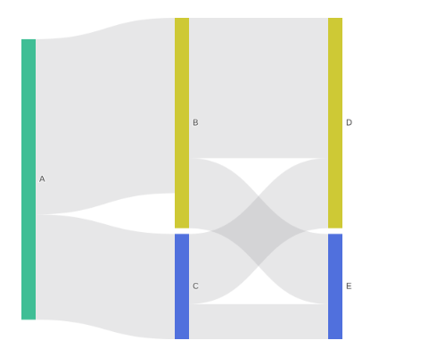](Sankey-Chart) [Sankey Chart](Sankey-Chart) 2 examples | [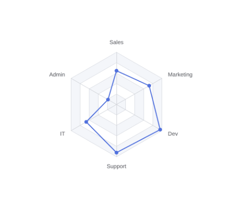](Radar-Chart) [Radar Chart](Radar-Chart) 4 examples | [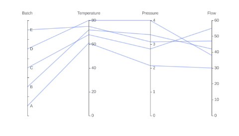](Parallel-Chart) [Parallel Chart](Parallel-Chart) 1 example |
| [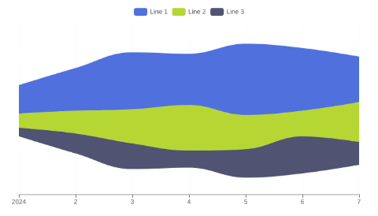](Theme-River-Chart) [Theme River Chart](Theme-River-Chart) 1 example | [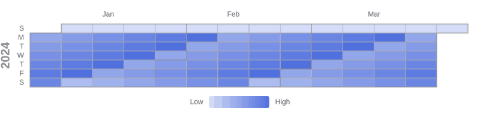](Calendar-Chart) [Calendar Chart](Calendar-Chart) 2 examples | [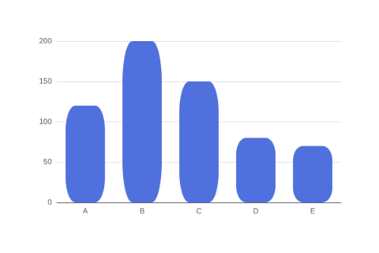](Pictorial-Bar-Chart) [Pictorial Bar Chart](Pictorial-Bar-Chart) 3 examples |
| [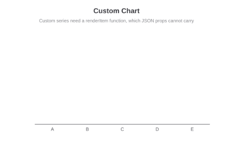](Custom-Chart) [Custom Chart](Custom-Chart) | [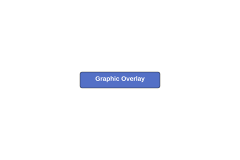](Graphic-Chart) [Graphic Chart](Graphic-Chart) | [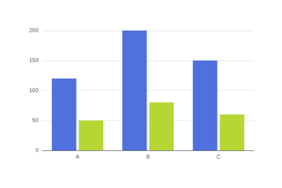](Dataset-Chart) [Dataset Chart](Dataset-Chart) 1 example |
| [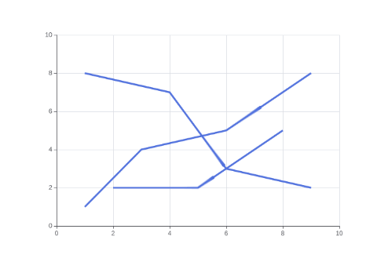](Lines-Chart) [Lines Chart](Lines-Chart) |   |   |

Reference pages: [Map Chart](Map-Chart).

## Open Components / ECharts 3D

| | | |
|:---:|:---:|:---:|
| [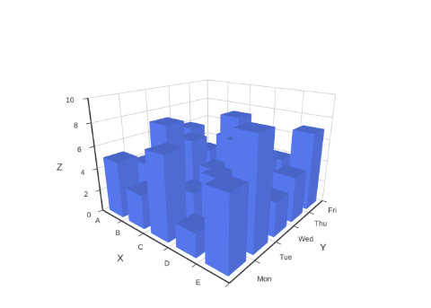](Bar-3D-Chart) [Bar 3D Chart](Bar-3D-Chart) | [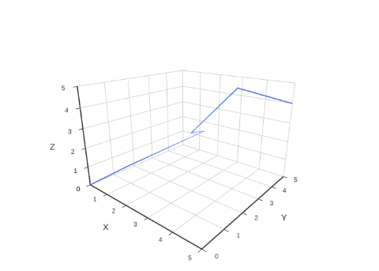](Line-3D-Chart) [Line 3D Chart](Line-3D-Chart) | [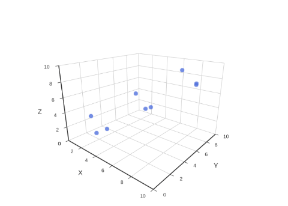](Scatter-3D-Chart) [Scatter 3D Chart](Scatter-3D-Chart) |
| [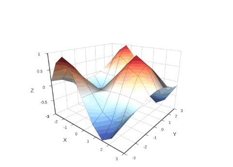](Surface-Chart) [Surface Chart](Surface-Chart) | [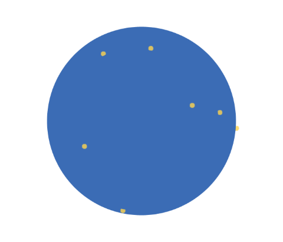](Globe-Chart) [Globe Chart](Globe-Chart) | [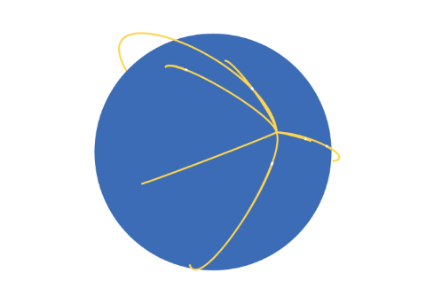](Lines-3D-Chart) [Lines 3D Chart](Lines-3D-Chart) |
| [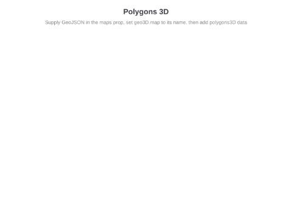](Polygons-3D-Chart) [Polygons 3D Chart](Polygons-3D-Chart) | [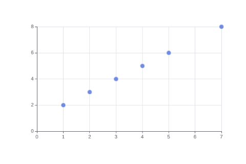](Scatter-GL-Chart) [Scatter GL Chart](Scatter-GL-Chart) | [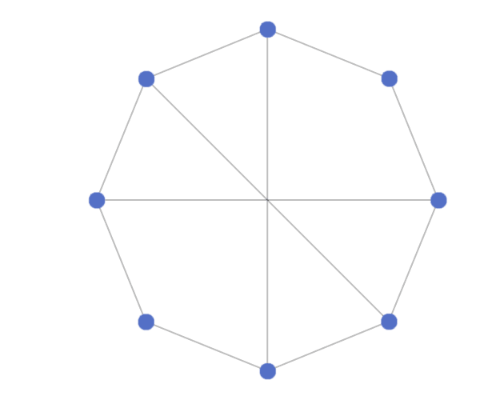](Graph-GL-Chart) [Graph GL Chart](Graph-GL-Chart) |
| [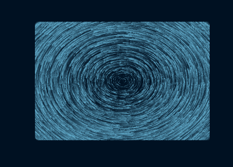](Flow-GL-Chart) [Flow GL Chart](Flow-GL-Chart) |   |   |

Reference pages: [Map 3D Chart](Map-3D-Chart).

## Open Components / Industrial

| | | |
|:---:|:---:|:---:|
| [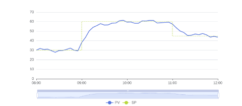](Industrial-Trend) [Industrial Trend](Industrial-Trend) | [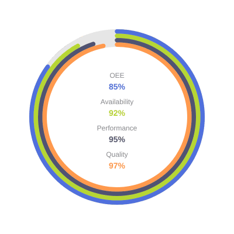](OEE-Summary) [OEE Summary](OEE-Summary) | [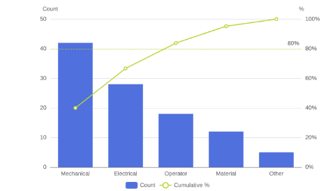](Pareto-Chart) [Pareto Chart](Pareto-Chart) |
| [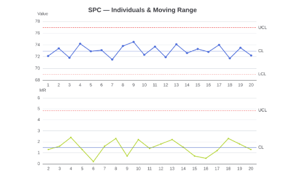](SPC-Chart) [SPC Chart](SPC-Chart) | [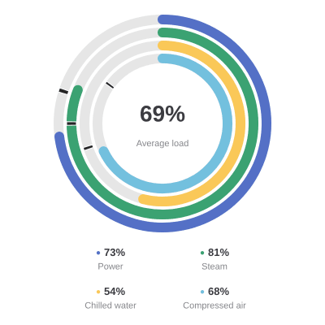](Metric-Rings) [Metric Rings](Metric-Rings) | [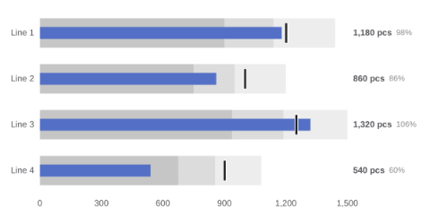](Bullet-Chart) [Bullet Chart](Bullet-Chart) |
| [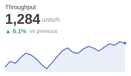](KPI-Tile) [KPI Tile](KPI-Tile) | [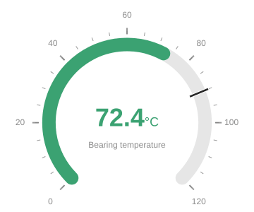](Dial-Gauge) [Dial Gauge](Dial-Gauge) | [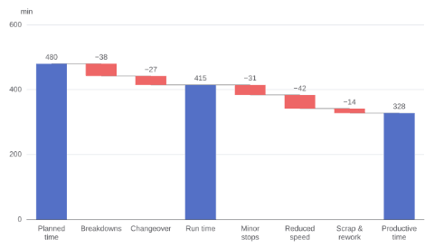](Waterfall-Chart) [Waterfall Chart](Waterfall-Chart) |
| [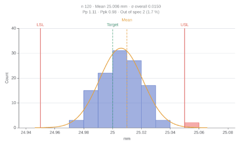](Process-Capability-Histogram) [Process Capability Histogram](Process-Capability-Histogram) | [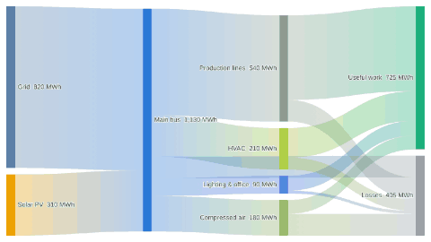](Flow-Diagram-Sankey) [Flow Diagram (Sankey)](Flow-Diagram-Sankey) | [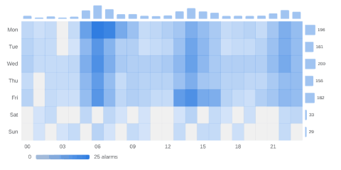](Event-Heatmap) [Event Heatmap](Event-Heatmap) |
| [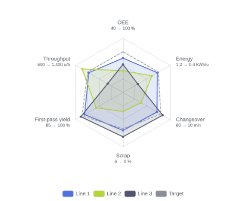](Radar-Comparison) [Radar Comparison](Radar-Comparison) |   |   |

## Open Components / Scheduling

| | | |
|:---:|:---:|:---:|
| [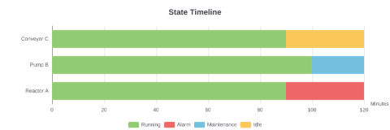](State-Timeline) [State Timeline](State-Timeline) | [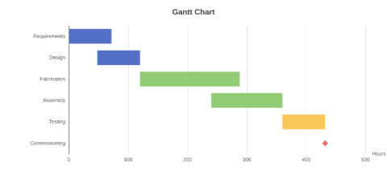](Gantt-Chart) [Gantt Chart](Gantt-Chart) |  [Schedule Calendar](Schedule-Calendar) |
|  [Shift Calendar](Shift-Calendar) |  [Downtime Tracker](Downtime-Tracker) |  [Batch Timeline](Batch-Timeline) |
|  [Resource Heatmap](Resource-Heatmap) |   |   |
