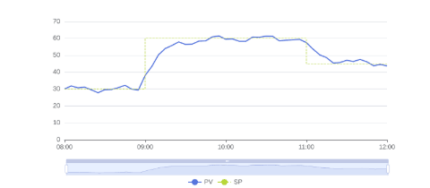

<!-- Generated by web/e2e/wiki.js - do not edit this page. Edit docs/wiki/examples/*.json, docs/wiki/notes/*.md or the generator, then run "npm run wiki" in web/. -->

Time-series PV/SP trend with alarm limits and data zoom.

| | |
|---|---|
| Component id | `open.industrial.Trend` |
| Palette | **Open Components / Industrial** → **Industrial Trend** |
| Default size | 800 × 350 |



*Industrial Trend as dropped from the palette, showing its built-in sample data.*

This component builds its chart from the domain props below, so there is no ECharts option to write: bind the props to your tags and queries. (A non-empty `option` is an advanced override that replaces the generated chart.)

## How to use it in Ignition

1. In the Designer, drag **Industrial Trend** from the **Open Components / Industrial** group of the Perspective component palette onto a view. It shows sample data.
2. Select it and replace the sample data in the Property Editor: type values, paste JSON (right-click a property, **Paste**), or add a binding.
3. Bind the data props to tags, tag history or named queries. The props and the shape each one expects are listed under [Props](#props); [Binding examples](#binding-examples) has worked examples.

## Binding examples

The trend reads everything from `data`: `pvData` (process value) and `spData` (setpoint) are lists of
`[time, value]` pairs with the time in epoch milliseconds, oldest first. Lists of objects work too; the
keys are then named by `data.timeField` / `data.valueField` (defaults `"t"` and `"v"`).

**Process value from tag history.** Put a **Tag History** binding on `props.data.pvData` (one tag, a
time range such as the last 8 hours, a sample size your screen can show) and add this script transform:

```python
def transform(self, value, quality, timestamp):
    # value: dataset from the Tag History binding: t_stamp, then the tag's column
    return [
        [value.getValueAt(row, 0).getTime(), value.getValueAt(row, 1)]
        for row in range(value.getRowCount())
        if value.getValueAt(row, 1) is not None
    ]
```

Do the same for the setpoint tag on `props.data.spData`, or set `showSetpoint` to `false`.

**Process value from a named query.** A query such as
`SELECT t_stamp, temperature FROM furnace_log WHERE t_stamp > :start ORDER BY t_stamp` bound to
`props.data.pvData` (Return Format: dataset) uses the same transform.

**Alarm limits from tags.** Bind each limit straight to its tag, no transform needed:

| Property | Tag binding (example) |
|---|---|
| `props.limits.hiAlarm` | `[default]Furnace1/Temperature/HiAlarmSP` |
| `props.limits.hiWarning` | `[default]Furnace1/Temperature/HiWarnSP` |
| `props.limits.loWarning` | `[default]Furnace1/Temperature/LoWarnSP` |
| `props.limits.loAlarm` | `[default]Furnace1/Temperature/LoAlarmSP` |

A limit that is `null` (or missing) draws no line. Set `yAxisLabel` to the engineering unit, e.g. `°C`.

## Props

| Property | Type | Default | Description |
|---|---|---|---|
| `data` | object | sample data | Data configuration for the trend. |
| `data.pvData` | array | `[]` | Process variable data: array of [time, value] pairs or array of objects. |
| `data.spData` | array | `[]` | Setpoint data: array of [time, value] pairs or array of objects. |
| `data.timeField` | string | `"t"` | Field holding the time when the data is an array of objects. Defaults to "t". |
| `data.valueField` | string | `"v"` | Field holding the value when the data is an array of objects. Defaults to "v". |
| `limits` | object | `{}` | Alarm and warning limits displayed as horizontal markLines. |
| `limits.hiAlarm` | number / null |  | High alarm limit. |
| `limits.hiWarning` | number / null |  | High warning limit. |
| `limits.loWarning` | number / null |  | Low warning limit. |
| `limits.loAlarm` | number / null |  | Low alarm limit. |
| `yAxisLabel` | string | `""` | Label for the Y axis (e.g. unit of measurement). |
| `showSetpoint` | boolean | `true` | Whether to show the setpoint line. |
| `showDataZoom` | boolean | `true` | Whether to show the data zoom slider. |

The shared props (`theme`, `renderer`, `notMerge`, `lazyUpdate`, `sanitizeTooltip`, ...) and the seven events are the same as on every component: see [Binding Data](Binding-Data), [Themes](Themes) and [Events](Events).
