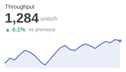

<!-- Generated by web/e2e/wiki.js - do not edit this page. Edit docs/wiki/examples/*.json, docs/wiki/notes/*.md or the generator, then run "npm run wiki" in web/. -->

One big number with unit, change versus previous or target, and a sparkline.

| | |
|---|---|
| Component id | `open.industrial.KpiTile` |
| Palette | **Open Components / Industrial** → **KPI Tile** |
| Default size | 260 × 150 |



*KPI Tile as dropped from the palette, showing its built-in sample data.*

This component builds its chart from the domain props below, so there is no ECharts option to write: bind the props to your tags and queries. (A non-empty `option` is an advanced override that replaces the generated chart.)

## How to use it in Ignition

1. In the Designer, drag **KPI Tile** from the **Open Components / Industrial** group of the Perspective component palette onto a view. It shows sample data.
2. Select it and replace the sample data in the Property Editor: type values, paste JSON (right-click a property, **Paste**), or add a binding.
3. Bind the data props to tags, tag history or named queries. The props and the shape each one expects are listed under [Props](#props); [Binding examples](#binding-examples) has worked examples.

## Binding examples

**Value and comparison from tags.**

| Property | Binding (example) |
|---|---|
| `props.value` | Tag binding: `[default]Line1/Production/RatePerHour` |
| `props.previous` | Tag binding: `[default]Line1/Production/RatePerHourLastShift` |
| `props.target` | Tag binding: `[default]Line1/Production/RateTarget` |

The change is measured against `previous`; when `previous` is `null` it is measured against `target`.
For a KPI where lower is better (scrap, downtime, energy) set `higherIsBetter` to `false`.

**Sparkline from tag history.** Put a **Tag History** binding on `props.history` (the same tag, for
example the last 8 hours with about 50 points) and add this transform. The list must be oldest first,
which is the order tag history returns:

```python
def transform(self, value, quality, timestamp):
    # value: dataset from the Tag History binding: t_stamp, then the tag's column
    return [
        value.getValueAt(row, 1)
        for row in range(value.getRowCount())
        if value.getValueAt(row, 1) is not None
    ]
```

When `value` is `null` the tile shows the last point of `history`, so a tile can be driven by the
history binding alone.

**Hourly totals from a named query.** A query returning one row per hour
(`SELECT hour_start, good_count FROM hourly_production ... ORDER BY hour_start`) bound to
`props.history` uses the same transform with `"good_count"` as the column.

## Props

| Property | Type | Default | Description |
|---|---|---|---|
| `title` | string | `"Throughput"` | Caption above the value. |
| `value` | number / null | `1284` | The number shown. When null, the last point of history is shown. |
| `unit` | string | `"units/h"` | Unit written after the value. |
| `decimals` | integer | `0` | Decimal places of the value. |
| `previous` | number / null | `1210` | Value of the previous period. When set, the change is measured against it. |
| `target` | number / null | `null` | Target value. The change is measured against it when previous is null, and it is drawn as a dashed line in the sparkline when it is near the history. |
| `deltaFormat` | string | `"percent"` | Show the change in percent of the reference, or as a difference in the unit of the value. One of: `"percent"`, `"absolute"`. |
| `deltaLabel` | string | `""` | Text after the change, e.g. "vs last shift". Blank gives "vs previous" or "vs target". |
| `higherIsBetter` | boolean | `true` | True colours an increase as good and a decrease as bad; false the other way round (scrap, downtime, energy). |
| `history` | array | sample data (24 items) | Recent values for the sparkline, oldest first: numbers, [time, value] pairs, or objects with a value. |
| `showSparkline` | boolean | `true` | Draw the history as a sparkline below the numbers. |
| `color` | string | `"#5470c6"` | Colour of the sparkline. |
| `goodColor` | string | `"#3ba272"` | Colour of a change in the wanted direction. |
| `badColor` | string | `"#e05252"` | Colour of a change in the unwanted direction. |

The shared props (`theme`, `renderer`, `notMerge`, `lazyUpdate`, `sanitizeTooltip`, ...) and the seven events are the same as on every component: see [Binding Data](Binding-Data), [Themes](Themes) and [Events](Events).
