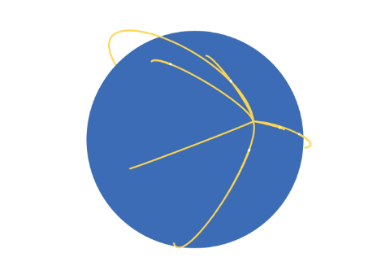

<!-- Generated by web/e2e/wiki.js - do not edit this page. Edit docs/wiki/examples/*.json, docs/wiki/notes/*.md or the generator, then run "npm run wiki" in web/. -->

3D flight/route lines on globe or geo3D.

| | |
|---|---|
| Component id | `open.echarts.Lines3DChart` |
| Palette | **Open Components / ECharts 3D** → **Lines 3D Chart** |
| Default size | 700 × 500 |
| WebGL | Needs ECharts-GL, which the browser downloads from the gateway the first time a 3D / WebGL component is shown, and a browser with WebGL enabled. |



*Lines 3D Chart as dropped from the palette.* It takes any ECharts option in its `option` prop; the palette entry only decides which sample option a new component starts with.

<details>
<summary>Option of a freshly dropped component</summary>

```json
{
  "globe": {
    "baseColor": "#3b6cb5",
    "shading": "color",
    "viewControl": { "autoRotate": false, "targetCoord": [30, 20], "distance": 190 }
  },
  "series": [
    {
      "type": "lines3D",
      "coordinateSystem": "globe",
      "lineStyle": { "width": 3, "color": "#ffd54f", "opacity": 1 },
      "effect": { "show": true, "trailWidth": 4, "trailLength": 0.3 },
      "data": [
        [[-0.13, 51.5], [55.3, 25.2]],
        [[-74, 40.7], [55.3, 25.2]],
        [[3.4, 6.5], [55.3, 25.2]],
        [[103.8, 1.35], [55.3, 25.2]],
        [[18.4, -33.9], [55.3, 25.2]],
        [[37.6, 55.8], [55.3, 25.2]],
        [[72.9, 19.1], [55.3, 25.2]]
      ]
    }
  ]
}
```

</details>

## Making your own

1. In the Designer, drag **Lines 3D Chart** from the **Open Components / ECharts 3D** group of the Perspective component palette onto a view.
2. Edit the `option` prop in the Property Editor, or paste a complete option over it (right-click `option`, **Paste**). Any option from the [ECharts documentation](https://echarts.apache.org/en/option.html) works as long as it is plain JSON (no JavaScript functions).
3. Bind the parts of the option that hold data; see [Binding Data](Binding-Data).
