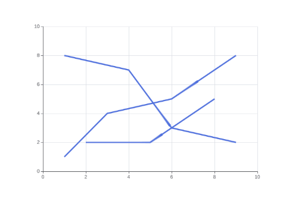

<!-- Generated by web/e2e/wiki.js - do not edit this page. Edit docs/wiki/examples/*.json, docs/wiki/notes/*.md or the generator, then run "npm run wiki" in web/. -->

Flight routes, bus lines, migration flows.

| | |
|---|---|
| Component id | `open.echarts.LinesChart` |
| Palette | **Open Components / ECharts** → **Lines Chart** |
| Default size | 700 × 500 |



*Lines Chart as dropped from the palette.* It takes any ECharts option in its `option` prop; the palette entry only decides which sample option a new component starts with.

<details>
<summary>Option of a freshly dropped component</summary>

```json
{
  "tooltip": { "trigger": "item" },
  "xAxis": { "min": 0, "max": 10 },
  "yAxis": { "min": 0, "max": 10 },
  "series": [
    {
      "type": "lines",
      "coordinateSystem": "cartesian2d",
      "polyline": true,
      "lineStyle": { "width": 3, "opacity": 0.8 },
      "effect": { "show": true, "symbolSize": 6, "period": 4 },
      "data": [
        { "name": "Route A", "coords": [[1, 1], [3, 4], [6, 5], [9, 8]] },
        { "name": "Route B", "coords": [[1, 8], [4, 7], [6, 3], [9, 2]] },
        { "name": "Route C", "coords": [[2, 2], [5, 2], [8, 5]] }
      ]
    }
  ]
}
```

</details>

## Making your own

1. In the Designer, drag **Lines Chart** from the **Open Components / ECharts** group of the Perspective component palette onto a view.
2. Edit the `option` prop in the Property Editor, or paste a complete option over it (right-click `option`, **Paste**). Any option from the [ECharts documentation](https://echarts.apache.org/en/option.html) works as long as it is plain JSON (no JavaScript functions).
3. Bind the parts of the option that hold data; see [Binding Data](Binding-Data).
