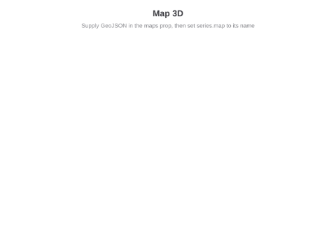

<!-- Generated by web/e2e/wiki.js - do not edit this page. Edit docs/wiki/examples/*.json, docs/wiki/notes/*.md or the generator, then run "npm run wiki" in web/. -->

3D geo map with elevation and overlays.

| | |
|---|---|
| Component id | `open.echarts.Map3DChart` |
| Palette | **Open Components / ECharts 3D** → **Map 3D Chart** |
| Default size | 700 × 500 |
| WebGL | Needs ECharts-GL, which the browser downloads from the gateway the first time a 3D / WebGL component is shown, and a browser with WebGL enabled. |

*Map 3D Chart as dropped from the palette.* It draws regions only once a map is supplied: ECharts ships no map geometry. Maps are given to the component through its `maps` prop, described under "Maps" in [docs/COMPONENTS.md](https://github.com/zbest1000/Ignition-Open-Components-/blob/main/docs/COMPONENTS.md#maps) in the repository.
