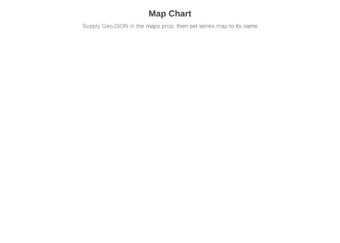

<!-- Generated by web/e2e/wiki.js - do not edit this page. Edit docs/wiki/examples/*.json, docs/wiki/notes/*.md or the generator, then run "npm run wiki" in web/. -->

Choropleth, SVG maps, geo scatter.

| | |
|---|---|
| Component id | `open.echarts.MapChart` |
| Palette | **Open Components / ECharts** → **Map Chart** |
| Default size | 700 × 500 |

*Map Chart as dropped from the palette.* It draws regions only once a map is supplied: ECharts ships no map geometry. Maps are given to the component through its `maps` prop, described under "Maps" in [docs/COMPONENTS.md](https://github.com/zbest1000/Ignition-Open-Components-/blob/main/docs/COMPONENTS.md#maps) in the repository.
