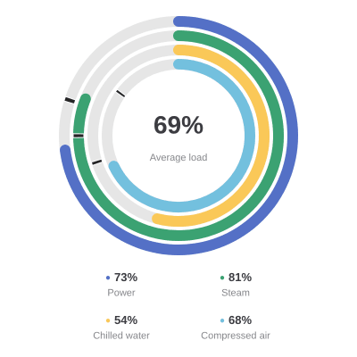

<!-- Generated by web/e2e/wiki.js - do not edit this page. Edit docs/wiki/examples/*.json, docs/wiki/notes/*.md or the generator, then run "npm run wiki" in web/. -->

Concentric progress rings for any set of metrics, with targets, thresholds and a centre summary.

| | |
|---|---|
| Component id | `open.industrial.MetricRings` |
| Palette | **Open Components / Industrial** → **Metric Rings** |
| Default size | 400 × 400 |



*Metric Rings as dropped from the palette, showing its built-in sample data.*

This component builds its chart from the domain props below, so there is no ECharts option to write: bind the props to your tags and queries. (A non-empty `option` is an advanced override that replaces the generated chart.)

## How to use it in Ignition

1. In the Designer, drag **Metric Rings** from the **Open Components / Industrial** group of the Perspective component palette onto a view. It shows sample data.
2. Select it and replace the sample data in the Property Editor: type values, paste JSON (right-click a property, **Paste**), or add a binding.
3. Bind the data props to tags, tag history or named queries. The props and the shape each one expects are listed under [Props](#props); [Binding examples](#binding-examples) has worked examples.

## Binding examples

`metrics` is a list with one object per ring, outermost first. Only `name` and `value` are needed.

**One tag per ring.** Type the metrics in the Property Editor (or paste the JSON below onto `metrics`),
then bind each `value` to its tag: `props.metrics[0].value`, `props.metrics[1].value`, ...

```json
[
  { "name": "Power", "value": 0, "target": 80 },
  { "name": "Steam", "value": 0, "target": 75 },
  { "name": "Chilled water", "value": 0, "target": 70 }
]
```

| Property | Tag binding (example) |
|---|---|
| `props.metrics[0].value` | `[default]Utilities/Power/LoadPct` |
| `props.metrics[1].value` | `[default]Utilities/Steam/LoadPct` |
| `props.metrics[2].value` | `[default]Utilities/ChilledWater/LoadPct` |

**Rings on different scales.** Give a metric its own `min`, `max` and `unit`, e.g. tank levels in litres:

```json
[
  { "name": "Tank 1", "value": 8200, "max": 12000, "unit": "L" },
  { "name": "Tank 2", "value": 3100, "max": 5000, "unit": "L" }
]
```

Set `summary` to `"none"` or type a `centerValue` when an average of such values would mean nothing.

**All rings from a named query.** For a variable number of rings, bind `props.metrics` to a query that
returns `name`, `value` and `target` columns (Return Format: dataset):

```python
def transform(self, value, quality, timestamp):
    return [
        {
            "name": str(value.getValueAt(row, "name")),
            "value": value.getValueAt(row, "value"),
            "target": value.getValueAt(row, "target"),
        }
        for row in range(value.getRowCount())
    ]
```

## Props

| Property | Type | Default | Description |
|---|---|---|---|
| `metrics` | array | sample data (4 items) | One ring per metric, outermost first: objects { name, value, min, max, target, color, unit, decimals, thresholds }. Only name and value are needed; the rest override the shared props for that ring. Bind value to a tag. At most 12 metrics are drawn. |
| `min` | number | `0` | Start of the scale for metrics without their own min. |
| `max` | number | `100` | End of the scale (a full ring) for metrics without their own max. |
| `unit` | string | `"%"` | Unit written after the values, for metrics without their own unit. |
| `decimals` | integer | `0` | Decimal places of the values, for metrics without their own decimals. |
| `centerTitle` | string | `"Average load"` | Caption below the value in the centre. |
| `centerValue` | number / string / null | `null` | A number (formatted with decimals and unit) or a text shown in the centre instead of the calculated summary. Null to calculate. |
| `summary` | string | `"average"` | The value calculated for the centre. product multiplies the fill of the rings as fractions and gives a percentage (the OEE rule); average, min, max and sum work on the values as given; none shows only the caption. One of: `"product"`, `"average"`, `"min"`, `"max"`, `"sum"`, `"none"`. |
| `thresholds` | array | `[]` | Colours rings by their value, overriding the metric colours. Value bands as objects { upTo, color }. A value takes the colour of the first band, in ascending order of upTo, whose upTo is greater than it; a band without upTo takes everything above. Example: [{"upTo": 60, "color": "#e05252"}, {"upTo": 85, "color": "#e6a23c"}, {"color": "#3ba272"}]. |
| `showLabels` | boolean | `true` | List the value and name of every metric beside the rings. |
| `labelPosition` | string | `"bottom"` | Where the list of values goes: below the rings, or to their right for a wide component. One of: `"bottom"`, `"right"`. |
| `showTargets` | boolean | `true` | Mark the target of each metric that has one on its ring. |
| `ringThickness` | number | `0` | Thickness of all rings together in percent of the outer radius (5-90). 0 chooses it from the number of rings. |
| `ringGap` | number | `25` | Space between two rings in percent of the room one ring has (0-90). |
| `startAngle` | number | `90` | Angle in degrees where the rings start: 90 is the top, 0 the right, 180 the left. The rings run clockwise. |
| `sweep` | number | `360` | Angle in degrees a full ring covers (30-360). 360 is a closed ring; startAngle 225 with sweep 270 gives a gauge that is open at the bottom. |

The shared props (`theme`, `renderer`, `notMerge`, `lazyUpdate`, `sanitizeTooltip`, ...) and the seven events are the same as on every component: see [Binding Data](Binding-Data), [Themes](Themes) and [Events](Events).
