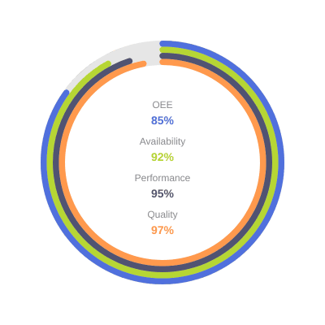

<!-- Generated by web/e2e/wiki.js - do not edit this page. Edit docs/wiki/examples/*.json, docs/wiki/notes/*.md or the generator, then run "npm run wiki" in web/. -->

Overall Equipment Effectiveness gauge with A/P/Q inputs.

| | |
|---|---|
| Component id | `open.industrial.OEE` |
| Palette | **Open Components / Industrial** → **OEE Summary** |
| Default size | 400 × 400 |



*OEE Summary as dropped from the palette, showing its built-in sample data.*

This component builds its chart from the domain props below, so there is no ECharts option to write: bind the props to your tags and queries. (A non-empty `option` is an advanced override that replaces the generated chart.)

## How to use it in Ignition

1. In the Designer, drag **OEE Summary** from the **Open Components / Industrial** group of the Perspective component palette onto a view. It shows sample data.
2. Select it and replace the sample data in the Property Editor: type values, paste JSON (right-click a property, **Paste**), or add a binding.
3. Bind the data props to tags, tag history or named queries. The props and the shape each one expects are listed under [Props](#props); [Binding examples](#binding-examples) has worked examples.

## Binding examples

**Three tags.** Bind the factors straight to tags that hold percentages (0-100); OEE is calculated as
A x P x Q:

| Property | Tag binding (example) |
|---|---|
| `props.availability` | `[default]Line1/OEE/Availability` |
| `props.performance` | `[default]Line1/OEE/Performance` |
| `props.quality` | `[default]Line1/OEE/Quality` |

If your tags hold fractions (0.92 rather than 92) use an **Expression** binding instead:
`{[default]Line1/OEE/Availability} * 100`.

**OEE calculated elsewhere.** When an MES already reports OEE, bind `props.oeeOverride` to that tag; the
OEE ring then shows it instead of the product. Leave it `null` to calculate.

**From a named query.** A query that returns one row, e.g.
`SELECT availability, performance, quality FROM oee_shift WHERE line = :line AND shift_id = :shift`,
bound to a custom property of the view (`view.custom.oee`, Return Format: json) gives a list with one
row object. Put a **Property** binding to `view.custom.oee` on each factor, with a transform that picks
its column:

```python
def transform(self, value, quality, timestamp):
    # value: view.custom.oee, a list with one row object
    return value[0]["availability"] if value else None
```

**Target and traffic-light colours.** Type these in the Property Editor; they rarely need a binding:
`target`: `85`, and `thresholds`:

```json
[{ "upTo": 60, "color": "#e05252" }, { "upTo": 85, "color": "#e6a23c" }, { "color": "#3ba272" }]
```

## Props

| Property | Type | Default | Description |
|---|---|---|---|
| `availability` | number | `92` | Availability in percent (0-100). |
| `performance` | number | `95` | Performance in percent (0-100). |
| `quality` | number | `97` | Quality in percent (0-100). |
| `oeeOverride` | number / null | `null` | Overrides the calculated OEE, in percent; clamped to 0-100. When null, OEE is computed as A*P*Q/10000. |
| `showLabels` | boolean | `true` | Show the names and values in the middle of the rings. |
| `labels` | object | `{}` | Ring names, e.g. for another language: { oee, availability, performance, quality }. Missing keys keep the English names. |
| `colors` | object / array | `{}` | Ring colours as { oee, availability, performance, quality }, or as an array in ring order starting with OEE (for use with metrics). Rings without a colour use the theme palette. |
| `thresholds` | array | `[]` | Colours every ring by its value, overriding colors. Value bands as objects { upTo, color }. A value takes the colour of the first band, in ascending order of upTo, whose upTo is greater than it; a band without upTo takes everything above. Example: [{"upTo": 60, "color": "#e05252"}, {"upTo": 85, "color": "#e6a23c"}, {"color": "#3ba272"}]. |
| `target` | number / null | `null` | OEE target in percent (e.g. 85 for world class), drawn as a marker on the OEE ring. Null for no marker. |
| `decimals` | integer / null | `null` | Decimal places of all values. Null shows the factors as given and the calculated OEE as a whole percent. |
| `metrics` | array | `[]` | Optional factors as objects { name, value, color, target }, values in percent (0-100). When non-empty they replace availability, performance and quality, and OEE is their product, e.g. A x P x Q x a fourth loss factor. |

The shared props (`theme`, `renderer`, `notMerge`, `lazyUpdate`, `sanitizeTooltip`, ...) and the seven events are the same as on every component: see [Binding Data](Binding-Data), [Themes](Themes) and [Events](Events).
