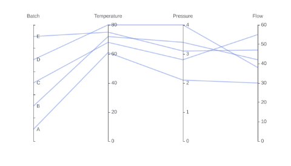
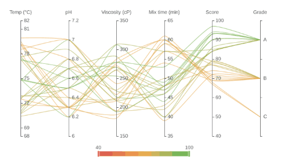

<!-- Generated by web/e2e/wiki.js - do not edit this page. Edit docs/wiki/examples/*.json, docs/wiki/notes/*.md or the generator, then run "npm run wiki" in web/. -->

Parallel coordinates.

| | |
|---|---|
| Component id | `open.echarts.ParallelChart` |
| Palette | **Open Components / ECharts** → **Parallel Chart** |
| Default size | 700 × 400 |



*Parallel Chart as dropped from the palette.* It takes any ECharts option in its `option` prop; the palette entry only decides which sample option a new component starts with.

<details>
<summary>Option of a freshly dropped component</summary>

```json
{
  "parallelAxis": [
    { "dim": 0, "name": "Batch", "type": "category", "data": ["A", "B", "C", "D", "E"] },
    { "dim": 1, "name": "Temperature" },
    { "dim": 2, "name": "Pressure" },
    { "dim": 3, "name": "Flow" }
  ],
  "series": [
    {
      "type": "parallel",
      "lineStyle": { "width": 2 },
      "data": [
        ["A", 61, 2.1, 30],
        ["B", 72, 3.4, 42],
        ["C", 68, 2.8, 55],
        ["D", 80, 4, 38],
        ["E", 75, 3.1, 47]
      ]
    }
  ]
}
```

</details>

## Examples

### Parallel Coordinates with Colour Scale

One line per batch across five measurements and a grade axis, coloured by quality score with a draggable range filter.



**How to make it in Ignition**

1. In the Designer, drag **Parallel Chart** from the **Open Components / ECharts** group of the Perspective component palette onto a view.
2. Open **Option JSON** below and copy it. In the Property Editor, right-click the `option` property and choose **Paste**: the pasted JSON replaces the sample option. (See [Getting Started](Getting-Started) for other ways to enter an option.)
3. Replace the sample data with live data by binding these paths (expand `option` in the Property Editor down to the property, then use its binding icon). Everything else in the option stays as pasted.

   | Property | The binding must return |
   |---|---|
   | `props.option.series[0].data` | a list of rows with 6 values each, in the order of the example: `[[74.8, 6.5, 269, 44, 93, "A"], ...]` |

   Script transform for `props.option.series[0].data`, turning a dataset into rows. With a time axis the first value of a row is the time in epoch milliseconds:

   ```python
   def transform(self, value, quality, timestamp):
       # value: dataset, e.g. from a Tag History binding: t_stamp, then one column per tag
       rows = []
       for row in range(value.getRowCount()):
           t = value.getValueAt(row, 0)
           if hasattr(t, "getTime"):  # a date: ECharts wants epoch milliseconds
               t = t.getTime()
           rows.append([t] + [value.getValueAt(row, col) for col in range(1, 6)])
       return rows
   ```

4. Bind `series[0].data` to one row per batch with a value for every axis, in the order of `parallelAxis` (`dim` is the column index).
5. Each axis has its own `name`, range (`min` / `max`) and may be a category axis (`type: "category"` with `data`), like the grade here.
6. Colour follows column 4 through `visualMap.dimension`; set `min` / `max` to that column’s range. Dragging the handles hides lines outside the range.
7. Users can also drag along any axis to brush a range; lines outside it fade (`inactiveOpacity`).

<details>
<summary>Option JSON</summary>

```json
{
  "tooltip": {},
  "visualMap": {
    "type": "continuous",
    "dimension": 4,
    "min": 40,
    "max": 100,
    "calculable": true,
    "orient": "horizontal",
    "left": "center",
    "bottom": 4,
    "itemWidth": 12,
    "itemHeight": 220,
    "inRange": { "color": ["#d9534f", "#f0ad4e", "#5cb85c"] }
  },
  "parallel": {
    "left": 50,
    "right": 70,
    "top": 50,
    "bottom": 70,
    "parallelAxisDefault": { "nameLocation": "end", "nameGap": 14, "nameTextStyle": { "fontSize": 12 } }
  },
  "parallelAxis": [
    { "dim": 0, "name": "Temp (°C)", "min": 68, "max": 82 },
    { "dim": 1, "name": "pH", "min": 6, "max": 7.2 },
    { "dim": 2, "name": "Viscosity (cP)", "min": 150, "max": 350 },
    { "dim": 3, "name": "Mix time (min)", "min": 35, "max": 65 },
    { "dim": 4, "name": "Score", "min": 40, "max": 100 },
    { "dim": 5, "name": "Grade", "type": "category", "data": ["C", "B", "A"] }
  ],
  "series": [
    {
      "name": "Batches",
      "type": "parallel",
      "smooth": 0.15,
      "lineStyle": { "width": 1.5, "opacity": 0.6 },
      "inactiveOpacity": 0.08,
      "data": [
        [74.8, 6.5, 269, 44, 93, "A"],
        [71, 6.8, 212, 48, 84, "A"],
        [78.5, 7, 222, 61, 68, "C"],
        [71.4, 6.7, 230, 57, 79, "B"],
        [77.3, 6.3, 264, 40, 79, "B"],
        [70.8, 6.7, 269, 47, 84, "A"],
        [71.8, 6.3, 181, 57, 72, "B"],
        [79.9, 7, 241, 54, 69, "B"],
        [72.9, 6.4, 214, 59, 77, "B"],
        [72.6, 6.7, 288, 40, 86, "A"],
        [78.2, 6.2, 272, 39, 72, "B"],
        [79.1, 6.8, 193, 60, 67, "C"],
        [74.9, 6.2, 308, 48, 93, "A"],
        [77.6, 6.9, 228, 46, 84, "A"],
        [70.4, 6.3, 216, 50, 77, "B"],
        [77.7, 6.3, 265, 48, 84, "A"],
        [79.1, 6.3, 276, 60, 69, "B"],
        [79.2, 6.4, 211, 59, 70, "B"],
        [74.9, 6.5, 278, 53, 97, "A"],
        [70.7, 6.5, 194, 43, 78, "B"],
        [71.6, 6.6, 254, 47, 90, "A"],
        [74.7, 7, 218, 46, 90, "A"],
        [72.8, 6.5, 309, 57, 85, "A"],
        [79.5, 6.3, 187, 48, 74, "B"],
        [72.5, 6.3, 283, 60, 71, "B"],
        [77.2, 6.7, 192, 48, 93, "A"],
        [77.4, 6.6, 278, 49, 94, "A"],
        [72.5, 6.8, 211, 42, 79, "B"]
      ]
    }
  ]
}
```

</details>
