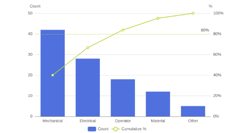

<!-- Generated by web/e2e/wiki.js - do not edit this page. Edit docs/wiki/examples/*.json, docs/wiki/notes/*.md or the generator, then run "npm run wiki" in web/. -->

Pareto analysis with categories, counts, and cumulative percentage.

| | |
|---|---|
| Component id | `open.industrial.Pareto` |
| Palette | **Open Components / Industrial** → **Pareto Chart** |
| Default size | 700 × 400 |



*Pareto Chart as dropped from the palette, showing its built-in sample data.*

This component builds its chart from the domain props below, so there is no ECharts option to write: bind the props to your tags and queries. (A non-empty `option` is an advanced override that replaces the generated chart.)

## How to use it in Ignition

1. In the Designer, drag **Pareto Chart** from the **Open Components / Industrial** group of the Perspective component palette onto a view. It shows sample data.
2. Select it and replace the sample data in the Property Editor: type values, paste JSON (right-click a property, **Paste**), or add a binding.
3. Bind the data props to tags, tag history or named queries. The props and the shape each one expects are listed under [Props](#props); [Binding examples](#binding-examples) has worked examples.

## Binding examples

`categories` and `counts` are two lists of the same length. The component sorts the bars itself, so the
query does not need an `ORDER BY`.

**Downtime reasons from a named query.** Bind the query once to a custom property of the view
(`view.custom.reasons`, Return Format: dataset):

```sql
SELECT reason, COUNT(*) AS stops
FROM downtime_events
WHERE line = :line AND start_time >= :from
GROUP BY reason
```

Then put a **Property** binding to `view.custom.reasons` on each of the two props, with these transforms.

`props.categories`:

```python
def transform(self, value, quality, timestamp):
    return [str(value.getValueAt(row, "reason")) for row in range(value.getRowCount())]
```

`props.counts`:

```python
def transform(self, value, quality, timestamp):
    return [value.getValueAt(row, "stops") for row in range(value.getRowCount())]
```

To rank by lost minutes instead of the number of stops, select `SUM(minutes)` and set `barLabel` to
`"Minutes"`.

**From counter tags.** For a fixed set of reject causes kept in tags, leave `categories` as typed and
bind each element of `counts` (`props.counts[0]`, `props.counts[1]`, ...) to its counter tag.

## Props

| Property | Type | Default | Description |
|---|---|---|---|
| `categories` | array | sample data (5 items) | Category labels. Bars are drawn sorted by count, largest first. |
| `counts` | array | `[42,28,18,12,5]` | Count for each category, in the same order as categories. Negative or non-numeric counts count as 0. |
| `showCumulativeLine` | boolean | `true` | Show the cumulative percentage line. |
| `show80PercentLine` | boolean | `true` | Show the 80% threshold markLine. |
| `barLabel` | string | `"Count"` | Label for the bar series. |
| `lineLabel` | string | `"Cumulative %"` | Label for the cumulative line series. |

The shared props (`theme`, `renderer`, `notMerge`, `lazyUpdate`, `sanitizeTooltip`, ...) and the seven events are the same as on every component: see [Binding Data](Binding-Data), [Themes](Themes) and [Events](Events).
