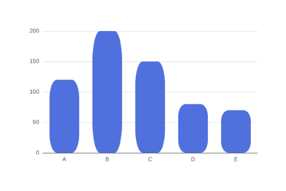
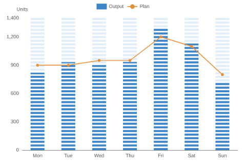
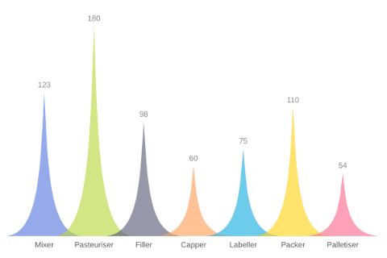
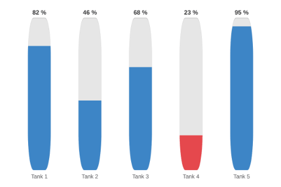

<!-- Generated by web/e2e/wiki.js - do not edit this page. Edit docs/wiki/examples/*.json, docs/wiki/notes/*.md or the generator, then run "npm run wiki" in web/. -->

Symbol-based pictorial bars.

| | |
|---|---|
| Component id | `open.echarts.PictorialBarChart` |
| Palette | **Open Components / ECharts** → **Pictorial Bar Chart** |
| Default size | 600 × 400 |



*Pictorial Bar Chart as dropped from the palette.* It takes any ECharts option in its `option` prop; the palette entry only decides which sample option a new component starts with.

<details>
<summary>Option of a freshly dropped component</summary>

```json
{
  "xAxis": { "type": "category", "data": ["A", "B", "C", "D", "E"] },
  "yAxis": { "type": "value" },
  "series": [{ "type": "pictorialBar", "symbol": "roundRect", "data": [120, 200, 150, 80, 70] }]
}
```

</details>

## Examples

- [Segmented Bars](#segmented-bars): Bars built from stacked blocks (like an LED level meter) over a faint full-height track, with a plan line.
- [Hill Bars](#hill-bars): Overlapping smooth peaks instead of rectangles, each in its own colour with the value on top.
- [Tank Levels](#tank-levels): Rounded tank outlines filled from the bottom to the level value, with the percentage above the liquid.

### Segmented Bars

Bars built from stacked blocks (like an LED level meter) over a faint full-height track, with a plan line.



**How to make it in Ignition**

1. In the Designer, drag **Pictorial Bar Chart** from the **Open Components / ECharts** group of the Perspective component palette onto a view.
2. Open **Option JSON** below and copy it. In the Property Editor, right-click the `option` property and choose **Paste**: the pasted JSON replaces the sample option. (See [Getting Started](Getting-Started) for other ways to enter an option.)
3. Replace the sample data with live data by binding these paths (expand `option` in the Property Editor down to the property, then use its binding icon). Everything else in the option stays as pasted.

   | Property | The binding must return |
   |---|---|
   | `props.option.xAxis.data` | a list of category labels: `["Mon", "Tue", "Wed"]` |
   | `props.option.series[0].data` | a list of numbers, one per category: `[820, 932, 901]` |
   | `props.option.series[1].data` | a list of numbers, one per category: `[820, 932, 901]` |
   | `props.option.series[2].data` | a list of numbers, one per category: `[820, 932, 901]` |

   Script transform for `props.option.xAxis.data` (the same query, its `label` column):

   ```python
   def transform(self, value, quality, timestamp):
       return [str(value.getValueAt(row, "label")) for row in range(value.getRowCount())]
   ```

   Script transform for `props.option.series[0].data`, on a binding that returns a dataset (for example a named query with a `value` column):

   ```python
   def transform(self, value, quality, timestamp):
       # value: dataset with a numeric column "value", one row per category
       return [value.getValueAt(row, "value") for row in range(value.getRowCount())]
   ```

4. Bind `xAxis.data` to the categories, `series[0].data` to the values and `series[2].data` to the plan line.
5. The blocks are a `pictorialBar` with `symbol: "rect"`, `symbolRepeat: true`, `symbolSize: [width, blockHeight]` and `symbolMargin` as the gap: change those to resize the segments.
6. The track is `series[1]`: the same blocks at low opacity, every value set to the axis maximum. Bind its values and `yAxis.max` together if the scale changes.

<details>
<summary>Option JSON</summary>

```json
{
  "legend": { "top": 4, "data": ["Output", "Plan"] },
  "tooltip": { "trigger": "axis", "axisPointer": { "type": "shadow" } },
  "grid": { "left": 54, "right": 20, "top": 44, "bottom": 34 },
  "xAxis": {
    "type": "category",
    "data": ["Mon", "Tue", "Wed", "Thu", "Fri", "Sat", "Sun"],
    "axisTick": { "show": false }
  },
  "yAxis": { "type": "value", "name": "Units", "max": 1400, "splitLine": { "show": false } },
  "series": [
    {
      "name": "Output",
      "type": "pictorialBar",
      "symbol": "rect",
      "symbolRepeat": true,
      "symbolClip": true,
      "symbolSize": [34, 5],
      "symbolMargin": 2,
      "z": 2,
      "itemStyle": { "color": "#3d85c6" },
      "data": [820, 932, 901, 934, 1290, 1130, 720]
    },
    {
      "name": "Track",
      "type": "pictorialBar",
      "symbol": "rect",
      "symbolRepeat": true,
      "symbolSize": [34, 5],
      "symbolMargin": 2,
      "z": 1,
      "silent": true,
      "tooltip": { "show": false },
      "itemStyle": { "color": "#3d85c6", "opacity": 0.15 },
      "data": [1400, 1400, 1400, 1400, 1400, 1400, 1400]
    },
    {
      "name": "Plan",
      "type": "line",
      "z": 3,
      "symbol": "circle",
      "symbolSize": 7,
      "lineStyle": { "width": 2 },
      "itemStyle": { "color": "#e69138" },
      "data": [900, 900, 950, 950, 1200, 1100, 800]
    }
  ]
}
```

</details>

### Hill Bars

Overlapping smooth peaks instead of rectangles, each in its own colour with the value on top.



**How to make it in Ignition**

1. In the Designer, drag **Pictorial Bar Chart** from the **Open Components / ECharts** group of the Perspective component palette onto a view.
2. Open **Option JSON** below and copy it. In the Property Editor, right-click the `option` property and choose **Paste**: the pasted JSON replaces the sample option. (See [Getting Started](Getting-Started) for other ways to enter an option.)
3. Replace the sample data with live data by binding these paths (expand `option` in the Property Editor down to the property, then use its binding icon). Everything else in the option stays as pasted.

   | Property | The binding must return |
   |---|---|
   | `props.option.xAxis.data` | a list of category labels: `["Mon", "Tue", "Wed"]` |
   | `props.option.series[0].data` | a list of numbers, one per category: `[820, 932, 901]` |

   Script transform for `props.option.xAxis.data` (the same query, its `label` column):

   ```python
   def transform(self, value, quality, timestamp):
       return [str(value.getValueAt(row, "label")) for row in range(value.getRowCount())]
   ```

   Script transform for `props.option.series[0].data`, on a binding that returns a dataset (for example a named query with a `value` column):

   ```python
   def transform(self, value, quality, timestamp):
       # value: dataset with a numeric column "value", one row per category
       return [value.getValueAt(row, "value") for row in range(value.getRowCount())]
   ```

4. Bind `xAxis.data` to the names and `series[0].data` to the values (plain numbers, or `{value, itemStyle: {color}}` to colour one peak).
5. The peak is a custom `symbol` path; `barCategoryGap: "-60%"` makes neighbours overlap. Use a less negative gap for more categories.
6. `colorBy: "data"` takes one theme colour per bar.

<details>
<summary>Option JSON</summary>

```json
{
  "tooltip": { "trigger": "axis", "axisPointer": { "type": "none" } },
  "grid": { "left": 30, "right": 30, "top": 40, "bottom": 34 },
  "xAxis": {
    "type": "category",
    "data": ["Mixer", "Pasteuriser", "Filler", "Capper", "Labeller", "Packer", "Palletiser"],
    "axisTick": { "show": false },
    "axisLine": { "show": false },
    "axisLabel": { "interval": 0 }
  },
  "yAxis": { "show": false },
  "series": [
    {
      "name": "Energy (kWh)",
      "type": "pictorialBar",
      "colorBy": "data",
      "barCategoryGap": "-60%",
      "symbol": "path://M0,10 L10,10 C5.5,10 5.5,5 5,0 C4.5,5 4.5,10 0,10 z",
      "itemStyle": { "opacity": 0.6 },
      "emphasis": { "itemStyle": { "opacity": 1 } },
      "label": { "show": true, "position": "top", "fontSize": 12 },
      "data": [123, 180, 98, 60, 75, 110, 54]
    }
  ]
}
```

</details>

### Tank Levels

Rounded tank outlines filled from the bottom to the level value, with the percentage above the liquid.



**How to make it in Ignition**

1. In the Designer, drag **Pictorial Bar Chart** from the **Open Components / ECharts** group of the Perspective component palette onto a view.
2. Open **Option JSON** below and copy it. In the Property Editor, right-click the `option` property and choose **Paste**: the pasted JSON replaces the sample option. (See [Getting Started](Getting-Started) for other ways to enter an option.)
3. Replace the sample data with live data by binding these paths (expand `option` in the Property Editor down to the property, then use its binding icon). Everything else in the option stays as pasted.

   | Property | The binding must return |
   |---|---|
   | `props.option.xAxis.data` | a list of category labels: `["Mon", "Tue", "Wed"]` |
   | `props.option.series[0].data` | a list in the shape of the example |
   | `props.option.series[1].data` | a list of numbers, one per category: `[820, 932, 901]` |

   Script transform for `props.option.xAxis.data` (the same query, its `label` column):

   ```python
   def transform(self, value, quality, timestamp):
       return [str(value.getValueAt(row, "label")) for row in range(value.getRowCount())]
   ```

   Script transform for `props.option.series[1].data`, on a binding that returns a dataset (for example a named query with a `value` column):

   ```python
   def transform(self, value, quality, timestamp):
       # value: dataset with a numeric column "value", one row per category
       return [value.getValueAt(row, "value") for row in range(value.getRowCount())]
   ```

   For `series[0].data` build the same structure as the example in a script transform or a project script; [Binding Data](Binding-Data) shows the pattern.

4. Bind `series[0].data` to the levels (0–100) and `xAxis.data` to the tank names.
5. Two series draw the same shape: `series[1]` is the empty tank (always 100), `series[0]` the liquid, cut off at its value by `symbolClip: true`. `symbolBoundingData: 100` tells both what a full tank is.
6. For a low-level colour give a data item its own style: `{"value": 23, "itemStyle": {"color": "#e5484d"}}` (as on Tank 4), e.g. from a script transform.
7. For levels in engineering units change `yAxis.max`, `symbolBoundingData`, the track values and `label.formatter` together.

<details>
<summary>Option JSON</summary>

```json
{
  "tooltip": { "trigger": "axis", "axisPointer": { "type": "none" } },
  "grid": { "left": 30, "right": 30, "top": 40, "bottom": 36 },
  "xAxis": {
    "type": "category",
    "data": ["Tank 1", "Tank 2", "Tank 3", "Tank 4", "Tank 5"],
    "axisTick": { "show": false },
    "axisLine": { "show": false }
  },
  "yAxis": { "max": 100, "show": false },
  "series": [
    {
      "name": "Level",
      "type": "pictorialBar",
      "symbol": "roundRect",
      "symbolClip": true,
      "symbolBoundingData": 100,
      "symbolSize": ["62%", "100%"],
      "z": 10,
      "itemStyle": { "color": "#3d85c6" },
      "label": {
        "show": true,
        "position": "top",
        "distance": 6,
        "formatter": "{c} %",
        "fontSize": 13,
        "fontWeight": "bold"
      },
      "data": [82, 46, 68, { "value": 23, "itemStyle": { "color": "#e5484d" } }, 95]
    },
    {
      "name": "Capacity",
      "type": "pictorialBar",
      "symbol": "roundRect",
      "symbolBoundingData": 100,
      "symbolSize": ["62%", "100%"],
      "silent": true,
      "tooltip": { "show": false },
      "itemStyle": { "color": "rgba(128,128,128,0.2)", "borderColor": "rgba(128,128,128,0.6)", "borderWidth": 1 },
      "data": [100, 100, 100, 100, 100]
    }
  ]
}
```

</details>
