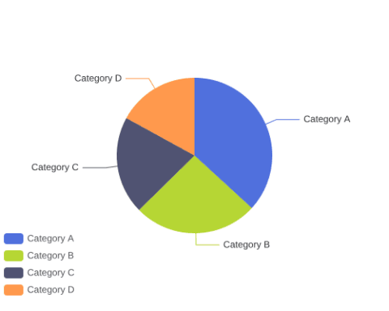
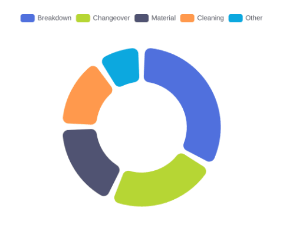
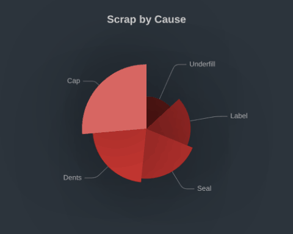
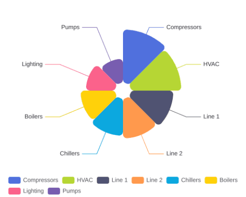
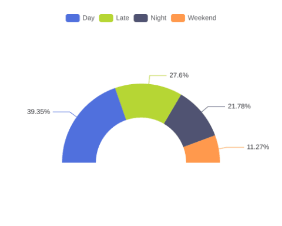
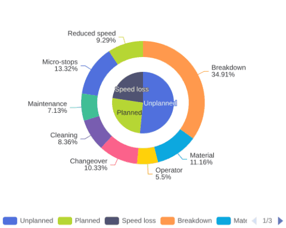
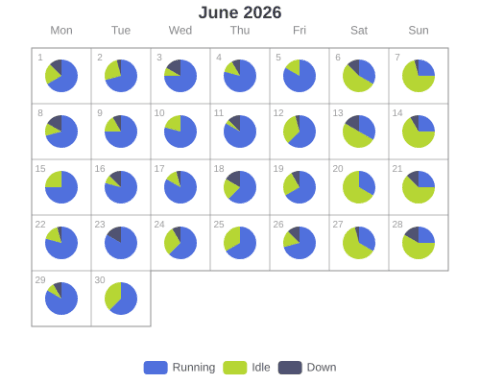

<!-- Generated by web/e2e/wiki.js - do not edit this page. Edit docs/wiki/examples/*.json, docs/wiki/notes/*.md or the generator, then run "npm run wiki" in web/. -->

Pie, donut, rose, and nested pie charts.

| | |
|---|---|
| Component id | `open.echarts.PieChart` |
| Palette | **Open Components / ECharts** → **Pie Chart** |
| Default size | 500 × 400 |



*Pie Chart as dropped from the palette.* It takes any ECharts option in its `option` prop; the palette entry only decides which sample option a new component starts with.

<details>
<summary>Option of a freshly dropped component</summary>

```json
{
  "tooltip": { "trigger": "item" },
  "legend": { "orient": "vertical", "left": "left" },
  "series": [
    {
      "type": "pie",
      "radius": "50%",
      "data": [
        { "value": 1048, "name": "Category A" },
        { "value": 735, "name": "Category B" },
        { "value": 580, "name": "Category C" },
        { "value": 484, "name": "Category D" }
      ]
    }
  ]
}
```

</details>

## Examples

- [Rounded Donut](#rounded-donut): A donut with gaps between the slices and rounded corners. The hovered slice is named in the centre.
- [Customized Pie (Dark)](#customized-pie-dark): A rose pie in shades of one colour, lighter for larger values, on its own dark panel. The dark background and text colours are part of the look and do not follow the theme.
- [Nightingale Rose](#nightingale-rose): Slices of equal angle whose radius shows the value, with rounded corners.
- [Half Donut](#half-donut): A donut drawn over a half circle, for a share-of-total readout that takes less height.
- [Nested Pies](#nested-pies): An inner pie of groups with an outer ring breaking each group down.
- [Pies on a Calendar](#pies-on-a-calendar): One small pie per day of a month, showing how each day split into running, idle and down hours. All pies read from one dataset: a row per day.

### Rounded Donut

A donut with gaps between the slices and rounded corners. The hovered slice is named in the centre.



**How to make it in Ignition**

1. In the Designer, drag **Pie Chart** from the **Open Components / ECharts** group of the Perspective component palette onto a view.
2. Open **Option JSON** below and copy it. In the Property Editor, right-click the `option` property and choose **Paste**: the pasted JSON replaces the sample option. (See [Getting Started](Getting-Started) for other ways to enter an option.)
3. Replace the sample data with live data by binding these paths (expand `option` in the Property Editor down to the property, then use its binding icon). Everything else in the option stays as pasted.

   | Property | The binding must return |
   |---|---|
   | `props.option.series[0].data` | a list of objects: `[{ "name": "Good", "value": 90 }, ...]` (keep any other keys the example has, such as `itemStyle`) |

   Script transform for `props.option.series[0].data`, on a binding that returns a dataset with a `name` and a `value` column:

   ```python
   def transform(self, value, quality, timestamp):
       return [
           {"name": str(value.getValueAt(row, "name")), "value": value.getValueAt(row, "value")}
           for row in range(value.getRowCount())
       ]
   ```

4. Bind `series[0].data` to a list of `{name, value}` objects, for example from a named query with a script transform.
5. `padAngle` is the gap between slices in degrees and `itemStyle.borderRadius` the corner rounding.
6. Labels are hidden until a slice is hovered; its name then appears in the middle (`emphasis.label`).

<details>
<summary>Option JSON</summary>

```json
{
  "tooltip": { "trigger": "item" },
  "legend": { "top": "5%", "left": "center" },
  "series": [
    {
      "name": "Downtime",
      "type": "pie",
      "radius": ["40%", "70%"],
      "center": ["50%", "56%"],
      "avoidLabelOverlap": false,
      "padAngle": 5,
      "itemStyle": { "borderRadius": 10 },
      "label": { "show": false, "position": "center" },
      "emphasis": { "label": { "show": true, "fontSize": 28, "fontWeight": "bold" } },
      "labelLine": { "show": false },
      "data": [
        { "value": 1048, "name": "Breakdown" },
        { "value": 735, "name": "Changeover" },
        { "value": 580, "name": "Material" },
        { "value": 484, "name": "Cleaning" },
        { "value": 300, "name": "Other" }
      ]
    }
  ]
}
```

</details>

### Customized Pie (Dark)

A rose pie in shades of one colour, lighter for larger values, on its own dark panel. The dark background and text colours are part of the look and do not follow the theme.



**How to make it in Ignition**

1. In the Designer, drag **Pie Chart** from the **Open Components / ECharts** group of the Perspective component palette onto a view.
2. Open **Option JSON** below and copy it. In the Property Editor, right-click the `option` property and choose **Paste**: the pasted JSON replaces the sample option. (See [Getting Started](Getting-Started) for other ways to enter an option.)
3. Replace the sample data with live data by binding these paths (expand `option` in the Property Editor down to the property, then use its binding icon). Everything else in the option stays as pasted.

   | Property | The binding must return |
   |---|---|
   | `props.option.series[0].data` | a list of objects: `[{ "name": "Good", "value": 90 }, ...]` (keep any other keys the example has, such as `itemStyle`) |

   Script transform for `props.option.series[0].data`, on a binding that returns a dataset with a `name` and a `value` column:

   ```python
   def transform(self, value, quality, timestamp):
       return [
           {"name": str(value.getValueAt(row, "name")), "value": value.getValueAt(row, "value")}
           for row in range(value.getRowCount())
       ]
   ```

4. Bind `series[0].data` to `{name, value}` objects. Supply them sorted by value: the chart draws them in the order given.
5. Set `visualMap.min` and `visualMap.max` to just below and above your data range: they map the value to how light the slice is drawn.
6. The background and text colours are fixed (`backgroundColor`, `title.textStyle.color`, `label.color`) and do not follow the theme.

<details>
<summary>Option JSON</summary>

```json
{
  "backgroundColor": "#2c343c",
  "title": { "text": "Scrap by Cause", "left": "center", "top": 20, "textStyle": { "color": "#ccc" } },
  "tooltip": { "trigger": "item" },
  "visualMap": { "show": false, "min": 80, "max": 600, "inRange": { "colorLightness": [0, 1] } },
  "series": [
    {
      "name": "Scrap",
      "type": "pie",
      "radius": "55%",
      "center": ["50%", "55%"],
      "roseType": "radius",
      "data": [
        { "value": 200, "name": "Underfill" },
        { "value": 274, "name": "Label" },
        { "value": 310, "name": "Seal" },
        { "value": 335, "name": "Dents" },
        { "value": 400, "name": "Cap" }
      ],
      "label": { "color": "rgba(255, 255, 255, 0.6)" },
      "labelLine": {
        "lineStyle": { "color": "rgba(255, 255, 255, 0.4)" },
        "smooth": 0.2,
        "length": 10,
        "length2": 20
      },
      "itemStyle": { "color": "#c23531", "shadowBlur": 200, "shadowColor": "rgba(0, 0, 0, 0.5)" },
      "animationType": "scale",
      "animationEasing": "elasticOut"
    }
  ]
}
```

</details>

### Nightingale Rose

Slices of equal angle whose radius shows the value, with rounded corners.



**How to make it in Ignition**

1. In the Designer, drag **Pie Chart** from the **Open Components / ECharts** group of the Perspective component palette onto a view.
2. Open **Option JSON** below and copy it. In the Property Editor, right-click the `option` property and choose **Paste**: the pasted JSON replaces the sample option. (See [Getting Started](Getting-Started) for other ways to enter an option.)
3. Replace the sample data with live data by binding these paths (expand `option` in the Property Editor down to the property, then use its binding icon). Everything else in the option stays as pasted.

   | Property | The binding must return |
   |---|---|
   | `props.option.series[0].data` | a list of objects: `[{ "name": "Good", "value": 90 }, ...]` (keep any other keys the example has, such as `itemStyle`) |

   Script transform for `props.option.series[0].data`, on a binding that returns a dataset with a `name` and a `value` column:

   ```python
   def transform(self, value, quality, timestamp):
       return [
           {"name": str(value.getValueAt(row, "name")), "value": value.getValueAt(row, "value")}
           for row in range(value.getRowCount())
       ]
   ```

4. Bind `series[0].data` to `{name, value}` objects. `roseType: "area"` gives every slice the same angle and shows the value as radius; `"radius"` varies both.

<details>
<summary>Option JSON</summary>

```json
{
  "tooltip": { "trigger": "item" },
  "legend": { "top": "bottom" },
  "series": [
    {
      "name": "Energy",
      "type": "pie",
      "radius": ["8%", "62%"],
      "center": ["50%", "46%"],
      "roseType": "area",
      "itemStyle": { "borderRadius": 8 },
      "data": [
        { "value": 40, "name": "Compressors" },
        { "value": 38, "name": "HVAC" },
        { "value": 32, "name": "Line 1" },
        { "value": 30, "name": "Line 2" },
        { "value": 28, "name": "Chillers" },
        { "value": 26, "name": "Boilers" },
        { "value": 22, "name": "Lighting" },
        { "value": 18, "name": "Pumps" }
      ]
    }
  ]
}
```

</details>

### Half Donut

A donut drawn over a half circle, for a share-of-total readout that takes less height.



**How to make it in Ignition**

1. In the Designer, drag **Pie Chart** from the **Open Components / ECharts** group of the Perspective component palette onto a view.
2. Open **Option JSON** below and copy it. In the Property Editor, right-click the `option` property and choose **Paste**: the pasted JSON replaces the sample option. (See [Getting Started](Getting-Started) for other ways to enter an option.)
3. Replace the sample data with live data by binding these paths (expand `option` in the Property Editor down to the property, then use its binding icon). Everything else in the option stays as pasted.

   | Property | The binding must return |
   |---|---|
   | `props.option.series[0].data` | a list of objects: `[{ "name": "Good", "value": 90 }, ...]` (keep any other keys the example has, such as `itemStyle`) |

   Script transform for `props.option.series[0].data`, on a binding that returns a dataset with a `name` and a `value` column:

   ```python
   def transform(self, value, quality, timestamp):
       return [
           {"name": str(value.getValueAt(row, "name")), "value": value.getValueAt(row, "value")}
           for row in range(value.getRowCount())
       ]
   ```

4. Bind `series[0].data` to `{name, value}` objects. `startAngle: 180` and `endAngle: 360` draw the upper half only; `center` moves it down to use the space.

<details>
<summary>Option JSON</summary>

```json
{
  "tooltip": { "trigger": "item" },
  "legend": { "top": "5%", "left": "center" },
  "series": [
    {
      "name": "Shift output",
      "type": "pie",
      "radius": ["40%", "70%"],
      "center": ["50%", "72%"],
      "startAngle": 180,
      "endAngle": 360,
      "label": { "formatter": "{d}%" },
      "data": [
        { "value": 1048, "name": "Day" },
        { "value": 735, "name": "Late" },
        { "value": 580, "name": "Night" },
        { "value": 300, "name": "Weekend" }
      ]
    }
  ]
}
```

</details>

### Nested Pies

An inner pie of groups with an outer ring breaking each group down.



**How to make it in Ignition**

1. In the Designer, drag **Pie Chart** from the **Open Components / ECharts** group of the Perspective component palette onto a view.
2. Open **Option JSON** below and copy it. In the Property Editor, right-click the `option` property and choose **Paste**: the pasted JSON replaces the sample option. (See [Getting Started](Getting-Started) for other ways to enter an option.)
3. Replace the sample data with live data by binding these paths (expand `option` in the Property Editor down to the property, then use its binding icon). Everything else in the option stays as pasted.

   | Property | The binding must return |
   |---|---|
   | `props.option.series[0].data` | a list of objects: `[{ "name": "Good", "value": 90 }, ...]` (keep any other keys the example has, such as `itemStyle`) |
   | `props.option.series[1].data` | a list of objects: `[{ "name": "Good", "value": 90 }, ...]` (keep any other keys the example has, such as `itemStyle`) |

   Script transform for `props.option.series[0].data`, on a binding that returns a dataset with a `name` and a `value` column:

   ```python
   def transform(self, value, quality, timestamp):
       return [
           {"name": str(value.getValueAt(row, "name")), "value": value.getValueAt(row, "value")}
           for row in range(value.getRowCount())
       ]
   ```

4. Two pie series with the same `center`: bind `series[0].data` to the groups and `series[1].data` to the breakdown, both as `{name, value}` objects.
5. List the breakdown in group order and make each group's parts add up to the group value, so the outer segments line up with the inner slices.

<details>
<summary>Option JSON</summary>

```json
{
  "tooltip": { "trigger": "item", "formatter": "{a}<br>{b}: {c} ({d}%)" },
  "legend": { "type": "scroll", "bottom": 0 },
  "series": [
    {
      "name": "Type",
      "type": "pie",
      "selectedMode": "single",
      "radius": [0, "27%"],
      "center": ["50%", "45%"],
      "label": { "position": "inner", "fontSize": 12 },
      "labelLine": { "show": false },
      "data": [
        { "value": 1548, "name": "Unplanned" },
        { "value": 775, "name": "Planned" },
        { "value": 679, "name": "Speed loss" }
      ]
    },
    {
      "name": "Cause",
      "type": "pie",
      "radius": ["40%", "54%"],
      "center": ["50%", "45%"],
      "label": { "formatter": "{b}\n{d}%" },
      "labelLine": { "length": 12, "length2": 8 },
      "data": [
        { "value": 1048, "name": "Breakdown" },
        { "value": 335, "name": "Material" },
        { "value": 165, "name": "Operator" },
        { "value": 310, "name": "Changeover" },
        { "value": 251, "name": "Cleaning" },
        { "value": 214, "name": "Maintenance" },
        { "value": 400, "name": "Micro-stops" },
        { "value": 279, "name": "Reduced speed" }
      ]
    }
  ]
}
```

</details>

### Pies on a Calendar

One small pie per day of a month, showing how each day split into running, idle and down hours. All pies read from one dataset: a row per day.



**How to make it in Ignition**

1. In the Designer, drag **Pie Chart** from the **Open Components / ECharts** group of the Perspective component palette onto a view.
2. Open **Option JSON** below and copy it. In the Property Editor, right-click the `option` property and choose **Paste**: the pasted JSON replaces the sample option. (See [Getting Started](Getting-Started) for other ways to enter an option.)
3. Replace the sample data with live data by binding these paths (expand `option` in the Property Editor down to the property, then use its binding icon). Everything else in the option stays as pasted.

   | Property | The binding must return |
   |---|---|
   | `props.option.dataset.source` | a table: a list of rows (the first row holds the column names), or a list of objects with one key per column |
   | `props.option.series[0].data` | a list of rows with 2 values each, in the order of the example: `[["2026-06-01", 1], ...]` |

   Script transform for `props.option.dataset.source`, turning any dataset into the table ECharts reads (header row first):

   ```python
   def transform(self, value, quality, timestamp):
       columns = list(value.getColumnNames())
       rows = [columns]
       for row in range(value.getRowCount()):
           rows.append([value.getValueAt(row, col) for col in range(len(columns))])
       return rows
   ```

   Script transform for `props.option.series[0].data`, turning a dataset into rows. With a time axis the first value of a row is the time in epoch milliseconds:

   ```python
   def transform(self, value, quality, timestamp):
       # value: dataset, e.g. from a Tag History binding: t_stamp, then one column per tag
       rows = []
       for row in range(value.getRowCount()):
           t = value.getValueAt(row, 0)
           if hasattr(t, "getTime"):  # a date: ECharts wants epoch milliseconds
               t = t.getTime()
           rows.append([t] + [value.getValueAt(row, col) for col in range(1, 2)])
       return rows
   ```

4. All pies read from `dataset.source`: a header row, then one row per day as `[date, running, idle, down]`. Bind `dataset.source` to that table.
5. There is one pie series per day. Each needs `center: [date]` and `encode.value` set to its row number in the dataset (1 for the first day).
6. For another month change `calendar.range`, the dates in the pie series and the `[date, dayNumber]` pairs in `series[0].data`, which draws the day numbers. Generate all three in one script transform.
7. `calendar.cellSize` and the pies' `radius` are in pixels: change them together when the component is resized.

<details>
<summary>Option JSON</summary>

```json
{
  "tooltip": { "trigger": "item", "formatter": "{b}: {d}%" },
  "legend": { "bottom": 5, "data": ["Running", "Idle", "Down"] },
  "calendar": {
    "top": 50,
    "left": "center",
    "orient": "vertical",
    "cellSize": [62, 58],
    "range": ["2026-06"],
    "yearLabel": { "show": false },
    "monthLabel": { "show": false },
    "itemStyle": { "color": "transparent", "borderColor": "rgba(128, 128, 128, 0.35)" },
    "splitLine": { "lineStyle": { "color": "rgba(128, 128, 128, 0.8)" } },
    "dayLabel": {
      "color": "#888",
      "margin": 12,
      "firstDay": 1,
      "nameMap": ["Sun", "Mon", "Tue", "Wed", "Thu", "Fri", "Sat"]
    }
  },
  "title": { "text": "June 2026", "left": "center", "top": 0 },
  "dataset": {
    "source": [
      ["Date", "Running", "Idle", "Down"],
      ["2026-06-01", 16, 5, 3],
      ["2026-06-02", 17, 6, 1],
      ["2026-06-03", 18, 2, 4],
      ["2026-06-04", 19, 3, 2],
      ["2026-06-05", 20, 4, 0],
      ["2026-06-06", 8, 13, 3],
      ["2026-06-07", 6, 17, 1],
      ["2026-06-08", 17, 3, 4],
      ["2026-06-09", 18, 4, 2],
      ["2026-06-10", 19, 5, 0],
      ["2026-06-11", 20, 1, 3],
      ["2026-06-12", 15, 8, 1],
      ["2026-06-13", 8, 12, 4],
      ["2026-06-14", 6, 16, 2],
      ["2026-06-15", 18, 6, 0],
      ["2026-06-16", 19, 2, 3],
      ["2026-06-17", 20, 3, 1],
      ["2026-06-18", 15, 5, 4],
      ["2026-06-19", 16, 6, 2],
      ["2026-06-20", 8, 16, 0],
      ["2026-06-21", 6, 15, 3],
      ["2026-06-22", 19, 4, 1],
      ["2026-06-23", 20, 0, 4],
      ["2026-06-24", 15, 7, 2],
      ["2026-06-25", 16, 8, 0],
      ["2026-06-26", 17, 4, 3],
      ["2026-06-27", 8, 15, 1],
      ["2026-06-28", 6, 14, 4],
      ["2026-06-29", 20, 2, 2],
      ["2026-06-30", 15, 9, 0]
    ]
  },
  "series": [
    {
      "type": "scatter",
      "coordinateSystem": "calendar",
      "symbolSize": 0,
      "silent": true,
      "data": [
        ["2026-06-01", 1],
        ["2026-06-02", 2],
        ["2026-06-03", 3],
        ["2026-06-04", 4],
        ["2026-06-05", 5],
        ["2026-06-06", 6],
        ["2026-06-07", 7],
        ["2026-06-08", 8],
        ["2026-06-09", 9],
        ["2026-06-10", 10],
        ["2026-06-11", 11],
        ["2026-06-12", 12],
        ["2026-06-13", 13],
        ["2026-06-14", 14],
        ["2026-06-15", 15],
        ["2026-06-16", 16],
        ["2026-06-17", 17],
        ["2026-06-18", 18],
        ["2026-06-19", 19],
        ["2026-06-20", 20],
        ["2026-06-21", 21],
        ["2026-06-22", 22],
        ["2026-06-23", 23],
        ["2026-06-24", 24],
        ["2026-06-25", 25],
        ["2026-06-26", 26],
        ["2026-06-27", 27],
        ["2026-06-28", 28],
        ["2026-06-29", 29],
        ["2026-06-30", 30]
      ],
      "label": {
        "show": true,
        "formatter": "{@[1]}",
        "offset": [-22, -19],
        "fontSize": 10,
        "color": "#888",
        "textBorderWidth": 0
      }
    },
    {
      "type": "pie",
      "coordinateSystem": "calendar",
      "center": ["2026-06-01"],
      "radius": 17,
      "label": { "show": false },
      "datasetIndex": 0,
      "seriesLayoutBy": "row",
      "encode": { "itemName": 0, "value": 1 }
    },
    {
      "type": "pie",
      "coordinateSystem": "calendar",
      "center": ["2026-06-02"],
      "radius": 17,
      "label": { "show": false },
      "datasetIndex": 0,
      "seriesLayoutBy": "row",
      "encode": { "itemName": 0, "value": 2 }
    },
    {
      "type": "pie",
      "coordinateSystem": "calendar",
      "center": ["2026-06-03"],
      "radius": 17,
      "label": { "show": false },
      "datasetIndex": 0,
      "seriesLayoutBy": "row",
      "encode": { "itemName": 0, "value": 3 }
    },
    {
      "type": "pie",
      "coordinateSystem": "calendar",
      "center": ["2026-06-04"],
      "radius": 17,
      "label": { "show": false },
      "datasetIndex": 0,
      "seriesLayoutBy": "row",
      "encode": { "itemName": 0, "value": 4 }
    },
    {
      "type": "pie",
      "coordinateSystem": "calendar",
      "center": ["2026-06-05"],
      "radius": 17,
      "label": { "show": false },
      "datasetIndex": 0,
      "seriesLayoutBy": "row",
      "encode": { "itemName": 0, "value": 5 }
    },
    {
      "type": "pie",
      "coordinateSystem": "calendar",
      "center": ["2026-06-06"],
      "radius": 17,
      "label": { "show": false },
      "datasetIndex": 0,
      "seriesLayoutBy": "row",
      "encode": { "itemName": 0, "value": 6 }
    },
    {
      "type": "pie",
      "coordinateSystem": "calendar",
      "center": ["2026-06-07"],
      "radius": 17,
      "label": { "show": false },
      "datasetIndex": 0,
      "seriesLayoutBy": "row",
      "encode": { "itemName": 0, "value": 7 }
    },
    {
      "type": "pie",
      "coordinateSystem": "calendar",
      "center": ["2026-06-08"],
      "radius": 17,
      "label": { "show": false },
      "datasetIndex": 0,
      "seriesLayoutBy": "row",
      "encode": { "itemName": 0, "value": 8 }
    },
    {
      "type": "pie",
      "coordinateSystem": "calendar",
      "center": ["2026-06-09"],
      "radius": 17,
      "label": { "show": false },
      "datasetIndex": 0,
      "seriesLayoutBy": "row",
      "encode": { "itemName": 0, "value": 9 }
    },
    {
      "type": "pie",
      "coordinateSystem": "calendar",
      "center": ["2026-06-10"],
      "radius": 17,
      "label": { "show": false },
      "datasetIndex": 0,
      "seriesLayoutBy": "row",
      "encode": { "itemName": 0, "value": 10 }
    },
    {
      "type": "pie",
      "coordinateSystem": "calendar",
      "center": ["2026-06-11"],
      "radius": 17,
      "label": { "show": false },
      "datasetIndex": 0,
      "seriesLayoutBy": "row",
      "encode": { "itemName": 0, "value": 11 }
    },
    {
      "type": "pie",
      "coordinateSystem": "calendar",
      "center": ["2026-06-12"],
      "radius": 17,
      "label": { "show": false },
      "datasetIndex": 0,
      "seriesLayoutBy": "row",
      "encode": { "itemName": 0, "value": 12 }
    },
    {
      "type": "pie",
      "coordinateSystem": "calendar",
      "center": ["2026-06-13"],
      "radius": 17,
      "label": { "show": false },
      "datasetIndex": 0,
      "seriesLayoutBy": "row",
      "encode": { "itemName": 0, "value": 13 }
    },
    {
      "type": "pie",
      "coordinateSystem": "calendar",
      "center": ["2026-06-14"],
      "radius": 17,
      "label": { "show": false },
      "datasetIndex": 0,
      "seriesLayoutBy": "row",
      "encode": { "itemName": 0, "value": 14 }
    },
    {
      "type": "pie",
      "coordinateSystem": "calendar",
      "center": ["2026-06-15"],
      "radius": 17,
      "label": { "show": false },
      "datasetIndex": 0,
      "seriesLayoutBy": "row",
      "encode": { "itemName": 0, "value": 15 }
    },
    {
      "type": "pie",
      "coordinateSystem": "calendar",
      "center": ["2026-06-16"],
      "radius": 17,
      "label": { "show": false },
      "datasetIndex": 0,
      "seriesLayoutBy": "row",
      "encode": { "itemName": 0, "value": 16 }
    },
    {
      "type": "pie",
      "coordinateSystem": "calendar",
      "center": ["2026-06-17"],
      "radius": 17,
      "label": { "show": false },
      "datasetIndex": 0,
      "seriesLayoutBy": "row",
      "encode": { "itemName": 0, "value": 17 }
    },
    {
      "type": "pie",
      "coordinateSystem": "calendar",
      "center": ["2026-06-18"],
      "radius": 17,
      "label": { "show": false },
      "datasetIndex": 0,
      "seriesLayoutBy": "row",
      "encode": { "itemName": 0, "value": 18 }
    },
    {
      "type": "pie",
      "coordinateSystem": "calendar",
      "center": ["2026-06-19"],
      "radius": 17,
      "label": { "show": false },
      "datasetIndex": 0,
      "seriesLayoutBy": "row",
      "encode": { "itemName": 0, "value": 19 }
    },
    {
      "type": "pie",
      "coordinateSystem": "calendar",
      "center": ["2026-06-20"],
      "radius": 17,
      "label": { "show": false },
      "datasetIndex": 0,
      "seriesLayoutBy": "row",
      "encode": { "itemName": 0, "value": 20 }
    },
    {
      "type": "pie",
      "coordinateSystem": "calendar",
      "center": ["2026-06-21"],
      "radius": 17,
      "label": { "show": false },
      "datasetIndex": 0,
      "seriesLayoutBy": "row",
      "encode": { "itemName": 0, "value": 21 }
    },
    {
      "type": "pie",
      "coordinateSystem": "calendar",
      "center": ["2026-06-22"],
      "radius": 17,
      "label": { "show": false },
      "datasetIndex": 0,
      "seriesLayoutBy": "row",
      "encode": { "itemName": 0, "value": 22 }
    },
    {
      "type": "pie",
      "coordinateSystem": "calendar",
      "center": ["2026-06-23"],
      "radius": 17,
      "label": { "show": false },
      "datasetIndex": 0,
      "seriesLayoutBy": "row",
      "encode": { "itemName": 0, "value": 23 }
    },
    {
      "type": "pie",
      "coordinateSystem": "calendar",
      "center": ["2026-06-24"],
      "radius": 17,
      "label": { "show": false },
      "datasetIndex": 0,
      "seriesLayoutBy": "row",
      "encode": { "itemName": 0, "value": 24 }
    },
    {
      "type": "pie",
      "coordinateSystem": "calendar",
      "center": ["2026-06-25"],
      "radius": 17,
      "label": { "show": false },
      "datasetIndex": 0,
      "seriesLayoutBy": "row",
      "encode": { "itemName": 0, "value": 25 }
    },
    {
      "type": "pie",
      "coordinateSystem": "calendar",
      "center": ["2026-06-26"],
      "radius": 17,
      "label": { "show": false },
      "datasetIndex": 0,
      "seriesLayoutBy": "row",
      "encode": { "itemName": 0, "value": 26 }
    },
    {
      "type": "pie",
      "coordinateSystem": "calendar",
      "center": ["2026-06-27"],
      "radius": 17,
      "label": { "show": false },
      "datasetIndex": 0,
      "seriesLayoutBy": "row",
      "encode": { "itemName": 0, "value": 27 }
    },
    {
      "type": "pie",
      "coordinateSystem": "calendar",
      "center": ["2026-06-28"],
      "radius": 17,
      "label": { "show": false },
      "datasetIndex": 0,
      "seriesLayoutBy": "row",
      "encode": { "itemName": 0, "value": 28 }
    },
    {
      "type": "pie",
      "coordinateSystem": "calendar",
      "center": ["2026-06-29"],
      "radius": 17,
      "label": { "show": false },
      "datasetIndex": 0,
      "seriesLayoutBy": "row",
      "encode": { "itemName": 0, "value": 29 }
    },
    {
      "type": "pie",
      "coordinateSystem": "calendar",
      "center": ["2026-06-30"],
      "radius": 17,
      "label": { "show": false },
      "datasetIndex": 0,
      "seriesLayoutBy": "row",
      "encode": { "itemName": 0, "value": 30 }
    }
  ]
}
```

</details>
