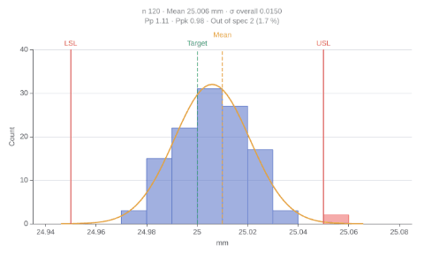

<!-- Generated by web/e2e/wiki.js - do not edit this page. Edit docs/wiki/examples/*.json, docs/wiki/notes/*.md or the generator, then run "npm run wiki" in web/. -->

Histogram of measurements with specification limits, fitted normal curve and capability statistics (Pp/Ppk or Cp/Cpk).

| | |
|---|---|
| Component id | `open.industrial.CapabilityHistogram` |
| Palette | **Open Components / Industrial** → **Process Capability Histogram** |
| Default size | 700 × 420 |



*Process Capability Histogram as dropped from the palette, showing its built-in sample data.*

This component builds its chart from the domain props below, so there is no ECharts option to write: bind the props to your tags and queries. (A non-empty `option` is an advanced override that replaces the generated chart.)

## How to use it in Ignition

1. In the Designer, drag **Process Capability Histogram** from the **Open Components / Industrial** group of the Perspective component palette onto a view. It shows sample data.
2. Select it and replace the sample data in the Property Editor: type values, paste JSON (right-click a property, **Paste**), or add a binding.
3. Bind the data props to tags, tag history or named queries. The props and the shape each one expects are listed under [Props](#props); [Binding examples](#binding-examples) has worked examples.

## Binding examples

`values` is a plain list of measurements; `lsl`, `usl` and `target` are the specification.

**Measurements from a named query.**

```sql
SELECT diameter FROM part_measurements
WHERE part_no = :part AND measured_at >= :from
ORDER BY measured_at
```

Bind it to `props.values` (Return Format: dataset):

```python
def transform(self, value, quality, timestamp):
    return [
        value.getValueAt(row, "diameter")
        for row in range(value.getRowCount())
        if value.getValueAt(row, "diameter") is not None
    ]
```

Keep the `ORDER BY`: with `sigmaMethod` set to `"within"` (Cp / Cpk) the variation is estimated from
consecutive values, so they must be in time order. `"overall"` (Pp / Ppk) does not depend on the order.

**Specification from tags or a recipe.** Bind `props.lsl`, `props.usl` and `props.target` to the tags
that hold the limits of the running product, e.g. `[default]Lathe3/Recipe/DiameterLSL`. For a one-sided
specification leave the other limit `null`.

Set `unit` to the unit of the measurements and `decimals` to their resolution.

## Props

| Property | Type | Default | Description |
|---|---|---|---|
| `values` | array of number | sample data (120 items) | Measurements. Non-numeric entries are ignored. Keep them in time order when sigmaMethod is "within". |
| `lsl` | number / null | `24.95` | Lower specification limit. null for none (one-sided specification). |
| `usl` | number / null | `25.05` | Upper specification limit. null for none (one-sided specification). |
| `target` | number / null | `25` | Target (nominal) value. null for none. |
| `bins` | string / integer | `"auto"` | Number of bins, or "auto": Freedman-Diaconis rule (Sturges when the interquartile range is 0), with the bin width rounded to 1, 2 or 5 x 10^k. Bins include their lower edge and exclude their upper edge; the last bin includes both. |
| `showNormalCurve` | boolean | `true` | Overlay the normal distribution fitted to the mean and the selected sigma, scaled to the histogram. |
| `showStats` | boolean | `true` | Show the readout: n, mean, sigma, the capability indices and the number of values out of spec. |
| `sigmaMethod` | string | `"overall"` | overall: sample standard deviation of all values; the indices are reported as Pp / Ppk. within: average moving range / 1.128 (short-term variation, as on the SPC chart; needs values in time order); the indices are reported as Cp / Cpk. One of: `"overall"`, `"within"`. |
| `decimals` | integer | `3` | Decimal places of the mean and the bin edges (0-10); sigma is shown with one more. |
| `unit` | string | `"mm"` | Unit of the measurements, shown on the axis, in the readout and in tooltips. |
| `title` | string | `""` | Chart title. Leave blank for no title. |
| `barColor` | string | `"#5470c6"` | Colour of the histogram inside the specification limits. |
| `outOfSpecColor` | string | `"#ee6666"` | Colour of the part of the histogram outside the specification limits. |
| `curveColor` | string | `"#e6a23c"` | Colour of the normal curve and the mean line. |
| `limitColor` | string | `"#d9534f"` | Colour of the LSL and USL lines. |
| `targetColor` | string | `"#3ba272"` | Colour of the target line. |

The shared props (`theme`, `renderer`, `notMerge`, `lazyUpdate`, `sanitizeTooltip`, ...) and the seven events are the same as on every component: see [Binding Data](Binding-Data), [Themes](Themes) and [Events](Events).
