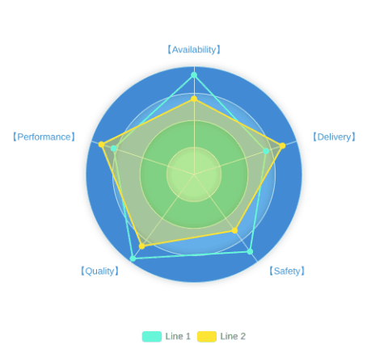
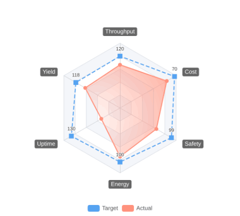
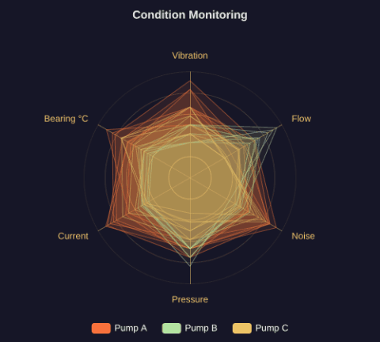
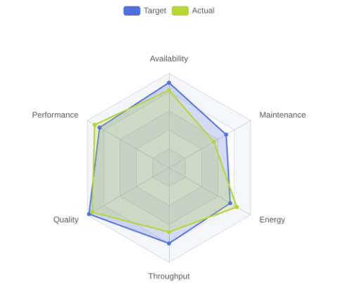

<!-- Generated by web/e2e/wiki.js - do not edit this page. Edit docs/wiki/examples/*.json, docs/wiki/notes/*.md or the generator, then run "npm run wiki" in web/. -->

Radar / spider charts.

| | |
|---|---|
| Component id | `open.echarts.RadarChart` |
| Palette | **Open Components / ECharts** → **Radar Chart** |
| Default size | 500 × 450 |


*Radar Chart as dropped from the palette.* It takes any ECharts option in its `option` prop; the palette entry only decides which sample option a new component starts with.

<details>
<summary>Option of a freshly dropped component</summary>

```json
{
  "radar": {
    "indicator": [
      { "name": "Sales", "max": 6500 },
      { "name": "Admin", "max": 16000 },
      { "name": "IT", "max": 30000 },
      { "name": "Support", "max": 38000 },
      { "name": "Dev", "max": 52000 },
      { "name": "Marketing", "max": 25000 }
    ]
  },
  "series": [
    {
      "type": "radar",
      "data": [{ "value": [4200, 3000, 20000, 35000, 50000, 18000], "name": "Budget" }]
    }
  ]
}
```

</details>

## Examples

- [Circular Radar](#circular-radar): Round grid with coloured rings, bracketed axis names and two filled series.
- [Radar with Boxed Names](#radar-with-boxed-names): Polygon grid with boxed axis names, a dashed outline with value labels and a gradient-filled series.
- [Dark Multi-run Radar](#dark-multi-run-radar): Many thin overlapping runs per series on a dark panel with a gold round grid (dark background is part of the look).
- [Filled Comparison Radar](#filled-comparison-radar): Two translucent filled polygons for a plan-versus-actual comparison, with a legend and tooltip.

### Circular Radar

Round grid with coloured rings, bracketed axis names and two filled series.



**How to make it in Ignition**

1. In the Designer, drag **Radar Chart** from the **Open Components / ECharts** group of the Perspective component palette onto a view.
2. Open **Option JSON** below and copy it. In the Property Editor, right-click the `option` property and choose **Paste**: the pasted JSON replaces the sample option. (See [Getting Started](Getting-Started) for other ways to enter an option.)
3. Replace the sample data with live data by binding these paths (expand `option` in the Property Editor down to the property, then use its binding icon). Everything else in the option stays as pasted.

   | Property | The binding must return |
   |---|---|
   | `props.option.series[0].data` | a list of objects whose `value` is a list of numbers: `[{ "name": ..., "value": [..] }, ...]` |

   For `series[0].data` build the same structure as the example in a script transform or a project script; [Binding Data](Binding-Data) shows the pattern.

4. Bind `series[0].data[n].value` to one list of numbers per polygon, in the order of `radar.indicator`.
5. Each indicator needs a `max`; set `min` as well if the scale does not start at 0.
6. The brackets around the axis names come from `radar.axisName.formatter`; the ring colours from `radar.splitArea.areaStyle.color` (one per ring, outside in).
7. The ring colours are fixed, so this look is the same on light and dark themes.

<details>
<summary>Option JSON</summary>

```json
{
  "color": ["#67F9D8", "#FFE434"],
  "legend": { "bottom": 4 },
  "tooltip": {},
  "radar": {
    "indicator": [
      { "name": "Availability", "max": 100 },
      { "name": "Performance", "max": 100 },
      { "name": "Quality", "max": 100 },
      { "name": "Safety", "max": 100 },
      { "name": "Delivery", "max": 100 }
    ],
    "center": ["50%", "50%"],
    "radius": "62%",
    "startAngle": 90,
    "splitNumber": 4,
    "shape": "circle",
    "axisName": { "formatter": "【{value}】", "color": "#428BD4" },
    "splitArea": {
      "areaStyle": {
        "color": ["#77EADF", "#26C3BE", "#64AFE9", "#428BD4"],
        "shadowColor": "rgba(0, 0, 0, 0.2)",
        "shadowBlur": 10
      }
    },
    "axisLine": { "lineStyle": { "color": "rgba(211, 253, 250, 0.8)" } },
    "splitLine": { "lineStyle": { "color": "rgba(211, 253, 250, 0.8)" } }
  },
  "series": [
    {
      "type": "radar",
      "emphasis": { "lineStyle": { "width": 4 } },
      "data": [
        { "value": [92, 78, 96, 88, 70], "name": "Line 1" },
        {
          "value": [70, 90, 82, 64, 86],
          "name": "Line 2",
          "areaStyle": { "color": "rgba(255, 228, 52, 0.6)" }
        }
      ]
    }
  ]
}
```

</details>

### Radar with Boxed Names

Polygon grid with boxed axis names, a dashed outline with value labels and a gradient-filled series.



**How to make it in Ignition**

1. In the Designer, drag **Radar Chart** from the **Open Components / ECharts** group of the Perspective component palette onto a view.
2. Open **Option JSON** below and copy it. In the Property Editor, right-click the `option` property and choose **Paste**: the pasted JSON replaces the sample option. (See [Getting Started](Getting-Started) for other ways to enter an option.)
3. Replace the sample data with live data by binding these paths (expand `option` in the Property Editor down to the property, then use its binding icon). Everything else in the option stays as pasted.

   | Property | The binding must return |
   |---|---|
   | `props.option.series[0].data` | a list of objects whose `value` is a list of numbers: `[{ "name": ..., "value": [..] }, ...]` |

   For `series[0].data` build the same structure as the example in a script transform or a project script; [Binding Data](Binding-Data) shows the pattern.

4. Bind `series[0].data[0].value` (dashed outline) and `data[1].value` (filled) to lists in the order of `radar.indicator`.
5. Indicators may have different `max` values, so each spoke has its own scale.
6. The boxes are `radar.axisName` (`backgroundColor`, `borderRadius`, `padding`). The fill is a radial gradient object in `data[1].areaStyle.color`.

<details>
<summary>Option JSON</summary>

```json
{
  "color": ["#56A3F1", "#FF917C"],
  "legend": { "bottom": 4 },
  "tooltip": {},
  "radar": {
    "indicator": [
      { "name": "Throughput", "max": 150 },
      { "name": "Yield", "max": 150 },
      { "name": "Uptime", "max": 150 },
      { "name": "Energy", "max": 120 },
      { "name": "Safety", "max": 108 },
      { "name": "Cost", "max": 72 }
    ],
    "center": ["50%", "50%"],
    "radius": "60%",
    "axisName": { "color": "#fff", "backgroundColor": "#666", "borderRadius": 3, "padding": [3, 5] }
  },
  "series": [
    {
      "type": "radar",
      "data": [
        {
          "value": [120, 118, 130, 100, 99, 70],
          "name": "Target",
          "symbol": "rect",
          "symbolSize": 10,
          "lineStyle": { "type": "dashed" },
          "label": { "show": true, "fontSize": 10 }
        },
        {
          "value": [100, 93, 50, 90, 70, 60],
          "name": "Actual",
          "areaStyle": {
            "color": {
              "type": "radial",
              "x": 0.1,
              "y": 0.6,
              "r": 1,
              "colorStops": [
                { "offset": 0, "color": "rgba(255, 145, 124, 0.1)" },
                { "offset": 1, "color": "rgba(255, 145, 124, 0.9)" }
              ]
            }
          }
        }
      ]
    }
  ]
}
```

</details>

### Dark Multi-run Radar

Many thin overlapping runs per series on a dark panel with a gold round grid (dark background is part of the look).



**How to make it in Ignition**

1. In the Designer, drag **Radar Chart** from the **Open Components / ECharts** group of the Perspective component palette onto a view.
2. Open **Option JSON** below and copy it. In the Property Editor, right-click the `option` property and choose **Paste**: the pasted JSON replaces the sample option. (See [Getting Started](Getting-Started) for other ways to enter an option.)
3. Replace the sample data with live data by binding these paths (expand `option` in the Property Editor down to the property, then use its binding icon). Everything else in the option stays as pasted.

   | Property | The binding must return |
   |---|---|
   | `props.option.series[0].data` | a list of rows with 6 values each, in the order of the example: `[[6, 100, 40, 7, 87, 118], ...]` |
   | `props.option.series[1].data` | a list of rows with 6 values each, in the order of the example: `[[4, 51, 30, 9, 51, 131], ...]` |
   | `props.option.series[2].data` | a list of rows with 6 values each, in the order of the example: `[[5, 65, 30, 5, 83, 75], ...]` |

   Script transform for `props.option.series[0].data`, turning a dataset into rows. With a time axis the first value of a row is the time in epoch milliseconds:

   ```python
   def transform(self, value, quality, timestamp):
       # value: dataset, e.g. from a Tag History binding: t_stamp, then one column per tag
       rows = []
       for row in range(value.getRowCount()):
           t = value.getValueAt(row, 0)
           if hasattr(t, "getTime"):  # a date: ECharts wants epoch milliseconds
               t = t.getTime()
           rows.append([t] + [value.getValueAt(row, col) for col in range(1, 6)])
       return rows
   ```

4. Every series holds MANY polygons: `series[n].data` is a list of rows, one row of indicator values per run (for example one per hour or per batch). Bind it to a dataset-to-rows transform.
5. The dark `backgroundColor` and the light text colours are part of the look, so it stays dark on a light theme. Remove `backgroundColor` and the `textStyle` / `axisName` colours to follow the theme instead.
6. Add `"selectedMode": "single"` to the legend to show one series at a time.

<details>
<summary>Option JSON</summary>

```json
{
  "backgroundColor": "#161627",
  "title": {
    "text": "Condition Monitoring",
    "left": "center",
    "top": 8,
    "textStyle": { "color": "#eee", "fontSize": 15 }
  },
  "legend": {
    "bottom": 6,
    "data": ["Pump A", "Pump B", "Pump C"],
    "itemGap": 20,
    "textStyle": { "color": "#fff", "fontSize": 12 }
  },
  "radar": {
    "indicator": [
      { "name": "Vibration", "max": 12 },
      { "name": "Bearing °C", "max": 110 },
      { "name": "Current", "max": 60 },
      { "name": "Pressure", "max": 12 },
      { "name": "Noise", "max": 100 },
      { "name": "Flow", "max": 200 }
    ],
    "center": ["50%", "52%"],
    "radius": "62%",
    "shape": "circle",
    "splitNumber": 5,
    "axisName": { "color": "rgb(238, 197, 102)" },
    "splitLine": {
      "lineStyle": {
        "color": [
          "rgba(238, 197, 102, 1)",
          "rgba(238, 197, 102, 0.8)",
          "rgba(238, 197, 102, 0.6)",
          "rgba(238, 197, 102, 0.4)",
          "rgba(238, 197, 102, 0.2)",
          "rgba(238, 197, 102, 0.1)"
        ]
      }
    },
    "splitArea": { "show": false },
    "axisLine": { "lineStyle": { "color": "rgba(238, 197, 102, 0.5)" } }
  },
  "series": [
    {
      "name": "Pump A",
      "type": "radar",
      "lineStyle": { "width": 1, "opacity": 0.5 },
      "data": [
        [6, 100, 40, 7, 87, 118],
        [8, 93, 50, 8, 85, 125],
        [10, 71, 42, 9, 86, 90],
        [10, 81, 54, 9, 63, 117],
        [11, 90, 48, 8, 94, 141],
        [8, 75, 52, 7, 64, 104],
        [8, 74, 55, 8, 87, 139]
      ],
      "symbol": "none",
      "itemStyle": { "color": "#F9713C" },
      "areaStyle": { "opacity": 0.1 }
    },
    {
      "name": "Pump B",
      "type": "radar",
      "lineStyle": { "width": 1, "opacity": 0.5 },
      "data": [
        [4, 51, 30, 9, 51, 131],
        [6, 45, 27, 8, 58, 189],
        [5, 48, 28, 8, 50, 149],
        [4, 59, 31, 8, 65, 152],
        [6, 62, 31, 9, 53, 170],
        [6, 55, 32, 8, 56, 143],
        [4, 55, 34, 10, 43, 181]
      ],
      "symbol": "none",
      "itemStyle": { "color": "#B3E4A1" },
      "areaStyle": { "opacity": 0.05 }
    },
    {
      "name": "Pump C",
      "type": "radar",
      "lineStyle": { "width": 1, "opacity": 0.5 },
      "data": [
        [5, 65, 30, 5, 83, 75],
        [7, 55, 36, 6, 54, 106],
        [8, 82, 44, 7, 75, 77],
        [5, 59, 29, 4, 70, 75],
        [8, 68, 40, 5, 79, 75],
        [6, 82, 30, 6, 49, 106],
        [7, 83, 28, 7, 55, 108]
      ],
      "symbol": "none",
      "itemStyle": { "color": "rgb(238, 197, 102)" },
      "areaStyle": { "opacity": 0.05 }
    }
  ]
}
```

</details>

### Filled Comparison Radar

Two translucent filled polygons for a plan-versus-actual comparison, with a legend and tooltip.



**How to make it in Ignition**

1. In the Designer, drag **Radar Chart** from the **Open Components / ECharts** group of the Perspective component palette onto a view.
2. Open **Option JSON** below and copy it. In the Property Editor, right-click the `option` property and choose **Paste**: the pasted JSON replaces the sample option. (See [Getting Started](Getting-Started) for other ways to enter an option.)
3. Replace the sample data with live data by binding these paths (expand `option` in the Property Editor down to the property, then use its binding icon). Everything else in the option stays as pasted.

   | Property | The binding must return |
   |---|---|
   | `props.option.series[0].data` | a list of objects whose `value` is a list of numbers: `[{ "name": ..., "value": [..] }, ...]` |

   For `series[0].data` build the same structure as the example in a script transform or a project script; [Binding Data](Binding-Data) shows the pattern.

4. Bind `series[0].data[0].value` and `data[1].value` to lists in the order of `radar.indicator` (for example target and actual).
5. Set each indicator’s `max`; here all are 100 %.

<details>
<summary>Option JSON</summary>

```json
{
  "legend": { "top": 4 },
  "tooltip": {},
  "radar": {
    "indicator": [
      { "name": "Availability", "max": 100 },
      { "name": "Performance", "max": 100 },
      { "name": "Quality", "max": 100 },
      { "name": "Throughput", "max": 100 },
      { "name": "Energy", "max": 100 },
      { "name": "Maintenance", "max": 100 }
    ],
    "center": ["50%", "55%"],
    "radius": "62%"
  },
  "series": [
    {
      "type": "radar",
      "symbolSize": 6,
      "areaStyle": { "opacity": 0.25 },
      "lineStyle": { "width": 2 },
      "data": [
        { "value": [90, 85, 98, 80, 75, 70], "name": "Target" },
        { "value": [82, 91, 94, 68, 83, 55], "name": "Actual" }
      ]
    }
  ]
}
```

</details>
