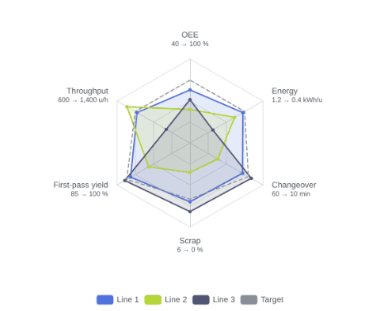

<!-- Generated by web/e2e/wiki.js - do not edit this page. Edit docs/wiki/examples/*.json, docs/wiki/notes/*.md or the generator, then run "npm run wiki" in web/. -->

Compares lines, shifts, machines or suppliers across metrics with different units on one radar.

| | |
|---|---|
| Component id | `open.industrial.RadarComparison` |
| Palette | **Open Components / Industrial** → **Radar Comparison** |
| Default size | 560 × 460 |



*Radar Comparison as dropped from the palette, showing its built-in sample data.*

This component builds its chart from the domain props below, so there is no ECharts option to write: bind the props to your tags and queries. (A non-empty `option` is an advanced override that replaces the generated chart.)

## How to use it in Ignition

1. In the Designer, drag **Radar Comparison** from the **Open Components / Industrial** group of the Perspective component palette onto a view. It shows sample data.
2. Select it and replace the sample data in the Property Editor: type values, paste JSON (right-click a property, **Paste**), or add a binding.
3. Bind the data props to tags, tag history or named queries. The props and the shape each one expects are listed under [Props](#props); [Binding examples](#binding-examples) has worked examples.

## Binding examples

`metrics` are the axes and are usually typed once; `series` holds one object per line, shift or machine
with its `values` in the same order as `metrics`.

**Lines compared on KPIs from a named query.** With the axes typed as

```json
[
  { "name": "OEE", "unit": "%", "min": 40, "max": 100 },
  { "name": "Throughput", "unit": "u/h", "min": 600, "max": 1400 },
  { "name": "Scrap", "unit": "%", "min": 0, "max": 6, "higherIsBetter": false }
]
```

a query that returns one row per line with a column per metric

```sql
SELECT line, oee, throughput, scrap FROM line_kpis WHERE shift_id = :shift ORDER BY line
```

is bound to `props.series` (Return Format: dataset) with this transform. The column order in the list
must match the order of `metrics`:

```python
def transform(self, value, quality, timestamp):
    columns = ["oee", "throughput", "scrap"]
    return [
        {
            "name": str(value.getValueAt(row, "line")),
            "values": [value.getValueAt(row, col) for col in columns],
        }
        for row in range(value.getRowCount())
    ]
```

**Target outline.** Set `target` to `{ "name": "Target", "values": [85, 1200, 2] }`, or bind
`props.target.values` to a query or tags that hold the targets.

**Lower is better.** Give such an axis `"higherIsBetter": false` (scrap, changeover time, energy per
unit): outward is then always the better direction on every axis.

## Props

| Property | Type | Default | Description |
|---|---|---|---|
| `metrics` | array | sample data (6 items) | The axes, at least three: { name, min, max, higherIsBetter, unit } (or just a name). Each axis is scaled to its own min..max, so metrics with different units can be compared; values outside the range are drawn at its ends. A missing min or max is taken from the data with some padding. Outward is always better: axes with higherIsBetter false are inverted, so their lowest value is at the rim. unit is written after values. |
| `series` | array | sample data (3 items) | The entities to compare (lines, shifts, machines, suppliers): { name, values }, with values in the same order as metrics, in real units. Extra values are ignored; a missing value is drawn at the centre and shown as a dash in the tooltip. |
| `target` | object | sample data | Optional reference drawn as a dashed outline: { name, values, color } with values in the same order as metrics. Leave empty for none. |
| `fill` | boolean | `true` | Fill the area of each series (the fill gets lighter as the number of series grows). |
| `shape` | string | `"polygon"` | Shape of the grid. One of: `"polygon"`, `"circle"`. |
| `showRange` | boolean | `true` | Write the range of each axis under its name, from the centre value to the rim value. |
| `showLegend` | boolean | `true` | Show the legend. |
| `decimals` | integer | `2` | Maximum decimal places of values in tooltips and axis ranges (0 to 6). |
| `colors` | array | `[]` | Series colours in order. Leave empty to use the palette of the theme. |
| `title` | string | `""` | Chart title. Leave blank for no title. |

The shared props (`theme`, `renderer`, `notMerge`, `lazyUpdate`, `sanitizeTooltip`, ...) and the seven events are the same as on every component: see [Binding Data](Binding-Data), [Themes](Themes) and [Events](Events).
