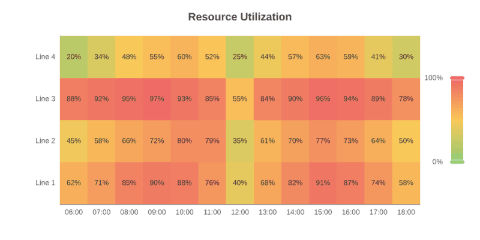

<!-- Generated by web/e2e/wiki.js - do not edit this page. Edit docs/wiki/examples/*.json, docs/wiki/notes/*.md or the generator, then run "npm run wiki" in web/. -->

Equipment utilisation percentage as heatmap (resource x time).

| | |
|---|---|
| Component id | `open.industrial.ResourceHeatmap` |
| Palette | **Open Components / Scheduling** → **Resource Heatmap** |
| Default size | 800 × 400 |



*Resource Heatmap as dropped from the palette, showing its built-in sample data.*

This component builds its chart from the domain props below, so there is no ECharts option to write: bind the props to your tags and queries. (A non-empty `option` is an advanced override that replaces the generated chart.)

## How to use it in Ignition

1. In the Designer, drag **Resource Heatmap** from the **Open Components / Scheduling** group of the Perspective component palette onto a view. It shows sample data.
2. Select it and replace the sample data in the Property Editor: type values, paste JSON (right-click a property, **Paste**), or add a binding.
3. Bind the data props to tags, tag history or named queries. The props and the shape each one expects are listed under [Props](#props); [Binding examples](#binding-examples) has worked examples.

## Binding examples

Three props belong together: `resources` (the rows), `timeSlots` (the columns) and `utilization`, a
matrix with one list per resource holding one number per time slot.

**Utilisation per line and hour from a named query.** Bind the query once to a custom property of the
view (`view.custom.util`, Return Format: dataset):

```sql
SELECT line, hour_label, utilization_pct
FROM hourly_utilization
WHERE day = :day
ORDER BY line, hour_label
```

Then put a **Property** binding to `view.custom.util` on each prop. A shared helper in a project
library script (here `charts.pivot`) keeps the three transforms in step:

```python
# Project library script "charts"
def pivot(ds, rowCol, colCol, valueCol):
    rows, cols, cells = [], [], {}
    for r in range(ds.getRowCount()):
        row, col = str(ds.getValueAt(r, rowCol)), str(ds.getValueAt(r, colCol))
        if row not in rows:
            rows.append(row)
        if col not in cols:
            cols.append(col)
        cells[(row, col)] = ds.getValueAt(r, valueCol)
    matrix = [[cells.get((row, col), 0) for col in cols] for row in rows]
    return rows, cols, matrix
```

| Property | Script transform body |
|---|---|
| `props.resources` | `return charts.pivot(value, "line", "hour_label", "utilization_pct")[0]` |
| `props.timeSlots` | `return charts.pivot(value, "line", "hour_label", "utilization_pct")[1]` |
| `props.utilization` | `return charts.pivot(value, "line", "hour_label", "utilization_pct")[2]` |

Set `maxValue` to the top of the scale: `100` for percent, or the shift length when the cells hold minutes.

## Props

| Property | Type | Default | Description |
|---|---|---|---|
| `resources` | array of string | `["Line 1","Line 2","Line 3","Line 4"]` | Resource names (Y axis rows). |
| `timeSlots` | array of string | sample data (13 items) | Time-slot labels (X axis columns). |
| `utilization` | array of array | sample data (4 items) | Utilization matrix: one row of numbers per resource, one number per time slot (0 to maxValue). An empty matrix shows "No data". Bind to your data. |
| `maxValue` | number | `100` | Maximum value for the colour scale (e.g. 100 for percent). |
| `title` | string | `""` | Chart title. Leave blank for the default title. |

The shared props (`theme`, `renderer`, `notMerge`, `lazyUpdate`, `sanitizeTooltip`, ...) and the seven events are the same as on every component: see [Binding Data](Binding-Data), [Themes](Themes) and [Events](Events).
