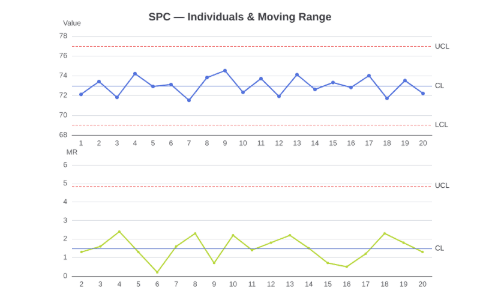

<!-- Generated by web/e2e/wiki.js - do not edit this page. Edit docs/wiki/examples/*.json, docs/wiki/notes/*.md or the generator, then run "npm run wiki" in web/. -->

Statistical Process Control — Individuals and Moving Range with run rules.

| | |
|---|---|
| Component id | `open.industrial.SPCChart` |
| Palette | **Open Components / Industrial** → **SPC Chart** |
| Default size | 800 × 500 |



*SPC Chart as dropped from the palette, showing its built-in sample data.*

This component builds its chart from the domain props below, so there is no ECharts option to write: bind the props to your tags and queries. (A non-empty `option` is an advanced override that replaces the generated chart.)

## How to use it in Ignition

1. In the Designer, drag **SPC Chart** from the **Open Components / Industrial** group of the Perspective component palette onto a view. It shows sample data.
2. Select it and replace the sample data in the Property Editor: type values, paste JSON (right-click a property, **Paste**), or add a binding.
3. Bind the data props to tags, tag history or named queries. The props and the shape each one expects are listed under [Props](#props); [Binding examples](#binding-examples) has worked examples.

## Binding examples

`values` is a plain list of measurements in time order, oldest first. The component calculates the
centre line and control limits itself.

**Last 50 measurements from a named query.**

```sql
SELECT diameter FROM (
    SELECT TOP 50 diameter, measured_at FROM part_measurements
    WHERE part_no = :part ORDER BY measured_at DESC
) latest ORDER BY measured_at
```

(`TOP 50` is SQL Server syntax; other databases use `LIMIT 50` at the end of the inner query.)
Bind it to `props.values` (Return Format: dataset) with this transform:

```python
def transform(self, value, quality, timestamp):
    return [
        value.getValueAt(row, "diameter")
        for row in range(value.getRowCount())
        if value.getValueAt(row, "diameter") is not None
    ]
```

**From tag history.** A **Tag History** binding on `props.values` for the measurement tag works with the
same idea; the value is in the second column:

```python
def transform(self, value, quality, timestamp):
    return [value.getValueAt(row, 1) for row in range(value.getRowCount())]
```

**Subgroups.** For an X-bar & R chart set `subgroupSize` to the number of parts measured per sample
(2-10); consecutive values are grouped, so the list must hold whole subgroups in order.

## Props

| Property | Type | Default | Description |
|---|---|---|---|
| `values` | array of number | sample data (20 items) | Measurements in time order. Bind to your sample data. |
| `subgroupSize` | integer | `1` | 1 = Individuals & Moving Range; 2–10 = X-bar & R on consecutive subgroups. |
| `showUCL` | boolean | `true` | Show the Upper Control Limit (UCL) markline. |
| `showLCL` | boolean | `true` | Show the Lower Control Limit (LCL) markline. |
| `showCenterLine` | boolean | `true` | Show the Center Line (process mean) markline. |
| `showMRChart` | boolean | `true` | Show the MR (or R) chart below the main chart. |
| `showRunRules` | boolean | `true` | Highlight points that violate Western Electric rules 1 and 4. |
| `title` | string | `""` | Chart title. Leave blank for the default title. |

The shared props (`theme`, `renderer`, `notMerge`, `lazyUpdate`, `sanitizeTooltip`, ...) and the seven events are the same as on every component: see [Binding Data](Binding-Data), [Themes](Themes) and [Events](Events).
