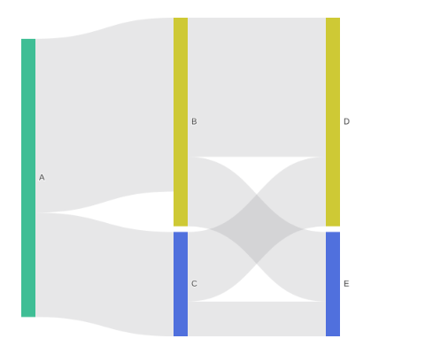
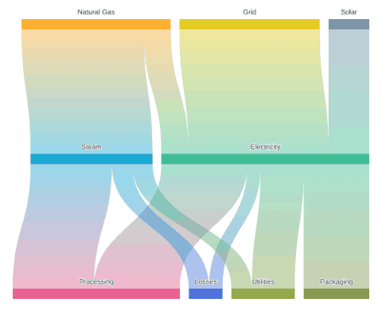
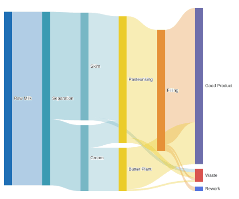

<!-- Generated by web/e2e/wiki.js - do not edit this page. Edit docs/wiki/examples/*.json, docs/wiki/notes/*.md or the generator, then run "npm run wiki" in web/. -->

Sankey flow and energy diagrams.

| | |
|---|---|
| Component id | `open.echarts.SankeyChart` |
| Palette | **Open Components / ECharts** → **Sankey Chart** |
| Default size | 600 × 500 |



*Sankey Chart as dropped from the palette.* It takes any ECharts option in its `option` prop; the palette entry only decides which sample option a new component starts with.

<details>
<summary>Option of a freshly dropped component</summary>

```json
{
  "series": [
    {
      "type": "sankey",
      "data": [{ "name": "A" }, { "name": "B" }, { "name": "C" }, { "name": "D" }, { "name": "E" }],
      "links": [
        { "source": "A", "target": "B", "value": 5 },
        { "source": "A", "target": "C", "value": 3 },
        { "source": "B", "target": "D", "value": 4 },
        { "source": "B", "target": "E", "value": 2 },
        { "source": "C", "target": "D", "value": 2 },
        { "source": "C", "target": "E", "value": 1 }
      ]
    }
  ]
}
```

</details>

## Examples

- [Vertical Sankey](#vertical-sankey): Top-to-bottom flow with links shaded from the source colour to the target colour; energy from source to consumer in MWh.
- [Sankey with Level Colours](#sankey-with-level-colours): Left-aligned material flow where each column has its own colour and the links take the colour of their source.

### Vertical Sankey

Top-to-bottom flow with links shaded from the source colour to the target colour; energy from source to consumer in MWh.



**How to make it in Ignition**

1. In the Designer, drag **Sankey Chart** from the **Open Components / ECharts** group of the Perspective component palette onto a view.
2. Open **Option JSON** below and copy it. In the Property Editor, right-click the `option` property and choose **Paste**: the pasted JSON replaces the sample option. (See [Getting Started](Getting-Started) for other ways to enter an option.)
3. Replace the sample data with live data by binding these paths (expand `option` in the Property Editor down to the property, then use its binding icon). Everything else in the option stays as pasted.

   | Property | The binding must return |
   |---|---|
   | `props.option.series[0].data` | a list of objects with the keys of the example (`name`) |
   | `props.option.series[0].links` | a list of objects with the keys of the example (`source`, `target`, `value`) |

   For `series[0].data`, `series[0].links` build the same structure as the example in a script transform or a project script; [Binding Data](Binding-Data) shows the pattern.

4. Bind `series[0].data` to the node list `[{name}]` and `series[0].links` to rows `{source, target, value}` (node names). A node’s size is the sum of its links.
5. `orient: "vertical"` turns the flow top to bottom; `lineStyle.color: "gradient"` blends the link between its two node colours.
6. Every name used in `links` must exist in `data`, and the links must not form a loop.

<details>
<summary>Option JSON</summary>

```json
{
  "tooltip": { "trigger": "item", "triggerOn": "mousemove" },
  "series": [
    {
      "type": "sankey",
      "orient": "vertical",
      "top": 30,
      "bottom": 30,
      "left": 20,
      "right": 20,
      "nodeWidth": 16,
      "nodeGap": 14,
      "label": { "position": "top", "fontSize": 11 },
      "emphasis": { "focus": "adjacency" },
      "lineStyle": { "color": "gradient", "curveness": 0.5, "opacity": 0.45 },
      "data": [
        { "name": "Grid" },
        { "name": "Solar" },
        { "name": "Natural Gas" },
        { "name": "Electricity" },
        { "name": "Steam" },
        { "name": "Processing" },
        { "name": "Packaging" },
        { "name": "Utilities" },
        { "name": "Losses" }
      ],
      "links": [
        { "source": "Grid", "target": "Electricity", "value": 620 },
        { "source": "Solar", "target": "Electricity", "value": 180 },
        { "source": "Natural Gas", "target": "Steam", "value": 540 },
        { "source": "Natural Gas", "target": "Electricity", "value": 120 },
        { "source": "Electricity", "target": "Processing", "value": 380 },
        { "source": "Electricity", "target": "Packaging", "value": 290 },
        { "source": "Electricity", "target": "Utilities", "value": 190 },
        { "source": "Electricity", "target": "Losses", "value": 60 },
        { "source": "Steam", "target": "Processing", "value": 360 },
        { "source": "Steam", "target": "Utilities", "value": 90 },
        { "source": "Steam", "target": "Losses", "value": 90 }
      ]
    }
  ]
}
```

</details>

### Sankey with Level Colours

Left-aligned material flow where each column has its own colour and the links take the colour of their source.



**How to make it in Ignition**

1. In the Designer, drag **Sankey Chart** from the **Open Components / ECharts** group of the Perspective component palette onto a view.
2. Open **Option JSON** below and copy it. In the Property Editor, right-click the `option` property and choose **Paste**: the pasted JSON replaces the sample option. (See [Getting Started](Getting-Started) for other ways to enter an option.)
3. Replace the sample data with live data by binding these paths (expand `option` in the Property Editor down to the property, then use its binding icon). Everything else in the option stays as pasted.

   | Property | The binding must return |
   |---|---|
   | `props.option.series[0].data` | a list of objects with the keys of the example (`name`) |
   | `props.option.series[0].links` | a list of objects with the keys of the example (`source`, `target`, `value`) |

   For `series[0].data`, `series[0].links` build the same structure as the example in a script transform or a project script; [Binding Data](Binding-Data) shows the pattern.

4. Bind `series[0].data` to `[{name}]` and `series[0].links` to `{source, target, value}`.
5. `series[0].levels` styles one column each (`depth` 0 is the first column): node colour under `itemStyle.color`, link style under `lineStyle`.
6. `nodeAlign: "left"` keeps end nodes in the column right after their source instead of pushing them to the right edge.
7. Give a waste or loss node its own `itemStyle.color` in `data` to make it stand out, as done here.

<details>
<summary>Option JSON</summary>

```json
{
  "tooltip": { "trigger": "item", "triggerOn": "mousemove" },
  "series": [
    {
      "type": "sankey",
      "top": 20,
      "bottom": 20,
      "left": 10,
      "right": 90,
      "nodeAlign": "left",
      "nodeGap": 12,
      "emphasis": { "focus": "adjacency" },
      "label": { "fontSize": 11 },
      "lineStyle": { "color": "source", "curveness": 0.5, "opacity": 0.35 },
      "levels": [
        { "depth": 0, "itemStyle": { "color": "#1f6fb5" } },
        { "depth": 1, "itemStyle": { "color": "#3b9ab2" } },
        { "depth": 2, "itemStyle": { "color": "#78b7c5" } },
        { "depth": 3, "itemStyle": { "color": "#ebcc2a" } },
        { "depth": 4, "itemStyle": { "color": "#e69138" } }
      ],
      "data": [
        { "name": "Raw Milk" },
        { "name": "Separation" },
        { "name": "Skim" },
        { "name": "Cream" },
        { "name": "Pasteurising" },
        { "name": "Waste", "itemStyle": { "color": "#d9534f" } },
        { "name": "Butter Plant" },
        { "name": "Filling" },
        { "name": "Good Product" },
        { "name": "Rework" }
      ],
      "links": [
        { "source": "Raw Milk", "target": "Separation", "value": 1000 },
        { "source": "Separation", "target": "Skim", "value": 620 },
        { "source": "Separation", "target": "Cream", "value": 380 },
        { "source": "Skim", "target": "Pasteurising", "value": 600 },
        { "source": "Skim", "target": "Waste", "value": 20 },
        { "source": "Cream", "target": "Butter Plant", "value": 250 },
        { "source": "Cream", "target": "Pasteurising", "value": 130 },
        { "source": "Pasteurising", "target": "Filling", "value": 700 },
        { "source": "Pasteurising", "target": "Waste", "value": 30 },
        { "source": "Filling", "target": "Good Product", "value": 660 },
        { "source": "Filling", "target": "Rework", "value": 25 },
        { "source": "Filling", "target": "Waste", "value": 15 },
        { "source": "Butter Plant", "target": "Good Product", "value": 240 },
        { "source": "Butter Plant", "target": "Waste", "value": 10 }
      ]
    }
  ]
}
```

</details>
