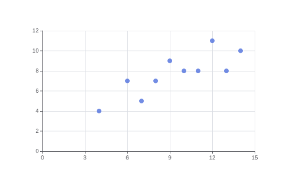
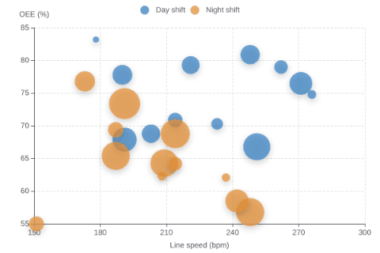
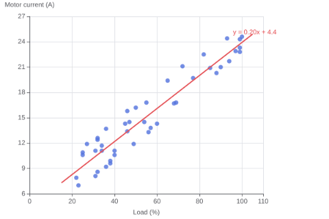
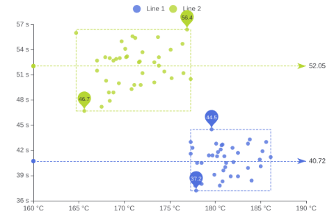

<!-- Generated by web/e2e/wiki.js - do not edit this page. Edit docs/wiki/examples/*.json, docs/wiki/notes/*.md or the generator, then run "npm run wiki" in web/. -->

Scatter, bubble, and large-scale scatter plots.

| | |
|---|---|
| Component id | `open.echarts.ScatterChart` |
| Palette | **Open Components / ECharts** → **Scatter Chart** |
| Default size | 600 × 400 |



*Scatter Chart as dropped from the palette.* It takes any ECharts option in its `option` prop; the palette entry only decides which sample option a new component starts with.

<details>
<summary>Option of a freshly dropped component</summary>

```json
{
  "xAxis": {},
  "yAxis": {},
  "tooltip": { "trigger": "item" },
  "series": [
    {
      "type": "scatter",
      "symbolSize": 10,
      "data": [[10, 8], [8, 7], [13, 8], [9, 9], [11, 8], [14, 10], [6, 7], [4, 4], [12, 11], [7, 5]]
    }
  ]
}
```

</details>

## Examples

- [Bubble Chart](#bubble-chart): Bubble size encodes a third value through a hidden visualMap; two series with soft glowing bubbles.
- [Scatter with Trend Line](#scatter-with-trend-line): Point cloud with a fitted straight line and its equation, drawn as a markLine between two coordinates.
- [Two-group Scatter with Marks](#two-group-scatter-with-marks): Two point clouds, each with a shaded bounding box, min/max pins and a dashed average line.

### Bubble Chart

Bubble size encodes a third value through a hidden visualMap; two series with soft glowing bubbles.



**How to make it in Ignition**

1. In the Designer, drag **Scatter Chart** from the **Open Components / ECharts** group of the Perspective component palette onto a view.
2. Open **Option JSON** below and copy it. In the Property Editor, right-click the `option` property and choose **Paste**: the pasted JSON replaces the sample option. (See [Getting Started](Getting-Started) for other ways to enter an option.)
3. Replace the sample data with live data by binding these paths (expand `option` in the Property Editor down to the property, then use its binding icon). Everything else in the option stays as pasted.

   | Property | The binding must return |
   |---|---|
   | `props.option.series[0].data` | a list of rows with 4 values each, in the order of the example: `[[191, 67.9, 42, "Batch 353"], ...]` |
   | `props.option.series[1].data` | a list of rows with 4 values each, in the order of the example: `[[187, 65.4, 50, "Batch 296"], ...]` |

   Script transform for `props.option.series[0].data`, turning a dataset into rows. With a time axis the first value of a row is the time in epoch milliseconds:

   ```python
   def transform(self, value, quality, timestamp):
       # value: dataset, e.g. from a Tag History binding: t_stamp, then one column per tag
       rows = []
       for row in range(value.getRowCount()):
           t = value.getValueAt(row, 0)
           if hasattr(t, "getTime"):  # a date: ECharts wants epoch milliseconds
               t = t.getTime()
           rows.append([t] + [value.getValueAt(row, col) for col in range(1, 4)])
       return rows
   ```

4. Bind each `series[n].data` to rows `[x, y, size, name]`: here line speed, OEE, batch size and a batch name.
5. Bubble size is NOT a function: the hidden `visualMap` maps column index 2 (`dimension`) from `min`–`max` to `inRange.symbolSize` pixels. Set `min` / `max` to the range of your size column.
6. The label shown on hover is the fourth column (`{@[3]}` in `emphasis.label.formatter`).

<details>
<summary>Option JSON</summary>

```json
{
  "legend": { "top": 4 },
  "tooltip": { "formatter": "{a}<br>{c}" },
  "grid": { "left": 54, "right": 24, "top": 44, "bottom": 46 },
  "xAxis": {
    "name": "Line speed (bpm)",
    "nameLocation": "middle",
    "nameGap": 28,
    "scale": true,
    "splitLine": { "lineStyle": { "type": "dashed" } }
  },
  "yAxis": { "name": "OEE (%)", "scale": true, "splitLine": { "lineStyle": { "type": "dashed" } } },
  "visualMap": { "show": false, "dimension": 2, "min": 5, "max": 60, "inRange": { "symbolSize": [10, 52] } },
  "series": [
    {
      "name": "Day shift",
      "type": "scatter",
      "data": [
        [191, 67.9, 42, "Batch 353"],
        [221, 79.3, 29, "Batch 375"],
        [203, 68.8, 30, "Batch 236"],
        [271, 76.5, 39, "Batch 489"],
        [262, 79, 20, "Batch 466"],
        [276, 74.8, 10, "Batch 897"],
        [248, 80.9, 32, "Batch 237"],
        [251, 66.8, 48, "Batch 604"],
        [214, 70.9, 22, "Batch 608"],
        [178, 83.2, 5, "Batch 358"],
        [190, 77.8, 33, "Batch 400"],
        [233, 70.3, 16, "Batch 580"]
      ],
      "itemStyle": {
        "color": "#3d85c6",
        "opacity": 0.75,
        "shadowBlur": 10,
        "shadowColor": "rgba(0,0,0,0.25)",
        "shadowOffsetY": 4
      },
      "emphasis": { "focus": "series", "label": { "show": true, "formatter": "{@[3]}", "position": "top" } }
    },
    {
      "name": "Night shift",
      "type": "scatter",
      "data": [
        [187, 65.4, 50, "Batch 296"],
        [237, 62.1, 9, "Batch 444"],
        [191, 73.4, 56, "Batch 383"],
        [209, 64.3, 49, "Batch 831"],
        [214, 64.2, 20, "Batch 694"],
        [248, 56.8, 50, "Batch 383"],
        [173, 76.8, 34, "Batch 286"],
        [214, 68.8, 52, "Batch 408"],
        [151, 55, 23, "Batch 763"],
        [242, 58.5, 40, "Batch 567"],
        [208, 62.3, 10, "Batch 171"],
        [187, 69.4, 24, "Batch 518"]
      ],
      "itemStyle": {
        "color": "#e69138",
        "opacity": 0.75,
        "shadowBlur": 10,
        "shadowColor": "rgba(0,0,0,0.25)",
        "shadowOffsetY": 4
      },
      "emphasis": { "focus": "series", "label": { "show": true, "formatter": "{@[3]}", "position": "top" } }
    }
  ]
}
```

</details>

### Scatter with Trend Line

Point cloud with a fitted straight line and its equation, drawn as a markLine between two coordinates.



**How to make it in Ignition**

1. In the Designer, drag **Scatter Chart** from the **Open Components / ECharts** group of the Perspective component palette onto a view.
2. Open **Option JSON** below and copy it. In the Property Editor, right-click the `option` property and choose **Paste**: the pasted JSON replaces the sample option. (See [Getting Started](Getting-Started) for other ways to enter an option.)
3. Replace the sample data with live data by binding these paths (expand `option` in the Property Editor down to the property, then use its binding icon). Everything else in the option stays as pasted.

   | Property | The binding must return |
   |---|---|
   | `props.option.series[0].data` | a list of rows with 2 values each, in the order of the example: `[[99, 23.3], ...]` |

   Script transform for `props.option.series[0].data`, turning a dataset into rows. With a time axis the first value of a row is the time in epoch milliseconds:

   ```python
   def transform(self, value, quality, timestamp):
       # value: dataset, e.g. from a Tag History binding: t_stamp, then one column per tag
       rows = []
       for row in range(value.getRowCount()):
           t = value.getValueAt(row, 0)
           if hasattr(t, "getTime"):  # a date: ECharts wants epoch milliseconds
               t = t.getTime()
           rows.append([t] + [value.getValueAt(row, col) for col in range(1, 2)])
       return rows
   ```

4. Bind `series[0].data` to rows `[x, y]`.
5. ECharts does not fit the line in a JSON option: compute slope and intercept yourself (script transform or query) and bind the two end points `series[0].markLine.data[0][0].coord` and `[0][1].coord` as `[x, y]`.
6. The equation text is `markLine.data[0][0].name`, shown by the label `formatter` (`{b}`); bind it to a formatted string.
7. For a plain average line use `markLine.data: [{"type": "average", "valueDim": "y"}]` instead; that one ECharts calculates itself.

<details>
<summary>Option JSON</summary>

```json
{
  "tooltip": { "formatter": "{c}" },
  "grid": { "left": 54, "right": 120, "top": 30, "bottom": 46 },
  "xAxis": { "name": "Load (%)", "nameLocation": "middle", "nameGap": 28, "min": 0, "max": 110 },
  "yAxis": { "name": "Motor current (A)", "scale": true },
  "series": [
    {
      "name": "Samples",
      "type": "scatter",
      "symbolSize": 8,
      "data": [
        [99, 23.3],
        [97, 22.9],
        [36, 13.7],
        [25, 10.9],
        [94, 21.7],
        [82, 22.5],
        [60, 14.3],
        [47, 14.5],
        [32, 12.6],
        [45, 14.3],
        [72, 21.1],
        [55, 16.8],
        [88, 20.3],
        [90, 21],
        [38, 9.6],
        [25, 10.6],
        [100, 24.6],
        [99, 24.3],
        [69, 16.8],
        [38, 9.9],
        [49, 11.9],
        [27, 11.9],
        [46, 15.8],
        [99, 22.8],
        [34, 11.7],
        [31, 11.1],
        [50, 16.2],
        [31, 8.1],
        [56, 13.3],
        [46, 13.4],
        [40, 11.1],
        [34, 11.1],
        [68, 16.7],
        [57, 13.8],
        [36, 9.2],
        [40, 10.6],
        [85, 20.9],
        [93, 24.4],
        [54, 14.5],
        [77, 19.7],
        [32, 12.4],
        [32, 8.6],
        [65, 19.4],
        [22, 7.9],
        [23, 7]
      ],
      "itemStyle": { "opacity": 0.8 },
      "markLine": {
        "symbol": "none",
        "animation": false,
        "lineStyle": { "type": "solid", "width": 2, "color": "#e5484d" },
        "label": { "formatter": "{b}", "position": "end", "color": "#e5484d", "fontSize": 12 },
        "tooltip": { "formatter": "{b}" },
        "data": [[{ "name": "y = 0.20x + 4.4", "coord": [15, 7.3] }, { "coord": [105, 24.9] }]]
      }
    }
  ]
}
```

</details>

### Two-group Scatter with Marks

Two point clouds, each with a shaded bounding box, min/max pins and a dashed average line.



**How to make it in Ignition**

1. In the Designer, drag **Scatter Chart** from the **Open Components / ECharts** group of the Perspective component palette onto a view.
2. Open **Option JSON** below and copy it. In the Property Editor, right-click the `option` property and choose **Paste**: the pasted JSON replaces the sample option. (See [Getting Started](Getting-Started) for other ways to enter an option.)
3. Replace the sample data with live data by binding these paths (expand `option` in the Property Editor down to the property, then use its binding icon). Everything else in the option stays as pasted.

   | Property | The binding must return |
   |---|---|
   | `props.option.series[0].data` | a list of rows with 2 values each, in the order of the example: `[[178, 40.5], ...]` |
   | `props.option.series[1].data` | a list of rows with 2 values each, in the order of the example: `[[168.4, 47.9], ...]` |

   Script transform for `props.option.series[0].data`, turning a dataset into rows. With a time axis the first value of a row is the time in epoch milliseconds:

   ```python
   def transform(self, value, quality, timestamp):
       # value: dataset, e.g. from a Tag History binding: t_stamp, then one column per tag
       rows = []
       for row in range(value.getRowCount()):
           t = value.getValueAt(row, 0)
           if hasattr(t, "getTime"):  # a date: ECharts wants epoch milliseconds
               t = t.getTime()
           rows.append([t] + [value.getValueAt(row, col) for col in range(1, 2)])
       return rows
   ```

4. Bind `series[0].data` and `series[1].data` to rows `[x, y]`.
5. Everything else is calculated by ECharts from the data: `markArea` spans min to max on both axes, `markPoint` pins the highest and lowest y, `markLine` draws the average y.
6. Axis units are in `xAxis.axisLabel.formatter` / `yAxis.axisLabel.formatter` (`{value} °C`).

<details>
<summary>Option JSON</summary>

```json
{
  "legend": { "top": 4 },
  "tooltip": { "formatter": "{a}<br>{c}" },
  "grid": { "left": 60, "right": 50, "top": 44, "bottom": 40 },
  "xAxis": { "scale": true, "axisLabel": { "formatter": "{value} °C" }, "splitLine": { "show": false } },
  "yAxis": { "scale": true, "axisLabel": { "formatter": "{value} s" }, "splitLine": { "show": false } },
  "series": [
    {
      "name": "Line 1",
      "type": "scatter",
      "symbolSize": 7,
      "data": [
        [178, 40.5],
        [177.6, 38.6],
        [180.3, 41.8],
        [177.9, 37.2],
        [180.2, 41.3],
        [183.8, 43.3],
        [181.7, 38.9],
        [182.5, 38.9],
        [183.6, 39.9],
        [179.6, 44.5],
        [182, 40.6],
        [177.5, 42.3],
        [180.9, 39.6],
        [180.8, 38.3],
        [180.8, 42.7],
        [178.5, 40.5],
        [185, 40.1],
        [186.1, 41.2],
        [177.3, 43],
        [180.1, 42.8],
        [182.5, 41.7],
        [185.6, 43],
        [179.3, 41.4],
        [181.2, 40.5],
        [180.5, 37.8],
        [179.7, 41.4],
        [178.5, 38],
        [179.9, 39.1],
        [181.1, 40],
        [177.3, 41.6],
        [184.9, 40.9],
        [180.7, 42.6],
        [183.6, 42.8],
        [184, 38.4],
        [185.2, 41.9],
        [180.6, 42.1],
        [177.8, 37.8],
        [178.3, 38.1],
        [181.9, 42.3],
        [181, 41.3]
      ],
      "emphasis": { "focus": "series" },
      "markArea": {
        "silent": true,
        "label": { "show": false },
        "itemStyle": { "color": "transparent", "borderWidth": 1, "borderType": "dashed" },
        "data": [[{ "xAxis": "min", "yAxis": "min" }, { "xAxis": "max", "yAxis": "max" }]]
      },
      "markPoint": {
        "symbolSize": 40,
        "label": { "fontSize": 10 },
        "data": [{ "type": "max", "name": "Max" }, { "type": "min", "name": "Min" }]
      },
      "markLine": { "lineStyle": { "type": "dashed" }, "data": [{ "type": "average", "name": "Average" }] }
    },
    {
      "name": "Line 2",
      "type": "scatter",
      "symbolSize": 7,
      "data": [
        [168.4, 47.9],
        [177.3, 50.5],
        [168.8, 52.7],
        [169.4, 50],
        [175.1, 54],
        [170.3, 53.2],
        [172, 51.2],
        [167.5, 47.2],
        [168, 50.3],
        [167, 51.5],
        [170.8, 49.3],
        [171.1, 49.8],
        [176.4, 54.7],
        [168.3, 48.9],
        [167, 52.7],
        [176.9, 56.4],
        [171.6, 52.5],
        [171.7, 52.6],
        [167.9, 53.1],
        [173.8, 52.1],
        [164.7, 56],
        [173.8, 53.1],
        [176.5, 51.2],
        [169.5, 53],
        [168.4, 53],
        [173.3, 52.5],
        [174.4, 51.4],
        [170.2, 53.1],
        [175.2, 50.6],
        [170.9, 55.6],
        [169.7, 55],
        [169.1, 52.9],
        [172, 53.7],
        [171.2, 55.4],
        [173.7, 55.5],
        [173.3, 50.1],
        [168.8, 48.9],
        [170.1, 54.1],
        [165.6, 46.7],
        [171.8, 49.8]
      ],
      "emphasis": { "focus": "series" },
      "markArea": {
        "silent": true,
        "label": { "show": false },
        "itemStyle": { "color": "transparent", "borderWidth": 1, "borderType": "dashed" },
        "data": [[{ "xAxis": "min", "yAxis": "min" }, { "xAxis": "max", "yAxis": "max" }]]
      },
      "markPoint": {
        "symbolSize": 40,
        "label": { "fontSize": 10 },
        "data": [{ "type": "max", "name": "Max" }, { "type": "min", "name": "Min" }]
      },
      "markLine": { "lineStyle": { "type": "dashed" }, "data": [{ "type": "average", "name": "Average" }] }
    }
  ]
}
```

</details>
