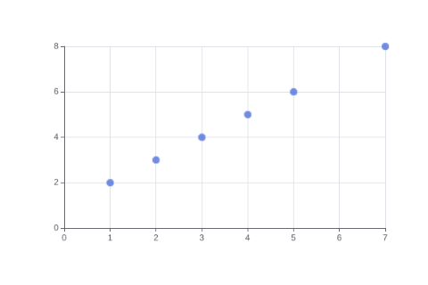

<!-- Generated by web/e2e/wiki.js - do not edit this page. Edit docs/wiki/examples/*.json, docs/wiki/notes/*.md or the generator, then run "npm run wiki" in web/. -->

WebGL-accelerated scatter for millions of points.

| | |
|---|---|
| Component id | `open.echarts.ScatterGLChart` |
| Palette | **Open Components / ECharts 3D** → **Scatter GL Chart** |
| Default size | 600 × 400 |
| WebGL | Needs ECharts-GL, which the browser downloads from the gateway the first time a 3D / WebGL component is shown, and a browser with WebGL enabled. |



*Scatter GL Chart as dropped from the palette.* It takes any ECharts option in its `option` prop; the palette entry only decides which sample option a new component starts with.

<details>
<summary>Option of a freshly dropped component</summary>

```json
{
  "xAxis": {},
  "yAxis": {},
  "series": [{ "type": "scatterGL", "data": [[1, 2], [3, 4], [5, 6], [7, 8], [2, 3], [4, 5]] }]
}
```

</details>

## Making your own

1. In the Designer, drag **Scatter GL Chart** from the **Open Components / ECharts 3D** group of the Perspective component palette onto a view.
2. Edit the `option` prop in the Property Editor, or paste a complete option over it (right-click `option`, **Paste**). Any option from the [ECharts documentation](https://echarts.apache.org/en/option.html) works as long as it is plain JSON (no JavaScript functions).
3. Bind the parts of the option that hold data; see [Binding Data](Binding-Data).
