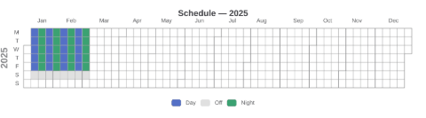

<!-- Generated by web/e2e/wiki.js - do not edit this page. Edit docs/wiki/examples/*.json, docs/wiki/notes/*.md or the generator, then run "npm run wiki" in web/. -->

Annual calendar heatmap for shift schedules and resource allocation.

| | |
|---|---|
| Component id | `open.industrial.ScheduleCalendar` |
| Palette | **Open Components / Scheduling** → **Schedule Calendar** |
| Default size | 900 × 250 |



*Schedule Calendar as dropped from the palette, showing its built-in sample data.*

This component builds its chart from the domain props below, so there is no ECharts option to write: bind the props to your tags and queries. (A non-empty `option` is an advanced override that replaces the generated chart.)

## How to use it in Ignition

1. In the Designer, drag **Schedule Calendar** from the **Open Components / Scheduling** group of the Perspective component palette onto a view. It shows sample data.
2. Select it and replace the sample data in the Property Editor: type values, paste JSON (right-click a property, **Paste**), or add a binding.
3. Bind the data props to tags, tag history or named queries. The props and the shape each one expects are listed under [Props](#props); [Binding examples](#binding-examples) has worked examples.

## Binding examples

`entries` is a list of `{ date, shift }` objects with `date` as a `YYYY-MM-DD` string; `year` selects the
period, a year (`"2025"`) or a month (`"2025-03"`).

**Shift plan from a named query.**

```sql
SELECT shift_date, shift_name, crew FROM shift_plan
WHERE shift_date BETWEEN :from AND :to
ORDER BY shift_date
```

Bind it to `props.entries` (Return Format: dataset). The transform formats the date as the string the
component expects:

```python
def transform(self, value, quality, timestamp):
    return [
        {
            "date": system.date.format(value.getValueAt(row, "shift_date"), "yyyy-MM-dd"),
            "shift": str(value.getValueAt(row, "shift_name")),
            "crew": str(value.getValueAt(row, "crew")),
        }
        for row in range(value.getRowCount())
    ]
```

**Always the current year or month.** Bind `props.year` with an **Expression** binding:
`dateFormat(now(0), "yyyy")` for the year, `dateFormat(now(0), "yyyy-MM")` for the month. A blank `year`
also means the current year.

**Colours per shift.** Type `shiftColors`, e.g. `{ "Day": "#5470c6", "Night": "#3a3f6b", "Off": "#e0e0e0" }`.

## Props

| Property | Type | Default | Description |
|---|---|---|---|
| `year` | string | `"2025"` | Period to render: a year ("2025") or a month ("2025-03"). Leave blank to use the current year. |
| `entries` | array of object | sample data (48 items) | Schedule entries: { date, shift, crew? } with date as a YYYY-MM-DD string. value and color are reserved and currently have no effect. Bind to your shift schedule. |
| `shiftColors` | object | `{}` | Map of shift name to colour. Merged over the built-in defaults. |
| `showLegend` | boolean | `true` | Show the shift colour legend. |
| `title` | string | `""` | Chart title. Leave blank for the default title. |

The shared props (`theme`, `renderer`, `notMerge`, `lazyUpdate`, `sanitizeTooltip`, ...) and the seven events are the same as on every component: see [Binding Data](Binding-Data), [Themes](Themes) and [Events](Events).
