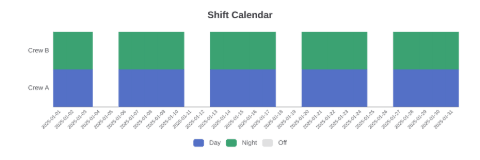

<!-- Generated by web/e2e/wiki.js - do not edit this page. Edit docs/wiki/examples/*.json, docs/wiki/notes/*.md or the generator, then run "npm run wiki" in web/. -->

Crew shift patterns by weekday across a date range.

| | |
|---|---|
| Component id | `open.industrial.ShiftCalendar` |
| Palette | **Open Components / Scheduling** → **Shift Calendar** |
| Default size | 900 × 300 |



*Shift Calendar as dropped from the palette, showing its built-in sample data.*

This component builds its chart from the domain props below, so there is no ECharts option to write: bind the props to your tags and queries. (A non-empty `option` is an advanced override that replaces the generated chart.)

## How to use it in Ignition

1. In the Designer, drag **Shift Calendar** from the **Open Components / Scheduling** group of the Perspective component palette onto a view. It shows sample data.
2. Select it and replace the sample data in the Property Editor: type values, paste JSON (right-click a property, **Paste**), or add a binding.
3. Bind the data props to tags, tag history or named queries. The props and the shape each one expects are listed under [Props](#props); [Binding examples](#binding-examples) has worked examples.

## Binding examples

The calendar is built from three small props that are normally typed rather than bound:

- `patterns`: the shift patterns, each with the weekdays it works (0 = Sunday .. 6 = Saturday);
- `crews`: which crew works which pattern;
- `dateRange`: the first and last day shown, as `YYYY-MM-DD` strings.

**A rolling four-week window.** Bind `props.dateRange` with an **Expression** binding and this script
transform (the expression only supplies the current time):

Expression: `now(0)`

```python
def transform(self, value, quality, timestamp):
    start = system.date.midnight(value)
    end = system.date.addDays(start, 27)
    return [system.date.format(start, "yyyy-MM-dd"), system.date.format(end, "yyyy-MM-dd")]
```

**Crews from a named query.** When crew assignments live in a table
(`SELECT crew_name, pattern_name FROM crew_assignments`), bind it to `props.crews`
(Return Format: dataset):

```python
def transform(self, value, quality, timestamp):
    return [
        {"crew": str(value.getValueAt(row, "crew_name")), "pattern": str(value.getValueAt(row, "pattern_name"))}
        for row in range(value.getRowCount())
    ]
```

Each `pattern` must be the `name` of an entry in `patterns`.

## Props

| Property | Type | Default | Description |
|---|---|---|---|
| `patterns` | array of object | sample data (3 items) | Shift patterns: { name, color, days } where days lists the weekdays worked (0 = Sunday .. 6 = Saturday). |
| `crews` | array of object | sample data (2 items) | Crew assignments: { crew, pattern } where pattern is the name of a shift pattern. startDate and rotationDays are reserved and currently unused. |
| `dateRange` | array of string | `["2025-01-01","2025-01-31"]` | Inclusive [startDate, endDate] as YYYY-MM-DD strings. |
| `title` | string | `""` | Chart title. Leave blank for the default title. |

The shared props (`theme`, `renderer`, `notMerge`, `lazyUpdate`, `sanitizeTooltip`, ...) and the seven events are the same as on every component: see [Binding Data](Binding-Data), [Themes](Themes) and [Events](Events).
