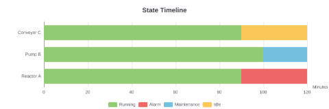

<!-- Generated by web/e2e/wiki.js - do not edit this page. Edit docs/wiki/examples/*.json, docs/wiki/notes/*.md or the generator, then run "npm run wiki" in web/. -->

Equipment state/alarm timeline with colour-coded event bars on lanes.

| | |
|---|---|
| Component id | `open.industrial.StateTimeline` |
| Palette | **Open Components / Scheduling** → **State Timeline** |
| Default size | 900 × 300 |



*State Timeline as dropped from the palette, showing its built-in sample data.*

This component builds its chart from the domain props below, so there is no ECharts option to write: bind the props to your tags and queries. (A non-empty `option` is an advanced override that replaces the generated chart.)

## How to use it in Ignition

1. In the Designer, drag **State Timeline** from the **Open Components / Scheduling** group of the Perspective component palette onto a view. It shows sample data.
2. Select it and replace the sample data in the Property Editor: type values, paste JSON (right-click a property, **Paste**), or add a binding.
3. Bind the data props to tags, tag history or named queries. The props and the shape each one expects are listed under [Props](#props); [Binding examples](#binding-examples) has worked examples.

## Binding examples

`events` is a list of `{ lane, start, end, state }` objects, with `start` and `end` in epoch
milliseconds. Each `lane` becomes a row.

**Machine states from a named query.**

```sql
SELECT machine, state, start_time, COALESCE(end_time, CURRENT_TIMESTAMP) AS end_time
FROM machine_states
WHERE start_time >= :from
ORDER BY machine, start_time
```

Bind it to `props.events` (Return Format: dataset):

```python
def transform(self, value, quality, timestamp):
    return [
        {
            "lane": str(value.getValueAt(row, "machine")),
            "state": str(value.getValueAt(row, "state")),
            "start": value.getValueAt(row, "start_time").getTime(),
            "end": value.getValueAt(row, "end_time").getTime(),
        }
        for row in range(value.getRowCount())
    ]
```

The `COALESCE` gives the state that is still running an end time, so it is drawn up to now.

**Colours per state.** Type `stateColors`; states not listed keep the built-in colours:

```json
{ "Running": "#3ba272", "Idle": "#e6a23c", "Faulted": "#e05252", "Maintenance": "#73c0de" }
```

**States from a tag's history.** For a state tag stored in the historian, query its history (a **Tag
History** binding, or `system.tag.queryTagHistory` in a script) and turn each change into an event that
ends where the next one starts:

```python
def transform(self, value, quality, timestamp):
    # value: dataset from a Tag History binding on a state tag: t_stamp, state
    names = {0: "Stopped", 1: "Running", 2: "Faulted"}
    events = []
    for row in range(value.getRowCount()):
        start = value.getValueAt(row, 0).getTime()
        last = row == value.getRowCount() - 1
        end = system.date.toMillis(system.date.now()) if last else value.getValueAt(row + 1, 0).getTime()
        events.append({
            "lane": "Filler",
            "state": names.get(value.getValueAt(row, 1), "Unknown"),
            "start": start,
            "end": end,
        })
    return events
```

## Props

| Property | Type | Default | Description |
|---|---|---|---|
| `events` | array of object | sample data (8 items) | State events as objects: { lane, start (epoch ms), end (epoch ms), state, color? }. Bind to your equipment-state history. |
| `stateColors` | object | `{}` | Map of state name to colour, e.g. { "Running": "#91cc75" }. Merged over the built-in defaults. |
| `title` | string | `""` | Chart title. Leave blank for the default title. |

The shared props (`theme`, `renderer`, `notMerge`, `lazyUpdate`, `sanitizeTooltip`, ...) and the seven events are the same as on every component: see [Binding Data](Binding-Data), [Themes](Themes) and [Events](Events).
