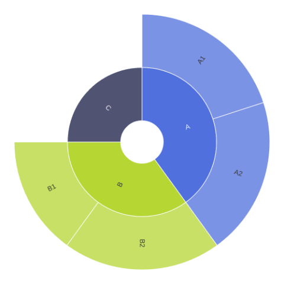
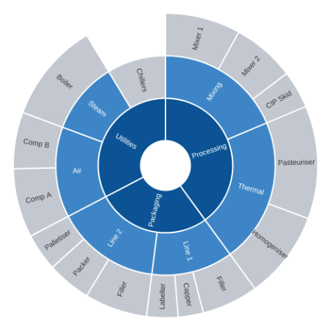
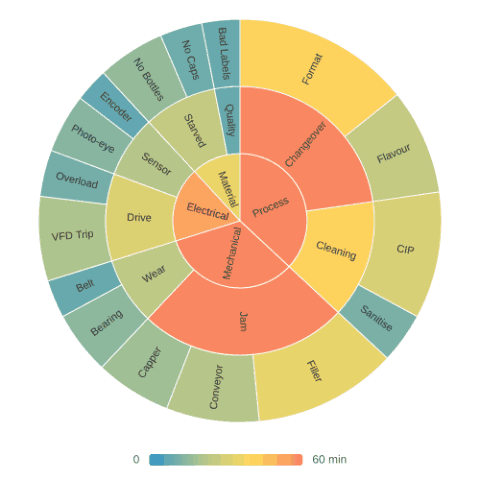
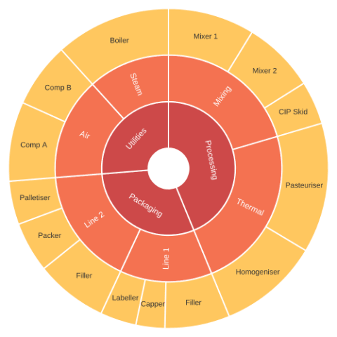
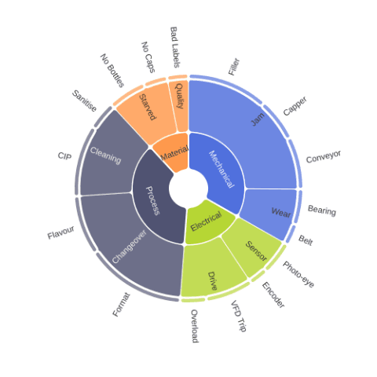
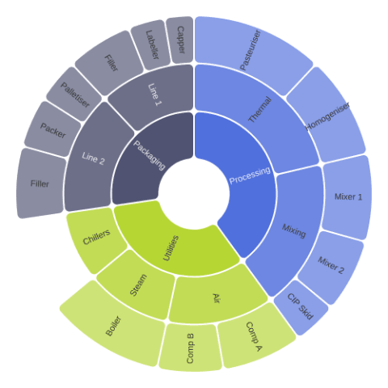

<!-- Generated by web/e2e/wiki.js - do not edit this page. Edit docs/wiki/examples/*.json, docs/wiki/notes/*.md or the generator, then run "npm run wiki" in web/. -->

Sunburst radial hierarchy.

| | |
|---|---|
| Component id | `open.echarts.SunburstChart` |
| Palette | **Open Components / ECharts** → **Sunburst Chart** |
| Default size | 500 × 500 |



*Sunburst Chart as dropped from the palette.* It takes any ECharts option in its `option` prop; the palette entry only decides which sample option a new component starts with.

<details>
<summary>Option of a freshly dropped component</summary>

```json
{
  "series": [
    {
      "type": "sunburst",
      "radius": ["15%", "90%"],
      "label": { "rotate": "radial" },
      "data": [
        {
          "name": "A",
          "value": 40,
          "children": [{ "name": "A1", "value": 20 }, { "name": "A2", "value": 20 }]
        },
        {
          "name": "B",
          "value": 35,
          "children": [{ "name": "B1", "value": 15 }, { "name": "B2", "value": 20 }]
        },
        { "name": "C", "value": 25 }
      ]
    }
  ]
}
```

</details>

## Examples

- [Monochrome Sunburst](#monochrome-sunburst): One hue that gets lighter with each level, with grey leaves; energy use by area, unit and machine.
- [Sunburst VisualMap](#sunburst-visualmap): Sectors coloured by their value through a continuous visualMap; downtime minutes by reason.
- [Sunburst Label Rotate](#sunburst-label-rotate): Each ring uses a different label rotation: tangential, radial, then horizontal.
- [Reason Wheel](#reason-wheel): Flavour-wheel layout: wide inner rings, a thin outer ring with labels outside and rounded corners.
- [Rounded Sunburst](#rounded-sunburst): Ring-shaped sunburst with rounded, separated sectors and a hollow centre.

### Monochrome Sunburst

One hue that gets lighter with each level, with grey leaves; energy use by area, unit and machine.



**How to make it in Ignition**

1. In the Designer, drag **Sunburst Chart** from the **Open Components / ECharts** group of the Perspective component palette onto a view.
2. Open **Option JSON** below and copy it. In the Property Editor, right-click the `option` property and choose **Paste**: the pasted JSON replaces the sample option. (See [Getting Started](Getting-Started) for other ways to enter an option.)
3. Replace the sample data with live data by binding these paths (expand `option` in the Property Editor down to the property, then use its binding icon). Everything else in the option stays as pasted.

   | Property | The binding must return |
   |---|---|
   | `props.option.series.data` | a tree of objects, `{ "name": ..., "value": ..., "children": [...] }` |

   For `series.data` build the same structure as the example in a script transform or a project script; [Binding Data](Binding-Data) shows the pattern.

4. Bind `series.data` to a tree: `[{name, children: [{name, children: [{name, value}]}]}]`. Only leaves need a `value`; parents are the sum of their children.
5. Colours come from `series.levels` (index 0 is the invisible root, then one entry per ring). To change the hue, replace the two blues; the last entry is the grey used for the outer ring.
6. A leaf that sits on an inner ring (here “Chillers”) would take that ring’s colour; give it its own `itemStyle.color` in the data to keep it grey.
7. `sort: null` keeps the order of the data; remove it to sort sectors by size.

<details>
<summary>Option JSON</summary>

```json
{
  "tooltip": {},
  "series": {
    "type": "sunburst",
    "radius": ["15%", "92%"],
    "sort": null,
    "emphasis": { "focus": "ancestor" },
    "label": { "rotate": "radial", "fontSize": 11 },
    "itemStyle": { "borderWidth": 2 },
    "levels": [
      {},
      { "itemStyle": { "color": "#0b5394" }, "label": { "color": "#fff" } },
      { "itemStyle": { "color": "#3d85c6" }, "label": { "color": "#fff" } },
      { "itemStyle": { "color": "#c3c7cf" }, "label": { "color": "#333" } }
    ],
    "data": [
      {
        "name": "Processing",
        "children": [
          {
            "name": "Mixing",
            "children": [
              { "name": "Mixer 1", "value": 12 },
              { "name": "Mixer 2", "value": 10 },
              { "name": "CIP Skid", "value": 6 }
            ]
          },
          {
            "name": "Thermal",
            "children": [{ "name": "Pasteuriser", "value": 18 }, { "name": "Homogeniser", "value": 14 }]
          }
        ]
      },
      {
        "name": "Packaging",
        "children": [
          {
            "name": "Line 1",
            "children": [
              { "name": "Filler", "value": 9 },
              { "name": "Capper", "value": 4 },
              { "name": "Labeller", "value": 5 }
            ]
          },
          {
            "name": "Line 2",
            "children": [
              { "name": "Filler", "value": 10 },
              { "name": "Packer", "value": 7 },
              { "name": "Palletiser", "value": 6 }
            ]
          }
        ]
      },
      {
        "name": "Utilities",
        "children": [
          {
            "name": "Air",
            "children": [{ "name": "Comp A", "value": 11 }, { "name": "Comp B", "value": 9 }]
          },
          { "name": "Steam", "children": [{ "name": "Boiler", "value": 16 }] },
          {
            "name": "Chillers",
            "value": 13,
            "itemStyle": { "color": "#c3c7cf" },
            "label": { "color": "#333" }
          }
        ]
      }
    ]
  }
}
```

</details>

### Sunburst VisualMap

Sectors coloured by their value through a continuous visualMap; downtime minutes by reason.



**How to make it in Ignition**

1. In the Designer, drag **Sunburst Chart** from the **Open Components / ECharts** group of the Perspective component palette onto a view.
2. Open **Option JSON** below and copy it. In the Property Editor, right-click the `option` property and choose **Paste**: the pasted JSON replaces the sample option. (See [Getting Started](Getting-Started) for other ways to enter an option.)
3. Replace the sample data with live data by binding these paths (expand `option` in the Property Editor down to the property, then use its binding icon). Everything else in the option stays as pasted.

   | Property | The binding must return |
   |---|---|
   | `props.option.series.data` | a tree of objects, `{ "name": ..., "value": ..., "children": [...] }` |

   For `series.data` build the same structure as the example in a script transform or a project script; [Binding Data](Binding-Data) shows the pattern.

4. Bind `series.data` to a tree where EVERY node that should be coloured has a `value`; parents without a value are summed from their children.
5. Set `visualMap.max` to the largest value you expect (bind it if it varies) and adjust the colour ramp in `visualMap.inRange.color`.
6. The end captions of the colour bar are `visualMap.text` (`[high, low]`).

<details>
<summary>Option JSON</summary>

```json
{
  "tooltip": {},
  "visualMap": {
    "type": "continuous",
    "min": 0,
    "max": 60,
    "orient": "horizontal",
    "left": "center",
    "bottom": 0,
    "itemHeight": 160,
    "itemWidth": 12,
    "text": ["60 min", "0"],
    "inRange": { "color": ["#2F93C8", "#AEC48F", "#FFDB5C", "#F98862"] }
  },
  "series": {
    "type": "sunburst",
    "center": ["50%", "46%"],
    "radius": [0, "84%"],
    "label": { "rotate": "radial", "fontSize": 11 },
    "data": [
      {
        "name": "Mechanical",
        "children": [
          {
            "name": "Jam",
            "children": [
              { "name": "Filler", "value": 34 },
              { "name": "Capper", "value": 18 },
              { "name": "Conveyor", "value": 22 }
            ]
          },
          {
            "name": "Wear",
            "children": [{ "name": "Bearing", "value": 15 }, { "name": "Belt", "value": 9 }]
          }
        ]
      },
      {
        "name": "Electrical",
        "children": [
          {
            "name": "Sensor",
            "children": [{ "name": "Photo-eye", "value": 14 }, { "name": "Encoder", "value": 8 }]
          },
          {
            "name": "Drive",
            "children": [{ "name": "VFD Trip", "value": 20 }, { "name": "Overload", "value": 11 }]
          }
        ]
      },
      {
        "name": "Process",
        "children": [
          {
            "name": "Changeover",
            "children": [{ "name": "Format", "value": 42 }, { "name": "Flavour", "value": 25 }]
          },
          {
            "name": "Cleaning",
            "children": [{ "name": "CIP", "value": 30 }, { "name": "Sanitise", "value": 12 }]
          }
        ]
      },
      {
        "name": "Material",
        "children": [
          {
            "name": "Starved",
            "children": [{ "name": "No Bottles", "value": 16 }, { "name": "No Caps", "value": 10 }]
          },
          { "name": "Quality", "children": [{ "name": "Bad Labels", "value": 9 }] }
        ]
      }
    ]
  }
}
```

</details>

### Sunburst Label Rotate

Each ring uses a different label rotation: tangential, radial, then horizontal.



**How to make it in Ignition**

1. In the Designer, drag **Sunburst Chart** from the **Open Components / ECharts** group of the Perspective component palette onto a view.
2. Open **Option JSON** below and copy it. In the Property Editor, right-click the `option` property and choose **Paste**: the pasted JSON replaces the sample option. (See [Getting Started](Getting-Started) for other ways to enter an option.)
3. Replace the sample data with live data by binding these paths (expand `option` in the Property Editor down to the property, then use its binding icon). Everything else in the option stays as pasted.

   | Property | The binding must return |
   |---|---|
   | `props.option.series.data` | a tree of objects, `{ "name": ..., "value": ..., "children": [...] }` |

   For `series.data` build the same structure as the example in a script transform or a project script; [Binding Data](Binding-Data) shows the pattern.

4. Each ring has its own entry in `series.levels` (index 0 is the root): `label.rotate` is `"tangential"` (along the arc), `"radial"` (along the spoke) or a number of degrees (`0` = horizontal).
5. Bind `series.data` to your tree (`{name, value}` leaves, `{name, children}` branches). Use horizontal labels only on rings with wide sectors.
6. The ring colours are `levels[n].itemStyle.color`; remove them to colour by top-level branch instead.

<details>
<summary>Option JSON</summary>

```json
{
  "series": {
    "type": "sunburst",
    "radius": ["12%", "95%"],
    "sort": null,
    "emphasis": { "focus": "ancestor" },
    "itemStyle": { "borderWidth": 2 },
    "levels": [
      {},
      { "itemStyle": { "color": "#CD4949" }, "label": { "rotate": "tangential", "color": "#fff" } },
      { "itemStyle": { "color": "#F47251" }, "label": { "rotate": "radial", "color": "#fff" } },
      {
        "itemStyle": { "color": "#FFC75F" },
        "label": { "rotate": 0, "color": "#333", "fontSize": 11 }
      }
    ],
    "data": [
      {
        "name": "Processing",
        "children": [
          {
            "name": "Mixing",
            "children": [
              { "name": "Mixer 1", "value": 12 },
              { "name": "Mixer 2", "value": 10 },
              { "name": "CIP Skid", "value": 6 }
            ]
          },
          {
            "name": "Thermal",
            "children": [{ "name": "Pasteuriser", "value": 18 }, { "name": "Homogeniser", "value": 14 }]
          }
        ]
      },
      {
        "name": "Packaging",
        "children": [
          {
            "name": "Line 1",
            "children": [
              { "name": "Filler", "value": 9 },
              { "name": "Capper", "value": 4 },
              { "name": "Labeller", "value": 5 }
            ]
          },
          {
            "name": "Line 2",
            "children": [
              { "name": "Filler", "value": 10 },
              { "name": "Packer", "value": 7 },
              { "name": "Palletiser", "value": 6 }
            ]
          }
        ]
      },
      {
        "name": "Utilities",
        "children": [
          {
            "name": "Air",
            "children": [{ "name": "Comp A", "value": 11 }, { "name": "Comp B", "value": 9 }]
          },
          { "name": "Steam", "children": [{ "name": "Boiler", "value": 16 }] }
        ]
      }
    ]
  }
}
```

</details>

### Reason Wheel

Flavour-wheel layout: wide inner rings, a thin outer ring with labels outside and rounded corners.



**How to make it in Ignition**

1. In the Designer, drag **Sunburst Chart** from the **Open Components / ECharts** group of the Perspective component palette onto a view.
2. Open **Option JSON** below and copy it. In the Property Editor, right-click the `option` property and choose **Paste**: the pasted JSON replaces the sample option. (See [Getting Started](Getting-Started) for other ways to enter an option.)
3. Replace the sample data with live data by binding these paths (expand `option` in the Property Editor down to the property, then use its binding icon). Everything else in the option stays as pasted.

   | Property | The binding must return |
   |---|---|
   | `props.option.series.data` | a tree of objects, `{ "name": ..., "value": ..., "children": [...] }` |

   For `series.data` build the same structure as the example in a script transform or a project script; [Binding Data](Binding-Data) shows the pattern.

4. Bind `series.data` to a three-level tree: category → group → reason, with a `value` on each reason.
5. Ring geometry is fixed per level in `series.levels[n].r0` / `r` (inner and outer radius). The outer ring is deliberately thin and puts its labels outside (`label.position: "outside"`), so leave about 40 % of the radius free for them.
6. Colours follow the top-level category (theme palette). Set `itemStyle.color` on a category node to pin it.
7. Reasons with very small values get crowded labels; group them into “Other” in your query or add `label.minAngle` to the outer level.

<details>
<summary>Option JSON</summary>

```json
{
  "tooltip": {},
  "series": {
    "type": "sunburst",
    "radius": [0, "100%"],
    "sort": null,
    "emphasis": { "focus": "ancestor" },
    "itemStyle": { "borderRadius": 5 },
    "data": [
      {
        "name": "Mechanical",
        "children": [
          {
            "name": "Jam",
            "children": [
              { "name": "Filler", "value": 34 },
              { "name": "Capper", "value": 18 },
              { "name": "Conveyor", "value": 22 }
            ]
          },
          {
            "name": "Wear",
            "children": [{ "name": "Bearing", "value": 15 }, { "name": "Belt", "value": 9 }]
          }
        ]
      },
      {
        "name": "Electrical",
        "children": [
          {
            "name": "Sensor",
            "children": [{ "name": "Photo-eye", "value": 14 }, { "name": "Encoder", "value": 8 }]
          },
          {
            "name": "Drive",
            "children": [{ "name": "VFD Trip", "value": 20 }, { "name": "Overload", "value": 11 }]
          }
        ]
      },
      {
        "name": "Process",
        "children": [
          {
            "name": "Changeover",
            "children": [{ "name": "Format", "value": 42 }, { "name": "Flavour", "value": 25 }]
          },
          {
            "name": "Cleaning",
            "children": [{ "name": "CIP", "value": 30 }, { "name": "Sanitise", "value": 12 }]
          }
        ]
      },
      {
        "name": "Material",
        "children": [
          {
            "name": "Starved",
            "children": [{ "name": "No Bottles", "value": 16 }, { "name": "No Caps", "value": 10 }]
          },
          { "name": "Quality", "children": [{ "name": "Bad Labels", "value": 9 }] }
        ]
      }
    ],
    "levels": [
      {},
      {
        "r0": "10%",
        "r": "30%",
        "itemStyle": { "borderWidth": 2 },
        "label": { "rotate": "tangential", "fontSize": 11 }
      },
      { "r0": "30%", "r": "58%", "label": { "align": "right", "fontSize": 11 } },
      {
        "r0": "58%",
        "r": "61%",
        "label": { "position": "outside", "padding": 3, "silent": false, "fontSize": 11 },
        "itemStyle": { "borderWidth": 3 }
      }
    ]
  }
}
```

</details>

### Rounded Sunburst

Ring-shaped sunburst with rounded, separated sectors and a hollow centre.



**How to make it in Ignition**

1. In the Designer, drag **Sunburst Chart** from the **Open Components / ECharts** group of the Perspective component palette onto a view.
2. Open **Option JSON** below and copy it. In the Property Editor, right-click the `option` property and choose **Paste**: the pasted JSON replaces the sample option. (See [Getting Started](Getting-Started) for other ways to enter an option.)
3. Replace the sample data with live data by binding these paths (expand `option` in the Property Editor down to the property, then use its binding icon). Everything else in the option stays as pasted.

   | Property | The binding must return |
   |---|---|
   | `props.option.series.data` | a tree of objects, `{ "name": ..., "value": ..., "children": [...] }` |

   For `series.data` build the same structure as the example in a script transform or a project script; [Binding Data](Binding-Data) shows the pattern.

4. Bind `series.data` to your tree (`{name, value}` leaves, `{name, children}` branches).
5. The look comes from `series.itemStyle.borderRadius` and `borderWidth`; the hollow centre from the first value of `series.radius`.
6. `label.minAngle` hides labels of sectors narrower than that many degrees.

<details>
<summary>Option JSON</summary>

```json
{
  "tooltip": {},
  "series": {
    "type": "sunburst",
    "radius": ["18%", "92%"],
    "itemStyle": { "borderRadius": 7, "borderWidth": 2 },
    "label": { "rotate": "radial", "fontSize": 11, "minAngle": 8 },
    "emphasis": { "focus": "descendant" },
    "data": [
      {
        "name": "Processing",
        "children": [
          {
            "name": "Mixing",
            "children": [
              { "name": "Mixer 1", "value": 12 },
              { "name": "Mixer 2", "value": 10 },
              { "name": "CIP Skid", "value": 6 }
            ]
          },
          {
            "name": "Thermal",
            "children": [{ "name": "Pasteuriser", "value": 18 }, { "name": "Homogeniser", "value": 14 }]
          }
        ]
      },
      {
        "name": "Packaging",
        "children": [
          {
            "name": "Line 1",
            "children": [
              { "name": "Filler", "value": 9 },
              { "name": "Capper", "value": 4 },
              { "name": "Labeller", "value": 5 }
            ]
          },
          {
            "name": "Line 2",
            "children": [
              { "name": "Filler", "value": 10 },
              { "name": "Packer", "value": 7 },
              { "name": "Palletiser", "value": 6 }
            ]
          }
        ]
      },
      {
        "name": "Utilities",
        "children": [
          {
            "name": "Air",
            "children": [{ "name": "Comp A", "value": 11 }, { "name": "Comp B", "value": 9 }]
          },
          { "name": "Steam", "children": [{ "name": "Boiler", "value": 16 }] },
          { "name": "Chillers", "value": 13 }
        ]
      }
    ]
  }
}
```

</details>
