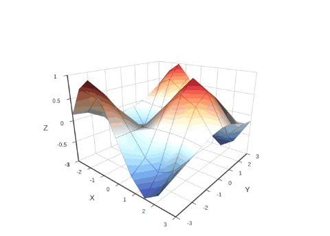

<!-- Generated by web/e2e/wiki.js - do not edit this page. Edit docs/wiki/examples/*.json, docs/wiki/notes/*.md or the generator, then run "npm run wiki" in web/. -->

3D mathematical surface plots.

| | |
|---|---|
| Component id | `open.echarts.SurfaceChart` |
| Palette | **Open Components / ECharts 3D** → **Surface Chart** |
| Default size | 700 × 500 |
| WebGL | Needs ECharts-GL, which the browser downloads from the gateway the first time a 3D / WebGL component is shown, and a browser with WebGL enabled. |



*Surface Chart as dropped from the palette.* It takes any ECharts option in its `option` prop; the palette entry only decides which sample option a new component starts with.

<details>
<summary>Option of a freshly dropped component</summary>

```json
{
  "grid3D": { "boxWidth": 100, "boxDepth": 100, "boxHeight": 70, "viewControl": { "distance": 200 } },
  "xAxis3D": {},
  "yAxis3D": {},
  "zAxis3D": {},
  "visualMap": {
    "show": false,
    "dimension": 2,
    "min": -1,
    "max": 1,
    "inRange": { "color": ["#313695", "#74add1", "#e0f3f8", "#fdae61", "#a50026"] }
  },
  "series": [
    {
      "type": "surface",
      "wireframe": { "show": true },
      "data": [
        [-3, -3, 0.14],
        [-2.2, -3, 0.77],
        [-1.5, -3, 0.99],
        [-0.8, -3, 0.67],
        [0, -3, 0],
        [0.8, -3, -0.67],
        [1.5, -3, -0.99],
        [2.2, -3, -0.77],
        [3, -3, -0.14],
        [-3, -2.2, 0.09],
        [-2.2, -2.2, 0.49],
        [-1.5, -2.2, 0.63],
        [-0.8, -2.2, 0.43],
        [0, -2.2, 0],
        [0.8, -2.2, -0.43],
        [1.5, -2.2, -0.63],
        [2.2, -2.2, -0.49],
        [3, -2.2, -0.09],
        [-3, -1.5, -0.01],
        [-2.2, -1.5, -0.06],
        [-1.5, -1.5, -0.07],
        [-0.8, -1.5, -0.05],
        [0, -1.5, 0],
        [0.8, -1.5, 0.05],
        [1.5, -1.5, 0.07],
        [2.2, -1.5, 0.06],
        [3, -1.5, 0.01],
        [-3, -0.8, -0.1],
        [-2.2, -0.8, -0.57],
        [-1.5, -0.8, -0.73],
        [-0.8, -0.8, -0.5],
        [0, -0.8, 0],
        [0.8, -0.8, 0.5],
        [1.5, -0.8, 0.73],
        [2.2, -0.8, 0.57],
        [3, -0.8, 0.1],
        [-3, 0, -0.14],
        [-2.2, 0, -0.78],
        [-1.5, 0, -1],
        [-0.8, 0, -0.68],
        [0, 0, 0],
        [0.8, 0, 0.68],
        [1.5, 0, 1],
        [2.2, 0, 0.78],
        [3, 0, 0.14],
        [-3, 0.8, -0.1],
        [-2.2, 0.8, -0.57],
        [-1.5, 0.8, -0.73],
        [-0.8, 0.8, -0.5],
        [0, 0.8, 0],
        [0.8, 0.8, 0.5],
        [1.5, 0.8, 0.73],
        [2.2, 0.8, 0.57],
        [3, 0.8, 0.1],
        [-3, 1.5, -0.01],
        [-2.2, 1.5, -0.06],
        [-1.5, 1.5, -0.07],
        [-0.8, 1.5, -0.05],
        [0, 1.5, 0],
        [0.8, 1.5, 0.05],
        [1.5, 1.5, 0.07],
        [2.2, 1.5, 0.06],
        [3, 1.5, 0.01],
        [-3, 2.2, 0.09],
        [-2.2, 2.2, 0.49],
        [-1.5, 2.2, 0.63],
        [-0.8, 2.2, 0.43],
        [0, 2.2, 0],
        [0.8, 2.2, -0.43],
        [1.5, 2.2, -0.63],
        [2.2, 2.2, -0.49],
        [3, 2.2, -0.09],
        [-3, 3, 0.14],
        [-2.2, 3, 0.77],
        [-1.5, 3, 0.99],
        [-0.8, 3, 0.67],
        [0, 3, 0],
        [0.8, 3, -0.67],
        [1.5, 3, -0.99],
        [2.2, 3, -0.77],
        [3, 3, -0.14]
      ]
    }
  ]
}
```

</details>

## Making your own

1. In the Designer, drag **Surface Chart** from the **Open Components / ECharts 3D** group of the Perspective component palette onto a view.
2. Edit the `option` prop in the Property Editor, or paste a complete option over it (right-click `option`, **Paste**). Any option from the [ECharts documentation](https://echarts.apache.org/en/option.html) works as long as it is plain JSON (no JavaScript functions).
3. Bind the parts of the option that hold data; see [Binding Data](Binding-Data).
