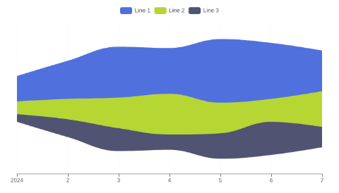
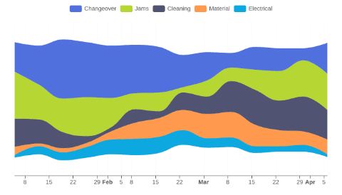

<!-- Generated by web/e2e/wiki.js - do not edit this page. Edit docs/wiki/examples/*.json, docs/wiki/notes/*.md or the generator, then run "npm run wiki" in web/. -->

Time-stream river.

| | |
|---|---|
| Component id | `open.echarts.ThemeRiverChart` |
| Palette | **Open Components / ECharts** → **Theme River Chart** |
| Default size | 700 × 400 |



*Theme River Chart as dropped from the palette.* It takes any ECharts option in its `option` prop; the palette entry only decides which sample option a new component starts with.

<details>
<summary>Option of a freshly dropped component</summary>

```json
{
  "tooltip": { "trigger": "axis" },
  "legend": { "top": 10 },
  "singleAxis": { "type": "time", "top": 50, "bottom": 40 },
  "series": [
    {
      "type": "themeRiver",
      "label": { "show": false },
      "data": [
        ["2024-01-01", 10, "Line 1"],
        ["2024-01-02", 15, "Line 1"],
        ["2024-01-03", 20, "Line 1"],
        ["2024-01-04", 18, "Line 1"],
        ["2024-01-05", 25, "Line 1"],
        ["2024-01-06", 22, "Line 1"],
        ["2024-01-07", 16, "Line 1"],
        ["2024-01-01", 5, "Line 2"],
        ["2024-01-02", 8, "Line 2"],
        ["2024-01-03", 12, "Line 2"],
        ["2024-01-04", 16, "Line 2"],
        ["2024-01-05", 12, "Line 2"],
        ["2024-01-06", 9, "Line 2"],
        ["2024-01-07", 14, "Line 2"],
        ["2024-01-01", 3, "Line 3"],
        ["2024-01-02", 7, "Line 3"],
        ["2024-01-03", 9, "Line 3"],
        ["2024-01-04", 6, "Line 3"],
        ["2024-01-05", 10, "Line 3"],
        ["2024-01-06", 13, "Line 3"],
        ["2024-01-07", 8, "Line 3"]
      ]
    }
  ]
}
```

</details>

## Examples

### Stream Graph with Legend

Five smooth streams over fourteen weeks with a legend, a vertical cursor line and no in-stream labels; downtime hours by reason.



**How to make it in Ignition**

1. In the Designer, drag **Theme River Chart** from the **Open Components / ECharts** group of the Perspective component palette onto a view.
2. Open **Option JSON** below and copy it. In the Property Editor, right-click the `option` property and choose **Paste**: the pasted JSON replaces the sample option. (See [Getting Started](Getting-Started) for other ways to enter an option.)
3. Replace the sample data with live data by binding these paths (expand `option` in the Property Editor down to the property, then use its binding icon). Everything else in the option stays as pasted.

   | Property | The binding must return |
   |---|---|
   | `props.option.series[0].data` | a list of rows with 3 values each, in the order of the example: `[["2026-01-05", 22, "Changeover"], ...]` |

   Script transform for `props.option.series[0].data`, turning a dataset into rows. With a time axis the first value of a row is the time in epoch milliseconds:

   ```python
   def transform(self, value, quality, timestamp):
       # value: dataset, e.g. from a Tag History binding: t_stamp, then one column per tag
       rows = []
       for row in range(value.getRowCount()):
           t = value.getValueAt(row, 0)
           if hasattr(t, "getTime"):  # a date: ECharts wants epoch milliseconds
               t = t.getTime()
           rows.append([t] + [value.getValueAt(row, col) for col in range(1, 3)])
       return rows
   ```

4. Bind `series[0].data` to rows `[date, value, streamName]`: every stream needs a row for every date, otherwise the bands tear.
5. The time axis is `singleAxis` (`type: "time"`); its `top` / `bottom` set the band area.
6. Stream names come from the third column and feed the legend; turn `series[0].label.show` on to write them inside the streams instead.

<details>
<summary>Option JSON</summary>

```json
{
  "tooltip": {
    "trigger": "axis",
    "axisPointer": { "type": "line", "lineStyle": { "width": 1, "type": "solid" } }
  },
  "legend": { "top": 6, "data": ["Changeover", "Jams", "Cleaning", "Material", "Electrical"] },
  "singleAxis": {
    "type": "time",
    "top": 50,
    "bottom": 40,
    "left": 30,
    "right": 30,
    "axisTick": {},
    "axisLabel": {},
    "axisPointer": { "animation": true, "label": { "show": true } },
    "splitLine": { "show": true, "lineStyle": { "type": "dashed", "opacity": 0.2 } }
  },
  "series": [
    {
      "type": "themeRiver",
      "label": { "show": false },
      "emphasis": { "itemStyle": { "shadowBlur": 20, "shadowColor": "rgba(0, 0, 0, 0.6)" } },
      "data": [
        ["2026-01-05", 22, "Changeover"],
        ["2026-01-05", 35, "Jams"],
        ["2026-01-05", 21, "Cleaning"],
        ["2026-01-05", 6, "Material"],
        ["2026-01-05", 2, "Electrical"],
        ["2026-01-12", 29, "Changeover"],
        ["2026-01-12", 26, "Jams"],
        ["2026-01-12", 18, "Cleaning"],
        ["2026-01-12", 2, "Material"],
        ["2026-01-12", 6, "Electrical"],
        ["2026-01-19", 44, "Changeover"],
        ["2026-01-19", 25, "Jams"],
        ["2026-01-19", 12, "Cleaning"],
        ["2026-01-19", 3, "Material"],
        ["2026-01-19", 6, "Electrical"],
        ["2026-01-26", 41, "Changeover"],
        ["2026-01-26", 29, "Jams"],
        ["2026-01-26", 5, "Cleaning"],
        ["2026-01-26", 3, "Material"],
        ["2026-01-26", 8, "Electrical"],
        ["2026-02-02", 39, "Changeover"],
        ["2026-02-02", 22, "Jams"],
        ["2026-02-02", 3, "Cleaning"],
        ["2026-02-02", 6, "Material"],
        ["2026-02-02", 11, "Electrical"],
        ["2026-02-09", 36, "Changeover"],
        ["2026-02-09", 12, "Jams"],
        ["2026-02-09", 10, "Cleaning"],
        ["2026-02-09", 12, "Material"],
        ["2026-02-09", 12, "Electrical"],
        ["2026-02-16", 34, "Changeover"],
        ["2026-02-16", 14, "Jams"],
        ["2026-02-16", 5, "Cleaning"],
        ["2026-02-16", 14, "Material"],
        ["2026-02-16", 12, "Electrical"],
        ["2026-02-23", 24, "Changeover"],
        ["2026-02-23", 4, "Jams"],
        ["2026-02-23", 13, "Cleaning"],
        ["2026-02-23", 15, "Material"],
        ["2026-02-23", 11, "Electrical"],
        ["2026-03-02", 21, "Changeover"],
        ["2026-03-02", 12, "Jams"],
        ["2026-03-02", 13, "Cleaning"],
        ["2026-03-02", 18, "Material"],
        ["2026-03-02", 7, "Electrical"],
        ["2026-03-09", 11, "Changeover"],
        ["2026-03-09", 10, "Jams"],
        ["2026-03-09", 23, "Cleaning"],
        ["2026-03-09", 19, "Material"],
        ["2026-03-09", 7, "Electrical"],
        ["2026-03-16", 17, "Changeover"],
        ["2026-03-16", 15, "Jams"],
        ["2026-03-16", 26, "Cleaning"],
        ["2026-03-16", 16, "Material"],
        ["2026-03-16", 5, "Electrical"],
        ["2026-03-23", 17, "Changeover"],
        ["2026-03-23", 22, "Jams"],
        ["2026-03-23", 22, "Cleaning"],
        ["2026-03-23", 12, "Material"],
        ["2026-03-23", 4, "Electrical"],
        ["2026-03-30", 9, "Changeover"],
        ["2026-03-30", 27, "Jams"],
        ["2026-03-30", 26, "Cleaning"],
        ["2026-03-30", 10, "Material"],
        ["2026-03-30", 5, "Electrical"],
        ["2026-04-06", 23, "Changeover"],
        ["2026-04-06", 27, "Jams"],
        ["2026-04-06", 22, "Cleaning"],
        ["2026-04-06", 11, "Material"],
        ["2026-04-06", 2, "Electrical"]
      ]
    }
  ]
}
```

</details>
