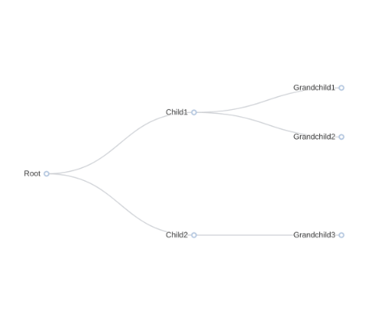
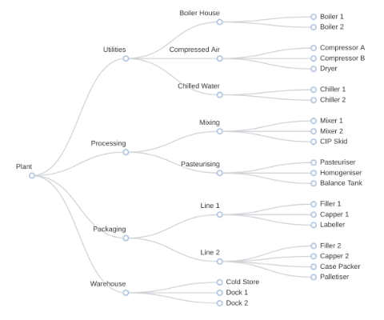
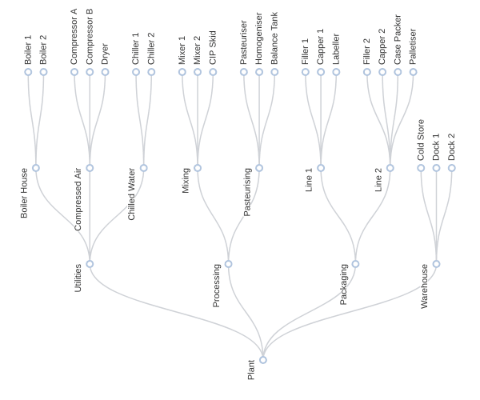
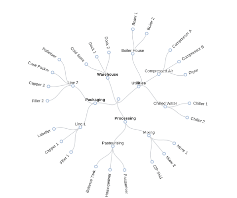
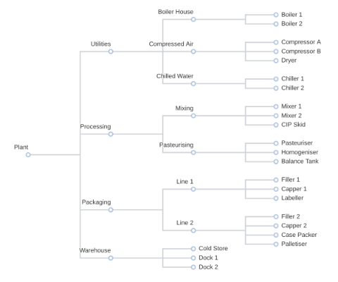
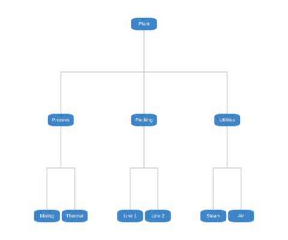
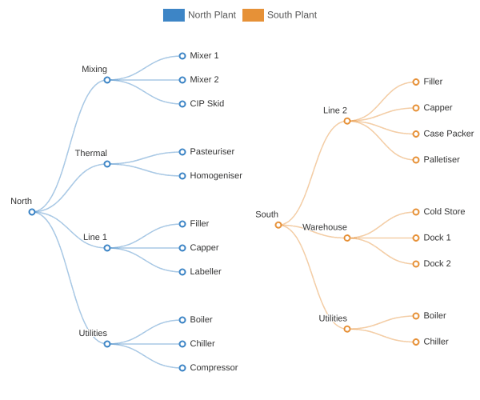

<!-- Generated by web/e2e/wiki.js - do not edit this page. Edit docs/wiki/examples/*.json, docs/wiki/notes/*.md or the generator, then run "npm run wiki" in web/. -->

Tree layouts (LR, RL, TB, BT, radial, polyline).

| | |
|---|---|
| Component id | `open.echarts.TreeChart` |
| Palette | **Open Components / ECharts** → **Tree Chart** |
| Default size | 600 × 500 |



*Tree Chart as dropped from the palette.* It takes any ECharts option in its `option` prop; the palette entry only decides which sample option a new component starts with.

<details>
<summary>Option of a freshly dropped component</summary>

```json
{
  "series": [
    {
      "type": "tree",
      "orient": "LR",
      "label": { "position": "left" },
      "data": [
        {
          "name": "Root",
          "children": [
            { "name": "Child1", "children": [{ "name": "Grandchild1" }, { "name": "Grandchild2" }] },
            { "name": "Child2", "children": [{ "name": "Grandchild3" }] }
          ]
        }
      ]
    }
  ]
}
```

</details>

## Examples

- [Left to Right Tree](#left-to-right-tree): Curved edges from a root on the left, branch labels above their node and leaf labels on the right; click a node to collapse it.
- [Bottom to Top Tree](#bottom-to-top-tree): Root at the bottom growing upwards, with vertical labels.
- [Radial Tree](#radial-tree): Root in the centre with levels on concentric circles and labels following the spokes.
- [Polyline Tree](#polyline-tree): Orthogonal (elbow) edges instead of curves, as in a classic hierarchy diagram.
- [Org Chart Tree](#org-chart-tree): Top-down boxes with the label inside each node and elbow connectors.
- [Multiple Trees](#multiple-trees): Two tree series side by side, switched on and off through the legend.

### Left to Right Tree

Curved edges from a root on the left, branch labels above their node and leaf labels on the right; click a node to collapse it.



**How to make it in Ignition**

1. In the Designer, drag **Tree Chart** from the **Open Components / ECharts** group of the Perspective component palette onto a view.
2. Open **Option JSON** below and copy it. In the Property Editor, right-click the `option` property and choose **Paste**: the pasted JSON replaces the sample option. (See [Getting Started](Getting-Started) for other ways to enter an option.)
3. Replace the sample data with live data by binding these paths (expand `option` in the Property Editor down to the property, then use its binding icon). Everything else in the option stays as pasted.

   | Property | The binding must return |
   |---|---|
   | `props.option.series[0].data` | a tree of objects, `{ "name": ..., "value": ..., "children": [...] }` |

   For `series[0].data` build the same structure as the example in a script transform or a project script; [Binding Data](Binding-Data) shows the pattern.

4. Bind `series[0].data` to a list holding ONE root object: `[{name, children: [{name, children: [...]}]}]`. A script transform that nests a flat parent/child query works well.
5. Branch labels sit above their node (`series[0].label`), leaf labels to the right (`series[0].leaves.label`), so no edge runs through the text. Leave room: `left` must fit the root label and `right` the longest leaf label.
6. `initialTreeDepth: -1` opens every level; set it to 1 or 2 to start collapsed. Add `"collapsed": true` to a node to close just that branch.
7. For large trees add `"roam": true` so the user can pan and zoom.

<details>
<summary>Option JSON</summary>

```json
{
  "tooltip": { "trigger": "item", "triggerOn": "mousemove" },
  "series": [
    {
      "type": "tree",
      "data": [
        {
          "name": "Plant",
          "children": [
            {
              "name": "Utilities",
              "children": [
                {
                  "name": "Boiler House",
                  "children": [{ "name": "Boiler 1" }, { "name": "Boiler 2" }]
                },
                {
                  "name": "Compressed Air",
                  "children": [{ "name": "Compressor A" }, { "name": "Compressor B" }, { "name": "Dryer" }]
                },
                {
                  "name": "Chilled Water",
                  "children": [{ "name": "Chiller 1" }, { "name": "Chiller 2" }]
                }
              ]
            },
            {
              "name": "Processing",
              "children": [
                {
                  "name": "Mixing",
                  "children": [{ "name": "Mixer 1" }, { "name": "Mixer 2" }, { "name": "CIP Skid" }]
                },
                {
                  "name": "Pasteurising",
                  "children": [{ "name": "Pasteuriser" }, { "name": "Homogeniser" }, { "name": "Balance Tank" }]
                }
              ]
            },
            {
              "name": "Packaging",
              "children": [
                {
                  "name": "Line 1",
                  "children": [{ "name": "Filler 1" }, { "name": "Capper 1" }, { "name": "Labeller" }]
                },
                {
                  "name": "Line 2",
                  "children": [
                    { "name": "Filler 2" },
                    { "name": "Capper 2" },
                    { "name": "Case Packer" },
                    { "name": "Palletiser" }
                  ]
                }
              ]
            },
            {
              "name": "Warehouse",
              "children": [{ "name": "Cold Store" }, { "name": "Dock 1" }, { "name": "Dock 2" }]
            }
          ]
        }
      ],
      "top": 10,
      "bottom": 10,
      "left": 50,
      "right": 110,
      "symbolSize": 8,
      "initialTreeDepth": -1,
      "label": {
        "position": "top",
        "verticalAlign": "bottom",
        "align": "right",
        "distance": 3,
        "fontSize": 11
      },
      "leaves": {
        "label": { "position": "right", "verticalAlign": "middle", "align": "left", "distance": 5 }
      },
      "emphasis": { "focus": "descendant" },
      "expandAndCollapse": true,
      "animationDuration": 550,
      "animationDurationUpdate": 750
    }
  ]
}
```

</details>

### Bottom to Top Tree

Root at the bottom growing upwards, with vertical labels.



**How to make it in Ignition**

1. In the Designer, drag **Tree Chart** from the **Open Components / ECharts** group of the Perspective component palette onto a view.
2. Open **Option JSON** below and copy it. In the Property Editor, right-click the `option` property and choose **Paste**: the pasted JSON replaces the sample option. (See [Getting Started](Getting-Started) for other ways to enter an option.)
3. Replace the sample data with live data by binding these paths (expand `option` in the Property Editor down to the property, then use its binding icon). Everything else in the option stays as pasted.

   | Property | The binding must return |
   |---|---|
   | `props.option.series[0].data` | a tree of objects, `{ "name": ..., "value": ..., "children": [...] }` |

   For `series[0].data` build the same structure as the example in a script transform or a project script; [Binding Data](Binding-Data) shows the pattern.

4. Bind `series[0].data` to a list holding one root object with nested `children`.
5. `orient` is `"BT"`; use `"TB"` for the root at the top (then change the leaf label to `position: "bottom"`, `align: "right"`).
6. Labels are rotated 90°: branch names run alongside their incoming edge (`series[0].label`), leaf names stand above the leaves (`series[0].leaves.label`). `top` must fit the longest leaf name.

<details>
<summary>Option JSON</summary>

```json
{
  "tooltip": { "trigger": "item", "triggerOn": "mousemove" },
  "series": [
    {
      "type": "tree",
      "data": [
        {
          "name": "Plant",
          "children": [
            {
              "name": "Utilities",
              "children": [
                {
                  "name": "Boiler House",
                  "children": [{ "name": "Boiler 1" }, { "name": "Boiler 2" }]
                },
                {
                  "name": "Compressed Air",
                  "children": [{ "name": "Compressor A" }, { "name": "Compressor B" }, { "name": "Dryer" }]
                },
                {
                  "name": "Chilled Water",
                  "children": [{ "name": "Chiller 1" }, { "name": "Chiller 2" }]
                }
              ]
            },
            {
              "name": "Processing",
              "children": [
                {
                  "name": "Mixing",
                  "children": [{ "name": "Mixer 1" }, { "name": "Mixer 2" }, { "name": "CIP Skid" }]
                },
                {
                  "name": "Pasteurising",
                  "children": [{ "name": "Pasteuriser" }, { "name": "Homogeniser" }, { "name": "Balance Tank" }]
                }
              ]
            },
            {
              "name": "Packaging",
              "children": [
                {
                  "name": "Line 1",
                  "children": [{ "name": "Filler 1" }, { "name": "Capper 1" }, { "name": "Labeller" }]
                },
                {
                  "name": "Line 2",
                  "children": [
                    { "name": "Filler 2" },
                    { "name": "Capper 2" },
                    { "name": "Case Packer" },
                    { "name": "Palletiser" }
                  ]
                }
              ]
            },
            {
              "name": "Warehouse",
              "children": [{ "name": "Cold Store" }, { "name": "Dock 1" }, { "name": "Dock 2" }]
            }
          ]
        }
      ],
      "orient": "BT",
      "left": 16,
      "right": 16,
      "top": 90,
      "bottom": 50,
      "symbolSize": 8,
      "initialTreeDepth": -1,
      "label": {
        "position": "left",
        "rotate": 90,
        "verticalAlign": "bottom",
        "align": "right",
        "distance": 4,
        "fontSize": 11
      },
      "leaves": { "label": { "position": "top", "rotate": 90, "verticalAlign": "middle", "align": "left" } },
      "emphasis": { "focus": "descendant" },
      "expandAndCollapse": true,
      "animationDurationUpdate": 750
    }
  ]
}
```

</details>

### Radial Tree

Root in the centre with levels on concentric circles and labels following the spokes.



**How to make it in Ignition**

1. In the Designer, drag **Tree Chart** from the **Open Components / ECharts** group of the Perspective component palette onto a view.
2. Open **Option JSON** below and copy it. In the Property Editor, right-click the `option` property and choose **Paste**: the pasted JSON replaces the sample option. (See [Getting Started](Getting-Started) for other ways to enter an option.)
3. Replace the sample data with live data by binding these paths (expand `option` in the Property Editor down to the property, then use its binding icon). Everything else in the option stays as pasted.

   | Property | The binding must return |
   |---|---|
   | `props.option.series[0].data` | a tree of objects, `{ "name": ..., "value": ..., "children": [...] }` |

   For `series[0].data` build the same structure as the example in a script transform or a project script; [Binding Data](Binding-Data) shows the pattern.

4. Bind `series[0].data` to a list holding one root object with nested `children`.
5. Labels follow the spokes automatically. Near the centre that gets crowded, so here the root label is hidden (`label.show: false` on the root) and every branch node carries `label: {rotate: 0, position: "top"}` to stay horizontal (leaves keep the automatic rotation). If you bind the whole data, add those `label` objects in your transform.
6. The four margins (`top`, `bottom`, `left`, `right`) must fit the longest leaf label, which is drawn outside the outer circle.

<details>
<summary>Option JSON</summary>

```json
{
  "tooltip": { "trigger": "item", "triggerOn": "mousemove" },
  "series": [
    {
      "type": "tree",
      "data": [
        {
          "name": "Plant",
          "children": [
            {
              "name": "Utilities",
              "children": [
                {
                  "name": "Boiler House",
                  "children": [{ "name": "Boiler 1" }, { "name": "Boiler 2" }],
                  "label": { "rotate": 0, "position": "top", "distance": 3 }
                },
                {
                  "name": "Compressed Air",
                  "children": [{ "name": "Compressor A" }, { "name": "Compressor B" }, { "name": "Dryer" }],
                  "label": { "rotate": 0, "position": "top", "distance": 3 }
                },
                {
                  "name": "Chilled Water",
                  "children": [{ "name": "Chiller 1" }, { "name": "Chiller 2" }],
                  "label": { "rotate": 0, "position": "top", "distance": 3 }
                }
              ],
              "label": { "rotate": 0, "position": "top", "distance": 4, "fontWeight": "bold" }
            },
            {
              "name": "Processing",
              "children": [
                {
                  "name": "Mixing",
                  "children": [{ "name": "Mixer 1" }, { "name": "Mixer 2" }, { "name": "CIP Skid" }],
                  "label": { "rotate": 0, "position": "top", "distance": 3 }
                },
                {
                  "name": "Pasteurising",
                  "children": [{ "name": "Pasteuriser" }, { "name": "Homogeniser" }, { "name": "Balance Tank" }],
                  "label": { "rotate": 0, "position": "top", "distance": 3 }
                }
              ],
              "label": { "rotate": 0, "position": "top", "distance": 4, "fontWeight": "bold" }
            },
            {
              "name": "Packaging",
              "children": [
                {
                  "name": "Line 1",
                  "children": [{ "name": "Filler 1" }, { "name": "Capper 1" }, { "name": "Labeller" }],
                  "label": { "rotate": 0, "position": "top", "distance": 3 }
                },
                {
                  "name": "Line 2",
                  "children": [
                    { "name": "Filler 2" },
                    { "name": "Capper 2" },
                    { "name": "Case Packer" },
                    { "name": "Palletiser" }
                  ],
                  "label": { "rotate": 0, "position": "top", "distance": 3 }
                }
              ],
              "label": { "rotate": 0, "position": "top", "distance": 4, "fontWeight": "bold" }
            },
            {
              "name": "Warehouse",
              "children": [{ "name": "Cold Store" }, { "name": "Dock 1" }, { "name": "Dock 2" }],
              "label": { "rotate": 0, "position": "top", "distance": 4, "fontWeight": "bold" }
            }
          ],
          "label": { "show": false }
        }
      ],
      "layout": "radial",
      "top": 70,
      "bottom": 70,
      "left": 70,
      "right": 70,
      "symbol": "emptyCircle",
      "symbolSize": 7,
      "initialTreeDepth": -1,
      "label": { "fontSize": 10 },
      "emphasis": { "focus": "descendant" },
      "animationDurationUpdate": 750
    }
  ]
}
```

</details>

### Polyline Tree

Orthogonal (elbow) edges instead of curves, as in a classic hierarchy diagram.



**How to make it in Ignition**

1. In the Designer, drag **Tree Chart** from the **Open Components / ECharts** group of the Perspective component palette onto a view.
2. Open **Option JSON** below and copy it. In the Property Editor, right-click the `option` property and choose **Paste**: the pasted JSON replaces the sample option. (See [Getting Started](Getting-Started) for other ways to enter an option.)
3. Replace the sample data with live data by binding these paths (expand `option` in the Property Editor down to the property, then use its binding icon). Everything else in the option stays as pasted.

   | Property | The binding must return |
   |---|---|
   | `props.option.series[0].data` | a tree of objects, `{ "name": ..., "value": ..., "children": [...] }` |

   For `series[0].data` build the same structure as the example in a script transform or a project script; [Binding Data](Binding-Data) shows the pattern.

4. Bind `series[0].data` to a list holding one root object with nested `children`.
5. `edgeShape: "polyline"` draws the elbows; `edgeForkPosition` is where the line forks between parent and child (0 % = at the parent, 100 % = at the child).

<details>
<summary>Option JSON</summary>

```json
{
  "tooltip": { "trigger": "item", "triggerOn": "mousemove" },
  "series": [
    {
      "type": "tree",
      "data": [
        {
          "name": "Plant",
          "children": [
            {
              "name": "Utilities",
              "children": [
                {
                  "name": "Boiler House",
                  "children": [{ "name": "Boiler 1" }, { "name": "Boiler 2" }]
                },
                {
                  "name": "Compressed Air",
                  "children": [{ "name": "Compressor A" }, { "name": "Compressor B" }, { "name": "Dryer" }]
                },
                {
                  "name": "Chilled Water",
                  "children": [{ "name": "Chiller 1" }, { "name": "Chiller 2" }]
                }
              ]
            },
            {
              "name": "Processing",
              "children": [
                {
                  "name": "Mixing",
                  "children": [{ "name": "Mixer 1" }, { "name": "Mixer 2" }, { "name": "CIP Skid" }]
                },
                {
                  "name": "Pasteurising",
                  "children": [{ "name": "Pasteuriser" }, { "name": "Homogeniser" }, { "name": "Balance Tank" }]
                }
              ]
            },
            {
              "name": "Packaging",
              "children": [
                {
                  "name": "Line 1",
                  "children": [{ "name": "Filler 1" }, { "name": "Capper 1" }, { "name": "Labeller" }]
                },
                {
                  "name": "Line 2",
                  "children": [
                    { "name": "Filler 2" },
                    { "name": "Capper 2" },
                    { "name": "Case Packer" },
                    { "name": "Palletiser" }
                  ]
                }
              ]
            },
            {
              "name": "Warehouse",
              "children": [{ "name": "Cold Store" }, { "name": "Dock 1" }, { "name": "Dock 2" }]
            }
          ]
        }
      ],
      "top": 10,
      "bottom": 10,
      "left": 50,
      "right": 110,
      "symbolSize": 7,
      "edgeShape": "polyline",
      "edgeForkPosition": "63%",
      "initialTreeDepth": -1,
      "lineStyle": { "width": 2 },
      "label": {
        "position": "top",
        "verticalAlign": "bottom",
        "align": "right",
        "distance": 3,
        "fontSize": 11
      },
      "leaves": {
        "label": { "position": "right", "verticalAlign": "middle", "align": "left", "distance": 5 }
      },
      "emphasis": { "focus": "descendant" },
      "expandAndCollapse": true,
      "animationDurationUpdate": 750
    }
  ]
}
```

</details>

### Org Chart Tree

Top-down boxes with the label inside each node and elbow connectors.



**How to make it in Ignition**

1. In the Designer, drag **Tree Chart** from the **Open Components / ECharts** group of the Perspective component palette onto a view.
2. Open **Option JSON** below and copy it. In the Property Editor, right-click the `option` property and choose **Paste**: the pasted JSON replaces the sample option. (See [Getting Started](Getting-Started) for other ways to enter an option.)
3. Replace the sample data with live data by binding these paths (expand `option` in the Property Editor down to the property, then use its binding icon). Everything else in the option stays as pasted.

   | Property | The binding must return |
   |---|---|
   | `props.option.series[0].data` | a tree of objects, `{ "name": ..., "value": ..., "children": [...] }` |

   For `series[0].data` build the same structure as the example in a script transform or a project script; [Binding Data](Binding-Data) shows the pattern.

4. Bind `series[0].data` to a list holding one root object with nested `children`. Keep names short: every node is a box of `symbolSize` `[width, height]` pixels with the name inside.
5. Sibling boxes are spaced evenly across the width, so the widest level decides how wide a box can be. With more than about seven boxes on one level, shrink `symbolSize` or enable panning (`roam` is already on).
6. Colour one box with `itemStyle.color` on that node, for example to show a state.

<details>
<summary>Option JSON</summary>

```json
{
  "series": [
    {
      "type": "tree",
      "orient": "TB",
      "top": 50,
      "bottom": 50,
      "left": 40,
      "right": 40,
      "symbol": "roundRect",
      "symbolSize": [54, 26],
      "edgeShape": "polyline",
      "edgeForkPosition": "50%",
      "initialTreeDepth": -1,
      "roam": true,
      "itemStyle": { "color": "#3d85c6", "borderWidth": 0 },
      "lineStyle": { "width": 2 },
      "label": { "position": "inside", "color": "#fff", "fontSize": 10 },
      "expandAndCollapse": false,
      "data": [
        {
          "name": "Plant",
          "children": [
            { "name": "Process", "children": [{ "name": "Mixing" }, { "name": "Thermal" }] },
            { "name": "Packing", "children": [{ "name": "Line 1" }, { "name": "Line 2" }] },
            { "name": "Utilities", "children": [{ "name": "Steam" }, { "name": "Air" }] }
          ]
        }
      ]
    }
  ]
}
```

</details>

### Multiple Trees

Two tree series side by side, switched on and off through the legend.



**How to make it in Ignition**

1. In the Designer, drag **Tree Chart** from the **Open Components / ECharts** group of the Perspective component palette onto a view.
2. Open **Option JSON** below and copy it. In the Property Editor, right-click the `option` property and choose **Paste**: the pasted JSON replaces the sample option. (See [Getting Started](Getting-Started) for other ways to enter an option.)
3. Replace the sample data with live data by binding these paths (expand `option` in the Property Editor down to the property, then use its binding icon). Everything else in the option stays as pasted.

   | Property | The binding must return |
   |---|---|
   | `props.option.series[0].data` | a tree of objects, `{ "name": ..., "value": ..., "children": [...] }` |
   | `props.option.series[1].data` | a tree of objects, `{ "name": ..., "value": ..., "children": [...] }` |

   For `series[0].data`, `series[1].data` build the same structure as the example in a script transform or a project script; [Binding Data](Binding-Data) shows the pattern.

4. Each tree is its own series with its own `data` (one root object each) and its own rectangle (`left` / `right` / `top` / `bottom`).
5. The legend entries must match the series `name`s; clicking one hides that tree.
6. Series colours are set explicitly (`itemStyle` and `lineStyle.color`) because tree series do not pick distinct theme colours on their own.

<details>
<summary>Option JSON</summary>

```json
{
  "tooltip": { "trigger": "item", "triggerOn": "mousemove" },
  "legend": {
    "top": 6,
    "left": "center",
    "data": [{ "name": "North Plant", "icon": "rect" }, { "name": "South Plant", "icon": "rect" }]
  },
  "series": [
    {
      "type": "tree",
      "name": "North Plant",
      "itemStyle": { "color": "#3d85c6", "borderColor": "#3d85c6" },
      "lineStyle": { "color": "rgba(61,133,198,0.45)" },
      "top": 40,
      "bottom": 10,
      "left": 40,
      "right": "62%",
      "symbolSize": 7,
      "label": {
        "position": "top",
        "verticalAlign": "bottom",
        "align": "right",
        "distance": 3,
        "fontSize": 11
      },
      "leaves": {
        "label": { "position": "right", "verticalAlign": "middle", "align": "left", "distance": 5 }
      },
      "emphasis": { "focus": "descendant" },
      "initialTreeDepth": -1,
      "data": [
        {
          "name": "North",
          "children": [
            {
              "name": "Mixing",
              "children": [{ "name": "Mixer 1" }, { "name": "Mixer 2" }, { "name": "CIP Skid" }]
            },
            {
              "name": "Thermal",
              "children": [{ "name": "Pasteuriser" }, { "name": "Homogeniser" }]
            },
            {
              "name": "Line 1",
              "children": [{ "name": "Filler" }, { "name": "Capper" }, { "name": "Labeller" }]
            },
            {
              "name": "Utilities",
              "children": [{ "name": "Boiler" }, { "name": "Chiller" }, { "name": "Compressor" }]
            }
          ]
        }
      ]
    },
    {
      "type": "tree",
      "name": "South Plant",
      "itemStyle": { "color": "#e69138", "borderColor": "#e69138" },
      "lineStyle": { "color": "rgba(230,145,56,0.45)" },
      "top": 70,
      "bottom": 40,
      "left": "58%",
      "right": 80,
      "symbolSize": 7,
      "label": {
        "position": "top",
        "verticalAlign": "bottom",
        "align": "right",
        "distance": 3,
        "fontSize": 11
      },
      "leaves": {
        "label": { "position": "right", "verticalAlign": "middle", "align": "left", "distance": 5 }
      },
      "emphasis": { "focus": "descendant" },
      "initialTreeDepth": -1,
      "data": [
        {
          "name": "South",
          "children": [
            {
              "name": "Line 2",
              "children": [
                { "name": "Filler" },
                { "name": "Capper" },
                { "name": "Case Packer" },
                { "name": "Palletiser" }
              ]
            },
            {
              "name": "Warehouse",
              "children": [{ "name": "Cold Store" }, { "name": "Dock 1" }, { "name": "Dock 2" }]
            },
            { "name": "Utilities", "children": [{ "name": "Boiler" }, { "name": "Chiller" }] }
          ]
        }
      ]
    }
  ]
}
```

</details>
